<div align="center">

# Qwen-Seis-Posttrain

[English](README.md) | [中文](README.zh-CN.md) | [nanoGPT-Seis (pretraining)](https://github.com/jiazhe868/nanogpt-seis) | [nanoGPT-Seis-Posttrain (113M SFT + GRPO)](https://github.com/jiazhe868/nanogpt-seis-posttrain)

Post-training Qwen3.5-9B for seismology on a shared GPU cluster: supervised fine-tuning on
teacher-written data, then multi-task GRPO with programmatic and judged rewards, measured on test sets
frozen before any training. Everything ran in one month on 8 nodes of 3 × NVIDIA A100-PCIe-40GB.

</div>

<p align="center">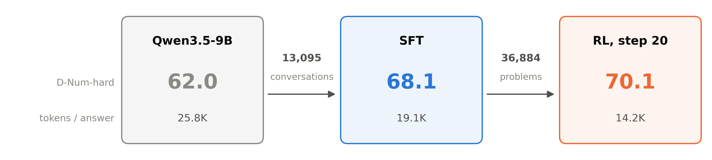</p>

<p align="center">D-Num-hard accuracy (avg@8 over 160 held-out problems) and mean tokens per answer at each stage.
The arrows carry the data that trained the next model.</p>

## Summary

A strong open model is the usual starting point for a domain assistant: fine-tune it on domain data, then
reinforce what works. Qwen3.5-9B is already strong at textbook seismology. On D-Num, 300 numerical problems
frozen before training, it is right on 91.6% of its samples and right at least once in 8 tries on 99.7% of
the problems. Its failures are mostly answers cut off at the 32K-token limit (4.6% of samples) and malformed
answers (2.3%); only 1.5% give a wrong value. The headroom is in cost, not in knowledge: within 8K tokens,
only 13% of its samples are right (§3.3).

A saturated test cannot show progress. Therefore, before any training result existed, I froze a harder
slice, D-Num-hard: 160 problems from 8 problem kinds that never appear in training. The base scores 62.0
on it, and two receiver-function kinds sit near 0%; on one of them, 159 of 160 samples run to the token
limit (§3.4).

Supervised fine-tuning (SFT) on 13,095 conversations (44.1M tokens), mostly solutions written by a
Qwen3.8-27B teacher to problems a solver had checked, teaches the teacher's shorter style. Mean answers
fall from 14.7K to 9.5K tokens and most sets improve: D-Num-hard +6.1, D-Fresh +8.1, D-Code +5.8,
GPQA Diamond +14.7, LiveCodeBench +14.3. D-Num falls 2.2 points, more than its 10-seed noise
(SD 0.46), because the fine-tuned model gives more wrong values (§5.4).

Reinforcement learning (RL) with GRPO-style group advantages then trains on 36,884 problems of four kinds:
numeric problems checked by a solver, code checked by hidden tests, reports scored by an LLM judge against
rubrics, and general instructions checked by programs. The problems had been filtered for difficulty
with the base model, but the SFT model is much stronger: in the first 20 steps, 87% of the numeric and
code groups had all 8 samples right and gave no gradient (§6.3).

The first 20 steps taught the model to finish its reasoning: on the dev set, numeric accuracy rose from
92.0 to 97.3 at a 16K-token cap. After that the answers kept shortening on every task, until numeric and
code accuracy reached zero at step 52 and a train/rollout mismatch alert stopped the run at step 56. The
obvious explanation, that one task rewarded short answers, does not hold: within each step, right and
wrong answers were about equally long. The cause is still open (§6.4).

Step 20, picked on the dev curve, keeps SFT's accuracy with 41% fewer tokens (5.6K against 9.5K):
D-Num-hard 70.1, D-Fresh +4.6, GPQA +2.9. It trades unfinished answers for wrong ones: on D-Num-hard its
unfinished answers fall from 361 to 211 of 1,280 and its wrong values rise from 46 to 161 (§7.1). It also
refuses less: 7.7 points fewer of the should-refuse prompts even under a broad detector, mostly unsafe
prompts worded like harmless ones (§7.4).

The report reward depends on a judge, so I scored the same reports with a second judge that never
touched training. The two disagree. The reward judge (Gemma) prefers the SFT model's reports to the
base's, 86% against 49% for the second judge (GPT-6 Luna). At a pass mark of 70, Gemma passes 100 of the
133 reports Luna fails, and the rubrics it applies are compound: 91% of their 5,765 criteria join several
claims. RL did not learn to please the judge; the gap between the judges narrowed (§6.5).

Labelling every failure gives two different pictures. Numerical failures are mostly execution: unfinished
answers whose method is right. The exception is two receiver-function kinds, where every model uses the
wrong relation, a knowledge gap. Report shortfalls are mostly missing or wrong science, and neither SFT
nor RL changed them (§7.2). Therefore, mid-training is not the next step for the numbers; for reports,
the cheapest test is knowledge-dense SFT data (§8.2).

Most of the month went to systems. The one 8-node job ran 71.9 hours: 28.7 of them ran the planned stages,
and 43.2 went to incidents, waits and holds, 35.1 of those before SFT could start (§9.2). A 9B model on
40 GB GPUs leaves no slack: the last pipeline stage peaked at 40,366 of 40,437 MiB (§5.3). Each incident
left a test or a guard; the ones worth learning from are in [PITFALLS.md](PITFALLS.md).

## Contents

1. [Results at a glance](#1-results-at-a-glance)
2. [Quick start](#2-quick-start)
3. [Define success before training](#3-define-success-before-training)
4. [Data: the RL bank and the SFT mix](#4-data-the-rl-bank-and-the-sft-mix)
5. [Stage 1: supervised fine-tuning](#5-stage-1-supervised-fine-tuning)
6. [Stage 2: multi-task RL](#6-stage-2-multi-task-rl)
7. [What the models get wrong](#7-what-the-models-get-wrong)
8. [What the tests and the results mean](#8-what-the-tests-and-the-results-mean)
9. [Systems: a month on a shared supercomputer](#9-systems-a-month-on-a-shared-supercomputer)
10. [What it found](#10-what-it-found)
11. [How this recipe scales](#11-how-this-recipe-scales)
12. [Failure atlas & pipeline pitfalls](#12-failure-atlas--pipeline-pitfalls)
13. [Repository layout](#13-repository-layout)
14. [Regenerate figures](#14-regenerate-figures)

[PITFALLS.md](PITFALLS.md) collects the failures met while building this pipeline and the checks that now
catch them.

---

## 1. Results at a glance

### 1.1 Model, data and compute

| | |
|---|---|
| Base model | Qwen3.5-9B, the released model with thinking at medium effort: 32 layers mixing Gated DeltaNet and full attention (head_dim 256), a multi-token-prediction (MTP) head, a 248,320-word vocabulary |
| Teacher | Qwen3.8-27B (FP8): writes the SFT solutions and reports and votes in problem verification |
| Reward judge | Gemma 4 26B-A4B (FP8) on one A100: the T3 report reward, verification votes, data checks |
| Second judge | GPT-6 Luna (API), evaluation only: D-Report's second judge, the judge-drift audit, the failure labels. Its outputs never enter training data |
| RL bank | 36,884 problems kept of 57,037 generated (§4): 25,588 numeric (T1), 2,495 code (T2), 1,193 report (T3), 7,608 general (T4) |
| SFT mix | 13,095 conversations, 44.1M tokens: 8,776 numeric solutions, 1,301 tool-use trajectories, 554 reports, 2,464 general answers written by the base model itself (§4.5) |
| RL | group-mean advantages over 8 samples, 126 prompts per step, PPO clip 0.2 / 0.28, no KL term, 16K-token responses; 56 of 120 planned steps ran, step 20 kept (§6) |
| Hardware | 8 nodes of 3 × A100-PCIe-40GB each, no NVLink, InfiniBand between nodes, Slurm. Training TP1 × PP8 × DP3 on 8 nodes; rollout on 24 one-GPU vLLM replicas on the same GPUs |
| Compute | ~756 node-hours from 2026-10-13 to 11-11; 575 of them in one 71.9-hour 8-node job (§9.2) |
| Evaluation | 5 domain sets frozen before training (770 items), 5 general benchmarks, a 650-prompt refusal set; 95% intervals, a 10-seed noise floor (§3) |

### 1.2 Results by stage

<p align="center">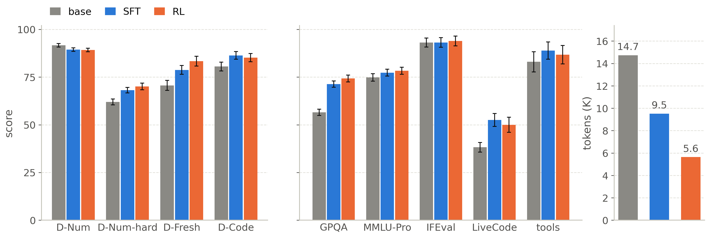</p>

| set (metric, items) | base | SFT | RL step 20 |
|---|---|---|---|
| D-Num (avg@8, 300) | **91.6** ± 1.0 | 89.4 ± 0.9 | 89.2 ± 1.0 |
| D-Num-hard (avg@8, 160) | 62.0 ± 1.6 | 68.1 ± 1.4 | **70.1** ± 1.7 |
| D-Fresh (avg@8, 60) | 70.6 ± 2.6 | 78.8 ± 2.3 | **83.3** ± 2.6 |
| D-Code (pass@1, 150) | 80.5 ± 2.3 | **86.3** ± 2.0 | 85.2 ± 2.2 |
| D-Report (win rate vs base, lower of two judges, 100) | 50 | 49.0 ± 9.0 | 49.0 ± 8.5 |
| GPQA Diamond (198) | 56.6 ± 1.6 | 71.3 ± 1.6 | **74.2** ± 1.8 |
| MMLU-Pro, 2K subset (change only) | 74.8 | 77.3 | 78.3 |
| IFEval (377) | 93.1 | 93.1 | 93.9 |
| LiveCodeBench after 2025-01 (70, change only) | 38.2 | **52.5** | 50.0 |
| tool calling (188) | 83.0 | 88.8 | 86.7 |
| refusal of should-refuse prompts, % (300) | **56.0** | 51.3 | 45.7 |
| over-refusal of benign prompts, % (350) | 3.4 | 4.0 | 2.6 |
| mean output tokens | 14,735 | 9,517 | **5,637** |

± is the 95% interval of the sampling noise. Every model, the base included, was re-run in the same harness
with the same prompts and settings (§3.2); no number is copied from elsewhere. The figure leaves out
D-Report, which gets its own figure (§6.5). Source: `docs/talk/data/run.json`.

SFT changed the most. It shortened the answers by a third and lifted every set where the base had run
out of tokens: 38% of the base's GPQA answers and 61% of its LiveCodeBench answers were cut off at 32K,
against 17% and 29% for SFT (`docs/talk/data/failure_types.json`, `cut_off_32k`). D-Num moved the other
way, because SFT gives more wrong values (§5.4).

RL changed the length again, not the accuracy: 41% fewer tokens than SFT at the same scores on most sets,
D-Fresh +4.6 and GPQA +2.9 the only gains outside the intervals. D-Num-hard rose 2.0 points over SFT,
which is inside the noise ([−0.8, +4.8], paired). Two of the eight ship gates fixed before RL pass, general
capability and cost; the D-Num gate (base + 8, i.e. 99.6) was out of reach by construction (§3.5).

D-Report shows no gain under the judge that never touched training, and refusal fell for real (§7.4).

### 1.3 Where the samples go

<p align="center">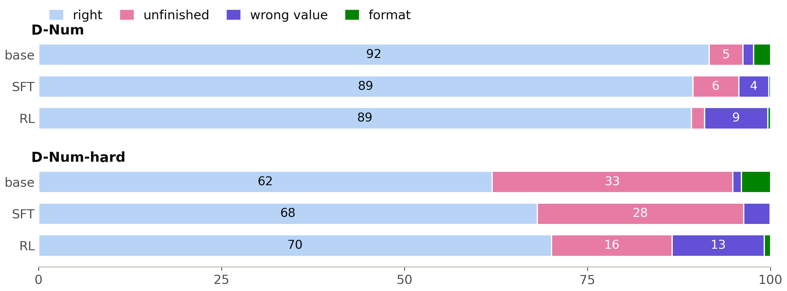</p>

Each bar splits one model's samples into four outcomes (%): right, unfinished (the reasoning never closed
within 32K tokens), a wrong value, and a format failure (several answers, none, or a missing unit). The
grader counts only the final answer.

On D-Num the base fails mostly by not finishing; SFT and RL fail mostly with wrong values. On D-Num-hard the
same trade is larger: unfinished answers fall from 33% (base) to 28% (SFT) to 16% (RL), while wrong values
rise from 1% to 4% to 13%. **Post-training here mostly changed when the model stops thinking, and a model
that stops earlier is wrong more often.** §7 asks what kind of error these wrong values are.

---

## 2. Quick start

```bash
# --- CPU: install, tests, graders, the memory planner ----------------------
pip install -e . -r requirements/core.txt
make test            # CPU unit tests (no GPU needed)
make graders         # adversarial grader suite, must pass 100%
make plan-cluster        # memory / FLOPs / communication budget for 8 nodes × 3 A100-40GB

# --- Slurm cluster: environment, models, node checks (scripts/slurm/README.md)
bash scripts/slurm/setup_login.sh conda
sbatch -A <allocation> scripts/slurm/build_env.slurm
bash scripts/slurm/setup_login.sh models && bash scripts/slurm/setup_login.sh sandbox
sbatch -A <allocation> scripts/slurm/check_node.slurm      # must print SANDBOX ISOLATED
sbatch -A <allocation> scripts/slurm/parity.slurm          # vLLM vs Megatron, eval and train forwards

# --- data: teacher, judge and base served, then generate → bank → SFT mix --
sbatch -A <allocation> scripts/slurm/data.slurm gen
sbatch -A <allocation> scripts/slurm/data.slurm bank
sbatch -A <allocation> scripts/slurm/data.slurm sft

# --- one 8-node job: baseline eval → SFT → SFT eval → RL-entry gate → RL → final eval
sbatch -A <allocation> scripts/slurm/campaign.slurm

# --- figures in this README, from the result files in docs/talk/data/ -----
python scripts/readme_figures.py
```

The full sequence, with the time of each step, is the table in
[scripts/slurm/README.md](scripts/slurm/README.md). The design documents behind each stage are in `docs/`:
[data_pipeline.md](docs/data_pipeline.md), [evaluation.md](docs/evaluation.md),
[rl_algorithm.md](docs/rl_algorithm.md), [rewards_and_hacking.md](docs/rewards_and_hacking.md),
[systems.md](docs/systems.md) and [verl_integration.md](docs/verl_integration.md).

---

## 3. Define success before training

### 3.1 Why the tests come first

The usual order is to train and then look for a test that shows the gain. Every later number depends on
the test, so here the order is reversed. The sets were built and frozen (content hashes, canaries) on
2026-10-22/23, before the RL bank and the SFT mix were built, so that decontamination could check against
them. Nothing was added afterwards except D-Num-hard, frozen on 10-27 before any SFT result existed (§3.4). Training never sees an item, a family or
a rubric of a test set: the numeric families are split into training and held-out families in the code
(`split="heldout"` in `src/dpt/data/gen/families.py`; the held-out definitions themselves are not
published, see Data & licensing), and a test enforces that the eval package never imports the reward code
(`tests/eval/test_independence.py`).

| set | items | what it measures | gold | metric |
|---|---|---|---|---|
| D-Num | 300 | one- to three-step numerical problems from 10 held-out solver families | a solver | avg@8 |
| D-Num-hard | 160 | 8 held-out families of 3 or more steps, 20 problems each | a solver, checked against an independent computation | avg@8 |
| D-Fresh | 60 | problems written after the model's release, so it cannot have seen them | a drafted `solve()` that must reproduce the answer, plus model votes | avg@8 |
| D-Code | 150 | domain coding tasks | hidden unit tests in a sandbox | pass@1 over 4 samples |
| D-Report | 100 | written reports, 5 weighted criteria and 5 common errors each | none: pairwise win rate against the base, two judges, both orders | win rate |
| general | 5 sets | GPQA Diamond, MMLU-Pro (2K), IFEval, LiveCodeBench after 2025-01, tool calling | public | per benchmark |
| refusal | 650 | 300 should-refuse prompts (JailbreakBench, XSTest unsafe), 350 benign controls | — | refusal rate |

Two perturbed twins of the numeric sets (280 items, numbers changed) are kept as contamination probes. There
are no domain experts in this month's plan: GPT-6 Luna drafted D-Fresh and D-Report, Gemma checked them,
and a 20-pair blind review by a person is prepared but not yet done (`dpt.eval.blind_review`). Every
reference in this project is therefore a program or a model, never a human label (§8.1).

### 3.2 The decoding and scoring contract

Every model, the base included, is re-run in one harness (`src/dpt/eval/harness.py`) with the same rendered
prompt, temperature 1.0, top-p 1.0, reasoning effort medium and at most 32K output tokens, with a seed per
item. Only the final answer is graded; an answer whose reasoning never closes fails, and the truncation rate
is reported for every set. The numeric grader (`dpt.eval.graders.numeric`) is a separate implementation
from the T1 reward, with strict units; on the same answers the two agree on 99.3–100% (§6.5).

### 3.3 The base model nearly saturates D-Num

<p align="center">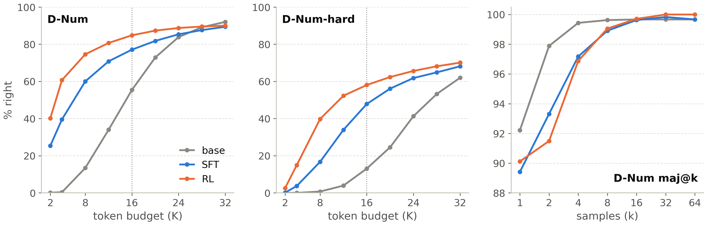</p>

Left and middle: the share of samples that are right within a token budget, as if the length cap were that
budget, every run of a model pooled (`dpt.eval.budget`; the dotted line is RL's 16K cap). Right: majority
vote over k samples on D-Num (`scripts/talk/research_1110.py`).

The base scores 91.6 on D-Num with one sample, 99.7% with at least one right answer in 8, and 99.6% by a
majority vote of 8. Measured that way the set is solved. Measured by cost it is not: only 13.4% of the
base's samples are right within 8K tokens and 55.4% within 16K, and a right answer costs 17.7K output
tokens on average, for one- to three-step textbook calculations. SFT and RL move the whole curve to the
left: within 8K tokens they are right on 60.0% and 74.6% of samples.

**On a strong base model, the first thing post-training buys is efficiency.** The number to watch for
this set is accuracy at a budget, not accuracy at the cap.

### 3.4 A harder slice, frozen before any result

A test that the base already passes cannot show whether training helps. On 10-27, before any SFT result,
I added D-Num-hard: 8 held-out problem kinds of three or more steps (receiver-function Moho depth and H-κ
Vp/Vs, rays in a velocity gradient, Mw from a spectral plateau, distance from a ground-motion model,
rupture length from directivity, Coulomb stress change), 20 problems each. Every solver was checked against
an independent computation (forward models, ray integrals by quadrature, a rotated stress tensor), and the
slice was chosen by family, never by which items a model failed.

The base scores 62.0 there. A third of its samples never finish within 32K tokens, and a right answer costs
41.6K tokens. Two receiver-function families sit at 0%: on H-κ, 159 of 160 samples ran to the cap; on Moho
depth, the few that finished used the difference of the P and S ray-path times instead of the plane-wave
delay $`H\left(\sqrt{1/v_s^2-p^2}-\sqrt{1/v_p^2-p^2}\right)`$, which puts the Moho 6–19% too deep.

### 3.5 Noise floor and gates

Ten runs of the base on D-Num with different seeds span 91.1–92.5 (SD 0.46; mean pairwise difference 0.52,
largest 1.42; `docs/talk/data/run.json`, `eval.noise_floor`). A difference smaller than about 1.4 points is noise.

Two kinds of gate decide what happens next, both fixed in advance:
- **The RL-entry gate** (after SFT). At the D-Num ceiling a strict "SFT above base" check would be decided
  by noise, and a failed gate used to end the 8-node job, whose next slot took about three days. So, on
  10-27 and before any SFT result, I made it noise-aware: D-Num may not fall below base by more than the
  combined 95% interval (~1.4 points), D-Code and D-Report must beat base, and a failure holds the job for
  a person's go or stop instead of ending it. SFT failed it (D-Num −2.2; D-Report not above base under the
  lower judge), and the go had been given in advance.
- **Eight ship gates** (after RL), with the thresholds of the reference plan this project started from.
  Two pass: general capability (+7.5, allowed down to −1.0) and cost (0.38× the base's tokens, allowed up
  to 1.3×). D-Num needed base + 8, i.e. 99.6, which no model can reach on a saturated set; that was known
  before RL, and a new threshold has to be fixed before the next run's results, not after.

Caveats, plainly:
- D-Num-hard rests on 160 problems from 8 families, and two families decide much of its spread (§8.1).
- D-Fresh has 60 problems, written and checked by models only.
- Everything is measured at one effort level and one budget, so accuracy and efficiency mix in every score.

```bash
python -m dpt.eval.harness --model-name base_medium --sets d_num --seed 0 --endpoint http://localhost:8000 \
    --out eval_results/base_medium           # one set, one seed; the noise floor repeats it for seeds 0-9
python -m dpt.eval.budget --eval-root eval_results --out talk/budget      # accuracy within each token budget
```

---

## 4. Data: the RL bank and the SFT mix

### 4.1 Why generated problems need four filters

Problems written by a template or a teacher fail in ways that a loss curve cannot show: a wrong label
teaches the wrong answer perfectly, a near-duplicate inflates one topic, a leaked test item inflates the
score, and a problem the model always solves gives RL no gradient. Each failure has its own filter, applied
in order (`src/dpt/data/pipeline.py`, `configs/data/pipeline.yaml`):

<p align="center">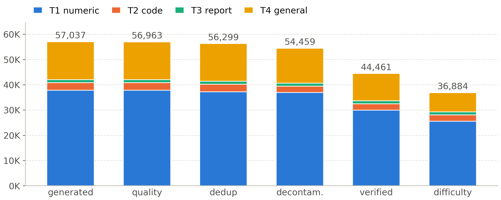</p>

| stage | removed | what it catches |
|---|---|---|
| quality | 74 | repeated 4-grams, too short |
| dedup | 664 | near duplicates (MinHash) |
| decontamination | 1,840 | n-gram / MinHash matches to any test set (1,399), semantic matches confirmed by the judge (441) |
| verification | 9,998 | whole templates rejected (9,842), models undecided (140), solver and models disagree (16) |
| difficulty | 7,577 | whole templates the base solves 8/8 (6,634), single problems solved 8/8 (943) |

57,037 generated problems became 36,884 (65%). The published bank holds 36,668 training problems, 190 dev
problems and 26 hard ones (solved 0/8 by the base) that were not trained on (`docs/talk/data/run.json`, `pipeline`).

### 4.2 Verification: a solver and two models must agree

A template is only as good as its solver. For each of the 102 templates and sources, the teacher solved 20
of its problems (4 samples each) and the judge ruled on them; a template whose problems the models reject
is dropped whole, because one broken solver produces hundreds of wrong labels at once. 20 were rejected
whole (19 numeric templates and `openai/gsm8k`), and the median template kept 95% of its problems.

The first full verification rejected all 102 templates. Two bugs that only real data exposed: the solver
registry was never imported, so every problem failed with `solver_error: KeyError`; and the judge, served
without a reasoning parser, printed its thinking without `</think>`, so every vote was empty. Both are
now tested, and the re-run from the cache took a minute. **Run each stage on a real-data sample before
trusting it at scale.** ([PITFALLS](PITFALLS.md) A1.)

### 4.3 Difficulty: drop what the model already solves

GRPO learns only from groups whose samples disagree (§6.3), so a problem solved 8 times out of 8 costs
compute and teaches nothing. The base model answered 1,780 audited problems 8 times each, on one A100 at a
time for about two days. 828 of the 1,620 audited T1 problems were solved 8/8. Templates solved 8/8 on at
least 90% of their audited problems were dropped whole (11 templates, 6,634 problems), and 943 more
problems solved 8/8 were dropped one by one.

The filter used the base model, and that was its flaw: SFT made the policy much stronger before RL began,
so most of the kept problems were already easy for the model that RL trained (§6.3). RL v2 re-grades every
problem with the SFT policy instead (§8.3).

### 4.4 Decontamination

A test item that leaks into training makes the score a memory test. Every training problem is checked
against every test set three ways: n-gram and MinHash overlap, a semantic match that the judge must
confirm (it rejected 4,991 candidate matches), and the answer (0 matches). The RL bank lost 1,840 of 56,299
problems (3.3%), the SFT mix 306 of 13,401 conversations (2.3%), and canary strings planted in the test
sets were found 0 times (`docs/contamination.md`).

### 4.5 The SFT mix

| subset | conversations | source |
|---|---|---|
| numeric reasoning (T1) | 8,776 | teacher solutions whose final answer passed the verifier |
| tool-use trajectories (T2) | 1,301 | code tasks solved with tool calls, kept only if the code ran and passed the hidden tests |
| reports (T3) | 554 | teacher reports, sampled several times and the best kept by the judge |
| general replay (T4) | 2,464 | the base model's own answers to general prompts, so SFT does not forget them |

17,638 samples became 13,095 after dropping unverified problems (1,742) and RL dev problems (162), then
quality and decontamination filters. The conversations are 44.1M tokens; the longest has 20,841 tokens,
and 28% are longer than 4,096 tokens, holding 62% of the tokens. Packing them into four length buckets
(4K, 8K, 16K, 32K) costs 1.9% padding, against 33% without buckets.

The report subset was rejection-sampled with Gemma, the same model that later judges D-Report and scores
the T3 reward. That choice is the most likely reason for the judges' split in §6.5.

---

## 5. Stage 1: supervised fine-tuning

### 5.1 Why SFT before RL

RL can only reinforce what the policy already does sometimes. The base model thinks for 15K tokens on a
median D-Num answer, and 34% of its rollouts on the bank run past 16K tokens; with a 16K response cap
(§6.1), a third of its RL samples would be cut off and carry no signal. SFT on the teacher's solutions
moves the policy to a shorter, cleaner style first, so that RL starts from samples that finish:

```
base:   long reasoning, answers cut off at the cap, several answers in one reply
SFT:    the teacher's shorter solutions, one final answer with its unit
RL:     starts from samples that finish, and reinforces the ones that are right
```

### 5.2 The recipe

Full-parameter SFT with verl's Megatron engine (`configs/sft/sft_9b.yaml`, inheriting `sft_27b.yaml`):
2 epochs, peak learning rate 8e-6 with 50 warmup steps and a cosine decay to 8e-7, weight decay 0.1, 126
conversations per step, the MTP head trained with weight 0.1 so it can still draft at inference. The layout
is TP1 × PP8 × DP3: each node holds one pipeline stage and its three GPUs are the data-parallel replicas,
so the gradient all-reduce never leaves a node (these A100s have no NVLink).

206 steps took 2.3 hours (~37 s per step once compiled): loss 0.79 → 0.46, MTP loss 0.87 → 0.47.

Two silent configuration defects were found on the way. verl 0.9.1 does not pass `optim.betas` to Megatron,
so SFT would have run with Adam β2 = 0.999 instead of the recipe's 0.95; the value is now set on Megatron
directly. And verl validates whenever `test_freq > 0`, even with no validation set, which crashed the first
full run at step 50; `test_freq: -1` fixes it ([PITFALLS](PITFALLS.md) C3).

### 5.3 Fitting a 9B model on 40 GB GPUs

<p align="center">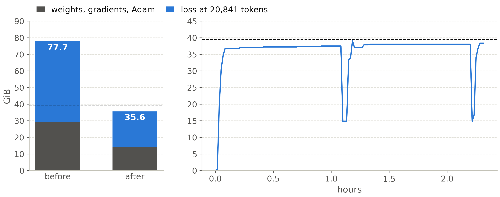</p>

Left: the memory the last pipeline stage needs at the longest SFT row (20,841 tokens), before and after the
fixes; the dashed line is the GPU's 39.5 GiB. Right: the same GPU during the 2.3-hour SFT run
(`docs/talk/data/last_stage_memory.json`, `rl.json`).

With TP1 the last pipeline stage holds the whole 248,320-word output layer and the MTP head, which keeps its
own copy of the 1.0B-parameter embedding: 3.14B parameters, 29.3 GiB of weights, gradients and Adam state
before a single activation. Both losses upcast the full logits to FP32, 2.38 MiB per token, so only
sequences of about 3.5K tokens fit, and 28% of the SFT rows are longer. The plan's memory budget had the
embedding stage as the heaviest, at 32.3 GB; it counted neither MTP's embedding copy nor the FP32 logits on
the last stage, because the 27B plan's TP4 split the vocabulary four ways and TP1 does not.

I kept the data, the losses and the optimizer math, and changed where the memory lives:

| fix | what it does | stage-7 effect |
|---|---|---|
| Adam on the CPU | Megatron's hybrid optimizer keeps the FP32 master weights and Adam state in host memory; every dtype stays FP32 | −11.7 GiB |
| Transformer Engine cross entropy | both losses do FP32 math on the BF16 logits instead of keeping an FP32 copy (fix 2 in `dpt.verl_ext.patches`) | 2.38 → 0.94 MiB per token |
| BF16 logits out of the FP16 wrapper | Megatron's `Float16Module` upcast the last stage's output to FP32; verl returns logits there, Megatron's trainer does not (fix 3) | −18.8 GiB at the longest row |
| uneven layer split | one decoder layer on the first and the last stage, five on each middle stage | fewer parameters where the output layer lives |

The fixes match an FP32 reference within 1e-4 nats per token and 1% relative L2 in the gradients (GPU unit
tests). An 8-node pre-flight on the 12 longest rows then peaked at 38,686 / 40,366 / 38,326 MiB on the
last stage's three GPUs, of 40,437. The same pre-flight found that one of the fixes had patched nothing:
verl defines the method on a subclass, the patch looked on the base class, and its unit test used a fake
class with the same mistake. A missing patch target now raises an error:

```python
# src/dpt/verl_ext/patches.py
def _own_attr(cls, name, what):
    """cls's own `name` (not inherited). Raises if missing: a fix must never be a silent no-op."""
    attr = vars(cls).get(name)
    if attr is None:
        raise RuntimeError(f"dpt.verl_ext.patches: {what} not found; did the pinned stack change?")
    return attr
```

**Measure the heaviest stage at the longest sequence, with every process that will share the node,
before the multi-node launch.** A one-GPU probe of the loss path took five minutes and missed the copy made
outside it; the 8-node pre-flight caught it, and three other problems, in an hour
([PITFALLS](PITFALLS.md) B2).

### 5.4 What SFT changed

| set | base | SFT | change |
|---|---|---|---|
| D-Num avg@8 | 91.6 | 89.4 [88.4, 90.3] | −2.2 |
| D-Num-hard avg@8 | 62.0 | 68.1 | +6.1 |
| D-Fresh avg@8 | 70.6 | 78.8 [76.5, 81.0] | +8.1 |
| D-Code pass@1 | 80.5 | 86.3 [84.3, 88.3] | +5.8 |
| D-Report win rate, Gemma / Luna | 50 | 86.0 / 49.0 | +36 / −1 |
| GPQA Diamond | 56.6 | 71.3 | +14.7 |
| LiveCodeBench after 2025-01 | 38.2 | 52.5 | +14.3 |
| mean output tokens | 14,735 | 9,517 | −35% |

SFT taught the teacher's shorter style and a clean answer format. The median D-Num answer fell from 15.2K
to 5.5K tokens, and format failures from 2.3% to 0.2% of samples. Short answers are almost all right: SFT
is 96.3% right on answers under 4K tokens, which are 42% of its samples, and 85.7% right on answers of
24–32K. The new errors are wrong values, 1.5% → 4.1% of samples, which is why D-Num fell.

**Length cuts both ways.** Shorter answers lifted every set where the base ran out of tokens, but part of
the gain is finishing, not knowing: GPQA's cut-off share fell from 38% to 17%. D-Code is the exception:
SFT's code answers are 2.5 times longer than the base's (11.1K against 4.5K tokens), and 8.3% are cut off.

---

## 6. Stage 2: multi-task RL

### 6.1 The algorithm as run

For each prompt the policy samples $`G = 8`$ answers. Each answer's advantage is its reward minus the
group's mean reward, without dividing by the group's standard deviation:

```math
A_i = r_i - \frac{1}{G}\sum_{j=1}^{G} r_j
```

Dividing by the spread would give the largest push to the groups that are nearly all right or all wrong,
where one success may be luck. Answers cut off at the cap are left out of the mean and get no advantage,
because "did not finish" is not "wrong" for their siblings:

```python
# src/dpt/rl/advantage.py: group_mean_advantage, after grouping the samples by prompt
for idx in groups.values():
    members = [i for i in idx if v[i]]      # v: valid, i.e. not cut off at the cap
    if len(members) < 2:
        continue                            # one sample has no baseline: its advantage stays 0
    mean = r[members].mean()
    adv[members] = r[members] - mean
```

The token loss is PPO's clipped surrogate with a higher upper clip (0.2 / 0.28, dual clip 3), summed over
tokens and divided by a fixed constant, so that dropping zero-advantage groups never rescales the gradient
of the rest. Tokens are importance-weighted by $`\min(\pi_\text{train}/\pi_\text{rollout}, 2)`$ to correct the
small differences between vLLM's and Megatron's probabilities (TIS), and a sequence whose mean log-probability
gap exceeds 1e-2 is masked. There is no KL term and no reference model. The derivations, and the reasons
each choice was made in the reference plan, are in [docs/rl_algorithm.md](docs/rl_algorithm.md).

What is specific to this run (`configs/rl/rl_9b.yaml`):

| setting | value | why |
|---|---|---|
| prompts per step | 126 × 8 samples, 2 updates of 63 | 128 does not divide by DP3 |
| response cap | 16K tokens, penalty from 12K to −0.5 at the cap | 24K does not fit the last pipeline stage with the MTP head trained; the base's median rollout is 12.7K tokens |
| steps | 120 planned, stage boundaries 0 / 34 / 86 | RL and the final eval had to fit in the running 8-node job, because a new one queued ~3 days |
| task mix | T1 50% / T2 25% / T4 25%, then T3 15% from step 34 | the judged task enters late, so judge-pleasing is not learned first |
| learning rate | 2e-6, 1e-6 for the last 34 steps | the 9B value of the reference plan |
| rollout | 24 one-GPU vLLM replicas, colocated, asynchronous partial rollout, MTP drafting off | drafting kept a CPU copy of every weight and ran the last node out of host memory ([PITFALLS](PITFALLS.md) B4) |
| alerts | pause when the train/rollout log-ppl gap exceeds 5e-3 | the gap rises long before the reward shows a problem |

A step took about 4 minutes once compiled (generation 150–190 s).

### 6.2 Rewards: four tasks, one judge

| task | what is checked | score | grader |
|---|---|---|---|
| T1 numeric (25,446 training problems) | one final value inside the problem's tolerance, with the right unit, and only one answer | 1 or 0 | program: the solver's value (`dpt.rewards.numeric`) |
| T2 code (2,483) | hidden unit tests in an Apptainer sandbox | share of tests passed; tampering scores 0 | program (`dpt.rewards.code_sandbox`) |
| T3 report (1,181) | 4–6 rubric criteria per question, each scored 0–10 | weighted score × a citation factor (−0.1 per reference Crossref cannot verify), minus length and self-praise penalties | **LLM: Gemma 4 26B-A4B**, temperature 0 (`dpt.rewards.judge`) |
| T4 general (7,558) | 1–3 programmatic constraints, all of which must hold, plus a relevance gate; math by exact match | 1 or 0 | program (`dpt.rewards.instruction`) |
| all | answer length | linear penalty from 12,288 to 16,384 tokens, reaching −0.5 | program |

T1, T2 and T4 are atomic: each checks one value, one test or one constraint. T3 is not. Its median
criterion has 47 words, and 91% of its 5,765 criteria join several claims with "and", "or" or ";", so one
criterion holds about three claims. RL v2 rewrites each criterion as 1–6 yes/no checks, each answered with a
quoted span of the report (`dpt.data.gen.t3_atomic`;
[docs/reports/reward_rubric_scaling_1110_en.md](docs/reports/reward_rubric_scaling_1110_en.md) §2).

### 6.3 Why the groups carried little signal

A GRPO group learns only when its samples disagree: if all 8 get the same reward, every advantage is zero.

<p align="center">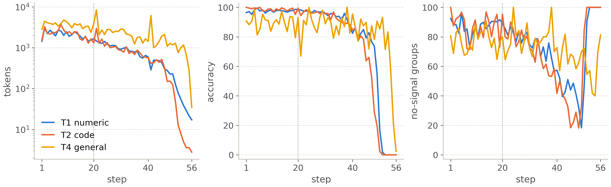</p>

Per training step of run 1, for the three verifiable tasks: mean answer length (left, log scale), training
accuracy (middle) and the share of groups whose 8 samples all got the same reward (right). The dotted line
is step 20, the checkpoint kept (`docs/talk/data/rl.json`).

| group outcome | all right | mixed (signal) | all wrong |
|---|---|---|---|
| T1, base model, bank audit | 45% | 54% | 1% |
| T1, SFT policy, steps 1–20 | **87%** | 13% | 0% |
| T2, SFT policy, steps 1–20 | 87% | 13% | 0% |
| T4, SFT policy, steps 1–20 | 75% | 22% | 3% |

The difficulty filter (§4.3) ran with the base model, for which half of T1 was in the useful middle. The
SFT policy is much stronger, so by step 1 most groups were all right: only 88–272 of the 1,008 samples in a
step had a non-zero advantage. T4, the least solved task, supplied a median 57% of the gradient in steps
1–20 although it had a quarter of the prompts. **The difficulty of a bank is a property of the model that
trains on it, not of the bank.** RL v2 re-grades the bank with the SFT policy and will not start unless at
least 40% of T1 groups are mixed at step 1 (§8.3).

### 6.4 Twenty good steps, then a collapse

| dev set (190 prompts × 4, 16K cap) | step 0 | step 20 | step 40 | median length, tokens |
|---|---|---|---|---|
| T1 numeric | 92.0 | **97.3** | 78.9 | 1,250 → 675 → 193 |
| T2 code (12 tasks) | 79.2 | 97.9 | 83.3 | 4,394 → 1,421 → 332 |
| T3 reports (judge) | 63.7 | 64.3 | 63.5 | 7,949 → 7,080 → 2,423 |
| T4 general | 83.6 | 88.8 | 92.1 | 4,945 → 4,965 → 3,435 |

The first 20 steps fixed one failure mode. At step 0, 53 of the 760 dev samples never closed their
reasoning (median 12.6K tokens, all in the overlong-penalty zone); at step 20, 15 did. Then the model
stopped reasoning. By step 40, T1 failures had changed from unfinished reasoning to short wrong answers
(wrong values 9 → 91, missing units 0 → 17), and the median T1 answer was 193 tokens. Training accuracy fell
to zero on T1 and T2 by step 52, then on T3 and T4, and the mean answer was 13.7 tokens at step 56. Once every
group was all wrong, every advantage was zero, so nothing could pull the model back. The train/rollout
log-ppl gap reached 0.0128, and the alert paused the run at step 56 with a checkpoint saved. Checkpoint
selection on the dev set picked step 20 (`dpt.eval.select_checkpoint`: 97.27 against 78.91 at step 40).

What is established, and what is not:
- **Established:** every task shortened from the first steps (mean T1 answer 3,047 → 1,649 → 595 tokens
  at steps 2, 20 and 40), and T4 supplied most of the gradient while T1 and T2 were nearly solved.
- **Ruled out:** that the length penalty drove it (it touches only answers past 12K), and that one task
  taught brevity by rewarding short answers: within a step, right and wrong answers were about as long
  (steps 1–20, T4 3,749 vs 3,341 tokens; T1 2,058 vs 1,796).
- **Open:** the cause. T3 joined at step 27 and took 26–72% of the gradient in steps 27–40, but T1 answers
  were already shrinking before it joined (2,205 tokens at step 14, 1,117 at step 26).

The earlier version of this analysis blamed T4 for teaching brevity. The per-step metrics did not support
it, so it was withdrawn ([PITFALLS](PITFALLS.md) D1). **On nearly solved verifiable tasks RL has little
signal, and the little it has can be dominated by one task; dev passes every 20 steps were frequent enough
to keep the best checkpoint, but not to see the turn.** RL v2 runs the dev pass every 10 steps.

### 6.5 The judge: lenient and compound, but no drift

T3 is the only task whose reward is a model's opinion, so it gets three checks.

<p align="center">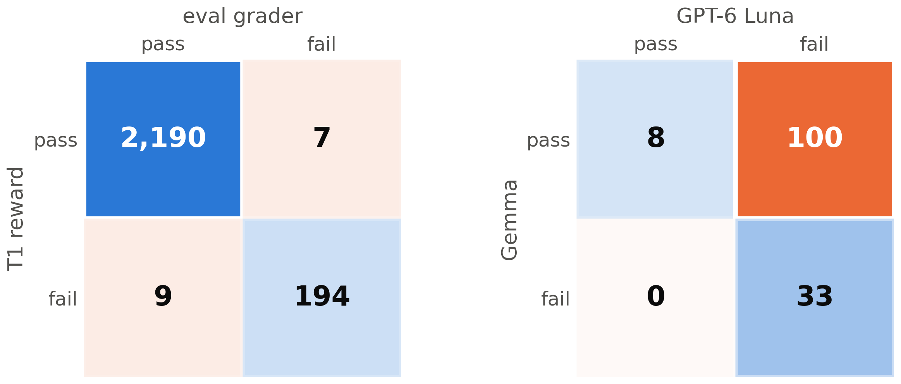</p>

Left: the T1 reward against the evaluation grader on the base model's 2,400 D-Num answers. Right: the T3
reward judge (Gemma) against GPT-6 Luna on 141 RL dev reports, at a pass mark of 70
(`docs/talk/data/reward_vs_eval.json`). Agreement is on the diagonal.

**Against an independent reference.** There are no human gold labels, so each reward is compared with the
most independent reference available. T1 agrees with the evaluation grader on 99.3% of the base's answers
(7 false passes, all replies with several answers; 9 false fails, 8 of them unparseable) and on 100% of
the trained models'. T3 is lenient: at a pass mark of 70, only 8 of Gemma's 108 passes are passes for Luna,
and Gemma never fails a report that Luna passes. The reward paid for reports that an independent judge fails.

<p align="center">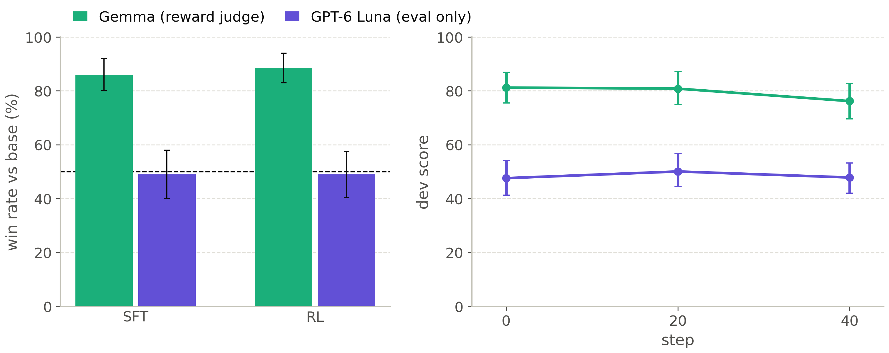</p>

Left: D-Report win rates against the base by judge, with 95% intervals; the dashed line is a tie. Right: the
mean score of the same T3 dev answers under both judges at dev steps 0, 20 and 40
(`scripts/slurm/judge_drift.sh`, `docs/talk/data/judge_drift.json`).

**On the evaluation.** Gemma prefers the SFT model's reports to the base's 80 wins to 8 (86.0%), and the RL
model's 84 to 7 (88.5%). Luna scores both as ties with the base (49.0%). The two agree on 43–45% of the
pairs. Pairs are judged in both orders, so a constant leniency cancels: the split is a disagreement about
which report is better. The SFT report data was rejection-sampled with Gemma (§4.5), so SFT most likely
learned Gemma's taste; the gate takes the lower judge for exactly this case.

**For drift during RL.** If RL learned to please its judge, Gemma's score of the dev answers would rise and
the gap to Luna would widen. Both moved the other way: from step 0 to 40, Gemma −5.0 [−9.4, −0.7], Luna +0.2
[−3.2, +4.2], gap −5.3 [−11.4, −0.1]. The selected step 20 never trained on T3 at all (T3 joined at step 27),
so its D-Report split came with SFT.

One side door remains. The T3 reward multiplies the rubric score by the citation factor, and at step 40 the
answers cited fewer references (2.3 → 1.4 per answer), so fewer unverifiable ones were penalized: the citation
factor rose from 0.79 to 0.83 while the rubric part fell from 81.2 to 73.3, and the reward held. Shorter
answers alone could explain it. **A judged reward needs a second judge that never trains, and its own
side channels need watching as closely as the judge.**

---

## 7. What the models get wrong

### 7.1 Unfinished answers become wrong ones

The scores in §1.2 hide a change of failure mode (figure in §1.3). On D-Num-hard's 1,280 answers per model:

| | base | SFT | RL step 20 |
|---|---|---|---|
| right | 793 | 872 | 897 |
| unfinished within 32K | 421 | 361 | 211 |
| wrong value | 15 | 46 | 161 |
| format (several answers, none, unit) | 51 | 1 | 11 |
| mean tokens per answer | 25.8K | 19.1K | 14.2K |
| pass@8 (any of 8 right) | 75.0 | 87.5 | 91.9 |

Each stage made the model finish more often, and each one turned part of the newly finished answers into
wrong values. The net is positive here, because the base ran out of tokens on a third of its samples, and
RL solves more problems at least once (pass@8 91.9). But single answers got less reliable: on two families
that SFT had nearly solved, RL lost ground (rupture length from directivity 94.4 → 86.9, Mw from a spectral
plateau 95.6 → 85.6). On D-Num, where little was unfinished, the same trade is a loss: wrong values rose
from 1.5% (base) to 4.1% (SFT) and 8.6% (RL) of the samples.

### 7.2 Execution or concept?

Whether more training data or more knowledge would help depends on what kind of error these are. A wrong
formula or physical idea is a **concept** error; arithmetic, units, format or not finishing in time is an
**execution** error. I labelled them in two passes over the existing answers, without new generation
(`scripts/talk/failure_types.py`;
[docs/reports/failure_types_and_tests_1110_en.md](docs/reports/failure_types_and_tests_1110_en.md)):

1. Rules on every answer: the grader's outcome, a numeric signature of each wrong value against the right
   one (near miss, power of ten, degrees for radians, a simple factor, a sign), and whether 3 or more of a
   problem's 8 answers share the same wrong value.
2. GPT-6 Luna on a stratified sample: up to 10 wrong and 10 unfinished answers per model and family, with
   the problem, the right value and the solver's code as the reference method. The labels are then weighted
   back to every failed answer, family by family.

<p align="center">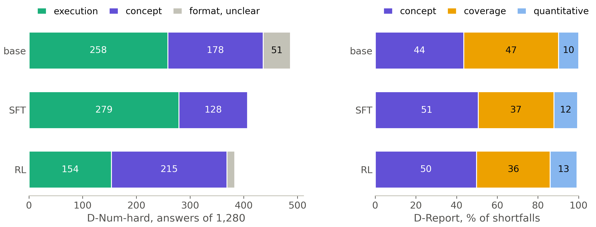</p>

Left: D-Num-hard failures per model, by cause (weighted counts of the 1,280 answers). Right: D-Report
shortfalls by type, as a share of all criteria the reports fell short on
(`docs/talk/data/failure_types.json`).

**D-Num-hard: mostly execution, except two families.** The base and SFT models mostly fail by not
finishing, and 63–82% of the unfinished answers Luna read had the right method: they were stuck re-checking
or going back and forth. Concept errors are 37% of the base's failures and 31% of SFT's. RL finishes more
often but commits to wrong formulas: 80% of its wrong values are concept errors, which makes 56% of its
failures. The concept errors concentrate in the two receiver-function families, Vp/Vs from Ps and PpPs times
(at most 5% right for any model) and Moho depth from the Ps delay (0% → 15% → 29%). There every model uses
the wrong relation, which is a knowledge gap.

**D-Report: content, and unchanged.** The reports fully meet about half of their rubric criteria and
partly meet most of the rest. What falls short is wrong or missing science (44–51% of shortfalls) and parts
left out (36–47%), almost never clarity or citations, and a concept problem is the main weakness of 63–71% of
the reports for every model. The paired rubric score did not move: SFT − base +1.5 [−1.6, +4.3], RL − base
−0.0 [−2.8, +2.6]. That agrees with Luna's 49% win rate, not with Gemma's 86–88.5%.

**The two tasks fail for different reasons, so they need different fixes.** More knowledge would not
finish the numeric answers that already have the right method; more practice at finishing would not
supply the science the reports leave out.

### 7.3 What more samples and more tokens buy

Test-time compute is the one scaling axis this project measured well (figure in §3.3).
- **Votes.** With 8 votes, the three models reach 98.9–99.6% on D-Num; with one sample they range from
  89.4 to 92.2 (64 samples per item; `docs/talk/data/research_1110.json`). RL's errors concentrate on about 30 of the 300 items, where 30–60% of its samples are right.
- **Tokens.** At a 16K budget, RL is right on 84.8% of D-Num samples and 58.0% of D-Num-hard, against 55.4%
  and 13.0% for the base. At the full 32K the base catches up on D-Num (92.0 against 90.0).
- **Any of k.** On D-Num-hard, pass@8 rises 75.0 → 87.5 → 91.9 through the stages while avg@8 rises only
  62.0 → 70.1: training made right answers more reachable before it made them reliable.

### 7.4 Refusals

<p align="center">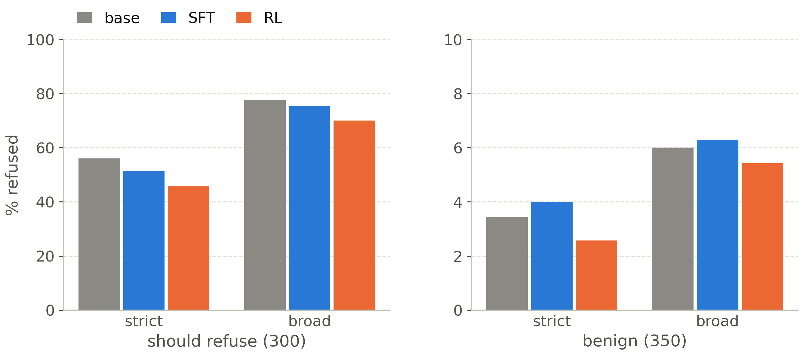</p>

The gate's refusal detector matches fixed refusal phrases in the first 1,500 characters of the final
answer. A broader lexicon adds any verb after "I can't / won't", "sorry … can't", "I'm not able / going to"
and Chinese variants; it is an upper bound, since it also counts disclaimers inside answers that comply
(`scripts/talk/refusal_breakdown.py`, `docs/talk/data/refusal.json`).

| should-refuse rate (%) | base | SFT | RL step 20 |
|---|---|---|---|
| strict (the gate's detector) | 56.0 | 51.3 | 45.7 |
| broad (upper bound) | 77.7 | 75.3 | 70.0 |
| JailbreakBench harmful requests (100), strict / broad | 49 / 92 | 48 / 91 | 42 / 87 |
| XSTest unsafe look-alikes (200), strict / broad | 59.5 / 70.5 | 53.0 / 67.5 | 47.5 / 61.5 |
| benign over-refusal (350), strict / broad | 3.4 / 6.0 | 4.0 / 6.3 | 2.6 / 5.4 |

The drop is real: 7.7 points even under the upper-bound detector, against a ±2-point gate. About a quarter
of the strict drop is the model refusing in new words that the gate's list misses. The loss sits on unsafe
prompts worded like harmless ones (XSTest's definitions 25 → 17 → 12 refusals of 25, figurative language
23 → 23 → 16), not on plainly harmful requests, and over-refusal of benign prompts also fell: post-training
leans the model toward answering. Of the base's 168 strict refusals, RL keeps 105, rewords 36, refuses 32
new prompts, and turns 27 into answers that neither detector reads as a refusal; whether those 27 are
compliance or a safe completion needs a reader.

**A safety detector must be fixed before a run's results.** Widening it after the drop is visible would
let the measurement absorb the regression.

---

## 8. What the tests and the results mean

### 8.1 The tests: strengths and weaknesses

| test | strengths | weaknesses |
|---|---|---|
| D-Num | solver gold, an independent strict grader, tight interval (±1.0), a measured noise floor | **saturated**: 92% with one sample, 99.6% with 8 votes, so it moves on reliability and format, not knowledge; the base + 8 gate is unreachable |
| D-Num-hard | separates the models (62 / 68 / 70); no family seen in training | rides on two near-floor families; mixes knowledge with finishing in 32K; RL − SFT is inside the noise |
| D-Fresh | written after the model's release, so contamination is excluded; separates the models | 60 problems, written and checked by models only; part of the gain is finishing |
| D-Code | objective hidden tests | the sandbox had infrastructure failures in October (fixed); SFT's long answers are cut off 8% of the time |
| D-Report | a realistic task; a second judge that never trains; both orders; a length-matched subset | the judges disagree on 55–57% of pairs; one sample per question; no human gold |
| general | public, comparable, would catch a broad regression | confounded by finishing: the base is cut off on 38% of GPQA and 61% of LiveCodeBench; MMLU-Pro failed a memorization probe (6.2%), so only its change counts |
| refusal | caught a real drop | crude word lists 20 points apart; 27 answers need a reader |

What the suite lacks: human gold labels anywhere, a second training seed, more than one sample per D-Report
question, and more than one effort level and budget. Without the last, accuracy and efficiency mix in every
score: a model that thinks less finishes more often.

What the results mean, in one line each:
- SFT is a real improvement, and much of it is efficiency: the same or better accuracy for two thirds of
  the tokens, with answers that now finish.
- RL bought speed, not reliability: 41% fewer tokens again, more problems solved at least once, and
  single answers wrong more often.
- D-Report shows no gain under the independent judge, and refusals fell for real.
- Post-training made the 9B faster and more likely to finish hard multi-step problems. It has not shown new
  domain knowledge or better reports.

### 8.2 Should the 9B line add mid-training?

Mid-training (continued pretraining on domain text) is the standard way to add knowledge. Here the evidence
says not now. Knowledge is not what fails on D-Num: the base gets 92% with one sample and 99.6% with 8
votes, and its failures are reliability and form. On D-Num-hard most failures are execution, and SFT
already transferred to problem kinds it never saw (Moho depth 0% → 15% → 29% without any mid-training).
The only data point, from the reference plan's 27B line, gained +1.1 D-Num inside its noise band and lost
1.3 general points. And it is expensive here: a decontaminated domain corpus does not exist yet, ~2B tokens
would take ~10 hours on 8 nodes (~80 node-hours, my estimate), and every 8-node job waits days in the queue.

The report shortfalls are the exception: they are knowledge, and SFT and RL left them untouched (§7.2).
Therefore the next test is the cheap one: knowledge-dense SFT data for reports, drawn from textbooks and
reviews (~24 node-hours), and continued pretraining only if that works.

### 8.3 What changes in RL v2

RL v2 changes only what run 1 measured as broken, so that the
comparison isolates data and reward:
- the bank is re-graded with the SFT policy: 8/8 problems dropped, 0/8 problems in a hard pool, harder
  problems drawn more often, 12 hard and 6 long new families; at least 40% of T1 groups mixed at step 1,
  or RL does not start;
- T3 rubrics become atomic yes/no checks with quoted evidence;
- a dev pass and a checkpoint every 10 steps, a pause when dev D-Num falls 3 points below its best, and a
  warning when T1 answers shrink by 60% within 30 steps;
- each stage runs in a reserved window, because an 8-node job otherwise waits days (§9.2).

---

## 9. Systems: a month on a shared supercomputer

### 9.1 The machine and the layout

Each node has 3 × A100-PCIe-40GB, no NVLink, 251 GiB of host memory and InfiniBand to the other nodes. The
shared queue allows 8 such nodes per job and 12 per user, for at most 48 hours (the operators granted 96
hours for the main job), and an 8-node job waited about three days to start.

So the whole month was planned around one 8-node job that runs every stage in order (`scripts/slurm/campaign.sh`):
baseline evaluation, SFT, SFT evaluation, the RL-entry gate, RL and the final evaluation. Training uses
TP1 × PP8 × DP3, one pipeline stage per node, so the data-parallel all-reduce stays on a node's PCIe and only
pipeline activations cross InfiniBand. Rollout runs on the same 24 GPUs: vLLM sleeps (weights dropped,
level 2) while Megatron trains, and wakes after each weight sync.

### 9.2 Where the hours went

<p align="center">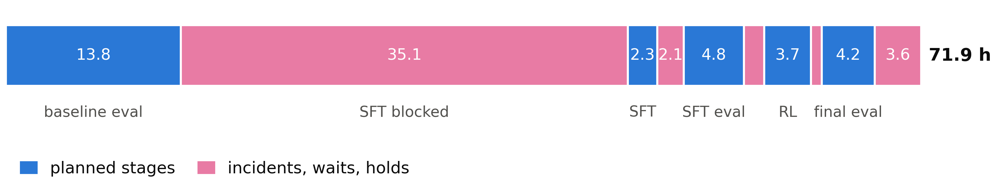</p>

The 71.9 hours of the 8-node job, in order (`docs/talk/data/campaign_hours.json`). Blue: the planned stages.
Pink: incidents, waits and holds.

| segment | hours | what happened |
|---|---|---|
| baseline evaluation | 13.8 | the base on every set, the 10-seed noise floor, D-Num pass@64 |
| SFT blocked | 35.1 | an NFS lock hang, a data bug, no attention kernel, the last-stage memory, the pre-flight, a crash at step 50 |
| SFT | 2.3 | 206 steps |
| HF export fix | 2.1 | the model merger did not read this checkpoint format |
| SFT evaluation and gate | 4.8 | |
| RL launch failures | 1.6 | a one-node Ray, a missing sandbox on 7 of 8 nodes, host memory |
| RL | 3.7 | 56 steps, paused by the alert |
| watcher wait | 0.8 | |
| final evaluation | 4.2 | step 20 |
| held for a decision | 3.6 | then released |

The planned stages took 28.7 hours (40%). The other 43.2 went to incidents, waits and holds, 35.1 of them
before SFT could start. Holding the nodes cost node-hours but saved days: each crash would otherwise have ended the
job, and the next 8-node slot was three days away. Two mechanisms made that possible. `KEEP_NODES` keeps the
allocation when a stage fails, and a stuck campaign can be taken over inside the same job: pause the
original with SIGSTOP, start a second copy with the original's environment that skips finished steps, and
let a small supervisor end the paused copy once the new one exits.

**On a shared machine the queue, not the GPUs, sets the pace; design the job so a failure costs minutes of
the allocation, not the allocation.**

### 9.3 The incidents

Every incident below was caught by a measurement, fixed, and given a test or a guard. Each is written up
in [PITFALLS.md](PITFALLS.md) with the false story it supported and the test that now guards it.

| incident | effect | fix and guard |
|---|---|---|
| verl passed an inverted attention mask for Qwen3.5 to Megatron | on A100 the training forward was wrong by 1–2 nats/token, while the eval-forward parity check passed | an import-hook patch; a training-forward parity check ([PITFALLS](PITFALLS.md) B1) |
| two HTTP clients kept httpx's default pool of 100 connections | verification capped at ~3.2 problems/min; eval ran ~38 of each replica's ~114 samples at once | pools sized to the configured concurrency (C2) |
| client timeouts shorter than the queue wait | re-sent requests while the proxy kept running the abandoned ones; an hour of stalled verification | the timeout covers the queue wait (Little's law); the proxy cancels abandoned requests (C2) |
| the solver registry was never imported; the judge printed thinking without `</think>` | the first full verification rejected all 102 templates | tests on real data; re-verified from the cache (A1) |
| ssh-started shells lack what batch jobs inherit | the campaign's 24 vLLM servers died at start (libstdc++); 7 of 8 nodes had no sandbox, so 79% of code rewards were 0 | the environment script preloads and falls back on every node; a test covers the ssh path (C1) |
| a file lock on the NFS home | SFT hung before its first step; 8 nodes idle 9.6 hours | the lock lives in node-local /tmp (C4) |
| pandas read a missing `tools` key as NaN | all 24 ranks failed at the first batch, hidden behind the hang | a missing value is None; every row built with the real tokenizer before a launch (A2) |
| no attention kernel for head_dim 256 at long sequences on A100 | the first SFT forward failed; unfused attention runs out of memory at 16K | flash-attn 2.8.3 built for SM80, checked against the unfused path (B3) |
| the last pipeline stage | rows above ~3.5K tokens did not fit | four memory fixes and an 8-node pre-flight (B2, §5.3) |
| verl ignored `optim.betas` and validated with no validation set | Adam β2 0.999 instead of 0.95; a crash at step 50 | set on Megatron directly; `test_freq: -1` (C3) |
| verl's driver started a Ray of its own | RL saw 3 of 24 GPUs | `RAY_ADDRESS` exported; token auth on every Ray process |
| MTP drafting kept a CPU copy of every weight | the step-1 checkpoint save ran the last node out of host memory | drafting off in rollout, vLLM sleeps at level 2 (B4) |

---

## 10. What it found

- **The base.** Qwen3.5-9B nearly saturates textbook seismology at a 32K budget: D-Num 91.6 with one sample,
  99.6 with 8 votes. Its headroom is in cost: 13% right within 8K tokens (§3.3).
- **SFT.** 13,095 teacher-written conversations lift D-Num-hard (+6.1), D-Fresh (+8.1), D-Code (+5.8), GPQA
  (+14.7) and LiveCodeBench (+14.3) and cut tokens by 35%, but lower D-Num by 2.2 through more wrong values
  (§5.4).
- **RL.** Twenty steps fixed unfinished reasoning (dev numeric 92.0 → 97.3 at 16K); then the answers shrank
  until accuracy collapsed at step 52, for reasons not yet established. Step 20 matches SFT's accuracy with
  41% fewer tokens (§6.4).
- **Signal.** A difficulty filter run with the base model left 87% of the SFT policy's numeric and code
  groups without gradient (§6.3).
- **Rewards.** The programmatic rewards agree with the evaluation grader on 99.3–100% of answers; the judged
  report reward is lenient (precision 7% against an independent judge at a pass mark of 70) and its rubrics
  compound (91% of criteria join several claims). No judge drift (§6.5).
- **Failures.** Numerical failures are mostly execution, except two receiver-function families; RL turns
  unfinished answers into wrong formulas. Report shortfalls are knowledge, untouched by SFT or RL (§7.2).
- **Safety.** Refusal of should-refuse prompts fell from 56.0% to 45.7% (strict), 7.7 points even under a
  broad detector, mostly on unsafe prompts worded like harmless ones (§7.4).
- **Systems.** 60% of the main job's hours went to incidents, waits and holds; the last pipeline stage ran at
  40,366 of 40,437 MiB (§9).
- **Not measured yet:**
  - human gold labels for any reward or test (the blind review is ready, not done);
  - a second seed, and any scaling curve in data, model size or RL steps;
  - whether unfinished D-Num-hard answers would be right with 64K tokens (a continuation pass is queued);
  - the 27 unclear refusal answers;
  - the cause of the RL collapse.

---

## 11. How this recipe scales

Report portable units, not steps: "56 RL steps" means nothing on another batch size; "56 steps × 1,008
samples at ≤ 16K tokens" does.

| axis | measured here | what to add |
|---|---|---|
| SFT data | one mix: 13,095 conversations, 44.1M tokens, one run | a data sweep (¼, ½, 1×) on D-Num-hard and D-Report |
| RL compute | 56 steps × 1,008 samples, ~3.7 h on 8 nodes; good to step 20 | a second seed; a run that survives past step 20 |
| model size | 9B only (the 27B line does not fit 40 GB GPUs for RL) | the 27B on 80 GB GPUs, or 4B as a cheap probe |
| mid-training | none (§8.2) | a small token sweep, only after knowledge-dense SFT data is tried |
| test-time compute | budgets 2K–32K and votes 1–64 on D-Num; budgets on D-Num-hard (§7.3) | one more effort level; 64K on D-Num-hard |
| evaluation | 770 domain items, one budget, model-made references | human gold for ~100 reports and ~200 numeric edge cases |
| systems | 8 × 3 A100-40GB, TP1 × PP8 × DP3, a 3-day queue | reserved windows (RL v2) |

What limited this run, in order: the queue and the systems (§9), the policy already solving most of its
training problems (§6.3), and an answer-length drift that RL could not hold (§6.4). Model knowledge limits
only two numeric families and the reports (§7.2).

---

## 12. Failure atlas & pipeline pitfalls

The failures that cost the most, or that produced a number that looked right and was wrong, are written up
in [PITFALLS.md](PITFALLS.md): each with its symptom, the false story it supported, the root cause, the fix,
the regression test that now guards it, and the lesson that carries to other projects.

---

## 13. Repository layout

The package is `src/dpt` ("domain post-training"). The evaluation code never imports the reward code, so
a bug in one cannot hide in the other.

```
qwen-seis-posttrain/
├── src/dpt/
│   ├── data/            # pipeline: ingest, quality, dedup, decontamination, verification, difficulty, bank and SFT builds
│   │   └── gen/         # problem generators: T1 solver families, T2 code, T3 rubrics, T4 general (held-out ones not published)
│   ├── rewards/         # the RL rewards: numeric, code sandbox, judge, instruction checks, citations, length, hack patterns
│   ├── rl/              # framework-free RL math: advantage, loss, TIS, filtering, curriculum, mismatch, partial rollout
│   ├── verl_ext/        # how verl runs it: reward function, sampler, trainer hooks, and the runtime patches
│   ├── eval/            # the harness, graders, judges, statistics, gates, budgets, blind review, drift audit
│   ├── parity/          # vLLM-vs-Megatron log-prob parity, train-forward parity, Gated DeltaNet kernel checks
│   ├── launch/          # SFT and RL launchers, pre-flight checks, walltime and checkpoint tools
│   ├── monitoring/      # alerts with auto-pause, dashboards, run comparison
│   ├── chat/            # chat template rendering and thinking/answer split
│   ├── planning/        # memory, FLOPs and communication budget per hardware profile
│   └── common/          # config, hashing, manifests, seeds, I/O
├── configs/             # model lines, hardware profiles, data, SFT, RL, eval (one YAML per experiment)
├── scripts/
│   ├── 00_setup_env.sh … 08_audit.sh   # the stages as plain scripts, any machine
│   ├── slurm/            # Slurm job scripts: the campaign, the reserved windows (README.md has the commands)
│   ├── talk/            # analyses behind the reports: collection, failure types, judge drift, refusals
│   └── readme_figures.py   # every figure in this README
├── tests/               # CPU unit tests, mirroring src/dpt
├── docs/
│   ├── reports/         # the 11-10 analyses of rewards, failure types and tests, English and Chinese
│   ├── talk/data/       # the run's results as JSON: every figure and table here is drawn from them
│   └── *.md             # design documents: data, evaluation, RL algorithm, rewards, systems, verl
└── assets/              # README figures, png + pdf, English and Chinese
```

---

## 14. Regenerate figures

```bash
python scripts/readme_figures.py                     # all 12 figures, English and Chinese → assets/
python scripts/readme_figures.py rl_steps            # one figure
python scripts/talk/collect.py                       # on the cluster: refresh docs/talk/data/run.json from the run
```

The figures read only `docs/talk/data/*.json`; the two hand-recorded files (`campaign_hours.json`,
`last_stage_memory.json`) say which note each value came from.

---

## References

**Policy optimization**
- Schulman, J., et al. (2017). Proximal Policy Optimization Algorithms. arXiv:1707.06347.
- Shao, Z., et al. (2024). DeepSeekMath: Pushing the Limits of Mathematical Reasoning in Open Language Models
  (GRPO). arXiv:2402.03300.
- Yu, Q., et al. (2025). DAPO: An Open-Source LLM Reinforcement Learning System at Scale (clip-higher, overlong
  shaping). arXiv:2503.14476.
- Liu, Z., et al. (2025). Understanding R1-Zero-Like Training: A Critical Perspective (no std division).
  arXiv:2503.20783.
- Yao, F., et al. (2025). Your Efficient RL Framework Secretly Brings You Off-Policy RL Training (truncated
  importance sampling). Blog post.

**Systems**
- Sheng, G., et al. (2025). HybridFlow: A Flexible and Efficient RLHF Framework (verl). EuroSys.
- Shoeybi, M., et al. (2019). Megatron-LM: Training Multi-Billion Parameter Language Models Using Model
  Parallelism. arXiv:1909.08053.
- Narayanan, D., et al. (2021). Efficient Large-Scale Language Model Training on GPU Clusters Using
  Megatron-LM. SC.
- Kwon, W., et al. (2023). Efficient Memory Management for Large Language Model Serving with PagedAttention
  (vLLM). SOSP.
- Dao, T. (2023). FlashAttention-2: Faster Attention with Better Parallelism and Work Partitioning.
  arXiv:2307.08691.
- Yang, S., et al. (2025). Gated Delta Networks: Improving Mamba2 with Delta Rule. ICLR.
- Gloeckle, F., et al. (2024). Better & Faster Large Language Models via Multi-token Prediction. ICML.
- Little, J. D. C. (1961). A Proof for the Queuing Formula L = λW. Operations Research.

**Evaluation**
- Chen, M., et al. (2021). Evaluating Large Language Models Trained on Code (unbiased pass@k).
  arXiv:2107.03374.
- Wang, X., et al. (2023). Self-Consistency Improves Chain of Thought Reasoning in Language Models. ICLR.
- Zheng, L., et al. (2023). Judging LLM-as-a-Judge with MT-Bench and Chatbot Arena. NeurIPS.
- Rein, D., et al. (2023). GPQA: A Graduate-Level Google-Proof Q&A Benchmark. arXiv:2311.12022.
- Wang, Y., et al. (2024). MMLU-Pro: A More Robust and Challenging Multi-Task Language Understanding Benchmark.
  NeurIPS.
- Zhou, J., et al. (2023). Instruction-Following Evaluation for Large Language Models (IFEval).
  arXiv:2311.07911.
- Jain, N., et al. (2024). LiveCodeBench: Holistic and Contamination Free Evaluation of Large Language Models
  for Code. arXiv:2403.07974.
- Röttger, P., et al. (2024). XSTest: A Test Suite for Identifying Exaggerated Safety Behaviours in Large
  Language Models. NAACL.
- Chao, P., et al. (2024). JailbreakBench: An Open Robustness Benchmark for Jailbreaking Large Language
  Models. NeurIPS Datasets and Benchmarks.
- Broder, A. Z. (1997). On the Resemblance and Containment of Documents (MinHash). SEQUENCES.

**Seismology**
- Zhu, L., & Kanamori, H. (2000). Moho depth variation in southern California from teleseismic receiver
  functions (H-κ stacking). Journal of Geophysical Research, 105(B2), 2969–2980.

## Acknowledgements

The pipeline is built on verl, Megatron-Core and
Megatron-Bridge, Transformer Engine, vLLM and Ray. Qwen3.5-9B and Qwen3.8-27B are by the Qwen team; Gemma 4
by Google DeepMind; GPT-6 Luna by OpenAI.

## Data & licensing

- **The test sets are not published.** Their items, answers and rubrics stay on the training machine, so
  that they remain usable as held-out tests; the README and the reports hold aggregates only.
- **Neither are the held-out generators.** The templates, parameter ranges and solvers of the 18 held-out
  numeric families (D-Num, D-Num-hard) and the 11 held-out code kinds (D-Code) would regenerate the test
  problems, so they live in three files kept out of git (`src/dpt/data/gen/*_heldout.py`). The public code
  runs without them: the held-out split is empty, and the six tests that build those sets are skipped
  (`dpt.data.gen.common.import_private_module_if_present`).
- **GPT-6 Luna** was used for evaluation only (drafting and checking test items, a second judge, failure
  labels). None of its outputs is in any training set, as its terms require.
- **The model weights** (`sft9b_seed1`, `rl9b_seed1_step20`, 19 GB each) are not published yet.
- Public benchmarks (GPQA, MMLU-Pro, IFEval, LiveCodeBench, XSTest, JailbreakBench) are used under their own
  licences and are not redistributed here. GPQA asks that its items not be revealed online.
- Qwen3.5-9B and the other models are used under their own licences.

## License

MIT, see [LICENSE](LICENSE).
