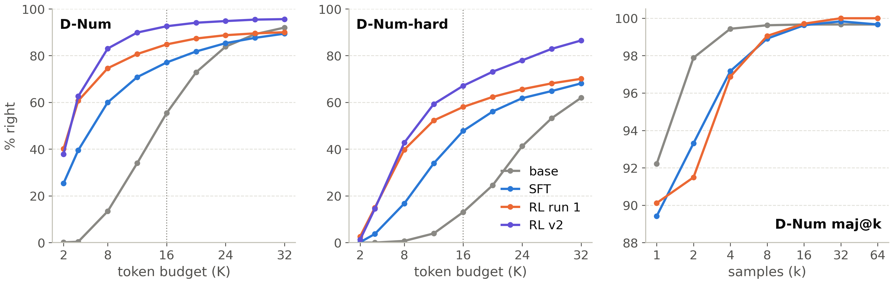
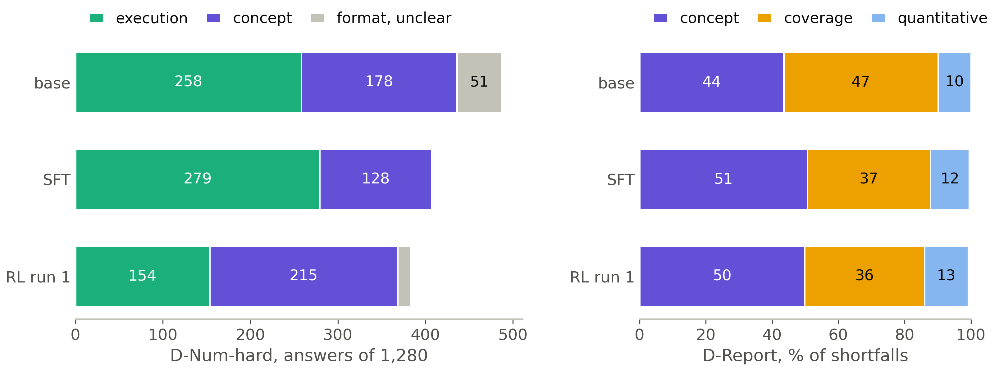
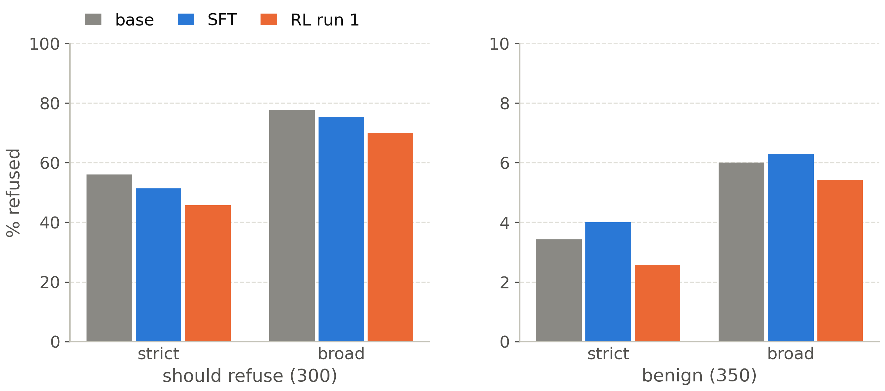
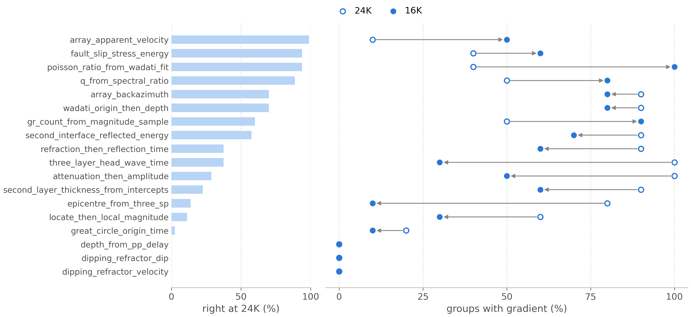
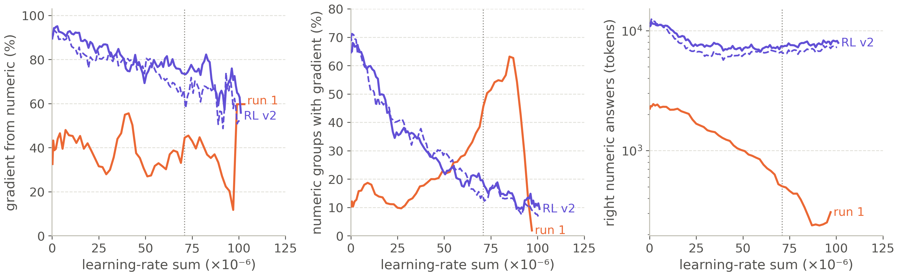
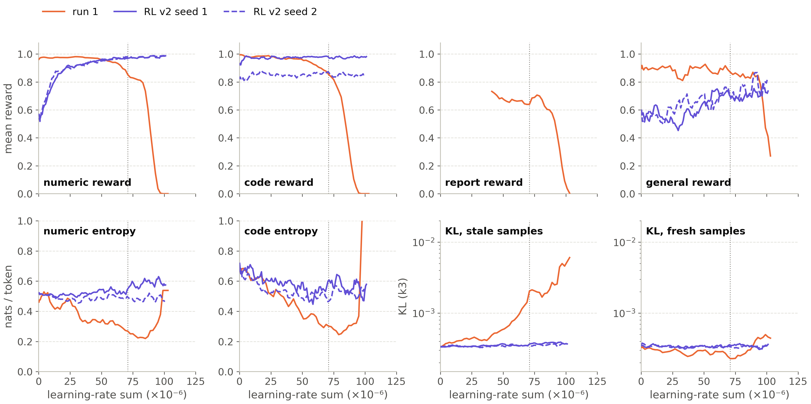

<div align="center">

# Qwen-Seis-Posttrain

[English](README.md) | [中文](README.zh-CN.md) | [nanoGPT-Seis (pretraining)](https://github.com/jiazhe868/nanogpt-seis) | [nanoGPT-Seis-Posttrain (113M SFT + GRPO)](https://github.com/jiazhe868/nanogpt-seis-posttrain)

Models on Hugging Face: [SFT](https://huggingface.co/jiazhe868/Qwen3.5-9B-Seis-SFT) | [RL run 1](https://huggingface.co/jiazhe868/Qwen3.5-9B-Seis-RL-run1) | [RL v2, the final model](https://huggingface.co/jiazhe868/Qwen3.5-9B-Seis-RL-v2)

Post-training Qwen3.5-9B for seismology on a shared GPU cluster: supervised fine-tuning on
teacher-written data, then multi-task GRPO with programmatic and judged rewards, measured on test sets
frozen before any training. Everything ran in one month on 8 nodes of 3 × NVIDIA A100-PCIe-40GB.

</div>

<p align="center"></p>

<p align="center">D-Num-hard accuracy (avg@8 over 160 held-out problems) and mean tokens per answer at each stage.
The arrows carry the data that trained the next model; both RL runs start from SFT.</p>

## Summary

The usual recipe for a domain model starts from a strong open model: fine-tune it on domain data, then
reinforce what works. Qwen3.5-9B is already strong at textbook seismology. On D-Num, 300 numerical problems
frozen before training, it is right on 91.6% of its samples, and on 99.7% of the problems it is right at
least once in 8 tries. Most of its failures are answers cut off at the 32K-token limit (4.6% of samples) or
malformed answers (2.3%), and 1.5% give a wrong value. So the room to improve is in how many tokens it
needs: within 8K tokens, 13% of its samples are right (§3.3).

A saturated test cannot show progress. Therefore, before any training result existed, I froze a harder
slice, D-Num-hard: 160 problems from 8 problem kinds that never appear in training. The base scores 62.0
on it, and two receiver-function kinds sit near 0%; on one of them, 159 of 160 samples run to the token
limit (§3.4).

Supervised fine-tuning (SFT) on 13,095 conversations (44.1M tokens) teaches the model the teacher's
shorter style. Most of the conversations are solutions written by a Qwen3.8-27B teacher to problems a
solver had checked. Mean answers fall from 14.7K to 9.5K tokens, and most sets improve: D-Num-hard +6.1,
D-Fresh +8.1, D-Code +5.8, GPQA Diamond +14.7, LiveCodeBench +14.3. D-Num falls 2.2 points, which is
outside its 10-seed noise (SD 0.46). The drop comes from wrong values, which become more common after
SFT (§5.4).

Reinforcement learning (RL) with GRPO-style group advantages then trains on 36,884 problems of four kinds:
numeric problems checked by a solver, code checked by hidden tests, reports scored by an LLM judge with
rubrics, and general instructions checked by programs. The problems had been filtered for difficulty
with the base model. After SFT the model was much stronger, so in the first 20 steps 87% of the numeric
and code groups had all 8 samples right, and those groups gave no gradient (§6.3).

The first 20 steps taught the model to finish its reasoning: on the dev set, numeric accuracy rose from
92.0 to 97.3 at a 16K-token cap. After that the answers kept getting shorter on every task. Numeric and
code accuracy reached zero at step 52, and a train/rollout mismatch alert stopped the run at step 56. I
first suspected that one task rewarded short answers. The training logs ruled that out: within each
step, right and wrong answers were about equally long. The cause is still open (§6.4).

Step 20, picked on the dev curve, keeps SFT's accuracy and uses 41% fewer tokens (5.6K per answer, down
from 9.5K): D-Num-hard 70.1, D-Fresh +4.6, GPQA +2.9. It leaves fewer answers unfinished and gives more
wrong values: on D-Num-hard, unfinished answers fall from 361 to 211 of 1,280, and wrong values rise from
46 to 161 (§7.1). It also refuses less. Even under a broad detector, its refusals of should-refuse
prompts fall by 7.7 points, mostly on unsafe prompts worded like harmless ones (§7.4).

The report reward depends on a judge, so I scored the same reports with a second judge that never
touched training. The two judges disagree. The reward judge (Gemma) gives the SFT model's reports an 86%
win rate over the base's, and the second judge (GPT-6 Luna) gives them 49%. At a pass mark of 70,
Gemma passes 100 of the 133 reports that Luna fails. The rubrics Gemma applies are also compound: 91% of
their 5,765 criteria join several claims. During RL the gap between the two judges narrowed, so RL did
not learn to please the judge (§6.5).

Next I labelled every failure, and the numbers and the reports turned out to fail for different reasons.
Numerical failures are mostly execution: unfinished answers whose method is right. To test that, I let
every answer that was cut off at 32K continue to 64K tokens. The SFT model then answers 83.9% of D-Num-hard
right, RL step 20 77.5% and the base 69.8% (§7.3). Two receiver-function kinds stay unsolved for the base,
which is a knowledge gap. The SFT model solves about half of them once it has room. Report shortfalls are
mostly missing or wrong science, and neither SFT nor RL changed them (§7.2). Therefore, mid-training is
not the next step for the numbers. For the reports, the cheapest test is knowledge-dense SFT data (§8.2).

These results set up the next runs. At 32K, RL step 20 is above SFT by 1.9 points on D-Num-hard [−0.7, +4.6] and
by 4.6 on D-Fresh [−0.8, +10.4], both inside the noise. Before the next RL run started, I fixed this paired
comparison at 32K as its test of success. What I want from RL now is a large gain where the model is weak, and on
D-Num-hard the weakness is finishing: at 32K the SFT model runs out of tokens on 28% of its answers and finishes
with a wrong value on 4%. RL v2 re-grades the bank with the SFT model, keeps the problems it solves only sometimes,
and adds 18 longer families with a dev split of their own. Every seed counts an answer that runs out of tokens as
wrong and has no soft length penalty: a replay of the first step showed that penalty pushing long right answers
shorter. Seeds 1–2 train at 24K; a third seed at 16K was planned and cancelled before it started. I expect the
cut-off rule to matter more than any of the weights
(§8.3). For the reports, I had the teacher write answers from 3,000 openly licensed papers
(§8.4).

No person was available to check the tests or the data, so a frontier LLM did the expert screening (§8.5). It
solved every D-Num-hard and D-Fresh problem without seeing the answers, and all 220 gold answers held. Leaving out the
7 flagged test items changes no result. It also found a generator that printed a wrong magnitude formula, so
825 problems in run 1's training bank carried labels 2.681 units too low. Bank v2 leaves them out. Of 100 rows of
the paper-based report data, it would keep 2 and drop 50: the teacher wrote earthquake facts from memory, and
many were wrong. Therefore, I dropped SFT v2, and the 8-node job planned for it runs RL v2 again with a second
seed. A third seed was queued and cancelled before it started: it would have waited days, and the two seeds agree.

RL v2's first seed trained all 110 of its steps without collapsing, and it passes the test. At 32K it is 18.4 points
above SFT on D-Num-hard [+14.4, +22.4], at 86.5, and 10.4 points above on D-Fresh [+5.2, +16.2]. It stays ahead at
64K, where run 1 fell 6.4 points below SFT: +6.3 [+3.7, +9.1] and +5.8 [+1.7, +10.4]. Most of the gain is answers
that now finish. At 32K only 6% of its D-Num-hard answers run out of tokens, against SFT's 28%, and its wrong values
rise only from 4% to 7%, where run 1's rose to 13%. Late in training only one numeric group in nine still carried
gradient, as few as in run 1's first steps, and the run stayed stable, so a scarce signal alone did not cause run 1's
collapse (§8.6). The other sets moved too: D-Num 95.6, the first stage above the base, D-Code 92.7, GPQA 77.5 and
LiveCodeBench 63.2, with the shortest answers of any stage. Refusals stayed at run 1's level. All of it ran on a
workstation while the cluster's final evaluation waited in the queue. A second seed passes too (+15.2 on D-Num-hard
and +8.5 on D-Fresh at 32K), so the third seed was cancelled before it started.

Most of the month went to systems. The one 8-node job ran 71.9 hours: 28.7 of them ran the planned stages,
and 43.2 went to incidents, waits and holds, 35.1 of those before SFT could start (§9.2). A 9B model on
40 GB GPUs leaves no slack: the last pipeline stage peaked at 40,366 of 40,437 MiB (§5.3). RL v2 ran as two more
8-node jobs of 43 and 22 hours, and its incidents cost seed 1's in-job evaluation and seed 2's last ten steps (§9).
Each incident left a test or a guard; the ones worth learning from are in [PITFALLS.md](PITFALLS.md).

## Contents

1. [Results at a glance](#1-results-at-a-glance)
2. [Quick start](#2-quick-start)
3. [Define success before training](#3-define-success-before-training)
4. [Data: the RL bank and the SFT mix](#4-data-the-rl-bank-and-the-sft-mix)
5. [Stage 1: supervised fine-tuning](#5-stage-1-supervised-fine-tuning)
6. [Stage 2: multi-task RL](#6-stage-2-multi-task-rl)
7. [What the models get wrong](#7-what-the-models-get-wrong)
8. [What the tests and the results mean](#8-what-the-tests-and-the-results-mean)
9. [Systems: a month on a shared supercomputer](#9-systems-a-month-on-a-shared-supercomputer)
10. [What it found](#10-what-it-found)
11. [How this recipe scales](#11-how-this-recipe-scales)
12. [Failure atlas & pipeline pitfalls](#12-failure-atlas--pipeline-pitfalls)
13. [Repository layout](#13-repository-layout)
14. [Regenerate figures](#14-regenerate-figures)

[PITFALLS.md](PITFALLS.md) collects the failures met in building this pipeline and the checks that now
catch them.

---

## 1. Results at a glance

### 1.1 Model, data and compute

| | |
|---|---|
| Base model | Qwen3.5-9B, the released model with thinking at medium effort: 32 layers mixing Gated DeltaNet and full attention (head_dim 256), a multi-token-prediction (MTP) head, a 248,320-word vocabulary |
| Teacher | Qwen3.8-27B (FP8): writes the SFT solutions and reports and votes in problem verification |
| Reward judge | Gemma 4 26B-A4B (FP8) on one A100: the T3 report reward, verification votes, data checks |
| Second judge | GPT-6 Luna (API), evaluation only: D-Report's second judge, the judge-drift audit, the failure labels. Its outputs never enter training data |
| RL bank | run 1: 36,884 problems kept of 57,037 generated (§4): 25,588 numeric (T1), 2,495 code (T2), 1,193 report (T3), 7,608 general (T4). RL v2: 13,075 problems graded by the SFT model: 7,433 numeric, 2,442 code, 3,200 general (§8.3) |
| SFT mix | 13,095 conversations, 44.1M tokens: 8,776 numeric solutions, 1,301 tool-use trajectories, 554 reports, 2,464 general answers written by the base model itself (§4.5) |
| RL | run 1: group-mean advantages over 8 samples, 126 prompts per step, PPO clip 0.2 / 0.28, no KL term, 16K-token responses; 56 of 120 planned steps ran, step 20 kept (§6). RL v2: the same algorithm at half the learning rate, 24K-token responses, a cut-off answer counted wrong; two seeds of 110 steps, seed 2 evaluated at step 100 (§8.3) |
| Hardware | 8 nodes of 3 × A100-PCIe-40GB each, no NVLink, InfiniBand between nodes, Slurm. Training TP1 × PP8 × DP3 on 8 nodes; rollout on 24 one-GPU vLLM replicas on the same GPUs |
| Compute | ~1,290 node-hours from 2026-10-13 to 11-19: 575 in run 1's 71.9-hour 8-node job and 521 in RL v2's two 8-node jobs (§9.2) |
| Evaluation | 5 domain sets frozen before training (770 items), 5 general benchmarks, a 650-prompt refusal set; 95% intervals, a 10-seed noise floor (§3) |

### 1.2 Results by stage

<p align="center"></p>

| set (metric, items) | base | SFT | RL step 20 | RL v2, seed 1, step 110 |
|---|---|---|---|---|
| D-Num (avg@8, 300) | 91.6 ± 1.0 | 89.4 ± 0.9 | 89.2 ± 1.0 | **95.6** ± 0.7 |
| D-Num-hard (avg@8, 160) | 62.0 ± 1.6 | 68.1 ± 1.4 | 70.1 ± 1.7 | **86.5** ± 1.5 |
| D-Fresh (avg@8, 60) | 70.6 ± 2.6 | 78.8 ± 2.3 | 83.3 ± 2.6 | **89.2** ± 1.9 |
| D-Code (pass@1, 150) | 80.5 ± 2.3 | 86.3 ± 2.0 | 85.2 ± 2.2 | **92.7** ± 1.5 |
| D-Report (win rate vs base, lower of two judges, 100) | 50 | 49.0 ± 9.0 | 49.0 ± 8.5 | 58.0 ± 9.0 |
| GPQA Diamond (198) | 56.6 ± 1.6 | 71.3 ± 1.6 | 74.2 ± 1.8 | **77.5** ± 1.5 |
| MMLU-Pro, 2K subset (change only) | 74.8 | 77.3 | 78.3 | 79.2 |
| IFEval (377) | 93.1 | 93.1 | 93.9 | 93.6 |
| LiveCodeBench after 2025-01 (70, change only) | 38.2 | 52.5 | 50.0 | **63.2** |
| tool calling (188) | 83.0 | 88.8 | 86.7 | 87.8 |
| refusal of should-refuse prompts, % (300) | **56.0** | 51.3 | 45.7 | 45.7 |
| over-refusal of benign prompts, % (350) | 3.4 | 4.0 | 2.6 | 2.9 |
| mean output tokens | 14,735 | 9,517 | 5,637 | **5,152** |

± is the 95% interval of the sampling noise. Every model, the base included, was re-run in the same harness
with the same prompts and settings (§3.2); no number is copied from elsewhere. The figure leaves out
D-Report, which gets its own figure (§6.5). Source: `docs/talk/data/run.json`. RL v2's final evaluation on the
cluster was still waiting in the queue when its training ended, so I ran every set on a workstation's A100s with
the same harness, prompts, settings and graders (`docs/talk/data/rl_v2_seed1_local_1118.json`). The code tests ran
in a bubblewrap sandbox, which gave SFT's cluster answers exactly their cluster scores (86.3 and 52.5), and
D-Report's second judge ran from the cluster's login node. The cluster re-runs D-Num-hard and D-Fresh as a check.

SFT changed the most. It shortened the answers by a third and lifted every set where the base had run
out of tokens. The share of GPQA answers cut off at 32K fell from 38% to 17%, and for LiveCodeBench from
61% to 29% (`docs/talk/data/failure_types.json`, `cut_off_32k`). D-Num fell, because SFT gives more wrong
values (§5.4).

RL shortened the answers again and left the accuracy about the same. The tokens per answer fell by
another 41%, and most sets kept their scores. The gains outside the intervals are D-Fresh +4.6 and
GPQA +2.9. D-Num-hard rose by another 2.0 points, which is inside the noise ([−0.8, +4.8], paired). Of
the eight ship gates fixed before RL, two pass: general capability and cost. The D-Num gate (base + 8,
i.e. 99.6) was out of reach by construction (§3.5).

D-Report shows no gain under the judge that never touched training, and refusal fell for real (§7.4).

RL v2, the second RL design (§8.3), is the first stage that moves D-Num-hard by a large step. Its first seed scores
86.5, which is 18.4 points above SFT [+14.4, +22.4] in a paired comparison over the 160 problems, and D-Fresh rises
by 10.4 [+5.2, +16.2]. Both pass the test fixed before it ran (§8.3). It gets there by finishing its answers: at 32K
only 6% of its D-Num-hard answers run out of tokens, against SFT's 28%.

The gain is not confined to those two sets. D-Num rises to 95.6, the first stage above the base (91.6), and D-Code
to 92.7, GPQA to 77.5 and LiveCodeBench to 63.2, all above SFT by more than their intervals. Answers are the shortest of any stage
(5,152 tokens on average). Two things did not move. Refusals stay at run 1's 45.7%, since RL v2 had no safety data
either, and D-Report under the second judge is 58.0, which is still inside the noise of SFT's 49.0.

A second seed lands close by on every set. It is evaluated at step 100, its last saved checkpoint (§8.3): D-Num-hard
83.4, D-Fresh 87.3, D-Num 95.0, D-Code 90.8, GPQA 77.9, LiveCodeBench 56.1, D-Report 62.5, refusals 49.0%
(`docs/talk/data/run.json`; its code sets were graded again on the workstation, because the cluster's sandbox failed
its start-up check and failed closed on every answer). Its code results may understate the recipe: during training,
about one code answer in eight was scored 0 by a broken sandbox ([PITFALLS](PITFALLS.md) C8).

Of the eight ship gates fixed before RL (§3.5), RL v2's two seeds pass five and six: D-Code, D-Fresh, general
capability, cost and reproducibility (their D-Num scores are 0.7 apart, inside the 2-point limit), and D-Report for
seed 2 only. D-Num, whose bar of base + 8 is out of reach by construction, and safety fail
(`docs/talk/data/ship_gates_rl_v2_1119.json`).

### 1.3 Where the samples go

<p align="center"></p>

Each bar splits one model's samples into four outcomes (%): right, unfinished (the reasoning never closed
within 32K tokens), a wrong value, and a format failure (several answers, none, or a missing unit). The
grader reads the final answer and nothing else.

On D-Num, most of the base's failures are unfinished answers, and most of SFT's and RL's failures are wrong
values. D-Num-hard shows the same shift on a larger scale: unfinished answers fall from 33% (base) to 28%
(SFT) to 16% (RL run 1), and wrong values rise from 1% to 4% to 13%. RL v2's unfinished answers fall to 6%, and its
wrong values stay at 7%. **Post-training here mostly changed when the model stops thinking.** Run 1 stopped earlier
and was wrong more often. RL v2 stops earlier too, and most of the answers it now finishes are right (§8.6). §7 asks
what kind of error run 1's wrong values are.

### 1.4 One question, every stage

The tables count how often each model is right. They do not show what an answer looks like, so here is one
problem answered by all four models. To keep it from being a picked example, I fixed the problem by a rule
before any model saw it: the first problem drawn with seed 20261118 from `three_layer_head_wave_time`, one of
the public training families. It asks for the travel time of a head wave through two flat layers over a
half-space, a problem a seismology student solves by hand in four steps. The family is in the training data,
so this is the kind of problem the models were trained on, but this draw of it is new to every model and is
in no test set.

Each model answered it 16 times with the evaluation's prompt and settings (medium effort, temperature 1,
top-p 1, at most 32K tokens), and the evaluation's numeric grader scored every answer. The figure shows each
model's first answer (sample 0): the start and the end of its reasoning, then its final answer. Under each
box are the counts over all 16 answers.

<p align="center"></p>

In their first answers, all four models read the problem the same way: they restate the layers and look for
the ray that runs along the top of the half-space. The difference is whether they finish. The base model is
still writing formulas when it reaches 32K tokens, and 14 of its 16 answers run out; its 2 right answers
took 21K and 23K tokens. SFT writes in the teacher's terse style and gets 9 of 16 right. Its first answer is
checking its arithmetic a second time when the limit cuts it off, and 7 of its answers run out. Both RL
models finish all 16 answers and get all 16 right, RL v2 with fewer tokens than run 1 (median 14.9K against
18.6K). None of the 64 answers gives a wrong value. On this problem every failure is an answer that never
ended.

One problem is not a test. It shows on one question what §1.3 and §7.1 measure on 160: post-training here
mostly changed when the model stops thinking. Source: `docs/talk/data/stage_example.json`, written by
`scripts/talk/stage_example.py`.

### 1.5 Against larger models, scored the same way

<p align="center"></p>

Two larger Qwen models answered D-Num-hard with the harness, prompts, effort setting, sampling (8 samples per problem
at temperature 1) and grader of every model above, in 4-bit weights on a workstation's A100s: Qwen3.8-27B, the
teacher that wrote the SFT solutions, and Qwen3.5-122B-A10B, the 9B's own generation with 13 times its parameters and
10B of them active per token. Every answer is scored as if the cap had been 16K or 32K tokens, the same test that
RL v2 passed against SFT (§8.3); the bars carry 95% intervals over the 160 problems, and tokens per answer are at the
32K cap. The 9B base model, where SFT started, is scored the same way; its answers come from the main evaluation in
the same harness at the same 32K cap. Data: `docs/talk/data/large_models_1120.json`; script:
`scripts/talk/large_models.py`.

| model | parameters | right at 16K | right at 32K | unfinished at 32K | tokens per answer, 32K |
|---|---|---|---|---|---|
| **RL v2 (this model)** | **9B** | **69.5%** | 84.9% | 7.4% | **12.4K** |
| SFT | 9B | 47.8% | 68.1% | 28.2% | 19.1K |
| Qwen3.5-9B (base) | 9B | 13.0% | 62.0% | 32.9% | 25.8K |
| Qwen3.8-27B (teacher) | 27B | 59.6% | **88.0%** | 10.2% | 16.0K |
| Qwen3.5-122B-A10B | 122B, 10B active | 22.7% | 82.0% | 14.8% | 22.4K |

**From the base to past the 122B.** The base 9B writes the longest answers of all, 25.8K tokens at the 32K cap, and
at a 16K budget 87% of them are unfinished: it is right on 13.0% at 16K and 62.0% at 32K. At 32K the 122B is ahead
of the base by 20.0 points [+16.0, +24.1]. RL v2 is ahead of the base by 56.4 points [+50.7, +62.0] at 16K and by
23.0 [+19.4, +26.7] at 32K, so post-training covered the whole distance from the base to the 122B and a little more.
SFT alone is ahead of the base by 34.8 [+29.8, +39.7] at 16K and by 6.2 [+3.4, +8.9] at 32K.

Where the 9B keeps up with models up to 13 times its size:
- **A 16K budget.** RL v2 is right on 69.5% of its answers, the 27B on 59.6% (+9.8 points [+6.1, +13.6]) and the
  122B on 22.7% (+46.7 [+41.3, +52.1]). The larger models are still reasoning when the budget ends: 40% of the 27B's
  answers and 77% of the 122B's are unfinished.
- **The 122B at 32K.** RL v2 84.9% against 82.0%: +3.0 points [+0.1, +5.8], just above the noise. Seed 1 alone is
  +4.5 [+1.3, +7.7]; seed 2 alone is level, +1.4 [−1.7, +4.4].
- **Cost.** At 32K RL v2 writes 12.4K tokens per answer, against 16.0K for the 27B and 22.4K for the 122B. With 9B
  parameters that is about a quarter of the 27B's compute per answer and about half of the 122B's (10B active).

Where it is behind: the teacher, with room to finish. At 32K the 27B is ahead by 3.1 points [−5.2, −1.1]. The two
miss in different ways. The 27B leaves 10.2% of its answers unfinished and gives a wrong value in 1.2%; RL v2
finishes more often (7.4% unfinished) and gives a wrong value more often (7.3%).

The route forward is fewer wrong values. RL v2 already finishes more often than the teacher, so more room would not
close the gap, and its excess of wrong values over the teacher's (7.3% against 1.2%) is larger than the whole gap of
3.1 points. §7.2 traced the same shift after RL run 1: unfinished answers turned into wrong formulas.

Caveats:
- The larger models ran with 4-bit weights (the card of the 27B's NVFP4 build reports GPQA 88.0 against 88.9 in BF16).
- One set of 160 problems; the differences are paired over the problems, the intervals in the table are not.
- 64K is left out on purpose: RL v2 trained with a 24K response cap and was never asked to use more, so a 64K test
  would measure room it never trained for.
- The 27B wrote the SFT solutions, so RL v2 learned its style; every model used the 9B's prompts and effort setting,
  not each model's own recommended ones.

---

## 2. Quick start

```bash
# --- the released models: serve the final one from the Hugging Face Hub (its card shows the prompt) ---
vllm serve jiazhe868/Qwen3.5-9B-Seis-RL-v2 --max-model-len 40960 --reasoning-parser qwen3 --language-model-only

# --- CPU: install, tests, graders, the memory planner ----------------------
pip install -e . -r requirements/core.txt
make test            # CPU unit tests (no GPU needed)
make graders         # adversarial grader suite, must pass 100%
make plan-cluster        # memory / FLOPs / communication budget for 8 nodes × 3 A100-40GB

# --- Slurm cluster: environment, models, node checks (scripts/slurm/README.md)
bash scripts/slurm/setup_login.sh conda
sbatch -A <allocation> scripts/slurm/build_env.slurm
bash scripts/slurm/setup_login.sh models && bash scripts/slurm/setup_login.sh sandbox
sbatch -A <allocation> scripts/slurm/check_node.slurm      # must print SANDBOX ISOLATED
sbatch -A <allocation> scripts/slurm/parity.slurm          # vLLM vs Megatron, eval and train forwards

# --- data: teacher, judge and base served, then generate → bank → SFT mix --
sbatch -A <allocation> scripts/slurm/data.slurm gen
sbatch -A <allocation> scripts/slurm/data.slurm bank
sbatch -A <allocation> scripts/slurm/data.slurm sft

# --- one 8-node job: baseline eval → SFT → SFT eval → RL-entry gate → RL → final eval
sbatch -A <allocation> scripts/slurm/campaign.slurm

# --- the next runs (§8.3): RL v2 with three seeds, one 8-node job each ------
scripts/slurm/submit_window.sh rl-build-queue          # seed 1: bank v2 if missing → 24K test → RL v2 → final eval
scripts/slurm/submit_window.sh sft-v2-queue            # seed 2: the same steps (the slot first planned for SFT v2, §8.4)
scripts/slurm/submit_window.sh rl-seed-queue 3         # seed 3: the same steps

# --- figures in this README, from the result files in docs/talk/data/ -----
python scripts/readme_figures.py
```

The full sequence, with the time of each step, is the table in
[scripts/slurm/README.md](scripts/slurm/README.md). The design documents behind each stage are in `docs/`:
[data_pipeline.md](docs/data_pipeline.md), [evaluation.md](docs/evaluation.md),
[rl_algorithm.md](docs/rl_algorithm.md), [rewards_and_hacking.md](docs/rewards_and_hacking.md),
[systems.md](docs/systems.md) and [verl_integration.md](docs/verl_integration.md).

---

## 3. Define success before training

### 3.1 Why the tests come first

The usual order is to train first and then look for a test that shows the gain. Every later number depends
on the test, so here the tests came first. The sets were built and frozen (content hashes, canaries) on
2026-10-22/23, before the RL bank and the SFT mix were built, so that decontamination could check the
training data for overlap with them. The one set added afterwards is D-Num-hard, frozen on 10-27 before any
SFT result existed (§3.4). Training never sees an item, a family or a rubric of a test set. The numeric
families are split into training and held-out families in the code
(`split="heldout"` in `src/dpt/data/gen/families.py`; the held-out definitions themselves are not
published, see Data & licensing), and a test enforces that the eval package never imports the reward code
(`tests/eval/test_independence.py`).

| set | items | what it measures | gold | metric |
|---|---|---|---|---|
| D-Num | 300 | one- to three-step numerical problems from 10 held-out solver families | a solver | avg@8 |
| D-Num-hard | 160 | 8 held-out families of 3 or more steps, 20 problems each | a solver, checked against an independent computation | avg@8 |
| D-Fresh | 60 | problems written after the model's release, so it cannot have seen them | a drafted `solve()` that must reproduce the answer, plus model votes | avg@8 |
| D-Code | 150 | domain coding tasks | hidden unit tests in a sandbox | pass@1 over 4 samples |
| D-Report | 100 | written reports, 5 weighted criteria and 5 common errors each | none: pairwise win rate against the base, two judges, both orders | win rate |
| general | 5 sets | GPQA Diamond, MMLU-Pro (2K), IFEval, LiveCodeBench after 2025-01, tool calling | public | per benchmark |
| refusal | 650 | 300 should-refuse prompts (JailbreakBench, XSTest unsafe), 350 benign controls | — | refusal rate |

Two perturbed twins of the numeric sets (280 items, numbers changed) are kept as contamination probes. This
month's plan has no domain experts. GPT-6 Luna drafted D-Fresh and D-Report, and Gemma checked them. The blind
review prepared for a person (`dpt.eval.blind_review`) found no reviewer, so a frontier LLM later screened the
sets and judged the blind pairs (§8.5). So every reference in this project is a program or a model, and none is a
human label (§8.1).

### 3.2 The decoding and scoring contract

Every model, the base included, is re-run in one harness (`src/dpt/eval/harness.py`) with the same rendered
prompt, temperature 1.0, top-p 1.0, reasoning effort medium and at most 32K output tokens, with a seed per
item. Only the final answer is graded. An answer whose reasoning never closes fails, and the truncation rate
is reported for every set. The numeric grader (`dpt.eval.graders.numeric`) is written separately from the
T1 reward and is strict about units. On the same answers the two agree on 99.3–100% (§6.5).

### 3.3 The base model nearly saturates D-Num

<p align="center"></p>

Left and middle: the share of samples that are right within a token budget, as if the length cap were that
budget, every run of a model pooled (`dpt.eval.budget`; the dotted line is RL's 16K cap). Right: majority
vote over k samples on D-Num (`scripts/talk/research_1110.py`).

The base scores 91.6 on D-Num with one sample, 99.7% with at least one right answer in 8, and 99.6% by a
majority vote of 8. Measured by accuracy, the set is solved. The next question is cost: within 8K tokens,
13.4% of the base's samples are right, and within 16K, 55.4%. A right answer costs 17.7K output tokens on
average, for one- to three-step textbook calculations. SFT and RL move the whole curve to the left: within
8K tokens, SFT is right on 60.0% of samples and RL on 74.6%.

**On a strong base model, the first thing post-training buys is efficiency.** The number to watch for
this set is accuracy at a budget, because at the cap the set is already solved.

### 3.4 A harder slice, frozen before any result

A test that the base already passes cannot show whether training helps. Therefore, on 10-27, before any
SFT result, I added D-Num-hard: 8 held-out problem kinds of three or more steps (receiver-function Moho
depth and H-κ Vp/Vs, rays in a velocity gradient, Mw from a spectral plateau, distance from a ground-motion
model, rupture length from directivity, Coulomb stress change), 20 problems each. Every solver was checked
with an independent computation (forward models, ray integrals by quadrature, a rotated stress tensor). The
slice was chosen by family, and which items a model failed played no part in the choice.

The base scores 62.0 there. A third of its samples never finish within 32K tokens, and a right answer costs
41.6K tokens. Two receiver-function families sit at 0%. On H-κ, 159 of 160 samples ran to the cap. On Moho
depth, the few that finished used the difference of the P and S ray-path times, which puts the Moho 6–19%
too deep. The right relation is the plane-wave delay $`H\left(\sqrt{1/v_s^2-p^2}-\sqrt{1/v_p^2-p^2}\right)`$.

### 3.5 Noise floor and gates

Ten runs of the base on D-Num with different seeds span 91.1–92.5 (SD 0.46; mean pairwise difference 0.52,
largest 1.42; `docs/talk/data/run.json`, `eval.noise_floor`). A difference smaller than about 1.4 points is noise.

Two kinds of gate decide what happens next, both fixed in advance:
- **The RL-entry gate** (after SFT). At the D-Num ceiling, a strict "SFT above base" check would be
  decided by noise. A failed gate also used to end the 8-node job, and the next slot took about three
  days. So, on 10-27 and before any SFT result, I made the gate noise-aware. D-Num may fall below base by
  at most the combined 95% interval (~1.4 points), D-Code and D-Report must beat base, and a failure now
  holds the job until a person says go or stop. SFT failed it (D-Num −2.2; D-Report not above base under
  the lower judge), and the go had been given in advance.
- **Eight ship gates** (after RL), with the thresholds of the reference plan this project started from.
  For run 1's step 20, two pass: general capability (+7.5, allowed down to −1.0) and cost (0.38× the base's
  tokens, allowed up to 1.3×). D-Num needed base + 8, i.e. 99.6, which no model can reach on a saturated set.
  That was known before RL, and no new threshold was fixed before RL v2's results came in, so RL v2 was judged
  against the same bar: its seeds pass five and six of the eight gates and miss D-Num at 95.6 and 95.0 (§1.2).

Caveats, plainly:
- D-Num-hard rests on 160 problems from 8 families, and two families decide much of its spread (§8.1).
- D-Fresh has 60 problems, and models alone wrote and checked them.
- Everything is measured at one effort level and one budget, so accuracy and efficiency mix in every score.

```bash
python -m dpt.eval.harness --model-name base_medium --sets d_num --seed 0 --endpoint http://localhost:8000 \
    --out eval_results/base_medium           # one set, one seed; the noise floor repeats it for seeds 0-9
python -m dpt.eval.budget --eval-root eval_results --out talk/budget      # accuracy within each token budget
```

---

## 4. Data: the RL bank and the SFT mix

### 4.1 Why generated problems need four filters

Problems written by a template or a teacher fail in ways that a loss curve cannot show: a wrong label
teaches the wrong answer perfectly, a near-duplicate inflates one topic, a leaked test item inflates the
score, and a problem the model always solves gives RL no gradient. Each failure has its own filter, applied
in order (`src/dpt/data/pipeline.py`, `configs/data/pipeline.yaml`):

<p align="center"></p>

| stage | removed | what it catches |
|---|---|---|
| quality | 74 | repeated 4-grams, too short |
| dedup | 664 | near duplicates (MinHash) |
| decontamination | 1,840 | n-gram / MinHash matches to any test set (1,399), semantic matches confirmed by the judge (441) |
| verification | 9,998 | whole templates rejected (9,842), models undecided (140), solver and models disagree (16) |
| difficulty | 7,577 | whole templates the base solves 8/8 (6,634), single problems solved 8/8 (943) |

57,037 generated problems became 36,884 (65%). The published bank holds 36,668 training problems, 190 dev
problems and 26 hard ones (solved 0/8 by the base) that were not trained on (`docs/talk/data/run.json`, `pipeline`).

### 4.2 Verification: a solver and two models must agree

A template's labels are as good as its solver. For each of the 102 templates and sources, the teacher
solved 20 of its problems (4 samples each), and the judge ruled on them. One broken solver produces
hundreds of wrong labels at once, so a template whose problems the models reject is dropped whole. 20 were
rejected whole (19 numeric templates and `openai/gsm8k`), and the median template kept 95% of its problems.

The first full verification rejected all 102 templates. It had hit two bugs that showed up only on real
data. The solver registry was never imported, so every problem failed with `solver_error: KeyError`. The
judge was served without a reasoning parser and printed its thinking without `</think>`, so every vote was
empty. Both are now tested, and the re-run from the cache took a minute. **Run each stage on a real-data
sample before trusting it at scale.** ([PITFALLS](PITFALLS.md) A1.)

### 4.3 Difficulty: drop what the model already solves

GRPO learns only from groups whose samples disagree (§6.3), so a problem solved 8 times out of 8 costs
compute and teaches nothing. The base model answered 1,780 audited problems 8 times each, on one A100 at a
time for about two days. 828 of the 1,620 audited T1 problems were solved 8/8. Templates solved 8/8 on at
least 90% of their audited problems were dropped whole (11 templates, 6,634 problems), and 943 more
problems solved 8/8 were dropped one by one.

The filter used the base model, and that was its flaw. SFT made the policy much stronger before RL began,
so most of the kept problems were already easy for the model that RL trained (§6.3). Therefore, RL v2
re-grades every problem with the SFT policy (§8.3).

### 4.4 Decontamination

A test item that leaks into training makes the score a memory test. Every training problem is compared
with every test set in three ways: n-gram and MinHash overlap, a semantic match that the judge must
confirm (it rejected 4,991 candidate matches), and the answer (0 matches). The RL bank lost 1,840 of 56,299
problems (3.3%), the SFT mix 306 of 13,401 conversations (2.3%), and canary strings planted in the test
sets were found 0 times (`docs/contamination.md`).

### 4.5 The SFT mix

| subset | conversations | source |
|---|---|---|
| numeric reasoning (T1) | 8,776 | teacher solutions whose final answer passed the verifier |
| tool-use trajectories (T2) | 1,301 | code tasks solved with tool calls, kept only if the code ran and passed the hidden tests |
| reports (T3) | 554 | teacher reports, sampled several times and the best kept by the judge |
| general replay (T4) | 2,464 | the base model's own answers to general prompts, so SFT does not forget them |

17,638 samples became 13,095 after dropping unverified problems (1,742) and RL dev problems (162), then
quality and decontamination filters. The conversations hold 44.1M tokens. The longest has 20,841 tokens,
and the 28% that are longer than 4,096 tokens hold 62% of the tokens. Without buckets, padding would cost
33%. Packing the conversations into four length buckets (4K, 8K, 16K, 32K) brings it down to 1.9%.

The report subset was rejection-sampled with Gemma, the same model that later judges D-Report and scores
the T3 reward. That choice is the most likely reason for the judges' split in §6.5.

---

## 5. Stage 1: supervised fine-tuning

### 5.1 Why SFT before RL

RL can only reinforce what the policy already does sometimes. The base model thinks for 15K tokens on a
median D-Num answer, and 34% of its rollouts on the bank run past 16K tokens. With a 16K response cap
(§6.1), a third of its RL samples would be cut off and carry no signal. Therefore, SFT on the teacher's
solutions first moves the policy to a shorter, cleaner style, so that RL starts from samples that finish:

```
base:   long reasoning, answers cut off at the cap, several answers in one reply
SFT:    the teacher's shorter solutions, one final answer with its unit
RL:     starts from samples that finish, and reinforces the ones that are right
```

### 5.2 The recipe

Full-parameter SFT with verl's Megatron engine (`configs/sft/sft_9b.yaml`, inheriting `sft_27b.yaml`):
2 epochs, peak learning rate 8e-6 with 50 warmup steps and a cosine decay to 8e-7, weight decay 0.1, 126
conversations per step, the MTP head trained with weight 0.1 so it can still draft at inference. The layout
is TP1 × PP8 × DP3: each node holds one pipeline stage and its three GPUs are the data-parallel replicas,
so the gradient all-reduce never leaves a node (these A100s have no NVLink).

206 steps took 2.3 hours (~37 s per step once compiled): loss 0.79 → 0.46, MTP loss 0.87 → 0.47.

Two silent configuration defects were found on the way. First, verl 0.9.1 does not pass `optim.betas` to
Megatron, so SFT would have run with Adam β2 = 0.999. The recipe asks for 0.95, so the value is now set on
Megatron directly. Second, verl validates whenever `test_freq > 0`, even with no validation set, and this
crashed the first full run at step 50. `test_freq: -1` fixes it ([PITFALLS](PITFALLS.md) C3).

### 5.3 Fitting a 9B model on 40 GB GPUs

<p align="center"></p>

Left: the memory the last pipeline stage needs at the longest SFT row (20,841 tokens), before and after the
fixes; the dashed line is the GPU's 39.5 GiB. Right: the same GPU during the 2.3-hour SFT run
(`docs/talk/data/last_stage_memory.json`, `rl.json`).

With TP1, the last pipeline stage holds the whole 248,320-word output layer and the MTP head, and the MTP
head keeps its own copy of the 1.0B-parameter embedding. That makes 3.14B parameters, or 29.3 GiB of
weights, gradients and Adam state, before a single activation. Both losses upcast the full logits to FP32,
at 2.38 MiB per token, so the stage has room for sequences of about 3.5K tokens, and 28% of the SFT rows
are longer. The plan's memory budget had the embedding stage as the heaviest, at 32.3 GB. It counted
neither MTP's embedding copy nor the FP32 logits on the last stage, because in the 27B plan TP4 split the
vocabulary four ways. With TP1 the vocabulary stays in one piece.

I kept the data, the losses and the optimizer math, and changed where the memory lives:

| fix | what it does | stage-7 effect |
|---|---|---|
| Adam on the CPU | Megatron's hybrid optimizer keeps the FP32 master weights and Adam state in host memory; every dtype stays FP32 | −11.7 GiB |
| Transformer Engine cross entropy | both losses do FP32 math on the BF16 logits instead of keeping an FP32 copy (fix 2 in `dpt.verl_ext.patches`) | 2.38 → 0.94 MiB per token |
| BF16 logits out of the FP16 wrapper | Megatron's `Float16Module` upcast the last stage's output to FP32; verl returns logits there, Megatron's trainer does not (fix 3) | −18.8 GiB at the longest row |
| uneven layer split | one decoder layer on the first and the last stage, five on each middle stage | fewer parameters where the output layer lives |

The fixes match an FP32 reference within 1e-4 nats per token and 1% relative L2 in the gradients (GPU unit
tests). An 8-node pre-flight on the 12 longest rows then peaked at 38,686 / 40,366 / 38,326 MiB on the
last stage's three GPUs, of 40,437. The same pre-flight found that one of the fixes had patched nothing:
verl defines the method on a subclass, the patch looked on the base class, and its unit test used a fake
class with the same mistake. A missing patch target now raises an error:

```python
# src/dpt/verl_ext/patches.py
def _own_attr(cls, name, what):
    """cls's own `name` (not inherited). Raises if missing: a fix must never be a silent no-op."""
    attr = vars(cls).get(name)
    if attr is None:
        raise RuntimeError(f"dpt.verl_ext.patches: {what} not found; did the pinned stack change?")
    return attr
```

**Measure the heaviest stage at the longest sequence, with every process that will share the node,
before the multi-node launch.** A one-GPU probe of the loss path took five minutes and missed the copy made
outside it. The 8-node pre-flight took an hour and caught that copy and three other problems
([PITFALLS](PITFALLS.md) B2).

### 5.4 What SFT changed

| set | base | SFT | change |
|---|---|---|---|
| D-Num avg@8 | 91.6 | 89.4 [88.4, 90.3] | −2.2 |
| D-Num-hard avg@8 | 62.0 | 68.1 | +6.1 |
| D-Fresh avg@8 | 70.6 | 78.8 [76.5, 81.0] | +8.1 |
| D-Code pass@1 | 80.5 | 86.3 [84.3, 88.3] | +5.8 |
| D-Report win rate, Gemma / Luna | 50 | 86.0 / 49.0 | +36 / −1 |
| GPQA Diamond | 56.6 | 71.3 | +14.7 |
| LiveCodeBench after 2025-01 | 38.2 | 52.5 | +14.3 |
| mean output tokens | 14,735 | 9,517 | −35% |

SFT taught the teacher's shorter style and a clean answer format. The median D-Num answer fell from 15.2K
to 5.5K tokens, and format failures fell from 2.3% to 0.2% of samples. Short answers are almost all right.
On answers under 4K tokens, which are 42% of its samples, SFT is 96.3% right; on answers of 24–32K it is
85.7% right. The new errors are wrong values, which rose from 1.5% to 4.1% of samples, and they are why
D-Num fell.

**Answer length can help a score or hurt it.** Shorter answers lifted every set where the base ran out of
tokens. Part of that gain is the model finishing in time, and it does not show new knowledge: GPQA's
cut-off share fell from 38% to 17%. On D-Code, SFT's answers grew 2.5 times longer, from 4.5K to 11.1K
tokens, and 8.3% of them are cut off.

---

## 6. Stage 2: multi-task RL

### 6.1 The algorithm as run

For each prompt the policy samples $`G = 8`$ answers. Each answer's advantage is its reward minus the
group's mean reward, without dividing by the group's standard deviation:

```math
A_i = r_i - \frac{1}{G}\sum_{j=1}^{G} r_j
```

Dividing by the spread would give the largest push to the groups that are nearly all right or all wrong,
where one success may be luck. Answers cut off at the cap are left out of the mean and get no advantage,
because an answer that did not finish should not count as a wrong answer when its siblings are scored:

```python
# src/dpt/rl/advantage.py: group_mean_advantage, after grouping the samples by prompt
for idx in groups.values():
    members = [i for i in idx if v[i]]      # v: valid, i.e. not cut off at the cap
    if len(members) < 2:
        continue                            # one sample has no baseline: its advantage stays 0
    mean = r[members].mean()
    adv[members] = r[members] - mean
```

The token loss is PPO's clipped surrogate with a higher upper clip (0.2 / 0.28, dual clip 3), summed over
tokens and divided by a fixed constant, so that dropping zero-advantage groups never rescales the gradient
of the rest. Tokens are importance-weighted by $`\min(\pi_\text{train}/\pi_\text{rollout}, 2)`$ to correct the
small differences between vLLM's and Megatron's probabilities (TIS), and a sequence whose mean log-probability
gap exceeds 1e-2 is masked. There is no KL term and no reference model. The derivations, and the reasons
each choice was made in the reference plan, are in [docs/rl_algorithm.md](docs/rl_algorithm.md).

What is specific to this run (`configs/rl/rl_9b.yaml`):

| setting | value | why |
|---|---|---|
| prompts per step | 126 × 8 samples, 2 updates of 63 | 128 does not divide by DP3 |
| response cap | 16K tokens, penalty from 12K to −0.5 at the cap | 24K does not fit the last pipeline stage with the MTP head trained; the base's median rollout is 12.7K tokens |
| steps | 120 planned, stage boundaries 0 / 34 / 86 | RL and the final eval had to fit in the running 8-node job, because a new one queued ~3 days |
| task mix | T1 50% / T2 25% / T4 25%, then T3 15% from step 34 | the judged task enters late, so judge-pleasing is not learned first |
| learning rate | 2e-6, 1e-6 for the last 34 steps | the 9B value of the reference plan |
| rollout | 24 one-GPU vLLM replicas, colocated, asynchronous partial rollout, MTP drafting off | drafting kept a CPU copy of every weight and ran the last node out of host memory ([PITFALLS](PITFALLS.md) B4) |
| alerts | pause when the train/rollout log-ppl gap exceeds 5e-3 | the gap rises long before the reward shows a problem |

A step took about 4 minutes once compiled (generation 150–190 s).

### 6.2 Rewards: four tasks, one judge

| task | what is checked | score | grader |
|---|---|---|---|
| T1 numeric (25,446 training problems) | one final value inside the problem's tolerance, with the right unit, and only one answer | 1 or 0 | program: the solver's value (`dpt.rewards.numeric`) |
| T2 code (2,483) | hidden unit tests in an Apptainer sandbox | share of tests passed; tampering scores 0 | program (`dpt.rewards.code_sandbox`) |
| T3 report (1,181) | 4–6 rubric criteria per question, each scored 0–10 | weighted score × a citation factor (−0.1 per reference Crossref cannot verify), minus length and self-praise penalties | **LLM: Gemma 4 26B-A4B**, temperature 0 (`dpt.rewards.judge`) |
| T4 general (7,558) | 1–3 programmatic constraints, all of which must hold, plus a relevance gate; math by exact match | 1 or 0 | program (`dpt.rewards.instruction`) |
| all | answer length | linear penalty from 12,288 to 16,384 tokens, reaching −0.5 | program |

T1, T2 and T4 are atomic: each checks one value, one test or one constraint. T3 criteria are compound. The
median criterion has 47 words, and 91% of the 5,765 criteria join several claims with "and", "or" or ";",
so one criterion holds about three claims. Therefore, RL v2 rewrites each criterion as 1–6 yes/no checks,
each answered with a quoted span of the report (`dpt.data.gen.t3_atomic`;
[docs/reports/reward_rubric_scaling_1110_en.md](docs/reports/reward_rubric_scaling_1110_en.md) §2).

### 6.3 Why the groups carried little signal

A GRPO group carries signal when its samples disagree. If all 8 get the same reward, every advantage is zero.

<p align="center"></p>

Per training step of run 1, for the three verifiable tasks: mean answer length (left, log scale), training
accuracy (middle) and the share of groups whose 8 samples all got the same reward (right). The dotted line
is step 20, the checkpoint kept (`docs/talk/data/rl.json`).

| group outcome | all right | mixed (signal) | all wrong |
|---|---|---|---|
| T1, base model, bank audit | 45% | 54% | 1% |
| T1, SFT policy, steps 1–20 | **87%** | 13% | 0% |
| T2, SFT policy, steps 1–20 | 87% | 13% | 0% |
| T4, SFT policy, steps 1–20 | 75% | 22% | 3% |

The difficulty filter (§4.3) ran with the base model. For the base, half of T1 was in the useful middle.
The SFT policy is much stronger, so by step 1 most groups were all right, and 88–272 of the 1,008 samples
in a step had a non-zero advantage. T4, the least solved task, had a quarter of the prompts and
supplied a median 57% of the gradient in steps 1–20. **How hard a bank is depends on the model that trains
on it.** Therefore, RL v2 re-grades the bank with the SFT policy. At step 1 at least 40% of T1 groups must be
mixed, and at least 1,000 T1 problems must be graded 1–6 of 8, or RL does not start (§8.3).

### 6.4 Twenty good steps, then a collapse

| dev set (190 prompts × 4, 16K cap) | step 0 | step 20 | step 40 | median length, tokens |
|---|---|---|---|---|
| T1 numeric | 92.0 | **97.3** | 78.9 | 1,250 → 675 → 193 |
| T2 code (12 tasks) | 79.2 | 97.9 | 83.3 | 4,394 → 1,421 → 332 |
| T3 reports (judge) | 63.7 | 64.3 | 63.5 | 7,949 → 7,080 → 2,423 |
| T4 general | 83.6 | 88.8 | 92.1 | 4,945 → 4,965 → 3,435 |

The first 20 steps fixed one failure mode. At step 0, 53 of the 760 dev samples never closed their
reasoning (median 12.6K tokens, all in the overlong-penalty zone); at step 20, 15 did. Then the model
stopped reasoning. By step 40, T1 failures had changed from unfinished reasoning to short wrong answers
(wrong values 9 → 91, missing units 0 → 17), and the median T1 answer was 193 tokens. Training accuracy fell
to zero on T1 and T2 by step 52, then on T3 and T4, and the mean answer was 13.7 tokens at step 56. Once every
group was all wrong, every advantage was zero, so nothing could pull the model back. The train/rollout
log-ppl gap reached 0.0128, and the alert paused the run at step 56 with a checkpoint saved. Checkpoint
selection on the dev set picked step 20 (`dpt.eval.select_checkpoint`: 97.27, falling to 78.91 at step 40).

What is established, what is ruled out, and what is still open:
- **Established:** every task shortened from the first steps (mean T1 answer 3,047 → 1,649 → 595 tokens
  at steps 2, 20 and 40). With T1 and T2 nearly solved, T4 supplied most of the gradient.
- **Ruled out:** that one task taught brevity by rewarding short answers. Within a step, right and wrong answers
  were about equally long (steps 1–20: T4 3,749 tokens for right answers and 3,341 for wrong ones; T1 2,058 and
  1,796). For T1, the comparison inside groups, where the gradient comes from, agrees (next point); T4 was not
  replayed.
- **Part of the first push: the length penalty.** I first ruled the penalty out. It only starts at 12K tokens, and
  some training answer passed 12K at just 14 of the 56 steps, nearly all of them before step 15
  (`docs/talk/data/rl.json`, `response_length/max`). That argument looked at the batch as a whole. A training step
  learns only from the groups whose answers differ (§8.3), so in November I rebuilt run 1's first step to see which
  answers it actually pushed. I took 256 of its numeric training problems that the model solves some of the time,
  let the SFT model that run 1 started from write 8 answers to each at 16K, and scored them with run 1's rule
  (`docs/talk/data/run1_step0_replay_1116.json`). 82 groups carried gradient. In 49 of them every answer was
  right, and the gradient came only from the penalty docking one long answer. Those groups hold 28% of the step's
  advantage, and all of it pushes toward shorter answers. In the 33 groups with both right and wrong answers, the
  right answers were shorter in 18, by a median of 250 tokens, much as the batch averages say. So the penalty can
  explain part of the early push toward short answers. It cannot explain steps 14 to 40, when almost no answer
  came near 12K.
- **Open:** the cause. T3 joined at step 27 and took 26–72% of the gradient in steps 27–40. The T1
  answers had started shrinking before T3 joined (2,205 tokens at step 14, 1,117 at step 26).

The earlier version of this analysis blamed T4 for teaching brevity. The per-step metrics did not support
it, so it was withdrawn ([PITFALLS](PITFALLS.md) D1). **On nearly solved verifiable tasks RL has little
signal, and one task can dominate the little it has. A dev pass every 20 steps was enough to keep the best
checkpoint. To see the turn as it happened, the passes have to come more often.** Therefore, RL v2 runs the
dev pass every 10 steps.

### 6.5 The judge: lenient, with compound rubrics and no drift

T3 is the one task whose reward is a model's opinion, so it gets three checks.

<p align="center"></p>

Left: how the T1 reward and the evaluation grader score the base model's 2,400 D-Num answers. Right: how
the T3 reward judge (Gemma) and GPT-6 Luna score 141 RL dev reports, at a pass mark of 70
(`docs/talk/data/reward_vs_eval.json`). Agreement is on the diagonal.

**With an independent reference.** There are no human gold labels, so each reward is compared with the
most independent reference available. T1 agrees with the evaluation grader on 99.3% of the base's answers
(7 false passes, all replies with several answers; 9 false fails, 8 of them unparseable) and on 100% of
the trained models'. T3 is lenient. At a pass mark of 70, Gemma passes 108 reports, and Luna passes 8 of
them. Gemma never fails a report that Luna passes. So the reward paid for reports that an independent
judge fails.

**With gold labels (November 16).** The comparison with Luna says the reward is lenient, but Luna is only a second
judge. To measure how lenient, and where, I needed labels I could trust more than either judge. There are still no
human labels. What there is now is a set of model-made gold labels that were checked. GPT-6.1 Sol read the 300
D-Report answers of the base, SFT and RL models, marked each rubric criterion as met, partly met or not met, and gave
each answer a score. A model review, as in §8.5, then checked the reference answers Sol worked from and corrected
eight of them (v3). These labels only measure; they never enter training or a reward prompt.

With them I could ask how often the reward's judge gets a criterion right. I scored the same answers with Gemma in
three formats, all on one machine: the reward's usual 0–10 score per criterion, a yes/no check per criterion with a
quoted span as evidence, and three levels per criterion, full, partial or none. On 31 held-out questions, all three
formats get the clear cases right. They wrongly fail 1–4% of the criteria the gold marks met, and wrongly pass
14–23% of those it marks not met. The trouble is the criteria in between. The gold marks 41% of all criteria partly
met, and the judge calls 82–84% of those met, whatever the format. Even when the format offered a "partial" level,
it used that level only 15% of the time.

<p align="center"></p>

How the judge marks the criteria of the 31 test questions in each format, sorted by what the gold says: 196
criteria met, 167 partly met, 43 not met. Each bar is the share the judge called met; with three levels, the light
part is the share it called partial (`docs/talk/data/rubric_formats_1116.json`).

The three-level panel shows where the "partial" level went. The judge gave it to 15% of the partly met criteria and
to 26% of the criteria the gold marks not met, and it left only 3% of the partly met ones with no credit at all. So
the third level mostly softened the judge's "no". It did not make the judge notice what a partly met answer leaves
out.

Whole answers show the formats apart. At each format's best pass mark:

| format | passes answers the gold scores below 60 | fails answers it scores 60 or more | balanced accuracy |
|---|---|---|---|
| 0–10 per criterion (the reward) | 69% | 6% | 0.63 |
| yes/no checks with a quote | 45% | 28% | 0.63 |
| three levels | 51% | 6% | 0.72 |

The 0–10 reward is most lenient with the SFT model's answers. The yes/no checks are stricter and pay for it with
many false fails, and the three levels give the best balance. Training cares about something else, though: GRPO
compares the answers to one question, so what matters is their order. On pairs of answers to the same question, all
three formats agree with the gold 66–67% of the time (`dpt.eval.rubric_calibration`, 128–129 pairs whose gold
scores differ by at least 10; the 0–10 scores match the cluster's run of the same judge at r = 0.99). Changing the
format moves the pass mark. It does not make this judge see what a partly met answer leaves out; that needs a
stronger judge, or criteria split into smaller checks.

<p align="center"></p>

Left: D-Report win rates over the base by judge, with 95% intervals; the dashed line is a tie. RL v2 is seed 1,
whose answers were judged by Gemma on the workstation and by Luna from the cluster's login node. Right: the mean
score of the same T3 dev answers under both judges at dev steps 0, 20 and 40 of run 1
(`scripts/slurm/judge_drift.sh`, `docs/talk/data/judge_drift.json`).

**On the evaluation.** Gemma prefers the SFT model's reports to the base's, 80 wins to 8 (86.0%), and the RL
model's, 84 to 7 (88.5%). Luna scores both as ties with the base (49.0%). The two judges agree on 43–45% of
the pairs. Pairs are judged in both orders, so a constant leniency cancels, and what is left is a
disagreement about which report is better. The SFT report data was rejection-sampled with Gemma (§4.5), so
SFT most likely learned Gemma's taste. The gate takes the lower of the two judges for exactly this case. RL v2,
which never trained on reports, gets 89.0% from Gemma and 58.0% from Luna, and its second seed 95.0% and 62.5%:
Luna's verdicts rose too, though still inside the noise of SFT's 49.0%.

**For drift during RL.** If RL learned to please its judge, Gemma's score of the dev answers would rise, and
the gap to Luna would widen. From step 0 to 40, Gemma's score fell and the gap narrowed: Gemma −5.0
[−9.4, −0.7], Luna +0.2 [−3.2, +4.2], gap −5.3 [−11.4, −0.1]. The selected step 20 never trained on T3 at
all (T3 joined at step 27), so its D-Report split came with SFT.

One side door remains. The T3 reward multiplies the rubric score by the citation factor. At step 40 the
answers cited fewer references (2.3 → 1.4 per answer), so fewer unverifiable ones were penalized. The
citation factor rose from 0.79 to 0.83, the rubric part fell from 81.2 to 73.3, and the reward held.
Shorter answers alone could explain this. **A judged reward needs a second judge that never trains, and its
own side channels need watching as closely as the judge.**

---

## 7. What the models get wrong

### 7.1 Unfinished answers become wrong ones

The scores in §1.2 hide a change of failure mode (figure in §1.3). On D-Num-hard's 1,280 answers per model:

| | base | SFT | RL step 20 | RL v2 seed 1 |
|---|---|---|---|---|
| right | 793 | 872 | 897 | 1,107 |
| unfinished within 32K | 421 | 361 | 211 | 81 |
| wrong value | 15 | 46 | 161 | 86 |
| format (several answers, none, unit) | 51 | 1 | 11 | 6 |
| mean tokens per answer | 25.8K | 19.1K | 14.2K | 12.9K |
| pass@8 (any of 8 right) | 75.0 | 87.5 | 91.9 | 100.0 |
| right with 64K tokens (§7.3) | 69.8% | 83.9% | 77.5% | 90.2% |

Each stage made the model finish more often, and each one turned part of the newly finished answers into
wrong values. On D-Num-hard the net effect is positive, because the base ran out of tokens on a third of its
samples, and RL solves more problems at least once (pass@8 91.9). At the same time, single answers got less
reliable. On two families that SFT had nearly solved, RL lost ground: rupture length from directivity went
from 94.4 to 86.9, and Mw from a spectral plateau from 95.6 to 85.6. On D-Num little was unfinished, so
there the same shift is a loss: wrong values rose from 1.5% (base) to 4.1% (SFT) and 8.6% (RL) of the
samples.

RL v2 breaks the pattern. It leaves only 81 answers unfinished, and it turns far fewer of the newly finished ones
into wrong values than run 1 did: 86, against 161. It gets 1,107 of the 1,280 right and solves every problem at
least once in 8 tries. On D-Num its wrong values fall to 3.9% of the samples, below SFT's 4.1% (seed 1,
`docs/talk/data/rl_v2_seed1_local_1118.json`; §8.6 asks why).

### 7.2 Execution or concept?

Whether more training data or more knowledge would help depends on what kind of error these are. A wrong
formula or physical idea is a **concept** error. Arithmetic, units, format or not finishing in time is an
**execution** error. Therefore, I labelled the failures in two passes over the existing answers, with no
new generation (`scripts/talk/failure_types.py`;
[docs/reports/failure_types_and_tests_1110_en.md](docs/reports/failure_types_and_tests_1110_en.md)):

1. Rules on every answer: the grader's outcome, a numeric signature that relates each wrong value to the
   right one (near miss, power of ten, degrees for radians, a simple factor, a sign), and whether 3 or more
   of a problem's 8 answers share the same wrong value.
2. GPT-6 Luna on a stratified sample: up to 10 wrong and 10 unfinished answers per model and family, with
   the problem, the right value and the solver's code as the reference method. The labels are then weighted
   back to every failed answer, family by family.

<p align="center"></p>

Left: D-Num-hard failures per model, by cause (weighted counts of the 1,280 answers). Right: D-Report
shortfalls by type, as a share of all criteria the reports fell short on
(`docs/talk/data/failure_types.json`).

**D-Num-hard: mostly execution, with concept errors in two families.** The base and SFT models mostly fail
by not finishing, and 63–82% of the unfinished answers Luna read had the right method: they were stuck
re-checking or going back and forth. Concept errors are 37% of the base's failures and 31% of SFT's. RL
finishes more often, and it commits to wrong formulas: 80% of its wrong values are concept errors, which
makes 56% of its failures. The concept errors concentrate in the two receiver-function families, Vp/Vs from
Ps and PpPs times (at most 5% right for any model at 32K) and Moho depth from the Ps delay (0% → 15% → 29%).
At 32K, most answers there use the wrong relation. With 64K tokens the SFT model solves 40.0% and 54.4% of
them, and the base still solves almost none (§7.3). So the two families are a knowledge gap for the base model.

**D-Report: content, and unchanged.** The reports fully meet about half of their rubric criteria and
partly meet most of the rest. The shortfalls are wrong or missing science (44–51% of shortfalls) and parts
left out (36–47%); clarity and citations almost never fall short. For every model, a concept problem is the
main weakness of 63–71% of the reports. The paired rubric score did not move: SFT − base +1.5 [−1.6, +4.3],
RL − base −0.0 [−2.8, +2.6]. That agrees with Luna's 49% win rate. It does not agree with Gemma's 86–88.5%.

**The two tasks fail for different reasons, so they need different fixes.** The numeric answers that
already have the right method need to finish, and more knowledge would not help them finish. The reports
leave out science, and more practice at finishing would not supply it.

### 7.3 What more samples and more tokens buy

Test-time compute is the one scaling axis this project measured well (figure in §3.3).
- **Votes.** With one sample, the base, SFT and run 1 score from 89.4 to 92.2 on D-Num, and with 8 votes they
  reach 98.9–99.6% (64 samples per item; `docs/talk/data/research_1110.json`). RL's errors concentrate on
  about 30 of the 300 items, where 30–60% of its samples are right.
- **Tokens.** At a 16K budget, the base is right on 55.4% of D-Num samples and 13.0% of D-Num-hard, run 1
  on 84.8% and 58.0%, and RL v2 on 92.6% and 67.1%. At the full 32K the base catches up with run 1 on D-Num
  (base 92.0, run 1 90.0), and RL v2 stays ahead (95.6).
- **Any of k.** On D-Num-hard, pass@8 rises 75.0 → 87.5 → 91.9 through the first three stages, and avg@8 rises
  62.0 → 70.1. So training made right answers more reachable before it made them reliable. RL v2 does both:
  pass@8 100.0 and avg@8 86.5.
- **Twice the room.** I let every D-Num-hard answer that was cut off at 32K continue to 64K tokens, with the
  same model and the same sampling. A 64K sample is the same as a 32K sample up to token 32K, so this costs a
  quarter of a fresh run (`scripts/talk/numhard_continue.py`, `docs/talk/data/numhard_64k.json`).

<p align="center"></p>

Outcomes of the 1,280 D-Num-hard answers per model, at the eval's 32K budget and at 64K.

| answers cut off at 32K | base | SFT | RL step 20 | RL v2, seed 1 |
|---|---|---|---|---|
| cut off at 32K | 421 | 361 | 211 | 81 |
| right at 64K | 100 | 202 | 95 | 48 |
| a wrong value at 64K | 148 | 92 | 85 | 29 |
| still unfinished at 64K | 151 | 65 | 30 | 4 |
| a format failure at 64K | 22 | 2 | 1 | 0 |

With room to finish, the SFT model is more accurate than run 1 and the base: 83.9% right at 64K, against 77.5% for
RL step 20 and 69.8% for the base. RL v2 is the most accurate at both budgets, 86.5% at 32K and 90.2% at 64K, and
48 of its 81 cut-off answers end right. More than half of SFT's cut-off answers were on their way to the right value. A
quarter of the base's were, and 151 of them run out of room again at 64K. RL's answers rarely run out of room,
and its wrong values stay: on rupture length, Mw and the ray range in a gradient it scores the same at both
budgets. The receiver-function families move for the trained models: Vp/Vs from 3.8% to 40.0% and Moho depth
from 15.0% to 54.4% for SFT, and RL v2 reaches 66.2% and 75.6% at 64K. The base stays at 0.0% and 0.6%.

**A model that thinks longer can be the more accurate one; one budget hides that.** At 32K run 1 is ahead of SFT
only because it finishes sooner. RL v2 is ahead at both budgets.

- **Against larger models.** §1.5 sets RL v2 beside Qwen3.8-27B and Qwen3.5-122B-A10B at the same budgets.

### 7.4 Refusals

<p align="center"></p>

The gate's refusal detector matches fixed refusal phrases in the first 1,500 characters of the final
answer. A broader lexicon adds any verb after "I can't / won't", "sorry … can't", "I'm not able / going to"
and Chinese variants; it is an upper bound, since it also counts disclaimers inside answers that comply
(`scripts/talk/refusal_breakdown.py`, `docs/talk/data/refusal.json`).

| should-refuse rate (%) | base | SFT | RL step 20 | RL v2 seed 1 | RL v2 seed 2 |
|---|---|---|---|---|---|
| strict (the gate's detector) | 56.0 | 51.3 | 45.7 | 45.7 | 49.0 |
| broad (upper bound) | 77.7 | 75.3 | 70.0 | 72.3 | 73.7 |
| JailbreakBench harmful requests (100), strict / broad | 49 / 92 | 48 / 91 | 42 / 87 | 42 / 91 | 42 / 89 |
| XSTest unsafe look-alikes (200), strict / broad | 59.5 / 70.5 | 53.0 / 67.5 | 47.5 / 61.5 | 47.5 / 63.0 | 52.5 / 66.0 |
| benign over-refusal (350), strict / broad | 3.4 / 6.0 | 4.0 / 6.3 | 2.6 / 5.4 | 2.9 / 4.9 | 4.0 / 6.3 |

The drop is real. Even under the upper-bound detector it is 7.7 points, and the gate allows ±2 points.
About a quarter of the strict drop is the model refusing in new words that the gate's list misses. The
should-refuse prompts are of two kinds, plainly harmful requests and unsafe prompts worded like harmless
ones, and the loss sits on the second kind (XSTest's definitions 25 → 17 → 12 refusals of 25, figurative
language 23 → 23 → 16). Over-refusal of benign prompts also fell, so post-training leans the model toward
answering. Of the base's 168 strict refusals, RL keeps 105, rewords 36, and turns 27 into answers that
neither detector reads as a refusal; it also refuses 32 new prompts. Whether those 27 answers are
compliance or a safe completion needs a reader.

RL v2 did not bring the refusals back, which is what one would expect, since it had no safety data either. Its two
seeds refuse 45.7% and 49.0% of the should-refuse prompts under the gate's detector, and 72.3% and 73.7% under the
broad one: a little above run 1 on the broad count, and still 4 to 5 points below the base. The loss sits on the same
kind of prompt. XSTest's definitions are refused 14 and 15 times of 25 (base 25), and plainly harmful requests about
as often as run 1 does.

**A safety detector must be fixed before a run's results.** Widening it after the drop is visible would
let the measurement absorb the regression.

---

## 8. What the tests and the results mean

### 8.1 The tests: strengths and weaknesses

| test | strengths | weaknesses |
|---|---|---|
| D-Num | solver gold, an independent strict grader, tight interval (±1.0), a measured noise floor | **saturated**: 92% with one sample, 99.6% with 8 votes, so its score moves with reliability and format; the base + 8 gate is unreachable |
| D-Num-hard | separates the models (62 / 68 / 70); no family seen in training | rides on two near-floor families; mixes knowledge with finishing in 32K, and at 64K the SFT model leads (§7.3); RL − SFT is inside the noise at 32K |
| D-Fresh | written after the model's release, so contamination is excluded; separates the models | 60 problems, written and checked by models only; part of the gain is finishing |
| D-Code | objective hidden tests | the sandbox had infrastructure failures in October and again on one node in November ([PITFALLS](PITFALLS.md) C8); a set with more than 5% sandbox errors now gets no score; SFT's long answers are cut off 8% of the time |
| D-Report | a realistic task; a second judge that never trains; both orders; a length-matched subset | the judges disagree on 55–57% of pairs; one sample per question; no human gold |
| general | public, comparable, would catch a broad regression | confounded by finishing: the base is cut off on 38% of GPQA and 61% of LiveCodeBench; MMLU-Pro failed a memorization probe (6.2%), so only its change counts |
| refusal | caught a real drop | crude word lists 20 points apart; 27 answers need a reader |

What the suite lacks: human gold labels anywhere (a model review stood in for a person, §8.5), a third
training seed (RL v2's seeds 1 and 2 agree within 0.7 points on D-Num; seed 3 was cancelled, §8.3), more than one sample
per D-Report question, and more than one effort level
and budget. Without the last, accuracy and efficiency mix in every
score: a model that thinks less finishes more often.

What the results mean, in one line each:
- SFT is a real improvement, and much of it is efficiency: the same or better accuracy for two thirds of
  the tokens, with answers that now finish.
- RL bought speed: 41% fewer tokens again and more problems solved at least once. Its single answers are
  wrong more often, so it did not buy reliability.
- D-Report shows no gain under the independent judge, and refusals fell for real.
- RL v2 bought reliability as well as speed: on two seeds it is 15 to 18 points above SFT on D-Num-hard at 32K and
  still ahead at 64K, and D-Num, D-Code, GPQA and LiveCodeBench rose too (§8.3).
- Post-training made the 9B faster and more likely to finish hard multi-step problems, and RL v2 made it right more
  often as well. It has not shown new domain knowledge, and the reports' gain is inside the noise (58.0 and 62.5
  against SFT's 49.0).

### 8.2 Should the 9B line add mid-training?

Mid-training (continued pretraining on domain text) is the standard way to add knowledge. Here the evidence
says not now. On D-Num the base gets 92% with one sample and 99.6% with 8 votes, and its failures are
reliability and form, so knowledge is not what fails there. On D-Num-hard most failures are execution, and
SFT already transferred to problem kinds it never saw: with 64K tokens the SFT model solves 54.4% of the
Moho-depth problems, and the base 0.6%, without any mid-training (§7.3).
The one data point, from the reference plan's 27B line, gained +1.1 D-Num inside its noise band and lost
1.3 general points. Mid-training is also expensive here. A decontaminated domain corpus does not exist yet,
~2B tokens would take ~10 hours on 8 nodes (~80 node-hours, my estimate), and every 8-node job waits days
in the queue.

The report shortfalls are knowledge, and SFT and RL left them untouched (§7.2). Therefore, the next test was
the cheap one: knowledge-dense SFT data for reports, written from openly licensed papers (§8.4). Its data did
not pass review, so that test has not run, and continued pretraining stays on hold.

### 8.3 RL v2: the test, the changes, the job

**The test comes first.** Before RL v2 runs, its success is fixed: at the 32K budget, D-Num-hard and D-Fresh
above SFT by more than their noise. Here that means the 95% interval of the paired per-item difference lies
above zero (items resampled, 10,000 draws). One 32K run gives three budgets, because a budget only caps an
answer and does not change the sampling. At 16K an answer counts if it used at most 16,384 tokens. At 64K the
answers whose thinking did not end within 32K are continued by the same model, as in §7.3
(`python -m dpt.eval.budget compare`). Run 1's step 20 on this test:

| set (items) | budget | SFT | RL step 20 | RL − SFT [95%] |
|---|---|---|---|---|
| D-Num-hard (160) | 16K | 47.8 | 58.0 | **+10.2** [+7.5, +12.9] |
| | 32K | 68.1 | 70.1 | +1.9 [−0.7, +4.6] |
| | 64K | 83.9 | 77.5 | **−6.4** [−9.0, −3.8] |
| D-Fresh (60) | 16K | 66.9 | 77.9 | **+11.0** [+5.0, +17.5] |
| | 32K | 78.8 | 83.3 | +4.6 [−0.8, +10.4] |
| | 64K | 84.0 | 85.0 | +1.0 [−4.0, +6.5] |

Source: `docs/talk/data/budgets_1111.json`. D-Fresh at 64K comes from `docs/talk/data/budgets_rl_v2_seed1_1118.json`:
the continuations of SFT's 41 and run 1's 12 cut-off answers ran together with RL v2's.

Run 1 passes at 16K and fails at 32K. It made the model faster and did not make it more reliable.

**RL v2 passes, with two seeds.** Seed 1 at step 110 and seed 2 at step 100 (its last saved checkpoint, see "How it
runs" below) on the same test:

| set (items) | budget | SFT | seed 1 | seed 2 | seed 1 − SFT [95%] | seed 2 − SFT [95%] | both seeds − SFT [95%] |
|---|---|---|---|---|---|---|---|
| D-Num-hard (160) | 16K | 47.8 | 67.1 | 71.8 | **+19.3** [+16.2, +22.3] | **+24.0** [+20.0, +28.1] | **+21.6** [+18.3, +25.0] |
| | 32K | 68.1 | 86.5 | 83.4 | **+18.4** [+14.4, +22.4] | **+15.2** [+11.9, +18.7] | **+16.8** [+13.4, +20.3] |
| | 64K | 83.9 | 90.2 | 88.2 | **+6.3** [+3.7, +9.1] | **+4.3** [+1.6, +7.1] | **+5.3** [+2.9, +7.8] |
| D-Fresh (60) | 16K | 66.9 | 85.6 | 85.6 | **+18.8** [+12.1, +26.0] | **+18.8** [+11.9, +26.2] | **+18.8** [+12.1, +26.1] |
| | 32K | 78.8 | 89.2 | 87.3 | **+10.4** [+5.2, +16.2] | **+8.5** [+3.5, +14.0] | **+9.5** [+4.4, +15.0] |
| | 64K | 84.0 | 89.8 | 87.9 | **+5.8** [+1.7, +10.4] | +4.0 [−0.4, +8.8] | **+4.9** [+0.8, +9.5] |

Source: `docs/talk/data/budgets_rl_v2_seeds12_1119.json` (`python -m dpt.eval.budget compare --pool
rl_v2=rl_v2_seed1,rl_v2_seed2`, then `table`); "both seeds" averages each item's score over the two. Seed 1's final
evaluation on the cluster was still waiting in the queue, so its sets ran on a workstation's A100s with the same
harness, prompts, settings and grader, and the 64K continuations with the same prompt and sampling. Seed 2's ran on
the cluster in its own job.

At 32K both seeds are above SFT by more than the noise on both sets, so RL v2 passes. They are above SFT at 16K as
well, and at 64K, where every model has room to finish, both are ahead on D-Num-hard and the pool is ahead on
D-Fresh. Run 1 was faster than SFT and fell behind it at 64K. RL v2 is faster too, and it stays ahead at 64K. So it
made the model more reliable as well as faster. Seed 3, which would have trained at 16K, was cancelled on November 20
before it started: it would have waited days in the queue, and seeds 1 and 2 agree (+18.4 and +15.2 on D-Num-hard at
32K). The cluster's re-run of seed 1's evaluation was cancelled with it.

**The changes, each with the evidence behind it:**

| change | evidence from run 1 | where |
|---|---|---|
| the bank re-graded with the SFT model (8 answers, 24K tokens, each answer also checked against 16K): a problem is dropped only when all 8 answers are right within 16K, problems solved 0/8 go to a hard pool that joins at step 20 with a 20% share; harder problems drawn 4, 3, 2 or 1 times per epoch (pass rate ≤ 2/8, ≤ 4/8, ≤ 6/8, 7/8) | in steps 1–20, 87% of the numeric and code groups had all 8 answers right and gave no gradient (§6.3) | `dpt.data.difficulty`, `configs/rl/rl_9b_v2.yaml` |
| 12 hard and 6 long numeric families added (3–8 steps; 10,800 generated, 200 per family graded and kept), drawn twice as often, and no family above 6% of its pool | the headroom is in long, hard problems: on D-Num-hard at 32K the SFT model runs out of tokens on 28.2% of its answers | `dpt.rl.curriculum.FamilyWeights`, `configs/rl/rl_9b_v2.yaml` |
| templates the verifiers could not decide go on to the re-grade, which keeps a problem only if the SFT model reaches its label at least once in 8 answers | the verifiers answer within 16K and kept 2 of the 12 long templates, with no label contested (PITFALLS A6) | `dpt.data.bank_merge.readmit_undecided`, `dpt.data.difficulty.drop_unconfirmed` |
| bank gates: at least 40% of numeric groups expected to have mixed results at step 1, and at least 1,000 numeric problems graded 1–6 of 8; each family's grades listed | run 1 had 13% | `dpt.data.bank_merge check` |
| run 1's dev split kept, and its problems kept out of training | the re-grading drops the dev problems the SFT model solves, so a newly drawn split would differ from run 1's and leak its problems into training | `dpt.data.bank_merge pin-dev` |
| a second dev split: up to 10 held-out problems from each hard and long family, never more than a third of the family's problems, with pause rules (accuracy 10 points below its best, wrong values 10 above their lowest, unfinished answers that already hold the right value 12 above, and length halved within 30 steps together with a 5-point loss, or under 2,500 tokens; halving alone only warns, since hard answers are meant to get shorter) | run 1's dev split held mostly easy problems; on D-Num-hard at 32K, run 1 turned 11.7 points of unfinished answers into 9.0 points of wrong values and 2.0 of right ones | `dpt.data.bank_merge carve-hard-dev`, `dpt.monitoring.bridge` |
| the local-magnitude problems left out (836 in the verified bank) | their printed formula is wrong for amplitudes in mm, so every label is 2.681 too low (§8.5) | `dpt.data.bank_merge.FAULTY_FAMILIES` |
| no report task in training; numeric 70%, code 15%, general 15% of the prompts | the test is numeric; the report reward is lenient (§6.5); code is not re-graded and 90% of its groups were 8/8; the general tasks were 21% of the prompts and gave a median 57% of the gradient | `configs/rl/rl_9b_v2.yaml` |
| half the learning rate: 1e-6, then 5e-7 | run 1 (2e-6, then 1e-6) peaked on dev at step 20 and drifted after it (§6.4) | `configs/rl/rl_9b_v2.yaml` |
| 24K-token responses with the MTP head frozen, if one training step at full length fits in memory; else 16K | run 1 trained at 16K and was tested at 32K; with the MTP head trained, 24K does not fit the last pipeline stage (§6.1) | `scripts/slurm/rl_v2_job.sh` |
| a dev pass and a checkpoint every 10 steps; a pause when dev D-Num falls 3 points below its best, or when the share of numeric dev answers with a wrong value rises 3 points above its lowest | from step 20 to step 40, dev D-Num went from 97.3 to 78.9, wrong values from 1.8% to 17.8%, and unfinished answers from 0.8% to 0% | `dpt.monitoring.alerts`, `docs/talk/data/run1_dev_outcomes.json` |
| every seed: a numeric answer that runs out of tokens counts as wrong (score 0) instead of leaving the loss, and no soft length penalty | on D-Num-hard at 32K, in 44–87% of the SFT model's unfinished answers the right value is already in the reasoning; on the pilot, the old rule gave 29% of the groups a gradient from the penalty alone and paid a right answer at 23.5K less than one that never finished | `dpt.rl.filtering`, `configs/rl/rl_9b_v2.yaml` |
| seed 3 only: a 16K cap, and difficulty weights from the pass rate within 16K | on the pilot, every right answer that finished past 16K had written its value by token 16,384 | `configs/rl/rl_9b_v2_seed3.yaml` |
| the length gap inside the groups that carry gradient, logged each step, over all answers and over finished ones | run 1 logged only batch averages of right and wrong lengths (§6.4) | `dpt.rl.pipeline.within_group_length_gap` |

The bank gate uses each problem's pass rate $`r`$ under the SFT model. A group of 8 samples of that problem has
mixed results with probability

```math
P_{\text{mixed}}(r) = 1 - r^{8} - (1 - r)^{8},
```

and the gate averages it over the numeric problems of the main pool. The estimate is optimistic: a problem
graded 7/8 may really be solved 95% of the time.

The atomic report rubrics are built: each criterion becomes 1–6 yes/no checks, and each "yes" needs a quoted
span. They wait for a run that trains reports again, and before that they have to agree with the second judge.

**Why I changed the design on November 15.** Before any seed ran, I went back to run 1 and asked a plain question:
what did it have to learn from? I had been treating its failure as an algorithm problem, but the algorithm was
already the careful kind. The loss sums tokens and divides by a fixed constant, the advantage has no standard
deviation in it, the clip is wider upward than downward, and an answer longer than 16K tokens carries over into the
next step. What run 1 lacked was material. In its first 26 steps, 83–91% of the answers sat in groups where all
eight answers got the same reward. The SFT model had already solved most of the bank.

It helps to spell out why such groups teach nothing. GRPO scores each answer against the other answers to the
same prompt. An answer above the group's average gets a positive advantage and is made more likely; an answer
below it gets a negative one and is made less likely. If all eight answers are right, each one equals the average,
every advantage is zero, and the step learns nothing from that prompt. The same holds if all eight are wrong. A
prompt teaches only when its answers differ, so the useful problems are the ones the model solves some of the
time. Below, a group "carries gradient" when its answers differ in this way. Most of this section is about finding
more such problems, and about not destroying the ones there are.

The target had also moved. The base model already passes D-Num, so the test that matters is D-Num-hard, and there
the SFT model's main failure is running out of tokens: at 32K, 28.2% of its answers never finish. Given 64K it gets
83.9% right, so most of what it misses it can do. It is slow. In 44–87% of its unfinished answers the right number
is already written somewhere in the reasoning: the model finds the answer and then keeps checking it.

So before any seed started I made three changes. I re-graded the bank at 24K, gave more weight to the problems the
model solves only sometimes, and added 18 new families of hard and long problems, with a dev split of their own
whose pause rules fire if unfinished answers start turning into wrong ones.

**The first pilot family surprised me.** I expected the new families to be hard for the model. Before trusting
that, I graded a few of their problems with the SFT model on local GPUs, 8 answers each at 24K
(`scripts/talk/difficulty_pilot.py`). The first family, `array_apparent_velocity`, came back 8 of 8 on all six
problems, with answers of 3,800 to 19,400 tokens. These families state their method in the question, so what they
test is long computation, and this model can compute; it is only slow. At a 24K cap such a problem teaches nothing,
because every answer finishes and every answer is right.

That made me think about the token budget. Suppose training stops each answer at 16K. Then 12% of the answers to
this family would be cut off before they finish, and what happens to a cut-off answer decides whether the problem
teaches anything:
- *Left out of the loss*, as the usual advice says: the group keeps only its finished answers. Here those are all
  right, so the group still teaches nothing.
- *Counted as wrong*: the group now has right and wrong answers, so it teaches. In this family a third of the groups
  would, and the lesson is exactly what D-Num-hard needs: finish in time, and stay right.

That evening I moved seed 3 to 16K with cut-off answers counted as wrong. Later that night, the full pilot changed
the other two seeds as well.

My first version of the re-grade would have thrown these problems away before any of this mattered. It dropped
every problem solved 8 of 8 at 24K, which is exactly what this family is. A review of the plan caught it. The
re-grade now also checks each answer against 16K, drops a problem only if all 8 answers are right within 16K, and
records both pass rates. Seeds 1–2 read the 24K rate, so slow 8-of-8 problems get no copies there, and seed 3 reads
the 16K rate (`dpt.data.difficulty`, `short_budget`).

**The full pilot.** One family is an anecdote, so I graded 10 problems from each of the 18 families, 8 answers each
at 24K (`docs/talk/data/difficulty_pilot_1115.json`). The families turned out to differ a lot. The model solves
four of them 8 of 8 on at least half of the problems, four it almost never finishes within 24K, and the other ten
lie in between. Overall it got 44% of the answers right, and half of all answers ran out of tokens. 47% of the
problems were graded 1–6 of 8, the range RL can learn from; in run 1's first steps, only 13% of the groups were
like that.

The table lists each family. Its last column is the share of problems whose 8 answers were not all the same, with
an answer that runs out of tokens counted as wrong, once for a 24K budget and once for 16K.

| family | kind | right | ran out at 24K | graded 1–6 of 8 | groups with gradient at 24K / 16K |
|---|---|---|---|---|---|
| `array_apparent_velocity` | hard | 99% | 1% | 0% | 10% / 50% |
| `poisson_ratio_from_wadati_fit` | hard | 94% | 6% | 10% | 40% / 100% |
| `q_from_spectral_ratio` | hard | 89% | 1% | 20% | 50% / 80% |
| `array_backazimuth` | hard | 70% | 26% | 50% | 90% / 80% |
| `gr_count_from_magnitude_sample` | hard | 60% | 5% | 50% | 50% / 90% |
| `second_interface_reflected_energy` | hard | 57% | 39% | 90% | 90% / 70% |
| `three_layer_head_wave_time` | hard | 38% | 60% | 100% | 100% / 30% |
| `second_layer_thickness_from_intercepts` | hard | 22% | 69% | 90% | 90% / 60% |
| `epicentre_from_three_sp` | hard | 14% | 85% | 80% | 80% / 10% |
| `depth_from_pp_delay` | hard | 0% | 92% | 0% | 0% / 0% |
| `dipping_refractor_dip` | hard | 0% | 92% | 0% | 0% / 0% |
| `dipping_refractor_velocity` | hard | 0% | 98% | 0% | 0% / 0% |
| `fault_slip_stress_energy` | long | 94% | 1% | 10% | 40% / 60% |
| `wadati_origin_then_depth` | long | 70% | 25% | 80% | 90% / 80% |
| `refraction_then_reflection_time` | long | 38% | 59% | 90% | 90% / 60% |
| `attenuation_then_amplitude` | long | 29% | 61% | 100% | 100% / 50% |
| `locate_then_local_magnitude` | long | 11% | 86% | 60% | 60% / 30% |
| `great_circle_origin_time` | long | 2% | 98% | 20% | 20% / 10% |
| all 180 problems | | 44% | 50% | 47% | 56% / 48% |

Reading down the last column shows what a smaller budget does. A family the model solves quickly gains gradient at
16K, because its few slow answers become wrong ones (`poisson_ratio_from_wadati_fit`, 40% to 100%). A family whose
right answers are all slow loses it, because at 16K none of them is right any more (`epicentre_from_three_sp`, 80%
to 10%).

<p align="center"></p>

Left: each family's share of right answers at 24K. Right: its share of groups with gradient at 24K (open) and at 16K
(filled), with a cut-off answer counted as wrong. The families are sorted by the left panel, so the ones the model
solves quickly are on top (`docs/talk/data/difficulty_pilot_1115.json`). The four families it solves almost every
time gain at 16K, and so does `gr_count_from_magnitude_sample`, whose answers are short (a median of 11,400 tokens).
The others lose, except the three the model never solves, which stay at zero.

**A replay of the first step changed seeds 1–2.** The plan for seeds 1–2 used the common rule. An answer that runs
out of tokens is left out of the loss, and an answer that ends in the last 4K tokens before the cap is docked a
little, up to 0.5, to discourage long answers. Before trusting that rule on these families, I wanted to see what the
very first training step would do with them. So I passed the pilot's answers through the trainer's own code for
truncation and advantages, once per rule, and looked at which answers each rule would push up and which down.

The penalty did something I had not expected. Picture one group: five right answers of a few thousand tokens, one
right answer that finishes at 23,500 tokens, and two answers cut off at 24K. The late right answer is docked to
0.63. The group's average is 0.94, so its advantage is −0.31, and the step pushes it down. The two answers that
never finished are left out, so their advantage is 0, and the step leaves them alone. Finishing right just before
the cap is punished, and not finishing at all is not.

Across the pilot this was common. At 24K, half of the groups carry gradient, but 29% of all groups get theirs only
from the penalty, in groups where every answer is right. Such a group teaches "be shorter" and nothing about being
right, and these groups hold a quarter of all the advantage. Without the penalty, still leaving cut-off answers
out, only 21% of the groups carry gradient at all. With cut-off answers counted as wrong and no penalty, 56% do at
24K and 48% at 16K. The penalty is then not needed, since an answer that runs out already scores 0.

<p align="center"></p>

The first training step under each rule for a cut-off answer, computed with the trainer's own code: the share of
groups whose answers got different rewards. Blue groups hold right and wrong answers; grey groups differ only by the
length penalty. Each panel shows the pilot's 180 problems at three budgets and, on the right, run 1's first step on
256 of its own problems at its 16K (`docs/talk/data/difficulty_pilot_1115.json`,
`docs/talk/data/run1_step0_replay_1116.json`). Run 1 had the same problem: 19% of its groups carried gradient from
the penalty alone and 13% from right against wrong.

So every seed now counts a cut-off numeric answer as wrong and has no soft length penalty. The seeds differ only in
their budget: 24K for seeds 1–2 if it fits in memory, 16K for seed 3.

**On these families the soft length penalty would have paid an answer that never finished more than a right one
that finished late.**

**Is 16K safe?** Cutting at 16K marks every right answer longer than 16K as wrong, and here that is 42% of the right
answers. That is fine if the model already had the value by 16K and spent the remaining tokens checking it. It is
harmful if the model needed those tokens to find the value. To tell the two apart, I recorded where in each answer a
number matching the gold first appears. I added this record after the first 49 problems had been graded, so it
covers the other 131, less the 12 whose question already contains the gold value. On those 119 problems, all 175
right answers that finished between 16K and 24K had written the value before token 16,384, typically by token 3,130,
and then ran on to about 20,600.

<p align="center"></p>

Every answer to those 119 problems in which a number matching the gold appears (857 of 952): where that number first
appears, against the answer's length. Answers that ran out of tokens have no length of their own, so they sit in the
strip on top, spread at random in height. The dashed lines mark 16K, and no answer can lie below the diagonal
(`docs/talk/data/value_positions_1115.json`). The right answers form a column at the left: the value comes early,
and the length is spent after it.

I also looked at what happens after the value appears. Of the 794 answers that wrote it before 16K, 389 ended
right, 46 ended wrong, and 359 were still checking when they hit 24K. So the long checking rarely talks the model
out of a right value. It just does not stop, and that is the habit a 16K cut should train away. One caution: any
number that matches counts, so these shares are upper bounds. In the answers I read, the early match was the real
computation.

16K does cost signal at the start. Going from 24K to 16K, 36 groups that had right and wrong answers become all
wrong, because all their right answers were slow, and 22 groups that were all right become mixed. A review proposed
20K, where 55% of the groups carry gradient, as many as at 24K. I kept 16K. The groups it loses at the start are the
problems where the model has the value and keeps checking, so they should come back as the habit of stopping spreads
from other problems. A seed at 20K would also be close to a third copy of the 24K seeds and teach little about the
budget. The re-grade still records the pass rate within 20K, and the job accepts a 20K cap, in case the 16K seed
stalls (`dpt.data.difficulty`, `extra_budgets`).

**What to watch during training.** Answers are now meant to get shorter, which makes length a tricky signal.
Shorter can mean the model stopped checking a value it already had, which is the goal. It can also mean the model
started skipping steps it needs, which is how run 1 went wrong (§6.4). Two measurements separate the two. Every seed
logs the length difference between the answers a step pushes up and the ones it pushes down, inside the groups that
carry gradient (`task/t1_num/len_gap_within`). With cut-off answers counted as wrong, this one is negative by
design, since the cut-off answers are the longest and they are wrong. So each seed also logs the same difference
over finished answers only (`task/t1_num/len_gap_within_finished`). On the pilot that one is near zero: inside a
group, right and wrong finished answers are about equally long (a median gap of +114 tokens over 38 groups). If it
turns clearly negative once hard answers are short, right answers themselves are getting shorter, and that is the
warning sign.

The pause rules follow the same idea. A halving of the hard answers' length within 30 steps only warns. The run
pauses if the halving comes with 5 points less accuracy or 5 points more wrong values on the hard dev split, or if
hard answers fall below an average of 2,500 tokens. A dev pass has 180 problems × 4 answers, so a score moves about
1.3 points between passes from sampling alone, and 5 points is well above that.

One page draws these signals for each seed, next to the thresholds of its own pause rules, and marks where a rule
fired. It replays the logged metrics through the trainer's alert code, so the page and the run cannot disagree.
Replayed on run 1's metrics, the RL v2 rules pause it at step 40, its first dev pass after the peak at step 20; run
1's own rules stopped it at step 56.

```bash
python scripts/talk/rl_v2_watch.py --run seed1=<run dir>/metrics.jsonl --reference run1=<run 1>/metrics.jsonl \
    --out rl_v2_watch.png         # also prints each pause rule's distance from firing
```

**Alternatives I did not take.** The reviews proposed more changes:
- *Masking all but the last 4K tokens of a cut-off answer, to spare its correct start.* The loss already sums
  tokens over a fixed constant, which is the plain policy gradient, and the start of a cut-off answer is shared
  with the right answers in its group, so most of that gradient cancels. The mask would bend the gradient, and it
  would be a second change.
- *A reward ladder that pays a cut-off answer more than a finished wrong one* (0.25 when its reasoning already holds
  the right value, 0.10 otherwise). It would pay the model for not finishing, and for writing many numbers into
  its reasoning. The hard dev split already stops a run that trades unfinished answers for wrong ones.
- *A tighter upper clip, 0.22 instead of 0.28.* Nothing measured here points to it, and the seeds keep run 1's
  losses.
- *Seed 3 at 20K* (above).
- *One seed kept on the old rule as a control.* Run 1 already ran a version of it, and on the pilot it gives
  gradient to fewer right-and-wrong groups (21% against 56%) and spends a quarter of its advantage on length alone.
  A control there would spend a third of the RL budget to confirm a rule I would not use again.

**For this model, hard mostly means long: on D-Num-hard at 32K it runs out of tokens eight times as often as it
finishes wrong.**

**How it runs.** RL v2 is one 8-node job of 48 hours, queued before its bank existed. If the bank is missing when
the job starts, the job builds it on its own nodes: the teacher and Gemma on 2 nodes and the SFT model on the
other 6, and the teacher nodes switch to the SFT model when their part is done. Then come the 24K test, RL, and
the final evaluation at the three budgets. Before RL, it holds out the hard dev split and writes the family map
that the curriculum's family weights read (`bank_merge carve-hard-dev`). The job reads its steps from the repository
when it starts, so they
can still be fixed during the days it waits in the queue (`scripts/slurm/rl_v2_queue.slurm`,
`scripts/slurm/rl_v2_job.sh`). The bank build embeds problems for decontamination on the CPU, because the GPUs
hold the servers; a first build ran out of GPU memory there.

Seed 1 started on November 16 and built the bank itself, and its first day did not go to plan. For 8 hours the
new families sat in decontamination, the step that makes sure no training problem is a near copy of a test question,
and the two teacher nodes waited. Each of those processes was using one core of a 128-core node. The cause was a
setting meant for the login node: `env.sh` limits threads there, and a job submitted from a login node takes that
environment along. I raised the two running processes to 56 threads with a debugger, and the step finished in 15
minutes without failing ([PITFALLS](PITFALLS.md) C6).

The next estimate was worse. The re-grade had 10,800 new problems to grade, 8 answers each at 24K, with most answers
near the cap. On the job's 24 replicas that is about 32 hours, more than the job had left before RL had to start.
RL v2 draws only about 10,600 numeric prompts over its whole run, so it does not need every problem. The re-grade
now takes 200 problems per family, 3,600 in all, a fixed sample chosen by a hash of each problem's id
(`difficulty.max_per_family`). Each new problem still comes up a few times, and seed 1 keeps about 13 hours for RL.

The verification step made a mistake of its own on the long families. It has two other models solve each generated
problem four times, and a template passes when at least 30% of its 20 checked problems agree with the label (§4.2).
It kept 2 of the 12 long templates. In the other ten nothing was contested: in every checked problem the two models
either agreed with the label or did not settle on an answer. They answer within 16K tokens, and on these 6–8-step
problems the teacher finished fewer than half of its answers. The SFT model, given 24K, reached the labels of the
same five families in 2–70% of its answers in the pilot. So I treat "undecided" as "not checked yet". Those templates
go on to the re-grade, 2,997 problems from five families before the cap, and the re-grade checks each label with the
SFT model. A problem stays if at least one of its 8 answers reaches the label. If none does, it is dropped, and it
does not go to the hard pool, where nothing would ever check it ([PITFALLS](PITFALLS.md) A6).

Two more 8-node jobs were queued to run the same steps with seeds 2 and 3 (`configs/rl/rl_9b_v2_seed2.yaml`,
`configs/rl/rl_9b_v2_seed3.yaml`); seed 2 ran, and seed 3 was cancelled before it started. The job for seed 2 was queued for SFT v2, which was dropped (§8.4), and its script
keeps that first name. If several jobs start without a bank, the later ones wait for the first one's build. A
seed reuses the length cap another seed chose, since the model, layout and lengths are the same. The final
evaluation compares each seed with SFT, and the seeds pooled: each item's score averaged over the seeds
(`dpt.eval.budget compare --pool`).

The seeds also train the same number of steps. Seed 1 spends its first day building the bank, so it has about 12
hours left for RL and will stop for time before step 120. The later seeds skip the build and would otherwise run
all 120 steps, and seeds that trained for different lengths would make the pooled comparison hard to read. So seeds 2
and 3 read the step where seed 1 stopped (its `WALLTIME.json`) and stop there too (`DPT_STOP_AT_STEP`). Their LR
schedule and sampler stay set for 120 steps, so they train those steps exactly as seed 1 did. The cluster allows 12
nodes per user, so the three 8-node jobs run one after another anyway.

Seed 1 stopped for time after step 110, at 02:19 on November 18, and its dev passes chose step 110. The final
evaluation that came next in the same job did not run: five of its servers never started, and the launcher waited
for them until its timeout ([PITFALLS](PITFALLS.md) E4). The evaluation went back into the queue as a 4-node job of
its own, and while it waited every set ran on a workstation (§1.2). Seed 2 started at 04:50 the same morning and
trained all 110 steps, but its step-110 checkpoint was never written: 24 ranks created the same folder at once on the
shared file system, and one of them failed ([PITFALLS](PITFALLS.md) C7). Its last saved checkpoint, step 100, is the
one evaluated. Its code reward was also partly broken for the whole run: one node's sandbox failed its container
check and scored about one code answer in eight 0 ([PITFALLS](PITFALLS.md) C8). In seed 1's run, steps 100 and 110 were within noise of each other on both dev splits. Seed 3 waits
behind it, with the fix.

```bash
scripts/slurm/submit_window.sh rl-build-queue      # seed 1: bank v2 if missing → 24K test → RL v2 → final evaluation
scripts/slurm/submit_window.sh sft-v2-queue        # seed 2: the same steps (scripts/slurm/sft_v2_job.sh)
scripts/slurm/submit_window.sh rl-seed-queue 3     # seed 3: the same steps
# when they have finished: each seed and the pooled seeds against SFT, as the table for this section
python -m dpt.eval.budget compare --rows sft,rl_seed1,rl_v2_seed1,rl_v2_seed2,rl_v2_seed3 \
    --pool rl_v2=rl_v2_seed1,rl_v2_seed2,rl_v2_seed3 --out budgets_rl_v2.json
python -m dpt.eval.budget table budgets_rl_v2.json --rows rl_seed1,rl_v2_seed1,rl_v2_seed2,rl_v2_seed3,rl_v2
```

**A job that waits days in the queue should read its steps when it starts.**

Caveats, plainly:
- two seeds of RL v2, and one of every other run (the third seed, which differed only in its budget, was cancelled
  before it started);
- every seed stops where seed 1 stopped for time, after step 110, so RL v2 trains 110 of its planned 120 steps, and
  its learning rate, which falls from step 86, ends at 6.5 × 10⁻⁷ instead of the planned 5 × 10⁻⁷;
- D-Fresh has 60 problems, so its interval is about ±5 points;
- the pilot has 10 problems per family; bank v2's real grades are known only after its build, and a bank with
  fewer than 1,000 learnable numeric problems stops the job before RL;
- the value-position check counts any number that matches the gold, so it overstates how often the value was
  found, and it covers 119 of the pilot's 180 problems;
- with the report task left out, RL v2 cannot improve D-Report.

### 8.4 Knowledge-dense report data and SFT v2

A model learns most of its facts in pretraining. A few thousand SFT rows mostly change how it answers, and
adding knowledge usually means continued pretraining on domain text. Here the report shortfalls are missing
science (§7.2), and continued pretraining is not justified yet (§8.2). The cheaper test is SFT rows whose
answers carry the facts. A teacher answering from memory passes on only what it already knows. Therefore, I let
the teacher write each answer from a paper it can read, and train the student on the question alone.

**The papers.** The corpus holds 19,945 full texts. OpenAlex gives the license of the copy that was downloaded,
and 7,642 of them are CC-BY, CC-BY-SA, CC0 or public domain. From these I took 3,000 seismology papers dated
before August 2026 (D-Fresh was written later). Each paper is cut at its acknowledgments or references and split
into sections of 4,000–9,000 characters: 8,286 sections, median 7,350 characters
(`docs/talk/data/knowledge_selection.json`).

**One section, step by step** (`src/dpt/data/gen/knowledge.py`):
1. The teacher writes 2 report questions that a specialist understands without the paper, each with the key
   facts from the section that a good answer needs.
2. For each question, the teacher writes a short plan and a report of about 550 words, D-Report's length. The
   section is given as notes that it must treat as its own knowledge. Its thinking still refers to those notes,
   so the thinking is dropped. The plan is written under the same rules and becomes the row's thinking.
3. An answer is kept when the plan and the report name no source the reader cannot see (notes, an excerpt, the
   paper, its authors, figures or tables), the report has 300–900 words, and Gemma finds no statement that
   contradicts the section, at most 2 claims it cannot support, and a knowledge score of at least 3 of 5.
4. Each kept report ends with a References line that cites the source paper (authors, year, title, DOI). The
   report prompt asks for references and the report reward checks them (§6.2), and the source paper is the one
   reference the row can give with certainty.

```
teacher sees:    a section of the paper (as notes) + a report question
student sees:    the report question
student learns:  a plan → the report → the source paper as its reference
```

The SFT mix builder then treats these rows like any other: admission, quality, decontamination against every
eval set (n-grams, embeddings and the teacher as a paraphrase judge), and rendering (§4.4, §4.5). D-Report was
drafted from topics with no source papers, so the risk left is wording close to its questions, and the
decontamination checks that.

**The plan.** SFT v2 was to continue SFT v1 for one epoch at half its peak learning rate (4e-6), on the knowledge
rows plus a replay sample of the v1 mix with twice their tokens. RL v3 would then run RL v2's recipe from SFT v2.

**What a review of the rows found.** Before training on them, I had 100 of the 3,262 rows read, drawn at random
with one row per paper. The reviewer checked each row against its section and against what is known in the
field (§8.5 describes the review).

| verdict | rows |
|---|---|
| keep: correct and useful | 2 |
| fix: useful, with errors that can be corrected | 48 |
| drop: wrong on a main point, off topic, or about one study | 50 |

The reviewer found at least one factual error in 98 rows, 382 in all (median 4 per row), and in 87 rows one
paper's numbers stated as if they held in general. The rows from seismology papers were not better: of 62, 28
would be dropped. Most errors are facts about named earthquakes and faults that the section does not contain.
Four rows call the East Anatolian Fault right-lateral; it is left-lateral. One makes a strike-slip earthquake a
thrust on a fault that does not exist. About a fifth of the rows come from papers with no seismology in them
(surveys of survivors, social media, governance). Their questions still ask about the earthquake, and the teacher
writes the seismology from memory (`docs/talk/data/screening_1114.json`).

**Why the checks missed it.** Gemma checked each report against its section. A claim the section does not
contain cannot contradict it, so a fact from the teacher's memory passes whenever Gemma does not know better. The
questions asked for knowledge a specialist has without the paper, and that pushed the reports toward exactly
those facts.

**What I did.** I dropped SFT v2 and RL v3 and stopped the data jobs. The 8-node job queued for them runs RL v2
with a second seed (§8.3).

**A check against the source covers only what the source says. A teacher asked for field knowledge writes the
rest from memory, and that part needs its own check.**

A version that could work would ask only about what the section states, match every specific claim in the report
to a sentence of the section, and use only papers about seismology. That lowers the yield, and it was not tried
this month. The data steps as they ran, on one node with the teacher and Gemma:

```bash
python -m dpt.data.gen.knowledge licenses --corpus fulltext.jsonl preprints.jsonl --out data/knowledge/licenses.jsonl
python -m dpt.data.gen.knowledge select --corpus fulltext.jsonl preprints.jsonl \
    --licenses data/knowledge/licenses.jsonl --out data/knowledge/chunks.jsonl --max-papers 3000
sbatch -A <allocation> scripts/slurm/knowledge.slurm   # questions → answers → checks, then the SFT v2 mix
```

Caveats, plainly:
- the review read 100 of 3,262 rows, so its shares are known to about ±10 points;
- the reviewer is a model, and a person might rate some errors as minor;
- the questions, answers and checks were all made by models.

### 8.5 A model review of the tests and the data

Every test here was written or checked by models, and so were the training labels. The usual check before
trusting such numbers is a domain expert's read, and none was available this month. Therefore, a frontier LLM did
the expert screening in place of a person. It is recorded as a model review, and its notes on single items stay
private, since the test sets are unpublished.

**How each part was checked:**
- numeric tests: every D-Num-hard and D-Fresh problem solved at full precision before the gold answer was
  shown, then compared with it;
- D-Report: every question, rubric criterion and listed error, with each number recomputed;
- the bank's expert queue: the 156 problems that verification set aside, solved the same way;
- 100 knowledge rows, against their sections (§8.4);
- the 30 blind D-Report pairs that had waited for a reviewer since the first run.

| what | items | result |
|---|---|---|
| D-Num-hard | 160 | every gold answer right; one solver per family, written from the question text, agrees to about 1e-14; 0 flagged |
| D-Fresh | 60 | every gold answer right; 1 flagged: its answer depends on an unstated convention, and its tolerance is 0.1% |
| D-Report | 100 questions, 529 criteria, 412 listed errors | 515 criteria sound; 6 questions flagged: 2 rubrics reward wrong physics, 1 lists a true statement as an error, 2 accept only one of several valid readings, and 1, found by a later review, gives travel times that contradict each other |
| bank expert queue | 156 | 150 labels sound, 6 dropped, 1 generator bug |
| knowledge rows | 100 | 2 keep, 48 fix, 50 drop (§8.4) |

24 D-Fresh problems do not name the unit of the answer. The grader asks every answer for a unit and converts
between units, so those are graded fairly.

**The screened subset.** I scored the rows again without the 7 flagged test items (`--exclude`, with the
private list):

| | frozen | screened |
|---|---|---|
| D-Num-hard, RL step 20 − SFT at 32K | +1.9 [−0.7, +4.6] | the same (no item left out) |
| D-Fresh, RL step 20 − SFT at 32K | +4.6 [−0.8, +10.4] | +3.6 [−1.5, +9.1] |
| D-Report vs base, SFT (Gemma / Luna) | 86.0 / 49.0 | 87.2 / 49.5 |
| D-Report vs base, RL step 20 (Gemma / Luna) | 88.5 / 49.0 | 88.8 / 48.9 |

No conclusion changes (`docs/talk/data/budgets_screened_1115.json`, `docs/talk/data/screening_1114.json`).

**The generator bug.** One numeric family printed ML = log10 A + 1.11 log10 r + 0.00189 r − 2.09 with the
amplitude A in mm. The constant −2.09 belongs to the form with A in nm. With a Wood–Anderson amplitude in mm, the
Hutton–Boore relation reads

```math
M_L = \log_{10} A + 1.11 \log_{10}(r/100) + 0.00189\,(r - 100) + 3.0 = \log_{10} A + 1.11 \log_{10} r + 0.00189\,r + 0.591,
```

with $`A`$ in mm and $`r`$ the hypocentral distance in km. Richter's anchor checks it: 1 mm at 100 km is ML 3.0, and
the printed formula gives 0.32. So every label was 2.681 too low. Each problem agreed with its own printed
formula, so the solver and the verifying models agreed with the label, and the problems passed verification:
836 of them, and run 1's training bank held 825 (2.2%). The review found the bug in 5 of them that verification
had set aside for unrelated reasons. The generator, and a code task with the same relation, now use +0.591, and
bank v2 leaves the old problems out (§8.3).

**A label can agree with its own question and still teach a false relation. Check a generator against a
physical anchor.**

**The blind review.** The first pass judged each pair once. The trained model won all 11 pairs in which its answer
came first, and 8 of the 19 in which it came second, so the reviewer favoured the first answer. A second pass
judged every pair with the answers swapped. A pair counts only when both orders agree, and the 6 pairs that split
count as ties.

| reviewer, same 30 pairs | RL step 20 vs base | agreement with the model reviewer |
|---|---|---|
| model reviewer, both orders | 60.0% | — |
| Gemma, the reward judge | 86.7% | 53% |
| Luna, the second judge | 45.0% | 63% |

The model reviewer sits between the two judges and closer to Luna, which again points to a lenient reward judge
(§6.5). With 30 pairs, its interval is about ±17 points.

**A model reviewer favours the answer it reads first. Judge both orders, as the judges do.**

```bash
python -m dpt.eval.budget compare --rows sft,rl_seed1,base_medium --baseline sft --exclude <private list>
python -m dpt.eval.report --row base_medium=… --row sft=… --row rl_seed1=… --exclude <private list> --summary-out …
python -m dpt.eval.blind_review page --row-dir eval_results/rl_seed1 --swap --out review_batch1_swapped.html
python -m dpt.eval.blind_review combine --first verdicts_batch1.csv --swapped verdicts_batch1_swapped.csv \
    --out verdicts_batch1_both.csv                  # a verdict counts when both orders agree
python -m dpt.eval.blind_review import --row-dir eval_results/rl_seed1 --reviewer model \
    --verdicts verdicts_batch1_both.csv verdicts_batch2_both.csv
```

Caveats, plainly:
- the reviewer is one model, not a person, and it may share blind spots with the models it judges;
- the flagged items stay in the frozen sets, and the tables report both versions;
- the blind review has 30 pairs.

### 8.6 Why RL v2 trains where run 1 collapsed

RL v2's first seed ran all 110 of its steps and did what run 1 never did: it kept improving after step 20, and its
answers stopped shrinking at a sensible length. On the test fixed before it ran, it is also well above SFT: +18.4
points on D-Num-hard and +10.4 on D-Fresh at 32K (§8.3). The obvious question is what made the difference. The honest
difficulty is that RL v2 changed five things at once: the bank, the rule for cut-off answers, the learning rate
(halved), the task mix (no report task) and the budget (24K instead of 16K). There is no control run, and no time
left for ablations. So this section asks a narrower question. Using only what the two runs logged, which changes can
be seen doing something, and which cannot be told apart? The numbers cover all 110 steps
(`docs/talk/data/rl_runs_compared.json`).

**One scale for both runs.** RL v2 runs at half run 1's learning rate, so comparing them step by step would be
unfair to run 1. With the Adam optimizer, one step moves the weights by roughly its learning rate whatever the
gradient's size, so the sum of the learning rates of all steps so far says how far a run has pushed the policy. On
that scale, RL v2's step 2n has gone about as far as run 1's step n. Run 1 collapsed at step 40, a learning-rate sum
of 71 (in units of 10⁻⁶, counting its warm-up). RL v2 passed 71 at step 76 and ended at 101, about where run 1
stopped (103, at step 56).

<p align="center"></p>

Both runs against the sum of their learning rates so far: the share of the gradient that comes from numeric
problems, the share of numeric groups whose answers differ, and the length of right numeric answers (log scale).
5-step means; the dashed line is RL v2's seed 2; the dotted line is run 1's collapse at step 40
(`docs/talk/data/rl_runs_compared.json`,
`scripts/talk/rl_compare.py`).

**The training curves.** Rewards, entropy and the train/rollout KL tell the same story from the trainer's side.

<p align="center"></p>

Reward per task, entropy per token and the KL between the trainer and the rollout engine (the k3 estimate), against
the sum of the learning rates, for run 1 and RL v2's two seeds. 5-step means; the dotted line is run 1's collapse.
There is no reference model, so there is no KL to SFT. "Stale samples" were drawn up to three steps earlier, so
their KL includes the policy's change since then; "fresh samples" were drawn by the current weights, so theirs is
the two engines' mismatch alone (`docs/talk/data/rl_runs_compared.json`).

Run 1's rewards start near 1 on every task, because its bank was easy for the SFT model, and fall to 0 after the
collapse. RL v2's numeric reward starts at 0.55 on the harder bank and climbs to 0.98. The entropy showed the trouble
early: run 1's numeric answers lost more than half of their entropy per token, from about 0.5 to about 0.2, while
their reward still looked fine, and RL v2's stayed near 0.5. So did the stale-sample KL. Run 1's rose from about
0.4×10⁻³ in its first 20 steps to 1.0×10⁻³ at step 35 and 1.6×10⁻³ at step 39, before the dev pass at step 40 showed
the collapse, and RL v2's stayed flat. The fresh-sample KL is flat for all three runs, so the engines agreed
throughout and the rise came from the policy itself. The PPO step's own KL stays below 10⁻⁵ for RL v2; run 1's
reached 0.08 at its last step.

Seed 2's code reward sits near 0.85 from the first step, against seed 1's 0.97. That gap is not the model. About one
code answer in eight was graded on a node whose sandbox had failed its container check, and the sandbox kept that
failure for the whole run, so those answers scored 0 ([PITFALLS](PITFALLS.md) C8). Its numeric reward, graded
without the sandbox, follows seed 1's.

**What each run learned from.** The gradient of a GRPO step comes only from groups whose answers got different
rewards (§8.3), and every task contributes its own share:

| | run 1, steps 1–20 | run 1, steps 21–40 | RL v2, steps 1–20 | RL v2, steps 21–40 | RL v2, steps 41–90 | RL v2, steps 91–110 |
|---|---|---|---|---|---|---|
| share of the gradient from numeric problems | 36% | 38% | **93%** | 85% | 77% | 70% |
| … from general prompts | 57% | 18% | 6% | 13% | 20% | 28% |
| … from judged reports | — | 35% | — | — | — | — |
| numeric groups with gradient | 12% | 24% | **65%** | 38% | 21% | **11%** |

Run 1 was meant to improve numeric reasoning, but most of its gradient came from other tasks, first the general
prompts and then, from step 27, the judged reports. Its numeric gradient came from about one group in eight. RL v2
learned mostly from numeric problems, from two groups in three at the start. Its share of groups with gradient then
fell as the model solved more of the bank, which is the healthy way for it to fall. Run 1's rose after about step 20
for the opposite reason: the model was getting worse, so more groups had a wrong answer in them, until every answer
was wrong and the share dropped to zero (middle panel).

The last column surprised me. By its last 20 steps, RL v2 had as few numeric groups with gradient as run 1 had in
its first 20, about one in nine, and it did not collapse. Its training accuracy on numeric problems stayed at 98%,
and its right answers grew a little longer (medians of 7,339 tokens over steps 41–90 and 8,009 over steps 91–110).
So a scarce right-against-wrong signal does not by itself make a run collapse. What differed is what filled the rest
of each step. In RL v2, numeric problems still gave 70% of the gradient, and there was no length term. In run 1,
other tasks gave most of the gradient, and in its first step a length penalty alone gave 28% of the advantage (next
paragraph).

**What the gradient paid for.** In run 1's first step, 19% of the groups had a gradient only because the length
penalty docked a long right answer, and those groups held 28% of the step's advantage, all of it pushing toward
shorter answers; 13% of the groups had right and wrong answers (§6.4). RL v2 has no length term: a right finished
answer scores 1, and a wrong or unfinished one scores 0. Inside its groups, the right finished answers were longer
than the wrong finished ones in 88 of 110 steps (a median of 734 tokens). So its gradient never favoured a short wrong
answer over a longer right one. The lengths show the difference. At equal learning-rate sums of 10, 40, 60 and 80,
run 1's right numeric answers had 2,230, 1,248, 815 and 458 tokens, and by 100 it had no right answers left. RL v2's
had 10,881, 7,061, 7,178 and 7,760, and 7,973 at 100: they shortened while unfinished answers were turning into
right ones, then stopped.

**What happened to the unfinished answers,** the failure both runs were meant to fix:

| | unfinished | right | wrong value |
|---|---|---|---|
| run 1, D-Num-hard at 32K, SFT → step 20 | −11.7 | +2.0 | +9.0 |
| RL v2, D-Num-hard at 32K, SFT → step 110 | −21.9 | **+18.4** | +3.1 |
| RL v2, hard dev split at 24K, SFT (its step-0 dev pass) → step 110 | −39.8 | **+44.9** | −3.4 |

The first two rows compare like with like: the same 160 held-out problems at the same budget. Run 1 stopped 11.7
points of answers from running out, and its wrong values rose by 9.0 points. RL v2 stopped 21.9 points, and its right
answers rose by 18.4. On its own hard dev split, at the training budget, the shift was larger, and wrong values fell
too. So what RL v2 learned on the training families carried over to the held-out ones, though less of it.

**The changes, by how much the evidence says about each:**

| change | what it changed | evidence | verdict |
|---|---|---|---|
| bank re-graded with the SFT model, 18 new families, weights for problems solved sometimes | where the gradient came from | numeric groups with gradient 65% against 12%; numeric share of the gradient 93% against 36% | changed the signal; measured |
| a cut-off answer counts as wrong, no length penalty | what the gradient paid for | run 1's first step: 28% of the advantage from the penalty alone; RL v2: right finished answers longer inside 88 of 110 steps, shortening stopped where answers finished | changed the incentive; measured, but entangled with the bank |
| half the learning rate | how far each step moves | RL v2 passed run 1's collapse point (a sum of 71) at step 76 and ended at 101; its right answers had 7,061 tokens at 40 and 7,973 at 100 | how far the policy moved does not explain the collapse alone; whether smaller steps are safer cannot be separated |
| no report task | removed a judged reward that took 26–72% of run 1's gradient in steps 27–40 | run 1's numeric answers were already shrinking before reports joined (2,205 tokens at step 14) | cannot be separated |
| a 24K budget instead of 16K | room to finish | a seed at 16K with everything else the same would separate it; seed 3 was that seed and was cancelled | open |
| dev pass every 10 steps, hard dev split, pause rules | what is measured and when the run stops | no pause rule fired in 110 steps | explains none of the difference; insurance |

**What carries over to other projects:**
- **Count where the gradient comes from before blaming the algorithm.** Both runs used the same losses, clip, group
  size and batch. Run 1's bank left most of its gradient to other tasks and to a length penalty.
- **A length penalty rewards brevity whether the answer is right or not.** When right-against-wrong signal is
  scarce, such a term can carry a large share of what a step learns: 28% in run 1's first step.
- **When the goal is to finish within a budget, score a cut-off answer as wrong.** Then the only way to earn reward
  is to finish and be right, and shortening stops where answers finish.
- **Compare runs at equal learning-rate sums, not at equal steps.**
- **A rising share of groups with gradient is not always progress.** In run 1 it rose because the model was getting
  worse.
- **Scarce signal alone does not make a run collapse.** RL v2 ended with as few numeric groups with gradient as run 1
  started with, and stayed stable. What fills the rest of the step matters more.

Caveats, plainly:
- two seeds, seed 2 evaluated at step 100 and with a code reward that was partly broken (C8); seed 3 was
  cancelled before it started;
- the hard dev split holds new problems from the training families; D-Num-hard's families are held out, and there
  the gain is smaller (the table above);
- without a control run, the bank and the rule cannot be told apart; the comparison only says that both changed
  what the gradient did.

```bash
python scripts/talk/collect_rl.py --run $SCRATCH/dpt/checkpoints/rl/rl9b_v2_seed1 --metrics-only \
    --hard-dev $WORK/dpt/data/v2/rl_dev_hard.jsonl --out rl_v2_seed1.json     # on the cluster, then copy it
python scripts/talk/rl_compare.py                                              # → docs/talk/data/rl_runs_compared.json
python scripts/readme_figures.py rl_runs_compared
```

---

## 9. Systems: a month on a shared supercomputer

### 9.1 The machine and the layout

Each node has 3 × A100-PCIe-40GB, no NVLink, 251 GiB of host memory and InfiniBand to the other nodes. The
shared queue allows 8 such nodes per job and 12 per user, for at most 48 hours (the operators granted 96
hours for the main job), and an 8-node job waited about three days to start.

Therefore, I planned the whole month around one 8-node job that runs every stage in order
(`scripts/slurm/campaign.sh`): baseline evaluation, SFT, SFT evaluation, the RL-entry gate, RL and the final
evaluation. Training uses TP1 × PP8 × DP3, one pipeline stage per node, so the data-parallel all-reduce
stays on a node's PCIe, and the traffic across InfiniBand is the pipeline activations. Rollout runs on the
same 24 GPUs: vLLM sleeps (weights dropped, level 2) during Megatron's training steps, and wakes after each
weight sync.

### 9.2 Where the hours went

<p align="center"></p>

The 71.9 hours of the 8-node job, in order (`docs/talk/data/campaign_hours.json`). Blue: the planned stages.
Pink: incidents, waits and holds.

| segment | hours | what happened |
|---|---|---|
| baseline evaluation | 13.8 | the base on every set, the 10-seed noise floor, D-Num pass@64 |
| SFT blocked | 35.1 | an NFS lock hang, a data bug, no attention kernel, the last-stage memory, the pre-flight, a crash at step 50 |
| SFT | 2.3 | 206 steps |
| HF export fix | 2.1 | the model merger did not read this checkpoint format |
| SFT evaluation and gate | 4.8 | |
| RL launch failures | 1.6 | a one-node Ray, a missing sandbox on 7 of 8 nodes, host memory |
| RL | 3.7 | 56 steps, paused by the alert |
| watcher wait | 0.8 | |
| final evaluation | 4.2 | step 20 |
| held for a decision | 3.6 | then released |

The planned stages took 28.7 hours (40%). The other 43.2 went to incidents, waits and holds, 35.1 of them
before SFT could start. Holding the nodes cost node-hours and saved days. Without the hold, each crash would
have ended the job, and the next 8-node slot was three days away. Two mechanisms made the hold possible.
`KEEP_NODES` keeps the allocation when a stage fails. A stuck campaign can also be taken over inside the
same job: pause the original with SIGSTOP, start a second copy with the original's environment that skips
finished steps, and let a small supervisor end the paused copy once the new one exits.

**On a shared machine the queue sets the pace. Design the job so that a failure costs minutes of the
allocation and the job keeps its nodes.**

RL v2 ran as two more 8-node jobs. Seed 1's ran 43.2 hours: about 22 to build bank v2 and test the 24K budget, 8 of
them stalled by a login node's thread limit ([PITFALLS](PITFALLS.md) C6), 20 to train its 110 steps, and 1 in a final
evaluation that never started (E4). Seed 2's ran 22.0 hours: 19 to train and 3 to evaluate, with a lost step-110
save (C7) and a broken sandbox on one node (C8). Since October 13 the project has used about 1,290 node-hours, or
3,737 SU (`docs/talk/data/run.json`, `compute`).

### 9.3 The incidents

Every incident below was caught by a measurement, fixed, and given a test or a guard. Each is written up
in [PITFALLS.md](PITFALLS.md) with the false story it supported and the test that now guards it.

| incident | effect | fix and guard |
|---|---|---|
| verl passed an inverted attention mask for Qwen3.5 to Megatron | on A100 the training forward was wrong by 1–2 nats/token; the parity check tested the eval forward and passed | an import-hook patch; a training-forward parity check ([PITFALLS](PITFALLS.md) B1) |
| two HTTP clients kept httpx's default pool of 100 connections | verification capped at ~3.2 problems/min; eval ran ~38 of each replica's ~114 samples at once | pools sized to the configured concurrency (C2) |
| client timeouts shorter than the queue wait | re-sent requests while the proxy kept running the abandoned ones; an hour of stalled verification | the timeout covers the queue wait (Little's law); the proxy cancels abandoned requests (C2) |
| the solver registry was never imported; the judge printed thinking without `</think>` | the first full verification rejected all 102 templates | tests on real data; re-verified from the cache (A1) |
| ssh-started shells lack what batch jobs inherit | the campaign's 24 vLLM servers died at start (libstdc++); 7 of 8 nodes had no sandbox, so 79% of code rewards were 0 | the environment script preloads and falls back on every node; a test covers the ssh path (C1) |
| a file lock on the NFS home | SFT hung before its first step; 8 nodes idle 9.6 hours | the lock lives in node-local /tmp (C4) |
| pandas read a missing `tools` key as NaN | all 24 ranks failed at the first batch, hidden behind the hang | a missing value is None; every row built with the real tokenizer before a launch (A2) |
| no attention kernel for head_dim 256 at long sequences on A100 | the first SFT forward failed; unfused attention runs out of memory at 16K | flash-attn 2.8.3 built for SM80, checked against the unfused path (B3) |
| the last pipeline stage | rows above ~3.5K tokens did not fit | four memory fixes and an 8-node pre-flight (B2, §5.3) |
| verl ignored `optim.betas` and validated with no validation set | Adam β2 0.999 instead of 0.95; a crash at step 50 | set on Megatron directly; `test_freq: -1` (C3) |
| verl's driver started a Ray of its own | RL saw 3 of 24 GPUs | `RAY_ADDRESS` exported; token auth on every Ray process |
| MTP drafting kept a CPU copy of every weight | the step-1 checkpoint save ran the last node out of host memory | drafting off in rollout, vLLM sleeps at level 2 (B4) |
| a login node's thread limit travelled with the job | bank v2's decontamination ran on one core of 128; 8 hours of seed 1's job | the running processes raised to 56 threads with a debugger; the job script sets the embedding clients' threads (C6) |
| five model servers never started in seed 1's final evaluation | it waited an hour and died; it went back into the queue as a job of its own | a missing server is launched again, and the evaluation goes on with two thirds (E4) |
| 24 ranks created one checkpoint folder on the shared file system | seed 2's step-110 save failed; steps 101-110 were lost | the folder creation retries (C7) |
| one node's sandbox failed its container check and kept the failure | about one code answer in eight scored 0 for seed 2's whole run, and its evaluation scored D-Code 0.0 | a failed check is retried; the evaluation needs a warm sandbox; above 5% sandbox errors a set gets no score (C8) |

---

## 10. What it found

- **The base.** Qwen3.5-9B nearly saturates textbook seismology at a 32K budget: D-Num 91.6 with one sample,
  99.6 with 8 votes. Its room to improve is in cost: 13% right within 8K tokens (§3.3).
- **SFT.** 13,095 teacher-written conversations lift D-Num-hard (+6.1), D-Fresh (+8.1), D-Code (+5.8), GPQA
  (+14.7) and LiveCodeBench (+14.3) and cut tokens by 35%. D-Num drops by 2.2, through more wrong values
  (§5.4).
- **RL.** Twenty steps fixed unfinished reasoning (dev numeric 92.0 → 97.3 at 16K). Then the answers shrank
  until accuracy collapsed at step 52, for reasons not yet established. Step 20 matches SFT's accuracy and
  uses 41% fewer tokens (§6.4).
- **Signal.** A difficulty filter run with the base model left 87% of the SFT policy's numeric and code
  groups without gradient (§6.3).
- **RL v2.** A bank re-graded with the SFT model, cut-off answers counted as wrong and half the learning rate: the
  first seed trained 110 steps without collapsing and passes the test fixed before it ran. At 32K it is 18.4 points
  above SFT on D-Num-hard (86.5) and 10.4 on D-Fresh, both beyond the noise, mostly by finishing the answers SFT
  ran out of tokens on (§8.3, §8.6). D-Num (95.6), D-Code (92.7), GPQA (77.5) and LiveCodeBench (63.2) rose too;
  refusals did not recover (45.7%), and D-Report under the second judge (58.0) is inside the noise (§1.2). A second
  seed passes as well; the two pooled are +16.8 [+13.4, +20.3] on D-Num-hard and +9.5 [+4.4, +15.0] on D-Fresh (§8.3).
- **Rewards.** The programmatic rewards agree with the evaluation grader on 99.3–100% of answers. The judged
  report reward is lenient (precision 7% with an independent judge as the reference, at a pass mark of 70),
  and its rubrics are compound (91% of criteria join several claims). There is no judge drift (§6.5).
- **Failures.** Numerical failures are mostly execution. In two receiver-function families the base model
  lacks the method. RL turns unfinished answers into wrong formulas. Report shortfalls are knowledge,
  untouched by SFT or RL (§7.2).
- **Budget.** With 64K tokens on D-Num-hard the SFT model answers 83.9% right, RL step 20 77.5% and the base
  69.8%. More than half of SFT's cut-off answers were on their way to the right value (§7.3).
- **Larger models.** On D-Num-hard at 16K, RL v2 (69.5%) is far ahead of Qwen3.8-27B (59.6%) and
  Qwen3.5-122B-A10B (22.7%), which are still reasoning when the budget ends. At 32K the 27B teacher leads by 3.1
  points and RL v2 is level with or just above the 122B, +3.0 [+0.1, +5.8] (§1.5).
- **Safety.** Refusal of should-refuse prompts fell from 56.0% to 45.7% (strict), and by 7.7 points even
  under a broad detector, mostly on unsafe prompts worded like harmless ones (§7.4).
- **Systems.** 60% of the main job's hours went to incidents, waits and holds; the last pipeline stage ran at
  40,366 of 40,437 MiB (§9).
- **Screening.** A model review found every one of the 220 numeric gold answers right and flagged 7 of 320 test
  items; without them no result changes. It found a generator whose magnitude labels were 2.681 too low in 825
  training problems of run 1 (§8.5).
- **Report data.** Of 100 report rows written from papers, the review would keep 2 and drop 50. The teacher
  wrote facts the source lacked from memory, and the source check could not see them, so SFT v2 was dropped
  (§8.4).
- **Reviewer bias.** Judged in one order, the model reviewer favoured the first answer. Over both orders it gives
  RL step 20 a 60.0% win rate against the base, between Gemma (86.7%) and Luna (45.0%) on the same pairs (§8.5).
- **Not measured yet:**
  - human gold labels for any reward or test (a model review stood in, §8.5);
  - a third seed (RL v2's seed 3, at 16K, was cancelled before it started), and any scaling curve in data, model
    size or RL steps;
  - the 27 unclear refusal answers;
  - the cause of run 1's collapse;
  - whether RL v2's 24K budget mattered: the seed that would have trained at 16K was cancelled (§8.3).

---

## 11. How this recipe scales

Report portable units. "56 RL steps" means nothing on another batch size. "56 steps × 1,008 samples at
≤ 16K tokens" says the same thing on any setup.

| axis | measured here | what to add |
|---|---|---|
| SFT data | one mix: 13,095 conversations, 44.1M tokens, one run | a data sweep (¼, ½, 1×) on D-Num-hard and D-Report; report rows written from papers with every claim matched to its source (the unmatched version failed review, §8.4) |
| RL compute | run 1: 56 steps × 1,008 samples at ≤ 16K tokens, ~3.7 h on 8 nodes, good to step 20. RL v2 seed 1: 110 steps × 1,008 samples at ≤ 24K tokens, ~20 h on 8 nodes, stable to the end (§8.6) | a third seed of RL v2 (the one queued was cancelled, §8.3); a longer run, to see where the gain stops |
| model size | 9B only (the 27B line does not fit 40 GB GPUs for RL) | the 27B on 80 GB GPUs, or 4B as a cheap probe |
| mid-training | none (§8.2) | a small token sweep, only after knowledge-dense SFT data is tried |
| test-time compute | budgets 2K–32K and votes 1–64 on D-Num; budgets up to 64K on D-Num-hard (§7.3) | one more effort level |
| evaluation | 770 domain items, one budget, model-made references, a model review of 320 of them (§8.5) | human gold for ~100 reports and ~200 numeric edge cases |
| systems | 8 × 3 A100-40GB, TP1 × PP8 × DP3, a 3-day queue | each run as one job that reads its steps when it starts (§8.3) |

What limited run 1, in order: the queue and the systems (§9), the policy already solving most of its
training problems (§6.3), and an answer-length drift that RL could not hold (§6.4). RL v2's first seed had neither
of the last two: its bank was graded by the model it trained, and its answers stopped shrinking where they finished
(§8.6). The queue still set the pace. Model knowledge is the limit in two numeric families and in the reports
(§7.2).

---

## 12. Failure atlas & pipeline pitfalls

The failures that cost the most, or that produced a number that looked right and was wrong, are written up
in [PITFALLS.md](PITFALLS.md): each with its symptom, the false story it supported, the root cause, the fix,
the regression test that now guards it, and the lesson that carries to other projects.

---

## 13. Repository layout

The package is `src/dpt` ("domain post-training"). The evaluation code never imports the reward code, so
a bug in one cannot hide in the other.

```
qwen-seis-posttrain/
├── src/dpt/
│   ├── data/            # pipeline: ingest, quality, dedup, decontamination, verification, difficulty, bank and SFT builds
│   │   └── gen/         # problem generators: T1 solver families, T2 code, T3 rubrics, T4 general, report data from papers (held-out ones not published)
│   ├── rewards/         # the RL rewards: numeric, code sandbox, judge, instruction checks, citations, length, hack patterns
│   ├── rl/              # framework-free RL math: advantage, loss, TIS, filtering, curriculum, mismatch, partial rollout
│   ├── verl_ext/        # how verl runs it: reward function, sampler, trainer hooks, and the runtime patches
│   ├── eval/            # the harness, graders, judges, statistics, gates, budgets, blind review, drift audit
│   ├── parity/          # vLLM-vs-Megatron log-prob parity, train-forward parity, Gated DeltaNet kernel checks
│   ├── launch/          # SFT and RL launchers, pre-flight checks, walltime and checkpoint tools
│   ├── monitoring/      # alerts with auto-pause, dashboards, run comparison
│   ├── chat/            # chat template rendering and thinking/answer split
│   ├── planning/        # memory, FLOPs and communication budget per hardware profile
│   └── common/          # config, hashing, manifests, seeds, I/O
├── configs/             # model lines, hardware profiles, data, SFT, RL, eval (one YAML per experiment)
├── scripts/
│   ├── 00_setup_env.sh … 08_audit.sh   # the stages as plain scripts, any machine
│   ├── slurm/            # Slurm job scripts: the campaign and RL v2's three seeds as one 8-node job each, the knowledge data (README.md has the commands)
│   ├── talk/            # analyses behind the reports: collection, the run comparison, the one-question example,
│   │                    #   failure types, judge drift, refusals, the RL v2 watch page
│   └── readme_figures.py   # every figure in this README
├── tests/               # CPU unit tests, mirroring src/dpt
├── docs/
│   ├── reports/         # the 11-10 analyses of rewards, failure types and tests, English and Chinese
│   ├── talk/data/       # the run's results as JSON: every figure and table here is drawn from them
│   └── *.md             # design documents: data, evaluation, RL algorithm, rewards, systems, verl
└── assets/              # README figures, png + pdf, English and Chinese
```

---

## 14. Regenerate figures

```bash
python scripts/readme_figures.py                     # all 20 figures, English and Chinese → assets/
python scripts/readme_figures.py rl_steps            # one figure
python scripts/talk/collect.py                       # on the cluster: refresh docs/talk/data/run.json from the run
python scripts/talk/collect.py --eval-only rl_v2     # a run evaluated off the cluster (WORK=<its folder>)
python scripts/talk/rl_compare.py                    # run 1 against RL v2: docs/talk/data/rl_runs_compared.json
python scripts/talk/stage_example.py --model ...     # one question, every stage: docs/talk/data/stage_example.json
python scripts/talk/refusal_breakdown.py             # refusals by detector and prompt kind: docs/talk/data/refusal.json
```

The figures read `docs/talk/data/*.json` and nothing else. The two hand-recorded files
(`campaign_hours.json`, `last_stage_memory.json`) say which note each value came from.

---

## References

**Policy optimization**
- Schulman, J., et al. (2017). Proximal Policy Optimization Algorithms. arXiv:1707.06347.
- Shao, Z., et al. (2024). DeepSeekMath: Pushing the Limits of Mathematical Reasoning in Open Language Models
  (GRPO). arXiv:2402.03300.
- Yu, Q., et al. (2025). DAPO: An Open-Source LLM Reinforcement Learning System at Scale (clip-higher, overlong
  shaping). arXiv:2503.14476.
- Liu, Z., et al. (2025). Understanding R1-Zero-Like Training: A Critical Perspective (no std division).
  arXiv:2503.20783.
- Yao, F., et al. (2025). Your Efficient RL Framework Secretly Brings You Off-Policy RL Training (truncated
  importance sampling). Blog post.

**Systems**
- Sheng, G., et al. (2025). HybridFlow: A Flexible and Efficient RLHF Framework (verl). EuroSys.
- Shoeybi, M., et al. (2019). Megatron-LM: Training Multi-Billion Parameter Language Models Using Model
  Parallelism. arXiv:1909.08053.
- Narayanan, D., et al. (2021). Efficient Large-Scale Language Model Training on GPU Clusters Using
  Megatron-LM. SC.
- Kwon, W., et al. (2023). Efficient Memory Management for Large Language Model Serving with PagedAttention
  (vLLM). SOSP.
- Dao, T. (2023). FlashAttention-2: Faster Attention with Better Parallelism and Work Partitioning.
  arXiv:2307.08691.
- Yang, S., et al. (2025). Gated Delta Networks: Improving Mamba2 with Delta Rule. ICLR.
- Gloeckle, F., et al. (2024). Better & Faster Large Language Models via Multi-token Prediction. ICML.
- Little, J. D. C. (1961). A Proof for the Queuing Formula L = λW. Operations Research.

**Evaluation**
- Chen, M., et al. (2021). Evaluating Large Language Models Trained on Code (unbiased pass@k).
  arXiv:2107.03374.
- Wang, X., et al. (2023). Self-Consistency Improves Chain of Thought Reasoning in Language Models. ICLR.
- Zheng, L., et al. (2023). Judging LLM-as-a-Judge with MT-Bench and Chatbot Arena. NeurIPS.
- Rein, D., et al. (2023). GPQA: A Graduate-Level Google-Proof Q&A Benchmark. arXiv:2311.12022.
- Wang, Y., et al. (2024). MMLU-Pro: A More Robust and Challenging Multi-Task Language Understanding Benchmark.
  NeurIPS.
- Zhou, J., et al. (2023). Instruction-Following Evaluation for Large Language Models (IFEval).
  arXiv:2311.07911.
- Jain, N., et al. (2024). LiveCodeBench: Holistic and Contamination Free Evaluation of Large Language Models
  for Code. arXiv:2403.07974.
- Röttger, P., et al. (2024). XSTest: A Test Suite for Identifying Exaggerated Safety Behaviours in Large
  Language Models. NAACL.
- Chao, P., et al. (2024). JailbreakBench: An Open Robustness Benchmark for Jailbreaking Large Language
  Models. NeurIPS Datasets and Benchmarks.
- Broder, A. Z. (1997). On the Resemblance and Containment of Documents (MinHash). SEQUENCES.

**Seismology**
- Zhu, L., & Kanamori, H. (2000). Moho depth variation in southern California from teleseismic receiver
  functions (H-κ stacking). Journal of Geophysical Research, 105(B2), 2969–2980.

## Acknowledgements

The pipeline is built on verl, Megatron-Core and
Megatron-Bridge, Transformer Engine, vLLM and Ray. Qwen3.5-9B and Qwen3.8-27B are by the Qwen team; Gemma 4
by Google DeepMind; GPT-6 Luna by OpenAI.

## Data & licensing

- **The test sets are not published.** Their items, answers and rubrics stay on the training machine, so
  that they remain usable as held-out tests; the README and the reports hold aggregates only.
- **The held-out generators are not published either.** The templates, parameter ranges and solvers of the
  18 held-out numeric families (D-Num, D-Num-hard) and the 11 held-out code kinds (D-Code) would regenerate
  the test problems, so they live in three files kept out of git (`src/dpt/data/gen/*_heldout.py`). The
  public code runs without them: the held-out split is empty, and the six tests that build those sets are
  skipped (`dpt.data.gen.common.import_private_module_if_present`).
- **GPT-6 Luna** was used for evaluation only (drafting and checking test items, a second judge, failure
  labels). None of its outputs is in any training set, as its terms require.
- **The model weights** are on Hugging Face under Apache-2.0, as the base model:
  [SFT](https://huggingface.co/jiazhe868/Qwen3.5-9B-Seis-SFT) (`sft9b_seed1`),
  [RL run 1](https://huggingface.co/jiazhe868/Qwen3.5-9B-Seis-RL-run1) (`rl9b_seed1_step20`) and
  [RL v2](https://huggingface.co/jiazhe868/Qwen3.5-9B-Seis-RL-v2) (seed 1, step 110), 19 GB each.
- Public benchmarks (GPQA, MMLU-Pro, IFEval, LiveCodeBench, XSTest, JailbreakBench) are used under their own
  licences and are not redistributed here. GPQA asks that its items not be revealed online.
- Qwen3.5-9B and the other models are used under their own licences.

## License

MIT, see [LICENSE](LICENSE).
