<div align="center">

# Qwen-Seis-Posttrain

[English](README.md) | [中文](README.zh-CN.md) | [nanoGPT-Seis (pretraining)](https://github.com/jiazhe868/nanogpt-seis) | [nanoGPT-Seis-Posttrain (113M SFT + GRPO)](https://github.com/jiazhe868/nanogpt-seis-posttrain)

Models on Hugging Face: [SFT](https://huggingface.co/jiazhe868/Qwen3.5-9B-Seis-SFT) | [RL run 1](https://huggingface.co/jiazhe868/Qwen3.5-9B-Seis-RL-run1) | [RL v2, the final model](https://huggingface.co/jiazhe868/Qwen3.5-9B-Seis-RL-v2)

Post-training Qwen3.5-9B for seismology on a shared GPU cluster: supervised fine-tuning (SFT) on teacher-written solutions, followed by multi-task Group Relative Policy Optimization (GRPO) reinforcement learning with programmatic and LLM-judged rewards, measured against domain benchmarks frozen before any training began. The entire campaign ran over one month on 8 Slurm nodes of 3 × NVIDIA A100-PCIe-40GB GPUs.

</div>

<p align="center">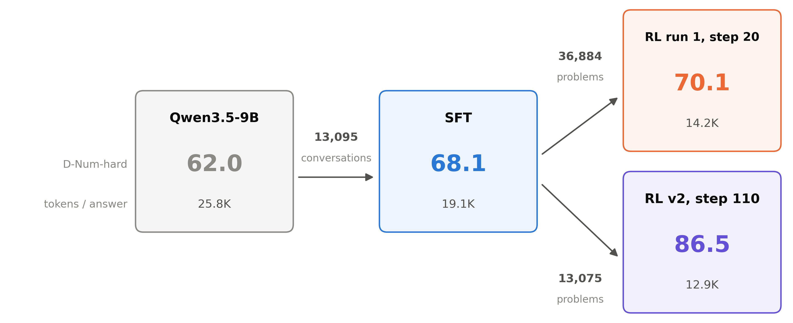</p>

<p align="center"><em>D-Num-hard accuracy (avg@8 over 160 held-out problems) and mean tokens per answer at each stage. The arrows carry the data used to train the next model; both RL runs start from the SFT checkpoint.</em></p>

## Summary

This project post-trains Qwen3.5-9B for quantitative seismology and scientific reasoning on a 24-GPU Slurm cluster (8 nodes × 3 A100-40GB GPUs). To keep evaluation honest, all primary test sets were constructed and frozen before any training run took place, and every model—including the unmodified base model—was re-evaluated from scratch under the exact same harness, prompt templates, and token budgets.

A quick orientation to the names used throughout this report:
- **Evaluation sets:** `D-Num` (300 textbook-level numerical seismology problems), `D-Num-hard` (160 harder, 3+ step numerical problems from unseen problem families), `D-Fresh` (60 brand-new problems drafted after the model's release cutoff), `D-Code` (150 seismology coding tasks graded in an isolated container), and `D-Report` (100 long-form scientific reports).
- **Training tasks:** `T1` (numeric problems checked by exact solvers), `T2` (Python coding tasks checked by hidden unit tests), `T3` (written reports graded by an LLM judge against rubrics), and `T4` (general instruction-following and math replay).
- **Metrics:** `avg@8` averages accuracy across 8 independent samples per problem; `pass@k` measures whether at least 1 of `k` samples is right.

Here is how the month unfolded across three training iterations and a heavy dose of systems engineering:

### 1. The baseline: strong on textbook problems, slow to finish
The standard recipe for building a specialist model starts from a capable open model, runs SFT to teach the desired style and format, and then uses RL to push accuracy higher. What surprised us at the start was how much textbook seismology Qwen3.5-9B already knew. On `D-Num`, it got 91.6% of individual samples right (`avg@8`), and on 99.7% of problems it solved the question at least once in 8 tries (`pass@8`). Almost all of its errors were execution glitches rather than bad physics: 4.6% of samples hit the 32K-token ceiling without finishing, 2.3% failed formatting rules (such as missing units or giving multiple answers), and only 1.5% actually computed a wrong numerical value.

Because accuracy at 32K tokens was already saturated, the real upside on `D-Num` was token efficiency: when capped at a much tighter 8K-token budget, only 13% of the base model's samples answered in time (§3.3). To measure genuine capability gains without hitting a ceiling, I created and froze a harder slice before any training results existed: D-Num-hard, covering 160 problems across 8 held-out problem families requiring 3 or more steps. On `D-Num-hard`, the base model scored 62.0%, and scored near 0% on two receiver-function families—on one of which 159 out of 160 samples ran all the way to the 32K token limit without emitting a final answer (§3.4).

### 2. Stage 1 (SFT): shorter answers and broad gains, at a slight cost to precision
We ran full-parameter SFT on 13,095 conversations (44.1M tokens), mostly consisting of step-by-step solutions written by a Qwen3.8-27B teacher and verified against programmatic solvers. SFT taught the 9B model the teacher's much crisper style and clean final-answer formatting. Average response length fell by more than a third, from 14.7K to 9.5K tokens, which unlocked higher scores on almost every benchmark where the base model had previously timed out:
- D-Num-hard: `+6.1` points (68.1%)
- D-Fresh: `+8.1` points (78.8%)
- D-Code: `+5.8` points (86.3%)
- GPQA Diamond: `+14.7` points (71.3%)
- LiveCodeBench: `+14.3` points (52.5%)

The one exception was `D-Num`, which dipped by 2.2 points (to 89.4%)—a genuine drop outside the 10-seed sampling noise floor (SD `0.46`). Tracing the errors showed why: SFT made the model finish more consistently, yet also slightly raised the rate of wrong numerical values (§5.4).

### 3. Stage 2 (RL run 1): 20 promising steps, followed by length collapse
Next, we trained multi-task GRPO on 36,884 problems across all four tasks (`T1`–`T4`). However, there was a subtle flaw in how the problem bank had been built: difficulty filtering had been run using the base model, not the SFT model. Because SFT had already made the policy substantially stronger, 87% of numeric (`T1`) and coding (`T2`) groups in the first 20 RL steps had all 8 sampled answers right—producing zero relative advantage and zero learning gradient (§6.3).

Even with scarce signal, the first 20 RL steps successfully taught the model to wrap up its reasoning cleanly: numeric accuracy on the 16K-capped dev set rose from 92.0% to 97.3%. After step 20, however, response lengths across every single task began shrinking rapidly. By step 52, numeric and code accuracies collapsed to zero, and a train/rollout log-probability mismatch alert automatically halted the run at step 56. At first I suspected `T4` (our general task) was rewarding short answers and dominating the sparse gradient, but inspecting per-step logs ruled that out—within each step, right and wrong answers were roughly the same length. The root cause of run 1's mid-run collapse remains open (§6.4).

Taking the best dev checkpoint (step 20) preserved SFT's overall accuracy while cutting output tokens by another 41% (down to 5.6K tokens per answer): `D-Num-hard` reached 70.1%, `D-Fresh` gained `+4.6`, and `GPQA` gained `+2.9`. Looking closely at `D-Num-hard` revealed an important trade-off: unfinished answers dropped from `361` to `211` (out of 1,280), while wrong numerical values jumped from `46` to `161` (§7.1). Safety refusals also slipped: even under a broad refusal detector, refusals on unsafe prompts fell by 7.7 points, concentrated on prompts phrased to look benign (§7.4).

### 4. Checking the judge and diagnosing why answers fail
Because `T3` reports relied on an LLM judge (`Gemma 4 26B-A4B`), we cross-checked the exact same report pairs using an independent second judge (GPT-6 Luna) that never touched training data or rewards. The two judges strongly disagreed: Gemma awarded SFT an 86% win rate over the base model, whereas Luna scored it 49% (a tie). At a passing threshold of 70, Gemma passed 100 of the 133 reports that Luna failed. Worse, 91% of Gemma's 5,765 rubric criteria packed multiple claims together into compound statements. Encouragingly, the gap between Gemma and Luna narrowed during RL, confirming that RL did not overfit to pleasing Gemma (§6.5).

To decide what to try next, I classified every model failure in detail and let every answer cut off at 32K tokens continue up to 64K tokens (§7.2, §7.3):
- Numerical failures are mostly execution problems (running out of room). When given 64K tokens to finish, the SFT model climbed to 83.9% on `D-Num-hard`—surpassing both RL step 20 (77.5%) and the base model (69.8%). The two receiver-function families remained a genuine knowledge gap for the base model, yet SFT solved roughly half of them once given enough tokens.
- Report failures are knowledge gaps. Reports lacked accurate scientific content, and neither SFT nor RL moved the needle under an independent judge.

The takeaway was clear: continued pretraining ("mid-training") was *not* the bottleneck for numerical problems, while for reports the cheapest next experiment was knowledge-dense SFT data (§8.2).

### 5. Auditing the data with frontier screening—and catching major bugs
Before starting the next round of runs (`RL v2` and a planned `SFT v2`), we had no domain experts available to audit our tests or synthetic data, so a frontier LLM performed an independent expert screening (§8.5):
- Frozen tests held up cleanly: Solving every `D-Num-hard` and `D-Fresh` problem blind (without seeing gold answers) confirmed all 220 numerical gold labels. Dropping the 7 test items flagged across the full suite did not alter a single conclusion.
- Caught a hidden magnitude-formula bug: Screening uncovered a generator bug that printed a wrong constant (`-2.09` instead of `+0.591` for amplitudes in mm) in the Hutton–Boore local-magnitude equation. Because every verifier plugged numbers into the formula printed in the prompt, 825 problems in RL run 1's bank passed verification with labels `2.681` units too low. Bank v2 removes them.
- Rejected paper-based SFT v2 data: To inject report knowledge cheaply, I had the teacher write SFT report answers from 3,000 open-access papers (§8.4). Screening 100 of the 3,262 generated rows recommended keeping only 2 and dropping 50: prompted to write specialist background, the teacher hallucinated earthquake and fault facts from memory (beyond what the paper excerpt contained), which Gemma's source-only check could not catch. I cancelled `SFT v2` and reassigned its queued 8-node job to run a second seed of `RL v2`.

### 6. Redesigning RL (`RL v2`): reliable, fast, and stable across 110 steps
At 32K tokens, RL run 1 step 20 only led SFT by `+1.9` points `[−0.7, +4.6]` on `D-Num-hard` and `+4.6` `[−0.8, +10.4]` on `D-Fresh`—both within sampling noise. Before running RL v2, I locked in a clear success test: beat SFT outside 95% paired bootstrap noise at 32K tokens on both `D-Num-hard` and `D-Fresh`.

To fix run 1's missing gradient and broken incentives, RL v2 made targeted changes (§8.3):
1. Re-graded the entire problem bank using the SFT model (keeping problems it solves only *sometimes*) and added 18 longer/harder problem families with their own hard dev split.
2. Scored cut-off answers as wrong (`0`) and removed the soft length penalty. Replaying run 1's first step showed that the soft length penalty pushed long *correct* answers shorter while ignoring unfinished ones.
3. Trained at 24K tokens (halving learning rate and dropping the noisy report task; a third seed planned at 16K was queued and cancelled before starting since seeds 1 and 2 agreed).

RL v2 succeeded cleanly. Seed 1 trained all 110 steps without collapsing and passed the pre-registered test decisively:
- On D-Num-hard at 32K: 86.5% (`+18.4` points over SFT `[+14.4, +22.4]`). Even at 64K—where run 1 had trailed SFT by `-6.4`—RL v2 stayed well ahead (`+6.3` `[+3.7, +9.1]`).
- On D-Fresh at 32K: 89.2% (`+10.4` over SFT `[+5.2, +16.2]`), and `+5.8` `[+1.7, +10.4]` at 64K.
- Why it worked: At 32K, unfinished `D-Num-hard` answers dropped from SFT's 28% down to 6%, while wrong values rose modestly from 4% to 7% (far better than run 1's 13%). Late in training, only 1 in 9 numeric groups still carried gradient—just as scarce as in run 1's opening steps—yet training remained rock solid, proving scarce signal alone did not cause run 1's collapse (§8.6).
- Broad improvements: `D-Num` hit 95.6% (the very first stage to beat the base model), `D-Code` 92.7%, `GPQA` 77.5%, and `LiveCodeBench` 63.2%, all with the shortest mean outputs of any stage (5,152 tokens). Refusals stayed around run 1's level (45.7%). Because cluster final evaluation waited in queue, seed 1's full suite ran on workstation A100s with the exact same harness; a second seed on the cluster reproduced the gain (`+15.2` on `D-Num-hard` and `+8.5` on `D-Fresh` at 32K), so seed 3 was cancelled before running.

### 7. The systems reality
Most of the calendar month went to systems and cluster debugging rather than pure ML. Our primary 8-node campaign job ran 71.9 hours: 28.7 hours executed planned evaluation and training, while 43.2 hours went to incidents, stalls, and holds (35.1 hours before SFT could even take step 1; §9.2). Fitting a 9B model with a 248,320-token vocabulary and MTP head onto 40 GB GPUs left almost zero margin—the final pipeline stage peaked at 40,366 MiB out of 40,437 MiB (§5.3). `RL v2` ran across two more 8-node jobs (43 and 22 hours), where cluster incidents lost seed 1's in-job final evaluation and seed 2's final ten steps (§9). Every single incident produced a regression test or guard; all 30 are documented in [PITFALLS.md](PITFALLS.md).

---

## Contents

1. [Results at a glance](#1-results-at-a-glance)
2. [Quick start](#2-quick-start)
3. [Define success before training](#3-define-success-before-training)
4. [Data: the RL bank and the SFT mix](#4-data-the-rl-bank-and-the-sft-mix)
5. [Stage 1: supervised fine-tuning](#5-stage-1-supervised-fine-tuning)
6. [Stage 2: multi-task RL](#6-stage-2-multi-task-rl)
7. [What the models get wrong](#7-what-the-models-get-wrong)
8. [What the tests and the results mean](#8-what-the-tests-and-the-results-mean)
9. [Systems: a month on a shared supercomputer](#9-systems-a-month-on-a-shared-supercomputer)
10. [What it found](#10-what-it-found)
11. [How this recipe scales](#11-how-this-recipe-scales)
12. [Failure atlas & pipeline pitfalls](#12-failure-atlas--pipeline-pitfalls)
13. [Repository layout](#13-repository-layout)
14. [Regenerate figures](#14-regenerate-figures)

Companion document: [PITFALLS.md](PITFALLS.md) catalogues the 30 failures encountered while building and running this pipeline, the false conclusions they nearly caused, and the tests that now catch them.

---

## 1. Results at a glance

### 1.1 Model, data and compute

| Component | Details |
|---|---|
| Base model | Qwen3.5-9B (released weights, thinking enabled at `medium` reasoning effort): 32 hybrid layers mixing Gated DeltaNet and full attention (`head_dim = 256`), a multi-token prediction (MTP) head, and a 248,320-token vocabulary |
| Teacher model | Qwen3.8-27B (FP8): writes SFT solutions and reports, and casts verification votes during problem validation |
| Reward judge | Gemma 4 26B-A4B (FP8) running on one A100: scores `T3` report rewards, casts verification votes, and runs data checks |
| Second judge | GPT-6 Luna (API), strictly evaluation-only: independent second judge for `D-Report`, RL judge-drift audits, and failure classification labels. Its outputs never enter training data |
| RL bank | Run 1: `36,884` problems kept out of `57,037` generated (§4): `25,588` numeric (`T1`), `2,495` code (`T2`), `1,193` report (`T3`), `7,608` general (`T4`). RL v2: `13,075` problems graded directly by the SFT policy: `7,433` numeric, `2,442` code, `3,200` general (§8.3) |
| SFT mix | `13,095` conversations (`44.1M` tokens): `8,776` verified numeric solutions, `1,301` verified tool-use coding trajectories, `554` judged reports, `2,464` general self-replay responses written by the base model (§4.5) |
| RL setup | Run 1: GRPO with group-mean advantages (`8` samples/prompt), `126` prompts/step, PPO clip `0.2 / 0.28`, no KL penalty, `16K`-token cap; `56` of `120` planned steps ran before halting, step `20` kept (§6). RL v2: same algorithm at half the learning rate, `24K`-token cap, cut-off answers counted wrong; two seeds trained `110` steps (seed 2 evaluated at step `100`, §8.3) |
| Hardware | 8 Slurm nodes × 3 NVIDIA A100-PCIe-40GB GPUs (no NVLink inside nodes; InfiniBand between nodes). Training uses `TP1 × PP8 × DP3`; rollout uses 24 single-GPU `vLLM` replicas colocated on those same GPUs |
| Compute used | `~1,290` node-hours from 2026-10-13 to 11-19: `575` node-hours in run 1's 71.9-hour 8-node job, and `521` node-hours in RL v2's two 8-node jobs (§9.2) |
| Evaluation suite | 5 domain test sets frozen before training (`770` items total), 5 public general benchmarks, and a `650`-prompt safety refusal suite; uncertainty reported with 95% bootstrap intervals and a 10-seed noise floor (§3) |

### 1.2 Results by stage

<p align="center">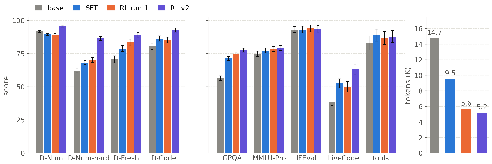</p>

| Benchmark (metric, items) | Base | SFT | RL run 1 (step 20) | RL v2 (seed 1, step 110) |
|---|---|---|---|---|
| D-Num (`avg@8`, 300) | 91.6 ± 1.0 | 89.4 ± 0.9 | 89.2 ± 1.0 | **95.6** ± 0.7 |
| D-Num-hard (`avg@8`, 160) | 62.0 ± 1.6 | 68.1 ± 1.4 | 70.1 ± 1.7 | **86.5** ± 1.5 |
| D-Fresh (`avg@8`, 60) | 70.6 ± 2.6 | 78.8 ± 2.3 | 83.3 ± 2.6 | **89.2** ± 1.9 |
| D-Code (`pass@1`, 150) | 80.5 ± 2.3 | 86.3 ± 2.0 | 85.2 ± 2.2 | **92.7** ± 1.5 |
| D-Report (win rate vs base, lower of 2 judges, 100) | 50 | 49.0 ± 9.0 | 49.0 ± 8.5 | 58.0 ± 9.0 |
| GPQA Diamond (198) | 56.6 ± 1.6 | 71.3 ± 1.6 | 74.2 ± 1.8 | **77.5** ± 1.5 |
| MMLU-Pro, 2K subset (change only) | 74.8 | 77.3 | 78.3 | 79.2 |
| IFEval (377) | 93.1 | 93.1 | 93.9 | 93.6 |
| LiveCodeBench after 2025-01 (70, change only) | 38.2 | 52.5 | 50.0 | **63.2** |
| Tool calling (188) | 83.0 | 88.8 | 86.7 | 87.8 |
| Refusal of should-refuse prompts, % (300) | **56.0** | 51.3 | 45.7 | 45.7 |
| Over-refusal of benign prompts, % (350) | 3.4 | 4.0 | 2.6 | 2.9 |
| Mean output tokens | 14,735 | 9,517 | 5,637 | **5,152** |

*Measurement protocol & sources:* Each `±` interval shows the 95% confidence interval of sampling noise. Every model—including the base model—was evaluated inside the exact same harness with identical prompts and decoding settings (§3.2); no scores are copied from external model cards. `D-Report` is plotted separately in §6.5. All numbers come from `docs/talk/data/run.json`. Because `RL v2` seed 1's cluster evaluation job was still waiting in the Slurm queue after training ended, we evaluated the checkpoint on workstation A100s using the exact same harness, prompts, settings, and graders (`docs/talk/data/rl_v2_seed1_local_1118.json`). For coding benchmarks on the workstation, tests ran inside a `bubblewrap` sandbox—verified first by re-grading SFT's cluster answers and recovering the exact cluster scores (`86.3` and `52.5`)—while GPT-6 Luna scored `D-Report` from the cluster login node.

How each stage moved the needle:
- SFT delivered the biggest initial leap—mostly by cutting verbosity. Average output length dropped by more than a third, boosting every benchmark where the base model had previously hit the 32K cap. Cut-off replies fell from `38%` to `17%` on GPQA Diamond and from `61%` to `29%` on LiveCodeBench (`docs/talk/data/failure_types.json`, `cut_off_32k`). Only `D-Num` dropped (`−2.2`), because SFT emitted slightly more wrong numerical values (§5.4).
- RL run 1 (step 20) bought speed without reliability. Mean tokens per answer fell by another `41%`, while most scores held steady. Only `D-Fresh` (`+4.6`) and `GPQA` (`+2.9`) moved beyond sampling noise; `D-Num-hard` (`+2.0`, `[−0.8, +4.8]` paired) stayed inside the noise band. Of the eight ship gates set before RL, only two passed (general capability and compute cost). Under our independent second judge, `D-Report` did not improve, while safety refusals dropped genuinely (§7.4).
- RL v2 finally broke through on hard reasoning. Seed 1 hit 86.5% on `D-Num-hard`—a paired gain of +18.4 points `[+14.4, +22.4]` over SFT—and 89.2% on `D-Fresh` (`+10.4` `[+5.2, +16.2]`), clearing the pre-registered test easily (§8.3). Crucially, it got there by *finishing* its reasoning: cut-offs on `D-Num-hard` fell from SFT's `28%` to just `6%`. The gains generalized across the entire table: `D-Num` rose to 95.6% (the first model to beat the base model's `91.6%`), `D-Code` hit 92.7%, `GPQA` 77.5%, and `LiveCodeBench` 63.2%, all with the shortest mean outputs (`5,152` tokens). Two things stayed flat: refusals remained at `45.7%` (no safety data was included in RL v2), and `D-Report` under the second judge (`58.0%`) remained within sampling noise of SFT's `49.0%`.
- Seed 2 replicated RL v2 cleanly. Evaluated at step 100 (its last saved checkpoint, §8.3), seed 2 scored 83.4 on `D-Num-hard`, 87.3 on `D-Fresh`, 95.0 on `D-Num`, 90.8 on `D-Code`, 77.9 on `GPQA`, 56.1 on `LiveCodeBench`, 62.5 on `D-Report`, and 49.0% refusals (`docs/talk/data/run.json`). Note that seed 2's code scores (re-graded on the workstation because the cluster sandbox failed startup) likely *underestimate* the recipe: during seed 2's training, a broken sandbox on 1 of the 8 nodes quietly scored roughly 1 in 8 code completions as `0` ([PITFALLS](PITFALLS.md) C8). Across the eight pre-defined ship gates (§3.5), RL v2's two seeds pass five and six respectively: `D-Code`, `D-Fresh`, general capability, cost, and reproducibility (`D-Num` seeds 1 and 2 are 0.7 points apart, well inside the 2-point limit), plus `D-Report` for seed 2 (`docs/talk/data/ship_gates_rl_v2_1119.json`). Both seeds miss the `D-Num` gate (`base + 8 = 99.6%`, unreachable by construction) and safety.

### 1.3 Where the samples go

<p align="center">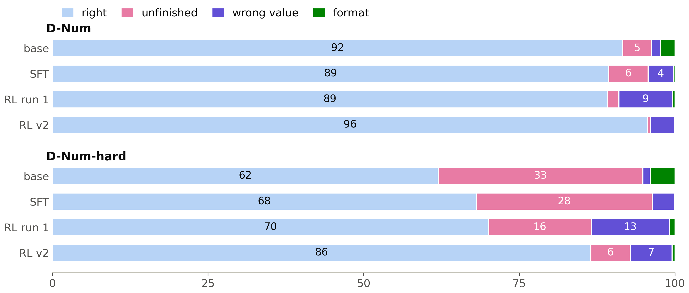</p>

To see *why* accuracy changes from stage to stage, this chart breaks each model's samples into four mutually exclusive outcomes (%):
1. **Right:** final boxed answer matches the solver value and unit.
2. **Unfinished:** reasoning never closed within the 32K-token budget.
3. **Wrong value:** reasoning finished, but the final answer is numerically wrong.
4. **Format failure:** multiple final answers, no extracted answer, or a missing unit (our strict grader inspects only the final answer).

Looking at those four buckets reveals the core story of this project: **post-training here mostly changed *when* the model stops thinking.**
- On `D-Num`, the base model's rare mistakes are mostly unfinished answers (`4.6%`), whereas SFT and RL run 1 fail mostly through wrong values.
- On `D-Num-hard`, that shift is dramatic: unfinished answers fall steadily from 33% (base) to 28% (SFT) to 16% (RL run 1), while wrong values climb from 1% to 4% to 13%.
- RL v2 breaks that trade-off: unfinished answers drop all the way to 6%, yet wrong values stay contained at 7%. Run 1 stopped thinking prematurely and guessed wrong; RL v2 stops thinking when it has solved the problem (§8.6). Section 7 investigates what kinds of errors those wrong values represent.

### 1.4 One question, every stage

Summary tables tell us *how often* each model gets a problem right, but not *what the reasoning looks like*. To illustrate the behavioural shift concretely without cherry-picking, I fixed a single test case by rule before looking at any outputs: the very first problem drawn with seed `20261118` from `three_layer_head_wave_time` (a public training family). It asks for the head-wave travel time through two flat horizontal layers over a half-space—a standard four-step hand calculation for a seismology student. While the family is in training, this specific parameter draw is unseen and appears in no test set.

Each model answered this exact prompt 16 times under standard evaluation settings (`medium` effort, temperature `1.0`, top-p `1.0`, 32K cap), and our numeric grader scored all 64 completions. The figure below shows sample 0 from each stage (start of reasoning, end of reasoning, and final output) alongside the 16-sample summary counts.

<p align="center">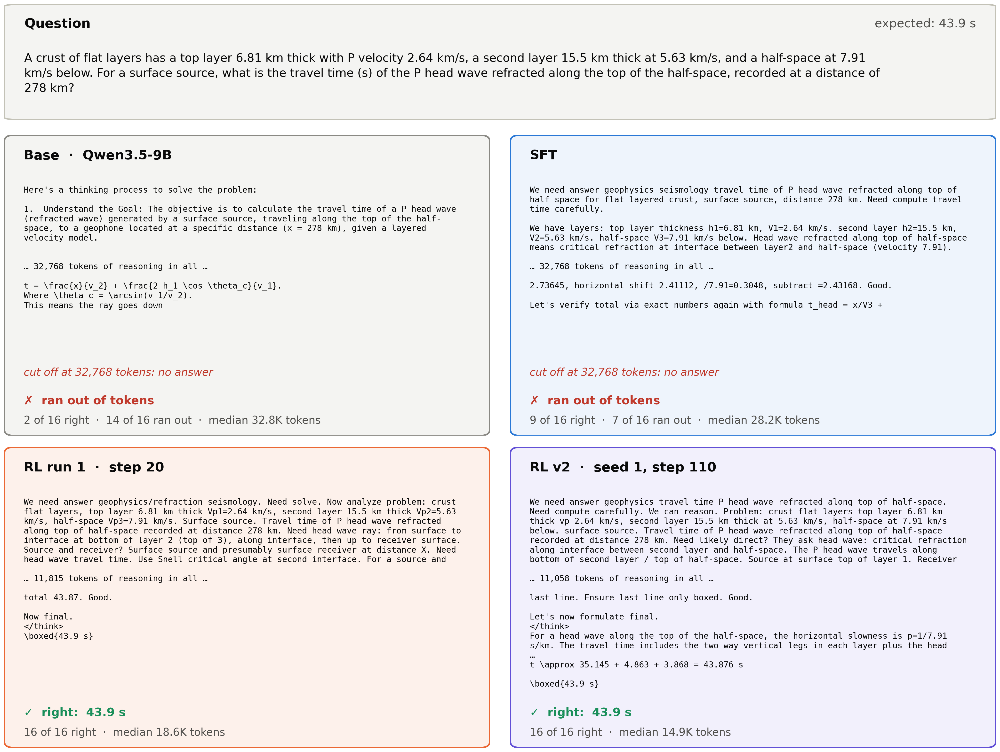</p>

Every model sets up the physics identically in its opening paragraphs—restating the layer thicknesses and velocities and tracking the critically refracted ray along the half-space interface. What separates them is whether they know when to stop:
- **Base:** still deriving and re-deriving equations when the 32K cap cuts it off. 14 of 16 answers time out unfinished; its 2 correct completions took 21K and 23K tokens.
- **SFT:** writes in the teacher's much tighter style and gets 9 of 16 right, yet sample 0 gets cut off mid-way through *double-checking* its own arithmetic—and 7 of 16 still hit the 32K cap.
- **RL run 1 & RL v2:** both finish all 16 attempts and get 16 of 16 right, with RL v2 using fewer tokens than run 1 (median `14.9K` vs `18.6K`). Across all 64 responses, not a single model emitted a wrong numerical value: every failure on this question was purely a failure to stop in time.

One question is only an illustration, not a benchmark, yet it mirrors exactly what §1.3 and §7.1 measure across all 160 problems in `D-Num-hard`. Source: `docs/talk/data/stage_example.json`, generated by `scripts/talk/stage_example.py`.

### 1.5 Against larger models, scored the same way

<p align="center">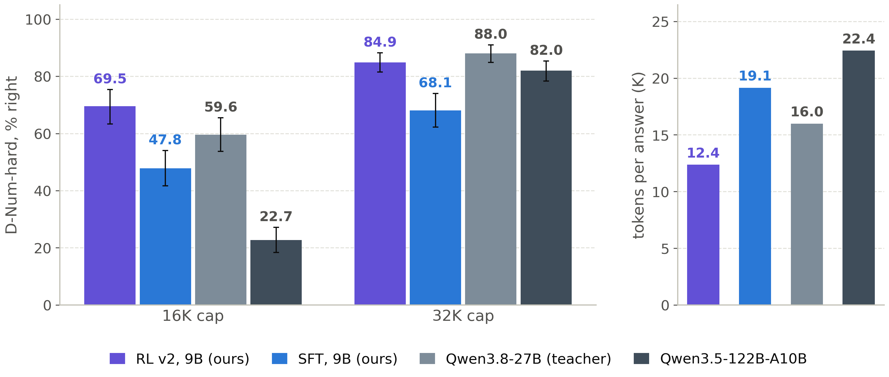</p>

How does our post-trained 9B model stack up against much larger models evaluated under identical conditions? We ran `D-Num-hard` on two larger Qwen models in 4-bit weights on workstation A100s using the exact same harness, prompts, `medium` effort setting, sampling (`8` samples/problem at temperature `1.0`), and grader:
- Qwen3.8-27B, the teacher model that originally generated our SFT solutions (`3×` parameters).
- Qwen3.5-122B-A10B, a Mixture-of-Experts model from the same generation (`13×` total parameters, `10B` active per token).

Each response is scored under both a 16K and a 32K token cap—the exact test RL v2 passed against SFT (§8.3). Error bars show 95% bootstrap intervals across the 160 problems; tokens per answer are measured at 32K. Data: `docs/talk/data/large_models_1120.json`; script: `scripts/talk/large_models.py`.

| Model | Parameters | Right at 16K | Right at 32K | Unfinished at 32K | Tokens per answer (32K) |
|---|---|---|---|---|---|
| **RL v2 (this model)** | **9B** | **69.5%** | 84.9% | 7.4% | **12.4K** |
| SFT | 9B | 47.8% | 68.1% | 28.2% | 19.1K |
| Qwen3.5-9B (base) | 9B | 13.0% | 62.0% | 32.9% | 25.8K |
| Qwen3.8-27B (teacher) | 27B | 59.6% | **88.0%** | 10.2% | 16.0K |
| Qwen3.5-122B-A10B | 122B (10B active) | 22.7% | 82.0% | 14.8% | 22.4K |

**Closing the entire gap from 9B base past 122B:**
The base 9B model generates the longest traces of any model (`25.8K` tokens on average at the 32K cap), leaving 87% of its answers unfinished under a 16K budget (`13.0%` right at 16K, `62.0%` at 32K). At 32K, the 122B model leads the 9B base by `+20.0` points `[+16.0, +24.1]`. Post-training takes the 9B model across that entire span and slightly further: RL v2 beats its base starting point by +56.4 points `[+50.7, +62.0]` at 16K and +23.0 points `[+19.4, +26.7]` at 32K (SFT alone already accounts for `+34.8` at 16K and `+6.2` at 32K).

Where the post-trained 9B matches or beats models up to 13× its size:
- **Under a 16K budget:** RL v2 achieves 69.5% accuracy, beating the 27B teacher (59.6%, `+9.8` points `[+6.1, +13.6]`) and far ahead of the 122B (22.7%, `+46.7` points `[+41.3, +52.1]`). Both larger models are still mid-derivation when 16K expires (`40%` unfinished for 27B, `77%` for 122B).
- **Against 122B at 32K:** RL v2 scores 84.9% across seeds vs 82.0% (`+3.0` points `[+0.1, +5.8]`, just above noise; seed 1 alone is `+4.5` `[+1.3, +7.7]`, seed 2 alone is `+1.4` `[−1.7, +4.4]`).
- **Compute per answer:** At 32K, RL v2 averages 12.4K tokens per answer versus 16.0K for 27B and 22.4K for 122B. With 9B dense parameters, RL v2 uses roughly one-quarter the FLOPs per answer of the 27B teacher and half those of the 122B-A10B model (10B active).

**Where the 27B teacher still leads:** Given a generous 32K window to finish, the 27B teacher leads RL v2 by 3.1 points `[−5.2, −1.1]` (`88.0%` vs `84.9%`). Crucially, the two models fail differently: the 27B leaves `10.2%` unfinished and makes only `1.2%` wrong-value errors, whereas RL v2 finishes more often (`7.4%` unfinished) yet emits 7.3% wrong values. Giving RL v2 even more tokens wouldn't close that 3.1-point gap—its `6.1`-point excess of wrong values over the teacher is larger than the entire gap. Reducing wrong formulas/values is the next frontier.

*Caveats to keep in mind:*
- Both larger models ran in 4-bit quantized weights (for reference, the 27B NVFP4 model card reports GPQA `88.0` vs `88.9` in BF16).
- All differences are paired over one 160-problem test set (the table's raw CIs are unpaired).
- 64K is intentionally omitted here because RL v2 trained with a 24K cap and was never asked to reason out to 64K.
- The 27B wrote the SFT solutions whose style RL v2 inherited, and every model ran with the 9B's prompts and `medium` effort rather than per-model tuned prompts.

---

## 2. Quick start

```bash
# --- Released models: serve the final model from Hugging Face Hub (see its card for the prompt) ---
vllm serve jiazhe868/Qwen3.5-9B-Seis-RL-v2 --max-model-len 40960 --reasoning-parser qwen3 --language-model-only

# --- Local CPU checks: install, unit tests, adversarial graders, cluster memory planner ---
pip install -e . -r requirements/core.txt
make test            # CPU unit tests (no GPU needed)
make graders         # adversarial grader suite (must pass 100%)
make plan-cluster    # memory / FLOPs / communication budget for 8 nodes × 3 A100-40GB

# --- Slurm cluster setup: environment, models, node isolation checks (see scripts/slurm/README.md) ---
bash scripts/slurm/setup_login.sh conda
sbatch -A <allocation> scripts/slurm/build_env.slurm
bash scripts/slurm/setup_login.sh models && bash scripts/slurm/setup_login.sh sandbox
sbatch -A <allocation> scripts/slurm/check_node.slurm      # must print SANDBOX ISOLATED
sbatch -A <allocation> scripts/slurm/parity.slurm          # vLLM vs Megatron parity (eval and train forwards)

# --- Data generation: serve teacher, judge, and base, then generate → build bank → SFT mix ---
sbatch -A <allocation> scripts/slurm/data.slurm gen
sbatch -A <allocation> scripts/slurm/data.slurm bank
sbatch -A <allocation> scripts/slurm/data.slurm sft

# --- Run 1 (single 8-node job): baseline eval → SFT → SFT eval → RL-entry gate → RL → final eval ---
sbatch -A <allocation> scripts/slurm/campaign.slurm

# --- RL v2 (§8.3): three independent 8-node jobs (one per seed) ---
scripts/slurm/submit_window.sh rl-build-queue          # seed 1: build bank v2 if missing → 24K test → RL v2 → final eval
scripts/slurm/submit_window.sh sft-v2-queue            # seed 2: same steps (reusing the slot originally reserved for SFT v2, §8.4)
scripts/slurm/submit_window.sh rl-seed-queue 3         # seed 3: same steps

# --- Regenerate every figure in this README from docs/talk/data/ ---
python scripts/readme_figures.py
```

The complete step-by-step operational sequence—along with expected wall-clock times and SU costs—is documented in [scripts/slurm/README.md](scripts/slurm/README.md). Deep-dive design documents for each subsystem live in `docs/`: [data_pipeline.md](docs/data_pipeline.md), [evaluation.md](docs/evaluation.md), [rl_algorithm.md](docs/rl_algorithm.md), [rewards_and_hacking.md](docs/rewards_and_hacking.md), [systems.md](docs/systems.md), and [verl_integration.md](docs/verl_integration.md).

---

## 3. Define success before training

### 3.1 Why the tests come first

A common failure mode in post-training projects is running training first and searching afterwards for a test set that shows improvement. Since every claim in this repository rests on held-out measurements, the evaluation suite was designed, built, and frozen before any training data or model checkpoints existed.

On 2026-10-22/23, we built and locked down our primary benchmarks using content hashes and planted canary strings so that downstream decontamination could rigorously verify zero overlap with training data. The sole addition afterwards was D-Num-hard, frozen on 2026-10-27 before any SFT training had produced results (§3.4). Training never touches any test question, problem family, or rubric: in code, numeric generators are strictly partitioned via `split="heldout"` (`src/dpt/data/gen/families.py`; held-out definitions remain unpublished, see [Data & licensing](#data--licensing)), and `tests/eval/test_independence.py` enforces that the evaluation package never imports reward code.

| Test set | Items | What it measures | Gold reference | Metric |
|---|---|---|---|---|
| D-Num | 300 | 1- to 3-step numerical seismology problems from 10 held-out solver families | Exact programmatic solver | `avg@8` |
| D-Num-hard | 160 | 8 held-out families requiring ≥ 3 reasoning steps (20 problems per family) | Programmatic solver cross-checked via independent calculation | `avg@8` |
| D-Fresh | 60 | Newly drafted problems written after model release (guaranteed unseen in pretraining) | Drafted `solve()` script reproducing the gold value + model consistency votes | `avg@8` |
| D-Code | 150 | Domain seismology programming tasks | Hidden unit tests executed in an Apptainer/bubblewrap sandbox | `pass@1` over 4 samples |
| D-Report | 100 | Long-form written scientific reports, each graded on 5 weighted criteria and 5 common errors | None: pairwise win rate vs base model across two judges in both orders | Win rate |
| General | 5 benchmarks | GPQA Diamond, MMLU-Pro (2K subset), IFEval, LiveCodeBench (after 2025-01), tool calling | Public ground truth | Benchmark-native metric |
| Refusal | 650 | 300 should-refuse prompts (JailbreakBench, XSTest unsafe) + 350 benign control prompts | — | Refusal rate (%) |

We also kept two perturbed twins of the numeric test sets (280 problems with modified numerical inputs) purely as memorization/contamination probes. Because no human domain experts were available within our one-month timeline, GPT-6 Luna drafted `D-Fresh` and `D-Report` while Gemma 4 26B-A4B audited them. Similarly, our human blind-review tool (`dpt.eval.blind_review`) found no human reviewer, so a frontier LLM later performed full expert screening on the test items and judged the blind pairs (§8.5). Every reference in this project is therefore programmatic or model-verified, with no human-labelled ground truth (§8.1).

### 3.2 The decoding and scoring contract

To make every comparison apples-to-apples, every model—the base model included—was run from scratch through one unified evaluation harness (`src/dpt/eval/harness.py`) using identical rendered prompts, `temperature = 1.0`, `top-p = 1.0`, `reasoning_effort = "medium"`, a `32K` output token cap, and deterministic per-item seeds. Only the final answer after `</think>` is graded. Any completion whose reasoning fails to close within 32K tokens automatically scores `0`, and we report the truncation rate alongside accuracy for every benchmark. The evaluation numeric grader (`dpt.eval.graders.numeric`) was implemented independently of the `T1` RL reward and enforces strict unit equivalence; across identical answers, the two agree `99.3%–100%` of the time (§6.5).

### 3.3 The base model nearly saturates D-Num

<p align="center"></p>

<p align="center"><em>Left and middle: fraction of samples answered correctly within a given token budget (evaluated as if the generation cap were truncated to that budget; all runs per model pooled via <code>dpt.eval.budget</code>; dotted line marks RL run 1's 16K cap). Right: majority-vote accuracy on D-Num across k samples (<code>scripts/talk/research_1110.py</code>).</em></p>

On `D-Num`, the unmodified base Qwen3.5-9B model scores 91.6% on a single draw (`avg@8`), solves 99.7% of problems at least once in 8 tries, and reaches 99.6% under an 8-sample majority vote. In terms of raw accuracy at 32K tokens, `D-Num` is already saturated before post-training begins.

Where the base model struggles is efficiency: a single correct answer on these 1- to 3-step textbook problems takes 17.7K output tokens on average. If you cap its generation budget at `8K` tokens, only 13.4% of base samples finish correctly; at `16K`, 55.4% do. SFT and RL shift the entire accuracy-vs-budget curve sharply leftward—at `8K` tokens, SFT is already right on 60.0% of samples, and RL run 1 reaches 74.6%.

**Key lesson:** When starting from a strong reasoning base model, the first thing post-training buys is token efficiency, not raw ceiling accuracy. On `D-Num`, accuracy at a tight token budget is far more informative than accuracy at 32K.

### 3.4 A harder slice, frozen before any result

A saturated test cannot tell whether training actually expands capability. Therefore, on 2026-10-27—prior to obtaining any SFT results—I added and froze D-Num-hard: 160 problems across 8 held-out families requiring three or more steps (20 problems each), chosen strictly by family complexity without inspecting any model outputs:
- Receiver-function Moho depth (from Ps delay)
- Receiver-function $`H\text{--}\kappa`$ stacking ($`V_p/V_s`$)
- Seismic rays in a linear velocity gradient
- Moment magnitude ($`M_w`$) from a spectral plateau
- Epicentral distance from a ground-motion prediction equation
- Rupture length from azimuthal directivity
- Static Coulomb stress change

Every family solver was independently verified using a second numerical implementation (forward synthetic models, numerical quadrature for ray integrals, and full tensor rotations for Coulomb stress).

On `D-Num-hard`, the base model scores 62.0%, leaves roughly one-third of all samples unfinished at 32K tokens, and averages 41.6K tokens per correct answer (counting wasted tokens across failed attempts). Most notably, the two receiver-function families sit at 0%: on $`H\text{--}\kappa`$ stacking, 159 out of 160 base samples hit the 32K ceiling without finishing. On Moho depth, the handful of completions that did finish subtracted P and S ray-path travel times—an incorrect approximation that overestimates Moho depth by `6%–19%`—instead of using the true plane-wave vertical delay time $`H\left(\sqrt{1/v_s^2-p^2}-\sqrt{1/v_p^2-p^2}\right)`$.

### 3.5 Noise floor and gates

To avoid over-interpreting random sampling fluctuations, we evaluated the base model across 10 independent seeds on `D-Num`. Scores spanned `91.1–92.5` (standard deviation `0.46`; mean pairwise difference `0.52`, maximum `1.42`; `docs/talk/data/run.json`, `eval.noise_floor`). Any change smaller than roughly 1.4 points on `D-Num` is indistinguishable from sampling noise.

Two sets of pre-registered gates governed progression throughout the campaign:
1. **The RL-entry gate (checked after SFT):** Originally copied from a 27B plan, a strict check requiring `SFT > base` on `D-Num` would have been decided by coin-flip noise near 92%, and a failed gate automatically killed the 8-node Slurm allocation (costing ~3 days in queue). On 2026-10-27—before any SFT results existed—I updated the gate to be noise-aware: `D-Num` could trail the base by up to the combined 95% interval (`~1.4` points), `D-Code` and `D-Report` had to beat base, and any failure would hold the allocation for human approval rather than exiting. SFT missed the gate (`D-Num −2.2`; `D-Report` tied under the second judge), and we proceeded with RL as pre-authorized.
2. **Eight ship gates (checked after RL):** Inherited directly from the reference plan's thresholds. Run 1 step 20 passed two: general capability (`+7.5`, floor `−1.0`) and cost (`0.38×` base tokens, ceiling `1.3×`). It failed `D-Num` because the inherited rule required `base + 8` (`99.6%`)—mathematically unreachable on a saturated benchmark. Because no new threshold was substituted before RL v2 finished, RL v2 was evaluated against the exact same bar: its two seeds pass five and six of the eight gates respectively, missing only `D-Num` (`95.6` and `95.0`) and safety refusals (§1.2).

*Evaluation caveats, stated plainly:*
- `D-Num-hard` rests on 160 problems across 8 families, and two receiver-function families drive much of the spread (§8.1).
- `D-Fresh` contains 60 problems, entirely drafted and verified by models.
- All headline scores are measured at one reasoning effort (`medium`) and one 32K cap, meaning accuracy and thinking efficiency are intertwined inside every raw score.

```bash
python -m dpt.eval.harness --model-name base_medium --sets d_num --seed 0 --endpoint http://localhost:8000 \
    --out eval_results/base_medium           # evaluate one set and one seed; repeat for seeds 0-9 to measure noise floor
python -m dpt.eval.budget --eval-root eval_results --out talk/budget      # compute accuracy across token budgets
```

---

## 4. Data: the RL bank and the SFT mix

### 4.1 Why generated problems need four filters

Synthetically generated problems—whether built from programmatic templates or written by an LLM teacher—fail in subtle ways that never show up in training loss curves: a buggy solver label trains the model to output wrong physics with high confidence; near-duplicate prompts overweight a single topic; leaked test items turn benchmarks into memorization tests; and problems the model already solves 100% of the time generate zero GRPO gradient.

To catch every one of those failure modes, every candidate problem passes sequentially through four automated filters (`src/dpt/data/pipeline.py`, `configs/data/pipeline.yaml`):

<p align="center">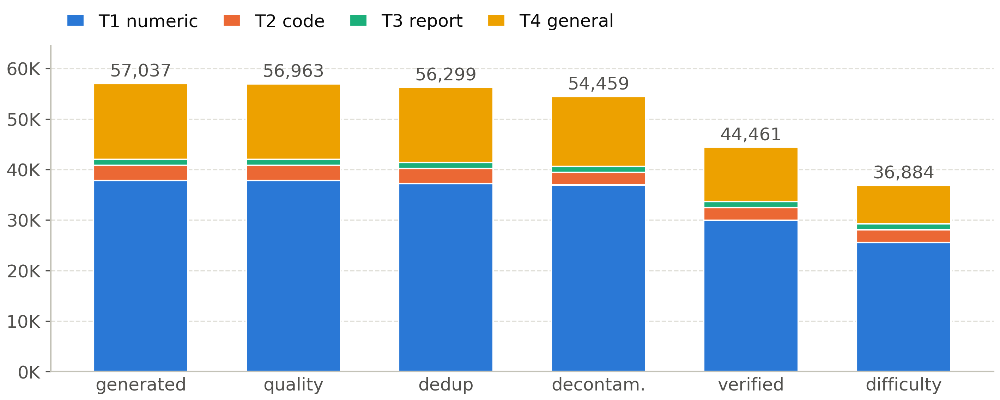</p>

| Pipeline stage | Removed | What the filter catches |
|---|---|---|
| Quality | 74 | Degenerate text, repeated 4-grams, or abnormally short prompts |
| Deduplication | 664 | Near-duplicate problem text or identical solver instances (MinHash) |
| Decontamination | 1,840 | `n-gram` / MinHash overlaps with any eval set (`1,399`), plus semantic paraphrases confirmed by the judge (`441`) |
| Verification | 9,998 | Whole templates rejected (`9,842`), verifying models undecided (`140`), or solver vs models disagree (`16`) |
| Difficulty | 7,577 | Whole templates solved `8/8` by the base model (`6,634`), plus individual `8/8` problems (`943`) |

Out of 57,037 generated problems, 36,884 (`65%`) survived into bank v1: `36,668` training problems, `190` RL dev problems, and `26` extra-hard `0/8` problems reserved outside main training (`docs/talk/data/run.json`, `pipeline`).

### 4.2 Verification: a solver and two models must agree

A parametric template's labels are only as trustworthy as its solver code. For each of the 102 problem templates and external sources, the Qwen3.8-27B teacher solved 20 sampled instances (4 samples each), and Gemma adjudicated any disagreements. Because a single flawed solver can poison hundreds of problems at once, any template rejected by the verifying models is dropped as a whole. Twenty sources/templates were dropped completely (`19` numeric templates plus `openai/gsm8k`); across kept templates, the median retention rate was `95%`.

During our very first full verification run, all 102 templates failed at once—a 100% rejection caused by two pipeline wiring bugs invisible in unit tests with mocks: the solver registry module had never been imported (triggering `solver_error: KeyError`), and the judge server had been launched without a reasoning parser (omitting `</think>`, leaving every parsed vote empty). Both issues now have permanent tests, and re-verifying from cached replies took about one minute. Always run every stage end-to-end on real data before trusting it at scale ([PITFALLS](PITFALLS.md) A1).

### 4.3 Difficulty: drop what the model already solves

GRPO computes relative advantages within a group of 8 samples for each prompt (§6.3). If all 8 samples receive the exact same reward (all `1` or all `0`), every advantage is zero—spending compute with zero gradient signal.

To build bank v1, the base model answered 1,780 audited problems 8 times each on single A100s over roughly two days. Among 1,620 audited `T1` numeric problems, 828 (`51%`) were already solved `8/8`. Templates where ≥90% of audited problems were `8/8` were dropped wholesale (11 templates, `6,634` problems), along with `943` individual `8/8` items.

**The flaw in bank v1:** filtering against the *base* model left behind problems that looked "medium difficulty" to the base model, yet were effortlessly solved `8/8` once the model underwent SFT. Because RL starts from the SFT checkpoint—not the base checkpoint—most of bank v1 carried no gradient when run 1 began (§6.3). That directly drove RL v2's decision to re-grade the entire bank with the SFT policy (§8.3).

### 4.4 Decontamination

Any test item leaking into training invalidates held-out evaluation. Every training problem and SFT conversation was checked against all domain and public benchmarks via three independent layers:
1. **Lexical overlap:** `n-gram` and MinHash similarity.
2. **Semantic paraphrase matching:** embedding similarity followed by LLM judge confirmation (the judge filtered out `4,991` false-positive semantic matches while confirming `441` real paraphrases).
3. **Exact answer matching:** zero collisions (`0` matches).

Decontamination removed `1,840` of `56,299` RL candidates (`3.3%`) and `306` of `13,401` SFT conversations (`2.3%`). Canary strings planted in every frozen benchmark appeared `0` times in the cleaned training sets (`docs/contamination.md`).

### 4.5 The SFT mix

| SFT subset | Conversations | Source & filtering |
|---|---|---|
| Numeric reasoning (`T1`) | 8,776 | Teacher solutions whose final answer passed the numeric verifier |
| Tool-use trajectories (`T2`) | 1,301 | Coding tasks solved via Python tool calls, kept only if code ran cleanly and passed hidden tests |
| Written reports (`T3`) | 554 | Teacher reports sampled multiple times and filtered via rejection sampling by Gemma |
| General self-replay (`T4`) | 2,464 | The base model's own responses to general instruction prompts, included to prevent catastrophic forgetting |

Starting from `17,638` raw trajectories, dropping unverified items (`1,742`), excluding RL dev prompts (`162`), and applying quality and decontamination filters left 13,095 conversations containing 44.1M tokens. Sequence lengths vary widely: the longest conversation is 20,841 tokens, and the `28%` of rows longer than 4,096 tokens account for `62%` of total tokens. Naive padding to max length would waste `33%` of compute; packing rows into four length buckets (`4K`, `8K`, `16K`, `32K`) cut padding waste down to 1.9%.

Note one critical subtlety: the `554` SFT reports were selected via rejection sampling with Gemma—the exact same model used later as `D-Report`'s primary judge and `T3`'s RL reward model. That shared taste explains the sharp split between Gemma and GPT-6 Luna in §6.5.

---

## 5. Stage 1: supervised fine-tuning

### 5.1 Why SFT before RL

RL can only reinforce behaviours that the policy already executes at least *some* of the time. On median `D-Num` questions, the base model thinks for 15K tokens before answering, and 34% of its rollouts on the RL bank exceed `16K` tokens. Since RL run 1 enforces a `16K`-token response cap (§6.1), starting RL directly from the base model would leave roughly one-third of all samples truncated with zero reward signal.

We therefore run SFT first on teacher-written solutions to teach a crisp, economical reasoning style and clean final-answer formatting—giving RL a clean starting point:

```
Base:   long meandering reasoning, answers cut off at the token cap, multiple candidate answers in one reply
SFT:    teacher's compact solutions, ending cleanly in a single final answer with its unit
RL:     starts from completions that actually finish, and reinforces the accurate ones
```

### 5.2 The recipe

We ran full-parameter SFT using `verl`'s Megatron backend (`configs/sft/sft_9b.yaml`, inheriting defaults from `sft_27b.yaml`):
- **Schedule:** `2` epochs (`206` optimizer steps, `126` conversations per batch), peak learning rate `8e-6` with `50` warmup steps and cosine decay to `8e-7`, weight decay `0.1`.
- **Multi-Token Prediction (MTP):** the MTP head trained jointly at loss weight `0.1` so speculative drafting remained calibrated at inference.
- **Parallel layout (`TP1 × PP8 × DP3`):** each of the 8 pipeline stages occupies one Slurm node, while the 3 GPUs inside that node act as data-parallel replicas (`DP3`). Because these A100-PCIe nodes have no NVLink, keeping data parallelism intra-node prevents heavy gradient `all-reduce` traffic from crossing InfiniBand.

Once Triton/CUDA compilation finished, steps took ~37 seconds each—completing all `206` steps in 2.3 hours (main loss `0.79 → 0.46`, MTP loss `0.87 → 0.47`).

Along the way, SFT uncovered two silent configuration overrides in `verl 0.9.1`:
1. `verl` did not forward `optim.betas` to Megatron's optimizer, so SFT would have trained with Adam `β2 = 0.999` instead of our specified `0.95` (now set directly on Megatron).
2. `verl` triggers validation whenever `test_freq > 0` even when `val_files: null`, crashing our first run at step 50; setting `test_freq: -1` resolved this ([PITFALLS](PITFALLS.md) C3).

### 5.3 Fitting a 9B model on 40 GB GPUs

<p align="center">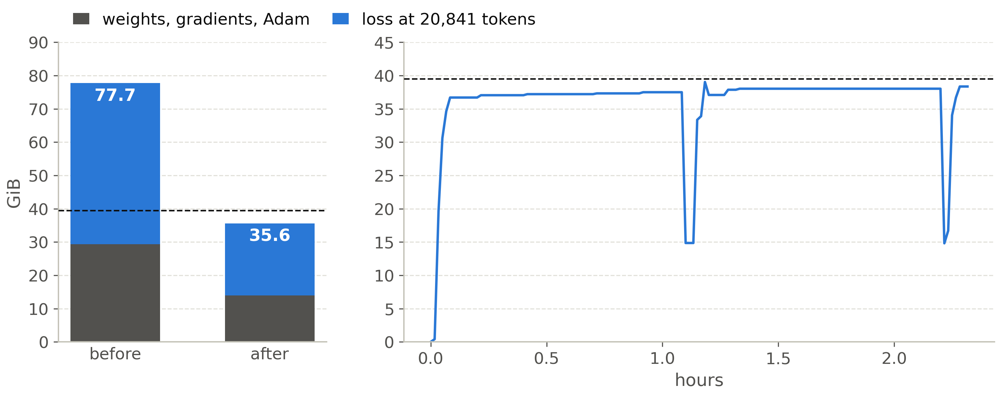</p>

<p align="center"><em>Left: memory footprint of the final pipeline stage on the longest SFT conversation (20,841 tokens) before and after our four memory fixes; dashed line marks the GPU's 39.5 GiB usable limit. Right: real-time GPU memory telemetry across the 2.3-hour SFT run (<code>docs/talk/data/last_stage_memory.json</code>, <code>rl.json</code>).</em></p>

Under `TP1` (no tensor parallelism), the eighth and final pipeline stage (0-indexed stage 7) holds the entire `248,320`-word unsharded output projection and the MTP head, which keeps its own `1.0B`-parameter copy of the vocabulary embedding. That totals 3.14B parameters—consuming 29.3 GiB for weights, gradients, and Adam optimizer states *before allocating a single activation*. Worse, both the main loss and MTP loss upcast the full vocabulary logits to FP32 (`2.38 MiB/token`), leaving room for only ~3.5K-token sequences—far short of the `28%` of SFT rows exceeding 4K tokens. Our initial analytical budget missed both the MTP embedding copy and the FP32 logits because the original 27B plan used `TP4` to shard the vocabulary four ways.

Rather than altering the training data, loss math, or optimizer precision, we kept the math identical and reorganized *where* memory lives:

| Memory fix | Mechanism | Impact on stage 7 |
|---|---|---|
| CPU-offloaded Adam | Megatron's hybrid optimizer moves FP32 master weights and Adam states to host RAM while keeping full FP32 math | `−11.7 GiB` |
| Transformer Engine cross-entropy | Computes FP32 cross-entropy directly from BF16 logits for both main and MTP losses, eliminating the FP32 logits copy (fix 2 in `dpt.verl_ext.patches`) | `2.38 → 0.94 MiB/token` |
| Keep BF16 logits out of `Float16Module` | Prevents Megatron's `Float16Module` from upcasting stage-7 logits to FP32 during `verl`'s LM-head forward (fix 3; Megatron's native trainer returns a scalar loss there, whereas `verl` returns logits) | `−18.8 GiB` at the longest row |
| Uneven pipeline split | Places only `1` decoder layer on the first and last pipeline stages, and `5` decoder layers on each middle stage | Offloads layer weights/activations away from the output head |

GPU unit tests verified that these changes preserve numerics within `1e-4` nats/token and gradients within `1%` relative L2 norm compared to an FP32 reference. An 8-node pre-flight on the 12 longest SFT rows then peaked at `38,686 / 40,366 / 38,326 MiB` across the three GPUs of the last stage (out of `40,437 MiB` total).

That pre-flight also caught a critical silent bug: one memory patch targeted a base class method that `verl` actually overrides on a subclass, and its unit test used a mock class replicating the wrong assumption. Every patch now asserts the method lives directly on the target class and fails loudly if missing:

```python
# src/dpt/verl_ext/patches.py
def _own_attr(cls, name, what):
    """cls's own `name` (not inherited). Raises if missing: a fix must never be a silent no-op."""
    attr = vars(cls).get(name)
    if attr is None:
        raise RuntimeError(f"dpt.verl_ext.patches: {what} not found; did the pinned stack change?")
    return attr
```

**Operational rule:** Always measure memory on the heaviest stage at the true maximum sequence length—with all co-scheduled processes running—before a multi-node launch. Our 5-minute single-GPU loss probe missed the `Float16Module` copy outside it; the 1-hour 8-node pre-flight caught that copy plus three other bugs ([PITFALLS](PITFALLS.md) B2).

### 5.4 What SFT changed

| Evaluation set | Base | SFT | Change |
|---|---|---|---|
| `D-Num` (`avg@8`) | 91.6 | 89.4 `[88.4, 90.3]` | `−2.2` |
| `D-Num-hard` (`avg@8`) | 62.0 | 68.1 | `+6.1` |
| `D-Fresh` (`avg@8`) | 70.6 | 78.8 `[76.5, 81.0]` | `+8.1` |
| `D-Code` (`pass@1`) | 80.5 | 86.3 `[84.3, 88.3]` | `+5.8` |
| `D-Report` win rate (`Gemma / Luna`) | 50 | 86.0 / 49.0 | `+36 / −1` |
| `GPQA Diamond` | 56.6 | 71.3 | `+14.7` |
| `LiveCodeBench` (after 2025-01) | 38.2 | 52.5 | `+14.3` |
| Mean output tokens | 14,735 | 9,517 | −35% |

SFT successfully transferred the teacher's crisp style and reliable formatting: on `D-Num`, median answer length dropped from `15.2K` to `5.5K` tokens, and formatting errors virtually vanished (`2.3% → 0.2%`). When SFT gives a concise answer under 4K tokens (`42%` of its samples), it is 96.3% accurate (versus `85.7%` on `24–32K` replies). Why did `D-Num` dip by `2.2` points? Because wrong numerical values rose from `1.5%` to `4.1%` of samples.

**Answer length cuts both ways:** shorter responses rescued benchmarks where the base model had constantly hit the 32K cap (GPQA cut-offs dropped `38% → 17%`), even without teaching new science. Conversely, on `D-Code`—where writing working code with thorough tool-style verification helps—SFT's responses grew `2.5×` longer (`4.5K → 11.1K` tokens, with `8.3%` cut off).

---

## 6. Stage 2: multi-task RL

### 6.1 The algorithm as run

For every prompt, the policy generates $`G = 8`$ completions. Rather than dividing by the group standard deviation—which exaggerates gradient updates on almost-solved or almost-impossible groups where a single success may just be luck—we compute plain centered group-mean advantages:

```math
A_i = r_i - \frac{1}{G}\sum_{j=1}^{G} r_j
```

In RL run 1, completions cut off at the token limit are masked out of the group mean and assigned zero advantage so that unfinished thoughts are neither rewarded nor treated identically to wrong answers among their siblings:

```python
# src/dpt/rl/advantage.py: group_mean_advantage, after grouping the samples by prompt
for idx in groups.values():
    members = [i for i in idx if v[i]]      # v: valid, i.e. not cut off at the cap
    if len(members) < 2:
        continue                            # one sample has no baseline: its advantage stays 0
    mean = r[members].mean()
    adv[members] = r[members] - mean
```

The token-level policy loss uses PPO's asymmetric clipped surrogate (`clip_low = 0.2`, `clip_high = 0.28`, `dual_clip = 3`), summed over tokens and divided by a fixed constant (rather than the count of active tokens) so that dropping zero-advantage groups never rescales gradient magnitudes on the rest of the batch. To correct small numerical drift between `vLLM` rollouts and `Megatron` training forwards, tokens receive Truncated Importance Sampling (TIS) weights $`\min(\pi_\text{train}/\pi_\text{rollout}, 2)`$, and any sequence whose mean log-probability mismatch exceeds `1e-2` is masked. There is no KL penalty and no reference model. Full derivations and ablation rationale are in [docs/rl_algorithm.md](docs/rl_algorithm.md).

Configuration details specific to RL run 1 (`configs/rl/rl_9b.yaml`):

| Setting | Value | Rationale |
|---|---|---|
| Prompts per step | `126 × 8` samples (`2` mini-batch updates of `63`) | `128` is not divisible by `DP3` |
| Response length cap | `16K` tokens, with linear penalty from `12K` to `−0.5` at the cap | `24K` would not fit stage 7 while training the MTP head; base rollout median was `12.7K` |
| Schedule | `120` planned steps (stage boundaries at steps `0 / 34 / 86`) | RL plus final evaluation had to fit inside one 8-node allocation (~3-day queue) |
| Task mix | `T1 50% / T2 25% / T4 25%`, introducing `T3 15%` from step 34 | Delays the LLM-judged report task so the policy doesn't optimize judge style first |
| Learning rate | `2e-6`, stepping down to `1e-6` for the final 34 steps | Carried over from the 9B reference plan |
| Rollout engine | `24` single-GPU `vLLM` replicas colocated with training, async partial rollout, MTP drafting off | MTP drafting forced sleep level 1 (keeping CPU weight copies) and OOM'd host RAM ([PITFALLS](PITFALLS.md) B4) |
| Safety alerts | Auto-pause if train/rollout `log-ppl` mismatch exceeds `5e-3` | Mismatch spikes long before reward collapses |

After compilation, each RL step took roughly 4 minutes (`150–190` seconds for rollout generation).

### 6.2 Rewards: four tasks, one judge

| Task | What is verified | Scoring rule | Grader |
|---|---|---|---|
| T1 Numeric (`25,446` train) | Exactly one final answer within solver tolerance, matching the required unit | `1` or `0` | Programmatic (`dpt.rewards.numeric`) |
| T2 Code (`2,483` train) | Hidden unit tests executed inside an isolated Apptainer container | Fraction of tests passed (`0` on tampering) | Programmatic (`dpt.rewards.code_sandbox`) |
| T3 Report (`1,181` train) | `4–6` question-specific rubric criteria scored `0–10` each | Weighted rubric score × citation multiplier (`−0.1` per Crossref-unverified ref), minus length/self-praise penalties | **LLM: Gemma 4 26B-A4B**, `temp = 0` (`dpt.rewards.judge`) |
| T4 General (`7,558` train) | `1–3` programmatic format/instruction constraints (all must hold) + relevance gate; exact match for math | `1` or `0` | Programmatic (`dpt.rewards.instruction`) |
| Length shaping (all) | Output token count | Linear penalty from `12,288` to `16,384` tokens, reaching `−0.5` | Programmatic |

While `T1`, `T2`, and `T4` test atomic pass/fail conditions, `T3` rubrics were compound: the median criterion was 47 words long, and 91% of all `5,765` criteria chained roughly three distinct scientific claims together with `"and"`, `"or"`, or `";"`. For RL v2, we decomposed each criterion into `1–6` atomic yes/no checks backed by verbatim quoted spans (`dpt.data.gen.t3_atomic`; [docs/reports/reward_rubric_scaling_1110_en.md](docs/reports/reward_rubric_scaling_1110_en.md) §2).

### 6.3 Why the groups carried little signal

GRPO computes each sample's advantage relative to the other 7 samples generated for the exact same prompt. Because the advantage is $`r_i - \bar{r}`$, a prompt group generates training gradient only when its 8 answers receive different rewards. Whenever all 8 answers get the exact same score—whether all 8 are right (`1`) or all 8 are wrong (`0`)—every sample matches the group average, every advantage evaluates to zero, and that prompt contributes nothing to the gradient update.

<p align="center">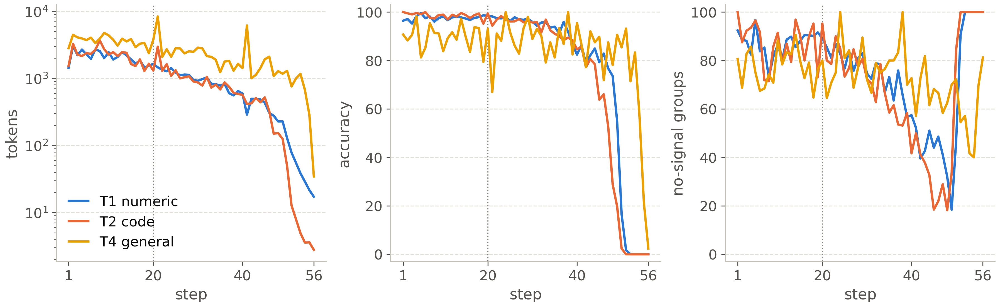</p>

<p align="center"><em>Per-step training telemetry across RL run 1 for the three verifiable tasks: mean response length (left, log scale), training accuracy (middle), and fraction of prompt groups where all 8 samples got identical rewards (right). The vertical dotted line marks step 20, the checkpoint selected for evaluation (<code>docs/talk/data/rl.json</code>).</em></p>

| Group outcome distribution | All right (0 gradient) | Mixed (carries gradient) | All wrong (0 gradient) |
|---|---|---|---|
| `T1` numeric, base model (during bank audit) | 45% | 54% | 1% |
| `T1` numeric, SFT policy (steps 1–20) | **87%** | 13% | 0% |
| `T2` code, SFT policy (steps 1–20) | 87% | 13% | 0% |
| `T4` general, SFT policy (steps 1–20) | 75% | 22% | 3% |

That table exposes the core problem with RL run 1's problem bank. Back in §4.3, we ran the difficulty filter using the base model. For the base model, roughly half of `T1` fell into the informative mixed-outcome regime. By the time RL began, however, we were starting from the SFT checkpoint, which was already substantially stronger and more consistent.

As a result, from the very first step of RL run 1, 87% of numeric and coding groups had all 8 samples right. Out of `1,008` total samples generated per training step (`126` prompts × `8`), only `88` to `272` samples actually carried a non-zero advantage. Meanwhile, `T4`—the general instruction-following task that represented only one-quarter of the prompts—happened to be the least saturated task and ended up supplying a median 57% of the entire RL gradient during steps 1–20.

Takeaway: A problem bank's effective difficulty is not an intrinsic property of the questions—it depends entirely on the policy checkpoint that is about to train on it. To fix this, RL v2 re-grades the entire bank using the SFT policy itself, and enforces a strict launch gate: at least `40%` of `T1` groups must be mixed at step 1, and at least `1,000` `T1` problems must sit in the `1–6/8` pass-rate range, or RL refuses to start (§8.3).

### 6.4 Twenty good steps, then a collapse

| Dev set (`190` prompts × 4, `16K` cap) | Step 0 | Step 20 | Step 40 | Median length (tokens) |
|---|---|---|---|---|
| T1 Numeric | 92.0 | **97.3** | 78.9 | `1,250 → 675 → 193` |
| T2 Code (12 tasks) | 79.2 | 97.9 | 83.3 | `4,394 → 1,421 → 332` |
| T3 Reports (judge) | 63.7 | 64.3 | 63.5 | `7,949 → 7,080 → 2,423` |
| T4 General | 83.6 | 88.8 | 92.1 | `4,945 → 4,965 → 3,435` |

The first 20 steps of RL run 1 worked exactly as intended, fixing the model's habit of running past the token cap. At step 0, `53` out of `760` dev samples hit the 16K ceiling without closing their reasoning (with a median length of `12.6K` tokens across cut-off tasks, sitting squarely inside the overlong-penalty zone). By step 20, only `15` dev samples failed to finish, lifting 16K dev numeric accuracy from 92.0% to 97.3% and dev coding accuracy from 79.2% to 97.9%.

After step 20, however, the policy rapidly stopped reasoning altogether. By step 40, response lengths had collapsed across every single task: the median `T1` answer shrank all the way down to 193 tokens—nowhere near enough room to perform multi-step seismology derivations. `T1` errors abruptly shifted from unfinished timeouts to terse wrong guesses (`9 → 91` wrong values, `0 → 17` missing units). By step 52, training accuracy on both `T1` and `T2` fell to 0%, followed shortly by `T3` and `T4`. At step 56, the average output across the batch was just 13.7 tokens, and the train/rollout `log-ppl` mismatch alert tripped at `0.0128`, automatically pausing the run with a checkpoint saved. Once every group became all-wrong, every advantage dropped to zero, leaving the optimizer with no signal to recover. Running checkpoint selection (`dpt.eval.select_checkpoint`) on the dev curve selected step 20 (`97.27` vs `78.91` at step 40).

Here is what the training logs prove, what they rule out, and what remains unresolved about that collapse:
- **Established:** Responses shrank monotonically across *every* task starting right from step 1 (`T1` batch means dropped `3,047 → 1,649 → 595` tokens across steps 2, 20, and 40). Because `T1` and `T2` were mostly solved, `T4` supplied the majority of early gradient.
- **Ruled out:** *"T4 taught the model brevity by rewarding short replies."* At first glance, that looked plausible because `T4` held most of the gradient while answers shrank. Checking the per-step telemetry contradicted it immediately: within any step across steps 1–20, right and wrong answers were roughly the same length (medians: `T4` `3,749` tokens for right replies vs `3,341` for wrong ones; `T1` `2,058` vs `1,796`). On `T1`, replaying individual groups—where GRPO advantages are actually computed—confirmed the same thing; `T4` was not replayed separately.
- Part of the initial push—the soft length penalty: I initially ruled out the `12K–16K` overlong length penalty as a culprit, too. Looking at batch-level logs (`docs/talk/data/rl.json`, `response_length/max`), some training answer exceeded `12K` in only `14` of the `56` steps, nearly all before step 15. However, batch averages hide what a GRPO step *actually* updates on, because zero-advantage groups contribute nothing. In November, I rebuilt and replayed run 1's very first step over `256` partially solved `T1` problems using the starting SFT model at `16K` (`docs/talk/data/run1_step0_replay_1116.json`). Out of `256` groups, `82` carried non-zero gradient—and in 49 of those 82, *every single answer was right*, meaning the gradient came exclusively from the soft length penalty docking one long answer! Those 49 penalty-only groups carried 28% of the step's total advantage, 100% of it pushing toward shorter outputs. Across the remaining `33` mixed right-and-wrong groups, right answers were shorter in `18` (by a median of `250` tokens, matching the batch trend). Thus, the soft length penalty clearly contributed to the early brevity push—yet it still cannot explain why answers kept collapsing from step 14 to step 40 when almost no answers came anywhere near `12K`.
- **Still open:** The exact trigger behind steps 14–40. Although `T3` joined at step 27 and took `26–72%` of the gradient during steps 27–40, `T1` answers had already shrunk from `2,205` tokens at step 14 down to `1,117` at step 26 *before* `T3` even entered training.

An earlier draft of these run notes blamed `T4` for teaching brevity; once per-step metrics refuted that claim, we formally withdrew it on 2026-11-06 ([PITFALLS](PITFALLS.md) D1). Notice also that running dev checks every 20 steps was fine for picking the step-20 peak checkpoint, yet too coarse to catch the exact inflection point in real time. That is why RL v2 evaluates the dev set every 10 steps.

### 6.5 The judge: lenient, with compound rubrics and no drift

Among all four tasks in RL run 1, `T3` (written reports) is the only one whose reward relies on another language model's judgment rather than a deterministic program. Because neural judges can be overly generous, biased toward familiar phrasing, or susceptible to reward hacking, we subjected Gemma to three independent checks.

<p align="center">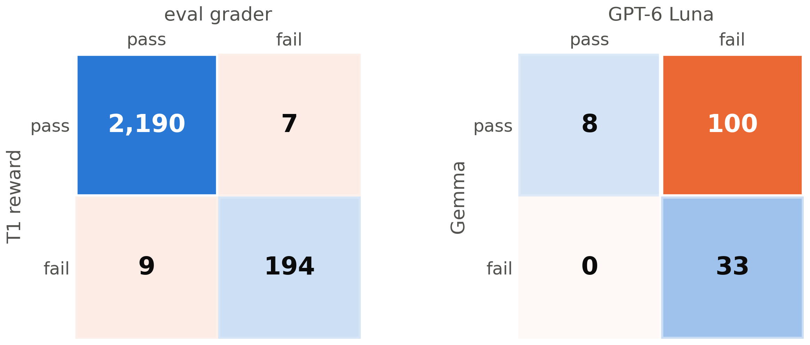</p>

<p align="center"><em>Left: confusion matrix comparing the T1 RL reward against the independently written evaluation numeric grader across 2,400 base D-Num replies. Right: T3 reward judge (Gemma) vs independent second judge (GPT-6 Luna) across 141 RL dev reports at a 70-point pass mark (<code>docs/talk/data/reward_vs_eval.json</code>). Points on the diagonal represent agreement.</em></p>

**1. Cross-checking against independent references**

Because no human gold labels exist, we compared each reward against the most independent reference available:
- **T1 Numeric:** Our programmatic RL reward agrees with the independently implemented evaluation grader on 99.3% of base-model replies (`7` false passes, all caused by replies containing multiple answers; `9` false fails, `8` of which were unparseable) and on 100% of post-trained replies.
- **T3 Reports:** By contrast, Gemma is substantially more lenient than our isolated evaluation judge, GPT-6 Luna. At a 70-point pass threshold, Gemma passed 108 out of `141` dev reports, whereas Luna passed only 8 of those `108` (and Gemma never failed a single report that Luna passed). In practice, the `T3` reward was paying positive credit for reports that an independent judge considered below bar.

**2. Calibrating judge formats against checked gold labels (November 16)**

Comparing Gemma with Luna tells us Gemma is lenient, yet Luna is still just a second judge. To measure *where* and *why* Gemma errs, we built a set of verified model-generated gold labels (strictly held out from all training and reward prompts): GPT-6.1 Sol read all `300` `D-Report` completions across base, SFT, and RL step 20, graded each rubric criterion as `met`, `partly met`, or `not met`, and assigned an overall score. A frontier model review (as in §8.5) then checked Sol's reference solutions and corrected eight of them (`v3`).

Using those gold labels across `31` held-out questions (`196` criteria marked `met`, `167` `partly met`, `43` `not met`), I re-scored the exact same reports with Gemma on a single machine under three distinct rubric formats:
1. the RL reward's original 0–10 score per criterion;
2. a binary yes/no check per criterion accompanied by a quoted span of evidence; and
3. a three-level score (`full`, `partial`, or `none`).

On the clear-cut extremes, all three formats performed well: they wrongly failed only `1–4%` of criteria marked `met` by gold, and wrongly passed `14–23%` of criteria marked `not met`. The breakdown occurred squarely in the middle: gold marked 41% of all criteria `partly met`, yet Gemma graded 82–84% of those partial criteria as fully `met` regardless of prompt format. Even when explicitly given a `"partial"` option, Gemma used it only `15%` of the time on partly-met criteria—and instead gave `"partial"` credit to `26%` of criteria that gold marked `not met`, leaving just `3%` of partly-met items with zero credit. In short, adding a middle level mostly softened Gemma's `"no"` rather than helping it spot omissions in half-correct answers.

<p align="center">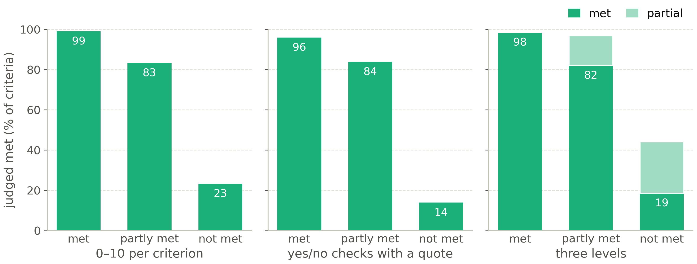</p>

<p align="center"><em>How Gemma scores rubric criteria across 31 test questions under three prompt formats, broken down by checked gold label: 196 met, 167 partly met, 43 not met. Each bar shows the share called "met"; under the three-level format, the light segment shows the share called "partial" (<code>docs/talk/data/rubric_formats_1116.json</code>).</em></p>

At each format's optimal whole-report pass threshold, the trade-off between leniency and false rejections separates the formats clearly:

| Rubric format | Passes reports gold scores `< 60` (false pass) | Fails reports gold scores `≥ 60` (false fail) | Balanced accuracy |
|---|---|---|---|
| 0–10 per criterion (used in RL) | 69% | 6% | 0.63 |
| Yes/no checks with quoted evidence | 45% | 28% | 0.63 |
| Three levels (`full / partial / none`) | 51% | 6% | 0.72 |

The `0–10` format was especially forgiving on SFT reports; binary `yes/no` checks were stricter overall at the cost of many false failures; and the three-level scale achieved the best balanced accuracy (`0.72`). For GRPO training, however, absolute thresholds do not matter—only relative ordering between candidate reports to the same question does. Comparing pairs of answers to the same prompt (`128–129` pairs whose gold scores differ by at least `10` points, `dpt.eval.rubric_calibration`), all three formats agreed with gold pairwise rankings 66–67% of the time (with `0–10` matching the cluster judge run at `r = 0.99`). Changing prompt format adjusts the pass bar, not Gemma's blind spot toward subtle scientific omissions; improving that requires either a stronger judge model or splitting compound criteria into smaller atomic checks.

**3. Evaluation bias vs. RL judge drift**

<p align="center">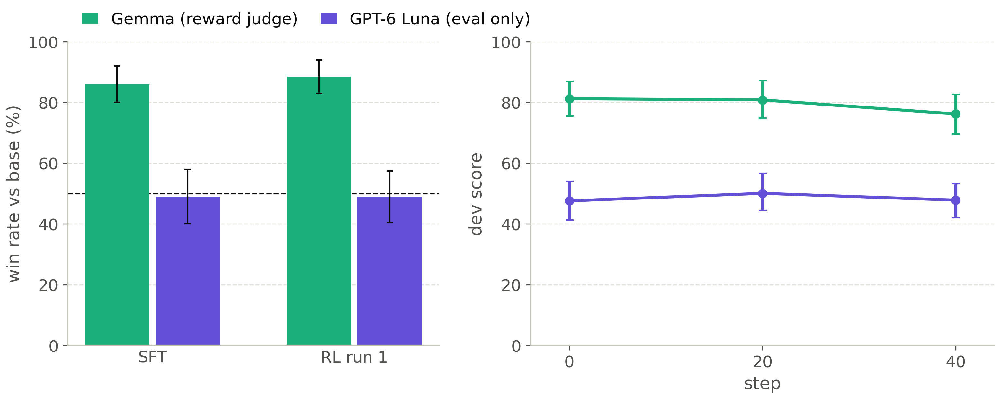</p>

<p align="center"><em>Left: D-Report pairwise win rates over the base model by judge, with 95% confidence intervals (dashed line marks a 50% tie; RL v2 is seed 1, judged by Gemma on the workstation and GPT-6 Luna from the cluster login node). Right: mean score of identical T3 dev answers tracked across steps 0, 20, and 40 of RL run 1 under both judges (<code>scripts/slurm/judge_drift.sh</code>, <code>docs/talk/data/judge_drift.json</code>).</em></p>

- Why the two judges disagreed on SFT (`D-Report`): Gemma preferred SFT reports over base reports `80–8` (86.0% win rate) and RL step 20 over base `84–7` (88.5%), whereas GPT-6 Luna scored both as dead ties (49.0%, with the two judges agreeing on just `43–45%` of pairs). Because every pair was evaluated in both orders (`A/B` and `B/A`), constant leniency cancels out—meaning the judges genuinely disagreed about *which report was better*. Since SFT's report training subset had been rejection-sampled using Gemma (§4.5), SFT almost certainly learned Gemma's stylistic preferences. That is precisely why our shipping gate always reads the *lower* of the two judges. (On RL v2—which never trained on reports—Gemma gave `89.0%` on seed 1 and `95.0%` on seed 2, while Luna gave `58.0%` and `62.5%`, still inside sampling noise of SFT's `49.0%`.)
- Did RL learn to hack Gemma? If RL had learned to game Gemma's rubric quirks, Gemma's scores on dev reports would climb while Luna's stayed flat or fell, widening the gap. In reality, between step 0 and step 40, Gemma's dev score *fell* (`−5.0` `[−9.4, −0.7]`) while Luna held steady (`+0.2` `[−3.2, +4.2]`), narrowing the gap by `−5.3` `[−11.4, −0.1]`. (Moreover, the kept step-20 checkpoint never saw `T3` at all, since `T3` only joined at step 27.)
- Watch every auxiliary multiplier inside a judged reward: Even without judge drift, a subtle side channel appeared in the component logs. By step 40, shorter reports cited fewer references (`2.3 → 1.4` per answer), which meant fewer unverified citations triggered Crossref penalties. Consequently, the `citation_factor` multiplier rose from `0.79` to `0.83`, nearly masking a sharp drop in actual rubric quality (`81.2 → 73.3`) and keeping total `T3` reward artificially flat. Shorter answers alone explain that shift. **Any judged reward requires both an isolated second judge and continuous tracking of every sub-component and multiplier inside the reward.**

---

## 7. What the models get wrong

### 7.1 Unfinished answers become wrong ones

Headline percentages in §1.2 conceal an important shift in *how* the models fail. Breaking down all `1,280` `D-Num-hard` completions (`160` problems × `8` samples) makes the trade-off unmistakable:

| Outcome across 1,280 `D-Num-hard` samples | Base | SFT | RL run 1 (step 20) | RL v2 (seed 1, step 110) |
|---|---|---|---|---|
| Right | 793 | 872 | 897 | **1,107** |
| Unfinished within 32K | 421 | 361 | 211 | **81** |
| Wrong value | 15 | 46 | 161 | 86 |
| Format error (multiple, missing, unit) | 51 | 1 | 11 | 6 |
| Mean tokens per answer | 25.8K | 19.1K | 14.2K | **12.9K** |
| `pass@8` (% problems solved ≥ 1/8) | 75.0 | 87.5 | 91.9 | **100.0** |
| Right with 64K token cap (§7.3) | 69.8% | 83.9% | 77.5% | **90.2%** |

Through the first three stages, each step pushed the model to terminate sooner—turning a slice of previously cut-off replies into finished wrong answers. On `D-Num-hard` that trade was net positive (`pass@8` climbed `75.0 → 91.9`), even as single-sample reliability dipped on previously mastered families like rupture length from directivity (`94.4 → 86.9`) and `Mw` from spectral plateau (`95.6 → 85.6`). On `D-Num`—where almost nothing was truncated to begin with—that same shift pushed wrong values from `1.5%` (base) to `4.1%` (SFT) to `8.6%` (RL run 1).

RL v2 broke that pattern: unfinished answers dropped to just 81, wrong values stayed near half of run 1's (`86` vs `161`), `1,107` of `1,280` samples succeeded, and `pass@8` hit 100.0%—while wrong values on `D-Num` dropped to `3.9%`, actually *below* SFT's `4.1%` (`docs/talk/data/rl_v2_seed1_local_1118.json`; §8.6 explains why).

### 7.2 Execution or concept?

To decide whether our next bottleneck was *more scientific knowledge* or *better execution*, I labelled every failure across existing evaluations in two passes (`scripts/talk/failure_types.py`; [docs/reports/failure_types_and_tests_1110_en.md](docs/reports/failure_types_and_tests_1110_en.md)):
1. Programmatic signatures: checking grader status, numeric error signatures (near-miss, factor of 10, degrees vs radians, constant factor, sign flip), and whether ≥`3/8` samples shared the exact same wrong value.
2. Stratified frontier review: GPT-6 Luna inspected up to 10 wrong and 10 unfinished replies per model and family—given the question, gold answer, and solver code—and weighted counts back to the full dataset.

We define a concept error as using the wrong physics equation or physical principle, and an execution error as arithmetic slips, unit mismatches, formatting errors, or running out of tokens despite a valid plan.

<p align="center"></p>

<p align="center"><em>Left: D-Num-hard failures across 1,280 samples per model, weighted by root cause. Right: D-Report rubric shortfalls by failure type (<code>docs/talk/data/failure_types.json</code>).</em></p>

- D-Num-hard is mostly an execution problem—with a sharp concept gap in two families. For the base and SFT models, `63–82%` of unfinished replies reviewed by Luna already had the *right* derivation and simply got trapped double-checking or second-guessing themselves. Concept errors accounted for `37%` of base failures and `31%` of SFT failures. RL run 1 finished sooner and committed prematurely to wrong equations (`80%` of its wrong values—and `56%` of all its failures—were concept errors). Almost all concept errors clustered in the two receiver-function families (`Vp/Vs` from `Ps`/`PpPs` times, ≤`5%` at 32K across base/SFT/run 1; Moho depth from `Ps` delay, `0% → 15% → 29%`). Yet given 64K tokens, SFT solved `40.0%` and `54.4%` of them while the base stayed near `0%` (§7.3)—confirming a true base-model knowledge gap that SFT partially bridged.
- D-Report is fundamentally a knowledge problem. Reports fully satisfy ~half of their criteria and partly satisfy most of the rest. Nearly all shortfalls come from wrong or missing science (`44–51%`) or omitted sections (`36–47%`), rarely from clarity or citations. For `63–71%` of reports across every model, conceptual accuracy is the main bottleneck, and paired rubric scores did not budge (`SFT − base = +1.5` `[−1.6, +4.3]`; `RL − base = 0.0` `[−2.8, +2.6]`), aligning with Luna's `49%` tie rather than Gemma's `86–88.5%`.

Different failure modes demand different fixes: numerical reasoning mostly needs models to finish derivations cleanly without cutting corners, whereas scientific reports need domain facts that neither SFT formatting nor RL alone supplied.

### 7.3 What more samples and more tokens buy

Inference-time scaling was measured thoroughly across both `k` (parallel votes) and `token budget` (thinking length):
- **Majority voting (`k = 1 → 8`):** On `D-Num`, single-sample accuracy (`89.4%–92.2%`) rises to `98.9%–99.6%` with 8-sample voting across base, SFT, and RL run 1 (`64` samples/item; `docs/talk/data/research_1110.json`). RL's errors concentrate on ~30 of 300 items where it gets `30–60%` of draws right.
- **Token budget (`16K` vs `32K`):** At `16K`, base scores `55.4%` (`D-Num`) and `13.0%` (`D-Num-hard`), run 1 reaches `84.8%` and `58.0%`, and RL v2 surges to `92.6%` and `67.1%`. By `32K`, base catches run 1 on `D-Num` (`92.0` vs `90.0`) while RL v2 maintains a clear lead (`95.6`).
- **Reachability (`pass@8`) vs reliability (`avg@8`):** Across the first three stages on `D-Num-hard`, `pass@8` jumped `75.0 → 87.5 → 91.9` while `avg@8` moved `62.0 → 70.1`—training made right answers reachable before making them consistent. RL v2 achieved both (`pass@8 = 100.0`, `avg@8 = 86.5`).
- **Doubling the ceiling (`32K → 64K` continuation):** To test whether cut-off replies actually knew how to finish, I resumed every completion truncated at `32K` on `D-Num-hard` up to `64K` tokens using the exact same model and sampling state (`scripts/talk/numhard_continue.py`, `docs/talk/data/numhard_64k.json`).

<p align="center">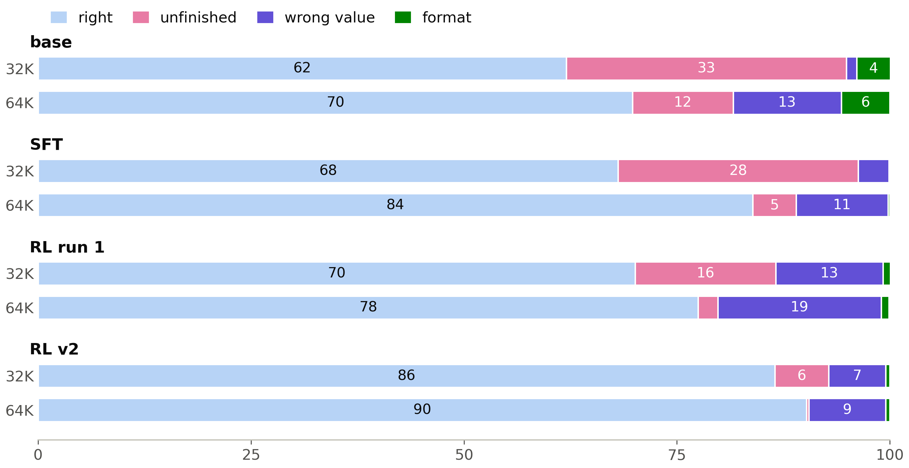</p>

<p align="center"><em>Outcomes across all 1,280 D-Num-hard responses per model at the 32K evaluation limit versus extended to 64K tokens.</em></p>

| Fate of replies cut off at `32K` | Base | SFT | RL step 20 | RL v2 (seed 1) |
|---|---|---|---|---|
| Cut off at 32K | 421 | 361 | 211 | 81 |
| → Right at 64K | 100 | 202 | 95 | 48 |
| → Wrong value at 64K | 148 | 92 | 85 | 29 |
| → Still unfinished at 64K | 151 | 65 | 30 | 4 |
| → Format failure at 64K | 22 | 2 | 1 | 0 |

When given 64K tokens to finish, SFT overtakes RL run 1 cleanly (`83.9%` vs `77.5%`, base `69.8%`)—over half of SFT's `361` truncated replies (`202`) were on track to the exact right answer! RL v2 remains the strongest model at *both* budgets (`86.5%` at 32K, `90.2%` at 64K), finishing `48` of its `81` remaining truncations correctly. Meanwhile, on the trained models, receiver-function accuracy rises substantially at 64K (SFT: `Vp/Vs` `3.8% → 40.0%`, Moho `15.0% → 54.4%`; RL v2: `66.2%` and `75.6%`; base remains stuck at `0.0%` and `0.6%`). **Evaluating at only one token budget hides which model actually reasons more accurately.**

### 7.4 Refusals

<p align="center"></p>

Our safety gate matches fixed refusal phrases within the first `1,500` characters of the final response (strict detector). To verify whether post-training simply altered refusal phrasing, we built a broad lexicon catching any verb following phrases like `"I can't / won't"`, `"sorry … can't"`, `"I'm not able / going to"`, plus Chinese equivalents (an upper bound that also counts safety disclaimers inside compliant answers; `scripts/talk/refusal_breakdown.py`, `docs/talk/data/refusal.json`).

| Should-refuse rate (%) | Base | SFT | RL step 20 | RL v2 seed 1 | RL v2 seed 2 |
|---|---|---|---|---|---|
| Strict (gate detector) | 56.0 | 51.3 | 45.7 | 45.7 | 49.0 |
| Broad (upper bound) | 77.7 | 75.3 | 70.0 | 72.3 | 73.7 |
| `JailbreakBench` harmful (100), strict / broad | 49 / 92 | 48 / 91 | 42 / 87 | 42 / 91 | 42 / 89 |
| `XSTest` unsafe look-alikes (200), strict / broad | 59.5 / 70.5 | 53.0 / 67.5 | 47.5 / 61.5 | 47.5 / 63.0 | 52.5 / 66.0 |
| Benign over-refusal (350), strict / broad | 3.4 / 6.0 | 4.0 / 6.3 | 2.6 / 5.4 | 2.9 / 4.9 | 4.0 / 6.3 |

The drop in refusals is genuine: even under the upper-bound broad detector, run 1 fell 7.7 percentage points (well beyond the gate's `±2` allowance). Roughly one-quarter of the strict drop reflects new phrasing, while the real behavioural drop sits on XSTest's unsafe look-alikes—for example, unsafe questions framed around `"definitions"` (`25 → 17 → 12` out of 25) or `"figurative language"` (`23 → 23 → 16`). Benign over-refusal fell alongside it, showing post-training shifted the model generally toward answering. Out of the base model's `168` strict refusals, RL run 1 kept `105`, rephrased `36`, turned `27` into non-refusals under both detectors (requiring human reading to tell compliance from safe completion), and newly refused `32` prompts.

Since RL v2 included no safety replay data either, refusals stayed depressed (`45.7%` and `49.0%` strict; `72.3%` and `73.7%` broad—slightly above run 1 yet `4–5` points below base), with the exact same drop on XSTest definitions (`14` and `15` of 25 vs base `25`). **Safety detectors must always be frozen before results arrive**—widening a detector post-hoc masks real regressions.

---

## 8. What the tests and the results mean

### 8.1 The tests: strengths and weaknesses

Before interpreting what the post-trained model can and cannot do, it helps to be completely honest about what each benchmark in our suite actually proves—and where its blind spots lie:

| Evaluation set | Strengths | Weaknesses |
|---|---|---|
| D-Num | Programmatic solver gold labels, strict independent unit-aware grader, narrow confidence interval (`±1.0`), empirically measured 10-seed noise floor | **Saturated:** `92%` single-sample accuracy (`99.6%` with 8 votes), so movements reflect reliability and formatting rather than new physics; the inherited `base + 8` (`99.6%`) gate is unreachable |
| D-Num-hard | Cleanly separates model stages (`62 / 68 / 70 / 86.5`); zero overlap with training problem families | Driven heavily by two near-floor receiver-function families; 32K mixes conceptual knowledge with finishing within budget (at 64K SFT leads RL run 1, §7.3; run 1 − SFT was within noise at 32K) |
| D-Fresh | Written after Qwen3.5's release cutoff, ruling out pretraining contamination; separates model stages cleanly | Small (`60` items), drafted and verified purely by models; part of the gain reflects finishing within 32K |
| D-Code | Objective hidden unit tests executed in isolated containers | Sandbox infrastructure bugs hit in October and on 1 node in November ([PITFALLS](PITFALLS.md) C8); sets with `>5%` infra errors now fail to score; SFT's longer code answers are truncated `8%` of the time |
| D-Report | Realistic scientific writing task, isolated second judge, two-order evaluation, length-matched slice | The two judges disagree on `55–57%` of pairs; only 1 sample per question; no human gold labels |
| General suite | Public, reproducible benchmarks capable of catching broad capability regressions | Confounded by 32K truncation (base truncated on `38%` of GPQA and `61%` of LiveCodeBench); MMLU-Pro flagged a `6.2%` memorization probe, so only relative deltas matter |
| Refusal suite | Successfully caught a genuine safety regression | Based on crude lexical lists `20` points apart; `27` ambiguous replies require human review |

*What our evaluation suite still lacks:* human-written gold labels anywhere (a frontier model review stood in for a person, §8.5), a third RL v2 seed (`seed 1` and `seed 2` agree within `0.7` points on `D-Num`; `seed 3` was cancelled before launch, §8.3), multiple samples per `D-Report` question, and sweeping multiple reasoning-effort settings alongside token budgets (without sweeping effort, accuracy and thinking efficiency stay coupled in every single score).

One-line summary of what each stage achieved:
- SFT delivered a real leap, largely via efficiency: equal or stronger accuracy at two-thirds the token count because answers stopped timing out.
- RL run 1 bought speed: another `41%` token reduction and higher `pass@8`, at the cost of lower single-sample reliability.
- D-Report showed no reliable gain under an independent judge, while safety refusals dropped genuinely.
- RL v2 delivered both speed and reliability: across two seeds, it beat SFT by `15–18` points on `D-Num-hard` at 32K, stayed clearly ahead at 64K, and lifted `D-Num`, `D-Code`, `GPQA`, and `LiveCodeBench` (§8.3).
- Overall, post-training taught the 9B model to finish hard multi-step calculations cleanly and accurately, yet has not demonstrated newly injected domain knowledge (`D-Report` improvements of `58.0` and `62.5` vs SFT's `49.0` remain within sampling noise).

### 8.2 Should the 9B line add mid-training?

Continued pretraining on domain text ("mid-training") is the standard prescription for adding factual knowledge. Our measurements say not yet for this 9B pipeline:
1. On `D-Num`, the base model already gets `92%` single-sample and `99.6%` 8-vote accuracy—its rare mistakes are formatting and slip-ups, not missing textbook knowledge.
2. On `D-Num-hard`, most errors are execution bottlenecks (truncations). Even without mid-training, SFT transferred across unseen families: at 64K tokens, SFT solves `54.4%` of Moho-depth problems compared to the base model's `0.6%` (§7.3).
3. The sole empirical data point from our reference 27B plan showed mid-training added only `+1.1` on `D-Num` (within noise) while dropping general benchmarks by `−1.3` points.
4. Mid-training is expensive on this cluster: we had no decontaminated domain corpus ready, `~2B` tokens would burn `~10` hours on 8 nodes (`~80` node-hours, estimated), and every 8-node allocation queues for days.

Since `D-Report` shortfalls *were* factual knowledge gaps untouched by SFT or RL (§7.2), we first tested the cheapest alternative: knowledge-dense SFT report rows synthesized from open-access papers (§8.4). When those failed expert screening, continued pretraining remained on hold.

### 8.3 RL v2: the test, the changes, the job

**1. Fixing the success criterion before launch**

Before RL v2 ran, I locked down its pass/fail criterion: at the 32K token budget, RL v2 must beat SFT outside sampling noise on both `D-Num-hard` and `D-Fresh`—meaning the 95% paired bootstrap confidence interval (10,000 item-resampling draws) lies strictly above zero. Evaluating one 32K generation run yields three effective budgets with zero confounding from resampling (`python -m dpt.eval.budget compare`): at `16K`, only answers finishing within `16,384` tokens count; at `32K`, we score the standard run; at `64K`, we resume truncated 32K completions with the exact same sampling state (§7.3).

Tested against this rule, RL run 1 (step 20) passed at 16K and failed at 32K and 64K—it was merely faster, not more reliable:

| Set (items) | Budget | SFT | RL run 1 (step 20) | `RL − SFT` `[95% CI]` |
|---|---|---|---|---|
| `D-Num-hard` (160) | 16K | 47.8 | 58.0 | **+10.2** `[+7.5, +12.9]` |
| | 32K | 68.1 | 70.1 | `+1.9` `[−0.7, +4.6]` |
| | 64K | 83.9 | 77.5 | **−6.4** `[−9.0, −3.8]` |
| `D-Fresh` (60) | 16K | 66.9 | 77.9 | **+11.0** `[+5.0, +17.5]` |
| | 32K | 78.8 | 83.3 | `+4.6` `[−0.8, +10.4]` |
| | 64K | 84.0 | 85.0 | `+1.0` `[−4.0, +6.5]` |

*Source:* `docs/talk/data/budgets_1111.json`; `D-Fresh` at 64K from `docs/talk/data/budgets_rl_v2_seed1_1118.json` (extending SFT's `41` and run 1's `12` cut-offs alongside RL v2).

**2. RL v2 passes decisively across two independent seeds**

Evaluating RL v2 seed 1 (step 110) and seed 2 (step 100, its last saved checkpoint—see *"How it runs"* below) on the exact same test:

| Set (items) | Budget | SFT | Seed 1 | Seed 2 | `Seed 1 − SFT` `[95%]` | `Seed 2 − SFT` `[95%]` | `Pooled − SFT` `[95%]` |
|---|---|---|---|---|---|---|---|
| `D-Num-hard` (160) | 16K | 47.8 | 67.1 | 71.8 | **+19.3** `[+16.2, +22.3]` | **+24.0** `[+20.0, +28.1]` | **+21.6** `[+18.3, +25.0]` |
| | 32K | 68.1 | 86.5 | 83.4 | **+18.4** `[+14.4, +22.4]` | **+15.2** `[+11.9, +18.7]` | **+16.8** `[+13.4, +20.3]` |
| | 64K | 83.9 | 90.2 | 88.2 | **+6.3** `[+3.7, +9.1]` | **+4.3** `[+1.6, +7.1]` | **+5.3** `[+2.9, +7.8]` |
| `D-Fresh` (60) | 16K | 66.9 | 85.6 | 85.6 | **+18.8** `[+12.1, +26.0]` | **+18.8** `[+11.9, +26.2]` | **+18.8** `[+12.1, +26.1]` |
| | 32K | 78.8 | 89.2 | 87.3 | **+10.4** `[+5.2, +16.2]` | **+8.5** `[+3.5, +14.0]` | **+9.5** `[+4.4, +15.0]` |
| | 64K | 84.0 | 89.8 | 87.9 | **+5.8** `[+1.7, +10.4]` | `+4.0` `[−0.4, +8.8]` | **+4.9** `[+0.8, +9.5]` |

*Source:* `docs/talk/data/budgets_rl_v2_seeds12_1119.json` (`--pool rl_v2=rl_v2_seed1,rl_v2_seed2`). Seed 1's cluster evaluation waited in queue, so its sets ran on workstation A100s with the exact same harness and graders; seed 2's evaluation ran on the cluster.

At `32K`, both seeds clear SFT well beyond noise on both benchmarks—and unlike run 1, both stay clearly ahead at 64K (`+6.3` and `+4.3` on `D-Num-hard`; `+4.9` pooled on `D-Fresh`), proving RL v2 improved genuine reasoning reliability as well as speed. Seed 3 (planned at 16K) was cancelled on November 20 before launch because it faced a multi-day queue wait while seeds 1 and 2 already agreed closely (`+18.4` and `+15.2`).

**3. Every change in RL v2, and the evidence behind it**

| Change | Evidence from RL run 1 | Implementation |
|---|---|---|
| Re-grade bank with SFT policy (`8` answers at `24K`, also checked against `16K`): drop only if `8/8` within `16K`; move `0/8` problems to a hard pool joining at step 20 (`20%` share); draw harder problems `4/3/2/1×` per epoch (`pass rate ≤ 2/8, ≤ 4/8, ≤ 6/8, 7/8`) | In steps 1–20, `87%` of numeric & code groups were `8/8` right and carried zero gradient (§6.3) | `dpt.data.difficulty`, `configs/rl/rl_9b_v2.yaml` |
| Add 12 hard + 6 long numeric families (`3–8` steps; `10,800` generated, `200`/family graded & kept), sampled `2×` more often, each family capped at `6%` of its pool | Headroom sits on long multi-step items: SFT truncated on `28.2%` of `D-Num-hard` at `32K` | `dpt.rl.curriculum.FamilyWeights`, `configs/rl/rl_9b_v2.yaml` |
| Readmit undecided long templates into SFT re-grading, keeping items only if SFT hits the label ≥`1/8` times | Verifiers used a `16K` cap and discarded `10/12` long templates despite zero contested labels ([PITFALLS](PITFALLS.md) A6) | `dpt.data.bank_merge.readmit_undecided`, `dpt.data.difficulty.drop_unconfirmed` |
| Pre-RL bank gates: require ≥`40%` expected mixed numeric groups at step 1, and ≥`1,000` numeric items in `1–6/8` | Run 1 started at only `13%` mixed numeric groups | `dpt.data.bank_merge check` |
| Preserve run 1's dev split and exclude its problems from training | Re-grading drops solved dev items; redrawing a dev split would break comparability and leak problems | `dpt.data.bank_merge pin-dev` |
| Add a hard dev split (up to `10` items/family, ≤`1/3` of family) with targeted pause rules (`acc` `-10` pts from best, wrong values `+10` pts, unfinished-but-value-seen `+12` pts, length halved in `30` steps *plus* `5`-pt loss or `<2,500` tokens) | Run 1's dev split held mostly easy problems; on `D-Num-hard` at `32K`, run 1 converted `11.7` pts of cut-offs into `9.0` pts of wrong values and only `2.0` pts of right answers | `dpt.data.bank_merge carve-hard-dev`, `dpt.monitoring.bridge` |
| Exclude faulty local-magnitude items (`836` in verified bank) | Printed formula used `−2.09` (nm constant) with amplitude in mm, yielding labels `2.681` units low (§8.5) | `dpt.data.bank_merge.FAULTY_FAMILIES` |
| Drop `T3` reports from training: prompt mix `70%` numeric, `15%` code, `15%` general | Primary target is numeric; `T3` judge was lenient (§6.5); un-regraded code was `90%` `8/8`; general (`21%` prompts) dominated `57%` of gradient | `configs/rl/rl_9b_v2.yaml` |
| Halve learning rate: `1e-6`, decaying to `5e-7` | Run 1 (`2e-6 → 1e-6`) peaked at step 20 and drifted afterwards (§6.4) | `configs/rl/rl_9b_v2.yaml` |
| 24K response cap with MTP head frozen if full-length step fits VRAM; else `16K` | Run 1 trained at `16K` and tested at `32K`; training MTP prevented `24K` from fitting stage 7 (§6.1) | `scripts/slurm/rl_v2_job.sh` |
| Dev eval & checkpoint every 10 steps; pause on `3`-pt `D-Num` drop or `+3`-pt jump in wrong numeric values | From step 20 to 40, dev `D-Num` fell `97.3 → 78.9`, wrong values surged `1.8% → 17.8%`, cut-offs fell `0.8% → 0%` | `dpt.monitoring.alerts`, `docs/talk/data/run1_dev_outcomes.json` |
| Every seed: score cut-off numeric answers as `0` (wrong) and drop the soft length penalty | `44–87%` of SFT's cut-offs already wrote the right number; pilot replay showed old rule gave `29%` of groups penalty-only gradient and paid a `23.5K` right answer less than a `24K` cut-off | `dpt.rl.filtering`, `configs/rl/rl_9b_v2.yaml` |
| Seed 3 only (cancelled): `16K` cap with `16K` difficulty weights | In the pilot, every right answer finishing past `16K` had already computed its answer before token `16,384` | `configs/rl/rl_9b_v2_seed3.yaml` |
| Log within-group length gap per step across all samples and across finished samples | Run 1 only logged batch-wide mean lengths of right vs wrong replies (§6.4) | `dpt.rl.pipeline.within_group_length_gap` |

To verify signal before RL starts, the bank gate calculates each item's expected probability of producing a mixed 8-sample group from its SFT pass rate $`r`$:

```math
P_{\text{mixed}}(r) = 1 - r^{8} - (1 - r)^{8},
```

averaging across main-pool numeric items (an optimistic upper bound, since an item graded `7/8` may truly solve `95%` of the time). Separately, atomic report rubrics (`1–6` yes/no checks per criterion requiring a verbatim quote) are already built and ready if a future run re-introduces reports.

**4. Why I redesigned RL v2 on November 15 (the pilot deep dive)**

Before launching any seed of RL v2, I went back to RL run 1 and asked a straightforward question: *what did the model actually have to learn from?* For weeks I had treated run 1's collapse as an algorithmic instability, yet its policy-gradient formulation was already the careful kind—token-sum normalization by a fixed constant, no division by group standard deviation, asymmetric clip-higher (`0.28`), and async carry-over of replies exceeding `16K` tokens. What run 1 actually lacked was learning signal. Across its opening 26 steps, `83–91%` of all sampled completions sat inside groups where every single one of the 8 answers received the exact same reward.

It is worth spelling out plainly why uniform groups teach nothing. GRPO evaluates each answer against its seven siblings for the same prompt: answers scoring above the group average get a positive advantage (reinforced), while answers below average get a negative advantage (suppressed). If all 8 answers are right, every score equals the average, every advantage is zero, and the optimizer learns nothing from that prompt. The exact same happens when all 8 answers are wrong. A prompt only "carries gradient" when its 8 answers disagree. Much of RL v2's redesign focuses on finding more prompts in that informative middle band—and avoiding incentives that corrupt the signal we do have.

At the same time, our evaluation target had shifted. Since the base model already saturates `D-Num`, the real benchmark is `D-Num-hard`—and there, the SFT model's primary failure is simply running out of time: at `32K` tokens, `28.2%` of its answers never finish, yet given `64K` tokens it solves `83.9%`. Worse, in `44–87%` of its unfinished traces, the right final value already sits inside the reasoning trace—the model solves the physics and then wastes the rest of its budget endlessly re-checking itself.

Therefore, before launching any RL v2 seed, I made three core design changes: re-grade the entire bank at `24K` with the SFT policy, oversample problems the SFT policy solves only sometimes, and add `18` new families of hard and long problems—backed by their own dedicated hard dev split whose pause rules trigger immediately if unfinished answers begin trading into wrong ones.

The first pilot surprise: I fully expected those 18 new families to be hard for the SFT model. Before trusting that assumption, I graded a handful of problems locally on workstation GPUs using the SFT checkpoint (`8` samples each at `24K`, `scripts/talk/difficulty_pilot.py`). To my surprise, the very first family—`array_apparent_velocity`—came back 8 out of 8 on all six problems, using between `3,800` and `19,400` tokens per reply. Because these families state the physical method directly in the prompt, they test sustained multi-step algebra rather than obscure formulas—and SFT *already knows how to do the algebra*, just slowly. Under a `24K` cap, every single sample finishes right (`8/8`), yielding zero gradient.

That immediately turned my attention to the token budget. Suppose instead that training enforces a tighter `16K` cap—cutting off roughly `12%` of this family's slow replies. Whether that problem teaches anything depends entirely on how the trainer handles cut-off completions:
- *Mask cut-offs out of the loss (standard practice):* only the finished answers stay in the group, and since all finished answers are right, the group still teaches nothing.
- *Score cut-offs as `0` (wrong):* suddenly, roughly one-third of these groups mix right and wrong samples, teaching the exact skill `D-Num-hard` demands: finish in time and stay accurate.

That evening I moved seed 3 to a `16K` cap with cut-offs scored as wrong; later that night, running the full pilot changed seeds 1 and 2 as well. Crucially, my first draft of the SFT re-grading script would have deleted slow-but-accurate families before any of this could help—because it dropped every problem solved `8/8` at `24K`. A careful plan review caught the bug: `dpt.data.difficulty` (`short_budget`) now checks every completion against *both* `24K` and `16K`, dropping a problem only if all 8 replies finish right within `16K`. Seeds 1–2 read the `24K` pass rate (excluding slow `8/8` problems there), while seed 3 reads the `16K` pass rate.

The full 18-family pilot: One family is just an anecdote, so I graded `10` problems from each of the `18` new families (`8` replies each at `24K`, `docs/talk/data/difficulty_pilot_1115.json`). Across all `180` problems, the SFT model solved `44%` of replies, ran out of tokens on `50%`, and put `47%` of problems into the `1–6/8` mixed-outcome band where GRPO thrives (compared with just `13%` in RL run 1's opening steps):

| Problem family | Kind | Right (`24K`) | Cut off (`24K`) | Graded `1–6/8` | Groups w/ gradient (`24K / 16K`) |
|---|---|---|---|---|---|
| `array_apparent_velocity` | hard | 99% | 1% | 0% | 10% / 50% |
| `poisson_ratio_from_wadati_fit` | hard | 94% | 6% | 10% | 40% / 100% |
| `q_from_spectral_ratio` | hard | 89% | 1% | 20% | 50% / 80% |
| `array_backazimuth` | hard | 70% | 26% | 50% | 90% / 80% |
| `gr_count_from_magnitude_sample` | hard | 60% | 5% | 50% | 50% / 90% |
| `second_interface_reflected_energy` | hard | 57% | 39% | 90% | 90% / 70% |
| `three_layer_head_wave_time` | hard | 38% | 60% | 100% | 100% / 30% |
| `second_layer_thickness_from_intercepts` | hard | 22% | 69% | 90% | 90% / 60% |
| `epicentre_from_three_sp` | hard | 14% | 85% | 80% | 80% / 10% |
| `depth_from_pp_delay` | hard | 0% | 92% | 0% | 0% / 0% |
| `dipping_refractor_dip` | hard | 0% | 92% | 0% | 0% / 0% |
| `dipping_refractor_velocity` | hard | 0% | 98% | 0% | 0% / 0% |
| `fault_slip_stress_energy` | long | 94% | 1% | 10% | 40% / 60% |
| `wadati_origin_then_depth` | long | 70% | 25% | 80% | 90% / 80% |
| `refraction_then_reflection_time` | long | 38% | 59% | 90% | 90% / 60% |
| `attenuation_then_amplitude` | long | 29% | 61% | 100% | 100% / 50% |
| `locate_then_local_magnitude` | long | 11% | 86% | 60% | 60% / 30% |
| `great_circle_origin_time` | long | 2% | 98% | 20% | 20% / 10% |
| All 180 problems | | 44% | 50% | 47% | 56% / 48% |

<p align="center"></p>

<p align="center"><em>Left: pass rate per family at 24K. Right: share of prompt groups carrying gradient at 24K (open bars) vs 16K (filled bars) when cut-offs score 0. Families are ordered by pass rate at 24K (<code>docs/talk/data/difficulty_pilot_1115.json</code>).</em></p>

Scanning down the last column shows how the `16K` budget redistributes training signal: families that SFT solves quickly *gain* gradient at `16K` because their few straggling completions flip from right to cut-off (`poisson_ratio_from_wadati_fit`: `40% → 100%`; `gr_count_from_magnitude_sample`, median `11,400` tokens: `50% → 90%`). Conversely, families where every right answer takes longer than 16K *lose* gradient (`epicentre_from_three_sp`: `80% → 10%`), while the three currently unsolvable families sit at zero under both budgets.

How replaying step 0 changed seeds 1–2: The original recipe for seeds 1–2 used the textbook overlong rule: leave cut-offs out of the loss, and apply a soft linear length penalty (up to `−0.5`) across the last `4K` tokens before the `24K` cap. Before trusting that rule on our long families, I fed the `180`-problem pilot completions directly through the trainer's exact truncation and advantage functions under each rule to see which answers step 0 would actually reinforce and which it would suppress.

The soft length penalty produced a striking perverse incentive. Picture one 8-sample group: 5 right answers finishing in a few thousand tokens, 1 right answer finishing cleanly at `23,500` tokens, and 2 answers cut off unfinished at `24K`:
- The `23,500`-token right answer gets docked by the penalty to score `0.63`. Against the group's finished average of `0.94`, its advantage becomes `−0.31`—so the gradient step actively pushes that *correct* answer down.
- Meanwhile, the 2 unfinished answers are masked out of the loss with advantage `0`—so the gradient step leaves them completely untouched.
**On these long families, the soft length penalty paid an answer that never finished more than a right answer that finished near the cap.**

Across the 24K pilot, `50%` of all groups carried gradient under the old rule, yet 29% of all groups got their gradient *purely* from the length penalty inside all-right groups (accounting for a quarter of total advantage, teaching only "be shorter" with zero signal on accuracy). Dropping the length penalty while still masking cut-offs out left only `21%` of groups carrying gradient. By contrast, simply scoring cut-offs as `0` (wrong) with no soft length penalty lifted true accuracy-driven gradient groups to `56%` at 24K and `48%` at 16K. Because unfinished answers already score `0`, a separate soft length penalty is completely unnecessary.

<p align="center">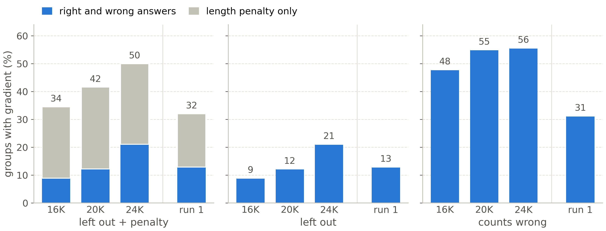</p>

<p align="center"><em>Step-0 gradient composition under each cut-off rule, computed with the trainer's actual advantage code across all 180 pilot problems at three budgets, alongside RL run 1's own step 0 over 256 problems at 16K (far right). Blue = groups mixing right and wrong answers; grey = groups differing solely by the length penalty (<code>docs/talk/data/difficulty_pilot_1115.json</code>, <code>run1_step0_replay_1116.json</code>). Notice run 1 suffered the exact same pathology: 19% penalty-only groups vs only 13% accuracy-based groups.</em></p>

Checking whether 16K cuts off real computation: Truncating at `16K` automatically marks every slow right answer (`>16K`) as wrong—which affects `42%` of right answers in the pilot. That is completely harmless if the model had already solved the problem before `16K` and merely wasted tokens double-checking; it would be harmful if the model genuinely needed `16K–24K` tokens to finish deriving the answer. To tell the two apart, I logged the exact token offset where a number matching the gold answer *first* appears inside each trace (added after the first `49` items, leaving `131` items minus `12` whose prompt itself contained the gold number = `119` problems). Across all `119` problems, every single one of the `175` right answers finishing between 16K and 24K had already written the gold value before token `16,384`—typically by token `3,130`, before rambling onward to `~20,600` tokens.

<p align="center">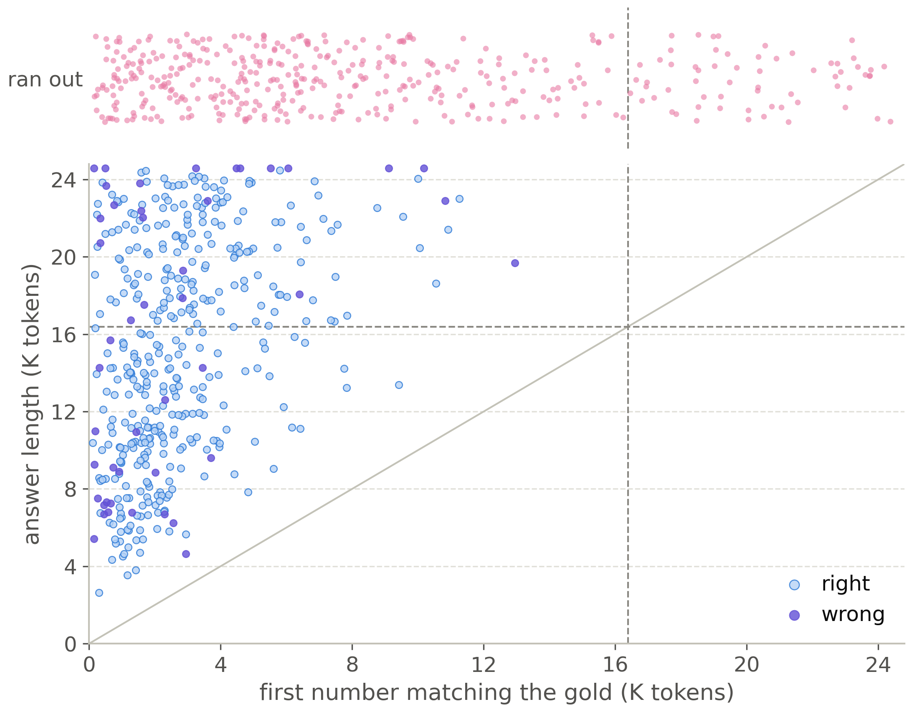</p>

<p align="center"><em>Token position where a number matching the gold answer first appears vs total response length across 857 of 952 completions on 119 pilot items. Cut-off replies at 24K have no finite finish length and are jittered vertically in the top strip; dashed lines mark 16K (<code>docs/talk/data/value_positions_1115.json</code>). Right answers cluster cleanly on the far left—the value is found early, and length accumulates afterwards.</em></p>

Tracking what happened *after* the model wrote the correct number before `16K` (`794` replies total): `389` finished right, only `46` talked themselves out of the right answer into a wrong final answer, and `359` were still double-checking when the `24K` cap cut them off. (Note one caution: any matching digit string counts, making these shares upper bounds, though spot-reading confirmed the early hits were genuine intermediate results.) Going from `24K` down to `16K` does forfeit some initial signal (`36` mixed groups become all-wrong while `22` all-right groups become mixed; `20K` keeps `55%` mixed groups like `24K` and remains supported via `extra_budgets` in `dpt.data.difficulty`). We kept `16K` for seed 3 because the lost groups were precisely problems where the model had already found the answer—which should return as concise stopping habits spread across families—and because a `20K` run would act too much like a near-duplicate of `24K`.

Monitoring healthy vs. harmful shortening: Because RL v2 explicitly aims to trim wasteful double-checking, watching raw answer length alone can be deceptive: shorter can mean healthier stopping *or* skipped physics steps (as in run 1, §6.4). To separate the two cleanly, every seed logs two within-group length-gap metrics across gradient-carrying groups:
1. `task/t1_num/len_gap_within` (pushed-up minus pushed-down lengths across *all* samples, which is negative by construction since `24K` cut-offs are longest and score `0`); and
2. `task/t1_num/len_gap_within_finished`, which restricts the comparison strictly to *finished* right vs wrong answers inside mixed groups. On the pilot, that finished gap sits near zero (`+114` tokens median across `38` groups). If it turns clearly negative after hard answers shorten, that signals right answers themselves are cutting corners.

Our automated pause rules apply the same logic: a `50%` drop in hard-answer length within `30` steps emits only a warning, pausing training only if accompanied by a `5`-point drop in hard-dev accuracy (well above the `~1.3`-point sampling jitter of a `180 × 4` dev pass), a `5`-point rise in wrong values, or mean hard-answer length falling below `2,500` tokens. One monitoring script replays logged metrics through the exact alert code so offline diagnostics and live training can never disagree—replaying run 1's logs triggers a pause cleanly at step `40` (the very first dev pass after step `20`) instead of step `56`:

```bash
python scripts/talk/rl_v2_watch.py --run seed1=<run dir>/metrics.jsonl --reference run1=<run 1>/metrics.jsonl \
    --out rl_v2_watch.png         # also prints how close each pause rule came to firing
```

Alternatives considered and rejected: Multiple design reviews suggested variations we explicitly left out:
- *Masking all but the final 4K tokens of cut-off answers to protect their valid prefix:* our fixed-constant token sum is already plain policy gradient, and since a cut-off reply's prefix matches the right replies in its group, shared-prefix gradients largely cancel naturally; masking would warp the gradient while adding a confounding change.
- *Partial-credit reward ladder (`0.25` if gold appeared in reasoning, `0.10` otherwise, vs `0` for finished wrong):* this directly pays the model *not* to finish and encourages spraying candidate numbers inside its reasoning trace.
- *Tightening `clip_high` from `0.28` to `0.22`:* no measurement pointed to clipping as run 1's flaw, so we kept run 1's PPO loss unchanged.
- *Moving seed 3 to `20K` (addressed above).*
- *Running one seed under the old cut-off rule as an explicit control:* run 1 already tested that rule, and pilot replays showed it shrinks true mixed-accuracy groups (`21%` vs `56%`) while wasting a quarter of advantage on length alone—too expensive to spend a third of our RL compute confirming a rule we would not ship.

**5. How RL v2 actually executed on the cluster (Nov 16–18)**

**For this model, "hard" mostly means "long": on `D-Num-hard` at 32K, SFT runs out of tokens eight times as often as it finishes with a wrong value.**

RL v2 ran inside 48-hour 8-node reservations (`scripts/slurm/rl_v2_queue.slurm`, `scripts/slurm/rl_v2_job.sh`) queued even before bank v2 existed. Each job pulls its execution steps dynamically from the repository at startup so last-minute fixes land even while waiting days in queue. If bank v2 is not built yet, the job builds it in-place across its 8 nodes (teacher + Gemma on `2` nodes, SFT on `6` nodes, switching the teacher nodes over to SFT once verification finishes, and running decontamination embeddings on CPU since GPUs hold inference servers), tests the `24K` memory fit, carves out the hard dev split and curriculum family weights (`bank_merge carve-hard-dev`), runs RL, and finishes with 3-budget evaluation.

Seed 1 launched on November 16, built bank v2 from scratch, and immediately hit three operational hurdles on day 1:
1. Login-node thread limit leaked to compute nodes: Decontamination stalled for 8 hours while two teacher nodes waited idly, because `env.sh` sets `OMP_NUM_THREADS=1` on login nodes and `sbatch` carried that cap onto 128-core compute nodes. I attached a live debugger to both client processes, called `at::set_num_threads(56)`, and decontamination finished in `15` minutes without aborting the job ([PITFALLS](PITFALLS.md) C6).
2. 24K grading time exceeded remaining walltime: Grading all `10,800` new problems × `8` samples at `24K` across `24` replicas would take `~32` hours—leaving almost zero time for RL. Since RL v2 draws only `~10,600` numeric prompts over its entire run, we deterministically capped re-grading at 200 hash-selected problems per family (`3,600` total, `difficulty.max_per_family`), preserving ~`13` hours for RL.
3. Rescuing undecided long templates: Standard verification at `16K` rejected `10` of `12` long templates purely because the verifiers ran out of tokens—not a single label was contested ([PITFALLS](PITFALLS.md) A6). `readmit_undecided` routed `2,997` items from those 5 families into SFT `24K` grading, keeping an item only if SFT hit the exact label in at least `1` of `8` replies.

Because seed 1 spent its first day building bank v2, it reached walltime cleanly after step 110 at `02:19` on November 18 (with dev passes picking step 110). Later seeds skip bank building and would otherwise reach step 120, making pooled cross-seed averages mismatched. Therefore, seeds 2 and 3 read seed 1's stop step from `WALLTIME.json` (`DPT_STOP_AT_STEP=110`) while keeping the `120`-step LR schedule and sampler identical so every step matches seed 1 exactly (since the cluster caps users at 12 nodes, the three 8-node jobs ran sequentially anyway).

Seed 1's in-job final evaluation died an hour after training ended when 5 of 24 `vLLM` servers silently failed `ssh` launch ([PITFALLS](PITFALLS.md) E4), forcing a separate 4-node queue job alongside full workstation A100 runs (§1.2). Seed 2 (`sft_v2_job.sh`, inheriting the cancelled `SFT v2` slot) started at `04:50` that morning and trained all `110` steps—though a cross-node Lustre mkdir race dropped its step-110 checkpoint save ([PITFALLS](PITFALLS.md) C7, so seed 2 was evaluated at step `100`, which matched step `110` within noise on seed 1's dev curves) and one broken sandbox zeroed roughly `1/8` of its training code rewards ([PITFALLS](PITFALLS.md) C8). Seed 3 waited behind it with all fixes applied, and was cancelled before launch once seeds 1 and 2 agreed cleanly.

```bash
scripts/slurm/submit_window.sh rl-build-queue      # seed 1: bank v2 (if missing) → 24K test → RL v2 → final eval
scripts/slurm/submit_window.sh sft-v2-queue        # seed 2: same steps (scripts/slurm/sft_v2_job.sh)
scripts/slurm/submit_window.sh rl-seed-queue 3     # seed 3: same steps (cancelled before launch)
# Compute paired comparison tables once finished:
python -m dpt.eval.budget compare --rows sft,rl_seed1,rl_v2_seed1,rl_v2_seed2,rl_v2_seed3 \
    --pool rl_v2=rl_v2_seed1,rl_v2_seed2,rl_v2_seed3 --out budgets_rl_v2.json
python -m dpt.eval.budget table budgets_rl_v2.json --rows rl_seed1,rl_v2_seed1,rl_v2_seed2,rl_v2_seed3,rl_v2
```

**A job that waits days in the queue should always read its execution steps when it starts.**

*RL v2 caveats, stated plainly:*
- Two seeds ran (`seed 2` evaluated at step `100` with ~1/8 broken code rewards via C8; `seed 3` at `16K` cancelled pre-launch).
- Every seed stopped where seed 1 hit walltime (after step `110` of `120`), leaving final LR at `6.5 × 10⁻⁷` rather than `5 × 10⁻⁷`.
- `D-Fresh` contains `60` items (`±5` pt CI); the pilot tested `10` items/family (true bank grades emerge after build, halting RL if `<1,000` learnable items survive); value-position logging covers `119/180` pilot problems and counts any matching number; omitting `T3` means RL v2 cannot improve `D-Report`.

### 8.4 Knowledge-dense report data and SFT v2

A model acquires almost all of its factual knowledge during pretraining. A few thousand SFT rows primarily reshape *how* a model formats and structures its answers, whereas injecting new domain knowledge normally requires continued pretraining on domain text. Because `D-Report` failed squarely on missing science (§7.2) while continued pretraining was not yet justified (§8.2), the natural low-cost experiment was testing whether knowledge-dense SFT rows could carry missing facts. Importantly, a teacher writing answers purely from memory can only pass along facts it already knows—so I designed a pipeline (`src/dpt/data/gen/knowledge.py`) where the teacher reads an actual seismology paper excerpt while writing, and the student trains on the question alone.

Out of `19,945` full texts in our corpus, OpenAlex license metadata identified `7,642` openly licensed papers (`CC-BY`, `CC-BY-SA`, `CC0`, or public domain). From these, I selected 3,000 seismology papers published before August 2026 (strictly predating `D-Fresh`), stripped acknowledgments and references, and split them into 8,286 sections of `4,000–9,000` characters (`median 7,350`, `docs/talk/data/knowledge_selection.json`).

How each section was turned into training data (`src/dpt/data/gen/knowledge.py`):
1. Question drafting: The Qwen3.8-27B teacher reads the excerpt and writes `2` specialist report questions crafted to be completely understandable *without* seeing the paper, along with key facts from the excerpt needed for a strong answer.
2. Plan and report generation: Given the excerpt disguised as background notes that it must treat as its own knowledge, the teacher writes a concise plan and a ~`550`-word report matching `D-Report`'s length. Because the teacher's raw `<think>` trace still refers to `"the notes"`, that thinking trace is discarded and the clean plan becomes the row's reasoning trace.
3. Automated quality filters: A row is kept only if neither the plan nor report leaks hidden sources (`"notes"`, `"excerpt"`, `"the paper"`, `"authors"`, `"Figure"`, `"Table"`), the report spans `300–900` words, and Gemma finds zero contradictions with the excerpt, at most `2` claims unsupported by the excerpt, and a knowledge score of at least `3` of `5`.
4. Verified citation & decontamination: Each kept report ends with a `References` line citing the source paper itself (authors, year, title, DOI—the one citation guaranteed accurate), and then passes standard SFT quality, embedding, and paraphrase decontamination against every eval set (note `D-Report` had no source papers, so decontamination guards against question wording overlap).

```
Teacher sees:    paper excerpt (as notes) + report question
Student sees:    report question only
Student learns:  clean plan (as reasoning) → report → source paper citation
```

Planned training schedule: `SFT v2` was scheduled to continue from `SFT v1` for `1` epoch at half the peak learning rate (`4e-6`), mixing the new knowledge rows with a replay sample of the `SFT v1` mix containing twice as many tokens, followed by `RL v3` using `RL v2`'s recipe.

What an independent review caught before training: Before feeding a single row into training, I had a frontier model audit `100` randomly sampled rows out of `3,262` (`1` row per paper), checking every claim against both its source paper excerpt and established seismological knowledge (§8.5 describes the review protocol, `docs/talk/data/screening_1114.json`):

| Screening verdict | Rows (of 100) |
|---|---|
| Keep: factually accurate and useful | 2 |
| Fix: useful, contains correctable factual errors | 48 |
| Drop: wrong on a core point, off-topic, or tied narrowly to one paper | 50 |

The audit revealed widespread factual errors: 98 out of 100 rows contained at least one factual error (`382` total errors, median `4` per row), and `87` overstated measurements from a single study as universal geophysical rules. Restricting to the `62` rows sourced from genuine seismology papers helped little (`28` of `62` still needed to be dropped). Why did so many errors slip through? Because our prompt asked for *specialist knowledge needed without the paper*, pushing the teacher to inject details about named earthquakes and faults from its own weights—calling the left-lateral East Anatolian Fault right-lateral in four separate rows, or turning a strike-slip event into a thrust earthquake on a non-existent fault. Meanwhile, roughly `20%` of the sampled rows came from non-seismology papers (survivor surveys, social media, disaster governance) whose questions still asked about the earthquake, forcing the teacher to invent the entire seismological narrative from memory.

Because Gemma checked each report *only against its source excerpt*, any hallucinated claim absent from the excerpt could not contradict the excerpt—passing silently whenever Gemma did not know better ([PITFALLS](PITFALLS.md) A4).

What I did next: I cancelled `SFT v2` and `RL v3` immediately, halted the knowledge data jobs, and reassigned the queued 8-node job to run RL v2 seed 2 (§8.3). **A check against the source only verifies what the source actually contains; if you ask a teacher for field knowledge beyond the source, that part needs its own domain check.** A future pipeline that could work would ask strictly about facts stated in the excerpt, tie every specific claim to an explicit sentence in the source, and filter papers rigorously for domain relevance—at lower yield.

```bash
python -m dpt.data.gen.knowledge licenses --corpus fulltext.jsonl preprints.jsonl --out data/knowledge/licenses.jsonl
python -m dpt.data.gen.knowledge select --corpus fulltext.jsonl preprints.jsonl \
    --licenses data/knowledge/licenses.jsonl --out data/knowledge/chunks.jsonl --max-papers 3000
sbatch -A <allocation> scripts/slurm/knowledge.slurm   # questions → answers → checks → SFT v2 mix (dropped pre-training)
```

*Caveats:* `100` of `3,262` rows carries `~±10` percentage points sampling uncertainty; audited by a model (a human expert might treat minor slips more leniently); questions, answers, and checks were all model-generated.

### 8.5 A model review of the tests and the data

Because every benchmark, rubric, and training label in this project was created or verified by programs and LLMs without human domain experts on staff, a frontier LLM stepped in to perform a comprehensive expert audit (recorded explicitly as a model review, with single-item notes kept private since test items remain unpublished).

How each asset was audited:
- Numeric benchmarks (`D-Num-hard`, `D-Fresh`): Solved blindly at full floating-point precision from question text alone *before* viewing gold labels, then cross-checked against gold.
- `D-Report`: Every single question, rubric criterion, and listed common error checked, with every embedded calculation recomputed.
- Bank expert queue: All `156` problems previously set aside by verification solved and checked the same way.
- Knowledge rows (`SFT v2`): `100` random rows verified against both source excerpts and field knowledge (§8.4).
- Blind pairs: All `30` blind `D-Report` pairs awaiting human review since run 1.

| Audited asset | Scope | Review verdict |
|---|---|---|
| `D-Num-hard` | 160 items | Every gold answer confirmed right; independent family solvers written from question text agree with gold to `~1e-14`; `0` items flagged |
| `D-Fresh` | 60 items | Every gold answer confirmed right; `1` item flagged for depending on an unstated convention with `0.1%` tolerance (`24` unitless items remain graded fairly since our grader enforces and converts units) |
| `D-Report` | 100 questions, 529 criteria, 412 listed errors | `515` criteria sound; `6` questions flagged (`2` rubrics reward wrong physics, `1` lists a true statement as an error due to semicolon splitting [A5], `2` accept only one valid interpretation, and `1` later found with contradictory travel times) |
| Bank expert queue | 156 items | `150` labels sound, `6` dropped, `1` systematic generator bug uncovered |
| Knowledge rows (`SFT v2`) | 100 rows | `2` keep, `48` fix, `50` drop (§8.4) |

The screened subset (excluding the 7 flagged test items):

| Evaluation comparison | Frozen set | Screened subset |
|---|---|---|
| `D-Num-hard`, RL step 20 − SFT (`32K`) | `+1.9` `[−0.7, +4.6]` | Identical (`0` items dropped) |
| `D-Fresh`, RL step 20 − SFT (`32K`) | `+4.6` `[−0.8, +10.4]` | `+3.6` `[−1.5, +9.1]` |
| `D-Report` vs base, SFT (`Gemma / Luna`) | `86.0 / 49.0` | `87.2 / 49.5` |
| `D-Report` vs base, RL step 20 (`Gemma / Luna`) | `88.5 / 49.0` | `88.8 / 48.9` |

No conclusion changes (`docs/talk/data/budgets_screened_1115.json`, `docs/talk/data/screening_1114.json`).

The generator bug caught by screening: Inspecting 5 problems in the bank's expert queue uncovered a subtle physics bug in a local-magnitude (`ML`) generator ([PITFALLS](PITFALLS.md) A3). The generator printed `ML = log10 A + 1.11 log10 r + 0.00189 r − 2.09` with amplitude `A` in mm, mistakenly using the `−2.09` constant that applies only when `A` is in nm. With a Wood–Anderson amplitude $`A`$ in mm and hypocentral distance $`r`$ in km, the Hutton–Boore relation is:

```math
M_L = \log_{10} A + 1.11 \log_{10}(r/100) + 0.00189\,(r - 100) + 3.0 = \log_{10} A + 1.11 \log_{10} r + 0.00189\,r + 0.591.
```

Testing against Richter's calibration anchor makes the bug obvious: `1 mm` at `100 km` defines `ML = 3.0`, whereas the printed formula returned `0.32`—always `2.681` magnitude units too low. Because every prompt printed the flawed equation verbatim, the programmatic solver, teacher, and judge all evaluated the exact same bad formula and agreed 100% (`836` problems passed verification, `825` or `2.2%` entered run 1's training bank). Both the numeric generator and a matching `T2` coding task now use `+0.591`, and bank v2 excludes all legacy items (§8.3). **A label can agree perfectly with its own question and still teach wrong physics—always check generators against physical anchor points.**

Blind review position bias: When the model reviewer initially judged `30` blind `D-Report` pairs in one order, the trained model won 11 of 11 pairs where it appeared first, and only 8 of 19 where it appeared second (picking the first answer in `22` of `30` pairs, [PITFALLS](PITFALLS.md) D6). Re-scoring every pair in swapped order and counting the `6` pairs that flipped between orders as ties yielded a 60.0% win rate for RL step 20 over base—falling right between Gemma (`86.7%`) and Luna (`45.0%`), closer to Luna (`±17` pt CI across `30` pairs):

| Reviewer (`30` identical pairs) | RL step 20 vs base | Agreement with model reviewer |
|---|---|---|
| Model reviewer (both orders) | **60.0%** | — |
| Gemma (reward judge) | 86.7% | 53% |
| GPT-6 Luna (independent second judge) | 45.0% | 63% |

```bash
python -m dpt.eval.budget compare --rows sft,rl_seed1,base_medium --baseline sft --exclude <private list>
python -m dpt.eval.report --row base_medium=… --row sft=… --row rl_seed1=… --exclude <private list> --summary-out …
python -m dpt.eval.blind_review page --row-dir eval_results/rl_seed1 --swap --out review_batch1_swapped.html
python -m dpt.eval.blind_review combine --first verdicts_batch1.csv --swapped verdicts_batch1_swapped.csv \
    --out verdicts_batch1_both.csv                  # a verdict counts only when both orders agree
python -m dpt.eval.blind_review import --row-dir eval_results/rl_seed1 --reviewer model \
    --verdicts verdicts_batch1_both.csv verdicts_batch2_both.csv
```

*Caveats:* single frontier model reviewer (not a human, and may share blind spots with evaluated models); flagged items remain inside the frozen baselines with both sets of scores reported; blind review covers `30` pairs.

### 8.6 Why RL v2 trains where run 1 collapsed

RL v2's first seed ran all `110` steps cleanly, continued improving well past step 20, stopped shortening at a healthy length, and beat SFT decisively (`+18.4` on `D-Num-hard` and `+10.4` on `D-Fresh` at `32K`, §8.3). Because RL v2 modified five levers at once—re-grading the bank, scoring cut-offs as `0` without a length penalty, halving the learning rate, removing `T3` reports, and raising the budget to `24K`—with neither a control run nor time left for single-variable ablations, we cannot cleanly isolate every lever. Instead, this section asks a sharper question: using only what both runs logged across all `110` steps (`docs/talk/data/rl_runs_compared.json`), which changes can we directly observe in action, and which remain confounded?

**1. Putting both runs on an equal cumulative-LR scale**

Because RL v2 uses half of run 1's learning rate, comparing step 20 against step 20 would be unfair to run 1. Under the Adam optimizer, each step updates weights by roughly its learning rate regardless of gradient scale, so the cumulative sum of learning rates measures how far an experiment has moved the policy (`step 2n` of RL v2 ≈ `step n` of run 1). On that scale, run 1 collapsed at step `40` at a cumulative LR sum of `71` (in units of `10⁻⁶`, including warmup) and stopped at `103` (step `56`). RL v2 passed `71` smoothly at step `76` and finished its `110` steps at `101`, nearly matching run 1's total optimization distance.

<p align="center"></p>

<p align="center"><em>RL run 1 vs RL v2 plotted against cumulative learning rate: share of total gradient coming from numeric problems (top), share of mixed-outcome numeric groups (middle), and length of right numeric answers on a log scale (bottom; 5-step means; dashed = RL v2 seed 2; dotted line = run 1's collapse at step 40; <code>docs/talk/data/rl_runs_compared.json</code>, <code>scripts/talk/rl_compare.py</code>).</em></p>

**2. Training dynamics: entropy and stale-sample KL warned long before accuracy fell**

<p align="center"></p>

<p align="center"><em>Per-task rewards, per-token entropy, and k3 KL divergence between trainer and rollout engine vs cumulative learning rate (5-step means; dotted line = run 1's collapse; no reference model is used, so there is no KL to SFT; "fresh samples" drawn by current weights measure pure engine mismatch, while "stale samples" drawn up to 3 steps earlier include policy drift; <code>docs/talk/data/rl_runs_compared.json</code>).</em></p>

- Rewards: Run 1's rewards started near `1.0` across every task (far too easy for SFT) and crashed to `0` at collapse. RL v2's numeric reward started at `0.55` on the SFT-calibrated bank and climbed steadily to `0.98`. (On seed 2, code reward hovered around `0.85` instead of `0.97` purely because one compute node's sandbox failed startup and scored ~`1/8` of code samples `0`, [PITFALLS](PITFALLS.md) C8; its sandbox-free numeric reward matches seed 1.)
- Entropy & KL divergence: Long before step 40's dev evaluation exposed run 1's collapse, numeric per-token entropy dropped by more than half (`0.5 → 0.2`) while training rewards still looked healthy, and stale-sample KL surged (`0.4×10⁻³` in steps 1–20 → `1.0×10⁻³` at step 35 → `1.6×10⁻³` at step 39). Across RL v2, entropy held steady near `0.5` and stale KL stayed flat. Fresh-sample KL stayed flat across all three runs—proving `vLLM` and `Megatron` agreed throughout and the divergence came purely from policy drift—while RL v2's own per-step PPO KL stayed below `1e-5` (versus run 1 spiking to `0.08` at step 56).

**3. Where the gradient came from—and what it paid for**

| Gradient & group telemetry | Run 1 (`1–20`) | Run 1 (`21–40`) | RL v2 (`1–20`) | RL v2 (`21–40`) | RL v2 (`41–90`) | RL v2 (`91–110`) |
|---|---|---|---|---|---|---|
| Share of gradient from numeric (`T1`) | 36% | 38% | **93%** | 85% | 77% | 70% |
| Share from general prompts (`T4`) | 57% | 18% | 6% | 13% | 20% | 28% |
| Share from judged reports (`T3`) | — | 35% | — | — | — | — |
| Numeric groups carrying gradient | 12% | 24% | **65%** | 38% | 21% | **11%** |

Although run 1 was meant to strengthen domain numeric reasoning, most of its gradient came from general prompts (`57%`) and judged reports (`35%`), with only ~1 in 8 numeric groups carrying signal (`12%`). By contrast, RL v2 drew 93% of its opening gradient from numeric problems (`65%`, or ~2 in 3, of numeric groups carried signal). As RL v2 mastered the bank, its mixed-group share declined naturally to `11%`—the *healthy* way for signal to fall—whereas run 1's mixed-group share *rose* (`12% → 24%`) for the opposite reason: an already-solved policy began failing, creating wrong answers inside groups until every group went all-wrong and dropped to zero.

The final column surprised me most: during steps `91–110`, RL v2 had just as few mixed numeric groups (`11%`, ~1 in 9) as run 1 had in its opening 20 steps, yet RL v2 never collapsed (`98%` numeric training accuracy, with right-answer medians edging gently *up* from `7,339` tokens in steps 41–90 to `8,009` in steps 91–110). **Scarce accuracy signal does not by itself cause collapse; what fills the rest of the step matters far more.** In RL v2, numeric problems still supplied `70%` of the gradient with zero length penalty; in run 1, other tasks dominated and a length penalty drove `28%` of step 0's advantage purely toward shorter replies.

Inside RL v2's mixed groups, finished right answers were longer than finished wrong answers in 88 of 110 steps (by a median of `734` tokens), so its gradient never rewarded guessing wrong quickly over thinking through to the right answer. Comparing right numeric answer lengths at identical cumulative LR sums (`10, 40, 60, 80, 100 × 10⁻⁶`) tells the whole story:
- **Run 1:** `2,230 → 1,248 → 815 → 458 → none left` (unstoppable collapse).
- **RL v2:** `10,881 → 7,061 → 7,178 → 7,760 → 7,973` (shortened while fixing truncations, then stabilized).

**4. How both runs transformed unfinished answers**

| Run & evaluation slice | Unfinished Δ | Right Δ | Wrong-value Δ |
|---|---|---|---|
| Run 1, `D-Num-hard` at `32K` (`SFT → step 20`) | `−11.7` | `+2.0` | `+9.0` |
| RL v2, `D-Num-hard` at `32K` (`SFT → step 110`) | `−21.9` | **+18.4** | `+3.1` |
| RL v2, hard dev split at `24K` (`SFT step 0 → step 110`) | `−39.8` | **+44.9** | `−3.4` |

Comparing like with like on the exact same `160` held-out problems at `32K`: run 1 eliminated `11.7` percentage points of cut-offs yet turned `9.0` points of them into wrong values; RL v2 eliminated `21.9` points of cut-offs and converted almost all of them into right answers (`+18.4`). On its own hard dev split at the `24K` training budget, RL v2 gained `+44.9` points while even *reducing* wrong values by `3.4` points—showing generalization from training families to unseen held-out families, albeit at smaller amplitude.

**5. Attributing every RL v2 change against logged evidence**

| Change | Mechanism altered | Observed evidence | Causal verdict |
|---|---|---|---|
| SFT-graded bank + 18 new families + difficulty weights | Source of gradient | Mixed numeric groups `65%` vs `12%`; numeric gradient share `93%` vs `36%` | Shifted signal cleanly; directly measured |
| Cut-offs score `0` + no soft length penalty | Incentive on length | Run 1 step 0: `28%` advantage from penalty alone; RL v2: right finished replies longer in `88/110` steps, shrinking stopped at completion | Fixed incentive; measured, coupled with bank |
| Half learning rate | Policy distance per step | RL v2 passed run 1's collapse point (`71`) at step `76` and ended at `101` (`7,061 → 7,973` tokens) | Distance moved alone cannot explain collapse; safety effect inseparable |
| No `T3` report task | Removed judged task taking `26–72%` gradient in steps 27–40 | Run 1 numeric answers already shrank before `T3` joined (`2,205` tokens at step 14) | Inseparable |
| `24K` budget (vs `16K`) | Room to finish | Needed `16K` seed 3 (cancelled pre-launch) to isolate | Open |
| 10-step dev + hard dev + pause rules | Telemetry & safety stops | Zero pause rules tripped across `110` steps | Pure safety insurance |

**Lessons that carry directly over to other RL projects:**
1. **Audit where your gradient comes from before blaming the RL objective.** Both runs shared identical losses, clipping, group size, and batch size; run 1's bank left almost all gradient to off-target tasks and a length penalty.
2. **A soft length penalty rewards brevity regardless of correctness.** When accuracy variance is scarce, a shaping term can account for a large share of the gradient (`28%` at step 0).
3. **When finishing within a budget is the goal, score cut-offs as `0`.** Then the *only* path to positive reward is finishing and getting the math right—and shortening stops naturally once completions finish.
4. **Compare RL runs at equal cumulative learning-rate sums**, not equal step numbers.
5. **A rising fraction of mixed groups isn't always healthy**—in run 1 it rose because an accurate model began deteriorating.
6. **Scarce signal alone doesn't cause collapse**—RL v2 ended as scarce as run 1 started and stayed stable; what fills the rest of the step matters more.

*Caveats:* two seeds ran (`seed 2` evaluated at step `100` with ~1/8 broken code rewards via C8; `seed 3` cancelled); hard dev draws unseen instances from *training* families rather than held-out families; without single-variable ablations, bank and cut-off rule remain coupled.

```bash
python scripts/talk/collect_rl.py --run $SCRATCH/dpt/checkpoints/rl/rl9b_v2_seed1 --metrics-only \
    --hard-dev $WORK/dpt/data/v2/rl_dev_hard.jsonl --out rl_v2_seed1.json     # on cluster, then copy locally
python scripts/talk/rl_compare.py                                              # → docs/talk/data/rl_runs_compared.json
python scripts/readme_figures.py rl_runs_compared
```

---

## 9. Systems: a month on a shared supercomputer

### 9.1 The machine and the layout

Each compute node packs `3 × NVIDIA A100-PCIe-40GB` GPUs with no NVLink inside the node, `251 GiB` of host RAM, and InfiniBand interconnects between nodes. On the shared Slurm queue, each job is capped at 8 GPU nodes (and each user at 12 nodes total) with a 48-hour walltime limit (cluster operators kindly granted `96` hours for our main run 1 campaign). Because an 8-node job routinely waited roughly 3 days in the queue before starting, any crash that terminated an allocation set the project back by half a week.

Consequently, I designed the entire run 1 campaign to execute sequentially inside one single 8-node Slurm job (`scripts/slurm/campaign.sh`): baseline evaluation → SFT → SFT evaluation → RL-entry gate → RL → final evaluation. Training runs `TP1 × PP8 × DP3`—placing one pipeline stage per node so heavy data-parallel gradient `all-reduce` stays over node-local PCIe while only lightweight pipeline activations cross InfiniBand. During RL, `24` single-GPU `vLLM` replicas share those exact 24 GPUs: `vLLM` enters sleep level 2 (freeing GPU weights completely) during Megatron gradient steps and wakes after each weight sync for rollout generation.

### 9.2 Where the hours went

<p align="center">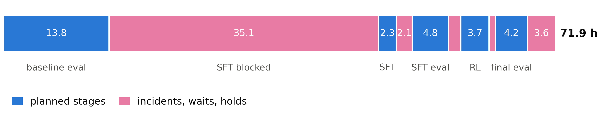</p>

<p align="center"><em>Chronological breakdown of run 1's 71.9-hour 8-node Slurm job (<code>docs/talk/data/campaign_hours.json</code>). Blue segments are planned evaluation and training; pink segments are systems incidents, fixes, and operator holds.</em></p>

| Campaign segment | Hours | What happened |
|---|---|---|
| Baseline evaluation | 13.8 | Full base suite, 10-seed `D-Num` noise floor, `D-Num pass@64` |
| SFT blocked | 35.1 | NFS lock hang (9.6h), pandas `NaN` crash, missing `flash-attn`, stage-7 VRAM fixes, pre-flight, step-50 validation crash |
| SFT training | 2.3 | `206` optimizer steps |
| HF export fix | 2.1 | Model merger adapted to handle this checkpoint format |
| SFT evaluation & gate | 4.8 | |
| RL launch failures | 1.6 | Single-node Ray override, missing sandbox on 7/8 nodes, stage-8 host RAM OOM |
| RL run 1 training | 3.7 | `56` steps, paused automatically by mismatch alert |
| Watcher wait | 0.8 | |
| Final evaluation | 4.2 | Step 20 checkpoint |
| Held for decision | 3.6 | Released cleanly afterwards |

Out of `71.9` wall-clock hours, planned computation took 28.7 hours (`40%`), whereas systems incidents, waits, and holds accounted for 43.2 hours (`60%`)—with `35.1` of those hours spent before SFT could even take its first step. Holding the nodes burned node-hours, yet saved days of wall-clock queue waits. Two mechanisms made holding allocations practical: `KEEP_NODES` pauses and retains the Slurm nodes whenever any stage fails, and in-job takeover rescues deadlocked runs without losing the queue slot (pause the stuck driver with `SIGSTOP`, launch a second copy inside the same allocation that inherits its environment and skips completed steps, and have a lightweight supervisor terminate the paused copy once the replacement finishes). **On congested shared machines, the queue sets the pace—engineer jobs so failures cost minutes of the allocation, not the allocation itself.**

`RL v2` ran across two more 8-node jobs:
- Seed 1 (`43.2` hours): `~22` hours building bank v2 and testing the `24K` budget (`8` hours stalled by the login node's `OMP_NUM_THREADS=1` leak, [PITFALLS](PITFALLS.md) C6), `20` hours training all `110` steps, and `1` hour lost in an evaluation whose `vLLM` servers silently failed to spawn (E4).
- Seed 2 (`22.0` hours): `19` hours training `110` steps and `3` hours evaluating, hitting a cross-node Lustre mkdir race at step 110 (C7) and one node's broken code sandbox (C8).

Total compute spent since October 13: `~1,290` node-hours, or `3,737 SU` (`docs/talk/data/run.json`, `compute`).

### 9.3 The incidents

Every systems and measurement incident encountered across the month is written up with its false story, root cause, fix, and regression test in [PITFALLS.md](PITFALLS.md). Here are the key systems incidents from the cluster runs:

| Incident | Impact | Fix & permanent guard |
|---|---|---|
| `verl` passed an inverted keep mask for Qwen3.5 to Megatron | On A100, training forward log-probs dropped `1–2` nats/token while eval parity passed | Import-hook mask conversion; GPU training-forward parity check ([PITFALLS](PITFALLS.md) B1) |
| Two HTTP clients kept `httpx`'s default 100-connection pool | Verification throttled to `~3.2` items/min; eval kept `~38/114` slots active | Pools sized to configured concurrency (C2) |
| Client timeouts shorter than queue wait + proxy 1h read timeout | Retried requests piled onto abandoned backend work; `pass@64` died at 1h | Little's law client timeouts; proxy removes read timeout and cancels dropped requests (C2) |
| Solver registry never imported; judge lacked reasoning parser | First full verification rejected all `102` templates | Real-data tests; 1-min cache re-verify (A1) |
| `ssh`-started shells miss login batch modules | `24` vLLM servers crashed (`libstdc++`); `7/8` nodes lacked `apptainer` → `79%` code scored `0` | `env.sh` preloads libs & resolves `apptainer` fallback; `ssh` test (C1) |
| File lock on NFS `$HOME` | SFT deadlocked pre-step-1; `8` nodes idle `9.6h` | Move lock to node-local `/tmp` (C4) |
| `pandas` read missing `tools` key as `NaN` | All `24` ranks crashed on batch 1 | Normalize to `None`; pre-flight tokenizes every real row (A2) |
| No fused attention kernel for `head_dim=256` at long sequences on A100 | First SFT forward failed; unfused OOM'd at `16K` | Compiled `flash-attn 2.8.3` for SM80; checked vs unfused (B3) |
| Unsharded vocab + MTP copy on last pipeline stage | Rows `>3.5K` tokens OOM'd | Four memory fixes + 8-node pre-flight (B2, §5.3) |
| `verl` ignored `optim.betas` and ran validation with `val_files: null` | Adam `β2 = 0.999`; crash at step 50 | Set directly on Megatron; `test_freq: -1` (C3) |
| `verl` driver spawned its own local Ray | RL saw only `3` of `24` GPUs | Export `RAY_ADDRESS`; token auth on Ray processes |
| MTP drafting forced vLLM sleep level 1 (CPU weight copies) | Step-1 checkpoint save OOM'd host RAM | Disable MTP rollout drafting → sleep level 2 (B4) |
| Login node `OMP_NUM_THREADS=1` leaked via `sbatch` | Bank v2 embedder ran single-threaded on 128-core node (`8h` lost) | Live debugger thread bump (`56`); explicit thread overrides in job script (C6) |
| `5` vLLM replicas silently failed `ssh` launch in seed 1 final eval | Eval timed out after 1h; requeued separately | Relaunch missing-log replicas after `60s`; proceed on `2/3` quorum (E4) |
| `24` ranks raced creating step-110 folder on Lustre | Seed 2 step-110 save failed; steps `101–110` lost | Retry `FileExistsError` on `local_mkdir_safe` (C7) |
| One node's sandbox cached a failed container probe | `~1/8` of seed 2 code training scored `0`; in-job `D-Code` scored `0.0` | Retry failed probes after `60s`; warm-up check; `>5%` error invalidates score (C8) |

---

## 10. What it found

- **The base model:** `Qwen3.5-9B` already saturates textbook seismology at 32K (`91.6%` single-sample, `99.6%` 8-vote accuracy on `D-Num`); its real headroom is token efficiency (`13%` right within `8K` tokens, §3.3).
- **SFT:** `13,095` teacher conversations lifted `D-Num-hard` (`+6.1`), `D-Fresh` (`+8.1`), `D-Code` (`+5.8`), `GPQA` (`+14.7`), and `LiveCodeBench` (`+14.3`) while cutting tokens `35%`, trading off a `−2.2` dip on `D-Num` via wrong values (§5.4).
- **RL run 1:** Fixed unfinished reasoning through step 20 (`16K` dev numeric `92.0 → 97.3`), matched SFT accuracy using `41%` fewer tokens, then collapsed to zero accuracy at step 52 for reasons still open (§6.4).
- **Gradient starvation:** Difficulty filtering on the base model left `87%` of SFT's numeric and code groups with zero GRPO gradient (§6.3).
- **RL v2:** Re-grading the bank with SFT, scoring cut-offs as wrong, and halving LR produced `110` stable steps and cleared the pre-registered test decisively: `+18.4` on `D-Num-hard` (`86.5`) and `+10.4` on `D-Fresh` at `32K`—mostly by finishing cut-off answers—while also lifting `D-Num` (`95.6`), `D-Code` (`92.7`), `GPQA` (`77.5`), and `LiveCodeBench` (`63.2`). Seed 2 replicated (`+16.8` `[+13.4, +20.3]` pooled on `D-Num-hard`, `+9.5` `[+4.4, +15.0]` on `D-Fresh`). Refusals remained low (`45.7%`), and `D-Report` (`58.0`) stayed inside noise (§1.2, §8.3, §8.6).
- **Rewards & judges:** Programmatic rewards agree `99.3–100%` with eval graders. Gemma's `0–10` report reward is highly lenient (`7%` precision vs Luna at mark `70`) and uses `91%` compound rubrics, though RL caused no judge drift (§6.5).
- **Failure modes:** Numeric errors are overwhelmingly execution (running out of tokens), except two receiver-function families where the base model lacks the formula. Reports fail on domain knowledge untouched by SFT or RL (§7.2).
- **64K budgets:** Given `64K` tokens on `D-Num-hard`, SFT jumps to `83.9%` (`>50%` of its `32K` cut-offs were on the right path), beating RL step 20 (`77.5%`) and base (`69.8%`); RL v2 leads both (`90.2%`, §7.3).
- **Against larger models:** At `16K` on `D-Num-hard`, `9B RL v2` (`69.5%`) beats `Qwen3.8-27B` (`59.6%`) and `Qwen3.5-122B-A10B` (`22.7%`) because larger models time out; at `32K`, `RL v2` matches/edges `122B` (`+3.0` `[+0.1, +5.8]`) while trailing the `27B` teacher by `3.1` points due to wrong values (`7.3%` vs `1.2%`, §1.5).
- **Safety:** Refusals on should-refuse prompts dropped from `56.0%` to `45.7%` (strict) and by `7.7` points under a broad upper bound, concentrated on benign-sounding unsafe prompts (§7.4).
- **Systems:** `60%` of run 1's 8-node job went to incidents/holds; stage 7 ran at `40,366 / 40,437 MiB` (§9).
- **Screening & bugs:** Frontier screening confirmed all `220` numeric test labels, flagged `7/320` items (no conclusion altered), exposed the Hutton–Boore constant bug in `825` run-1 training problems (§8.5), and rejected `98/100` paper-based `SFT v2` rows due to ungrounded memory hallucinations (§8.4).
- **Reviewer position bias:** Single-order blind review strongly favoured first position; over both orders, RL step 20 scores `60.0%` vs base, sitting between Gemma (`86.7%`) and Luna (`45.0%`, §8.5).

**Still unmeasured:** human gold labels anywhere; a third seed (`seed 3` at `16K` cancelled pre-launch) or data/size/step scaling curves; manual review of the `27` ambiguous refusal shifts; the root cause of run 1's collapse; and isolating the `24K` vs `16K` budget effect cleanly (§8.3).

---

## 11. How this recipe scales

Always report compute in portable units: saying `"56 RL steps"` means nothing on a different batch size, whereas `"56 steps × 1,008 samples at ≤ 16K tokens"` defines exact work.

| Scaling axis | Measured in this project | Recommended next additions |
|---|---|---|
| SFT data | One mix: `13,095` conversations (`44.1M` tokens), single run | Data sweep (`¼×, ½×, 1×`) on `D-Num-hard` & `D-Report`; strictly sentence-grounded paper report rows (§8.4) |
| RL compute | Run 1: `56 × 1,008` at `≤16K` (`~3.7h` on 8 nodes, good to step 20). RL v2 seed 1: `110 × 1,008` at `≤24K` (`~20h` on 8 nodes, stable throughout, §8.6) | A `16K` third seed (`seed 3` cancelled, §8.3); longer training past `110` steps to locate saturation |
| Model size | `9B` only (`27B` RL does not fit 40 GB GPUs) | `27B` on 80 GB GPUs, or `4B` for cheap ablations |
| Mid-training | None (§8.2) | Small token-count sweep only *after* sentence-grounded knowledge SFT is tested |
| Test-time compute | `2K–32K` budgets & `1–64` votes on `D-Num`; up to `64K` on `D-Num-hard` (§7.3) | Sweep `low` and `xhigh` reasoning effort |
| Evaluation | `770` domain items, single budget, model-checked refs (`320` reviewed, §8.5) | Human gold benchmarks on `~100` reports and `~200` numerical edge cases |
| Systems | `8 × 3` A100-40GB, `TP1 × PP8 × DP3`, ~3-day queue | Self-updating queued jobs that pull steps at start (§8.3) |

In order, run 1 was bounded by cluster queueing/systems (§9), an overly easy bank (§6.3), and an uncontained length collapse (§6.4). RL v2 fixed the second and third bottlenecks; queueing still sets wall-clock cadence, while domain knowledge remains the limit on two numeric families and reports (§7.2).

---

## 12. Failure atlas & pipeline pitfalls

Every high-cost failure—especially silent bugs that produced numbers looking right while measuring something wrong—is documented in [PITFALLS.md](PITFALLS.md) using a consistent **Symptom → False story → Root cause → Fix → Permanent regression test → Invalidated artifacts → Generalisable lesson** format.

---

## 13. Repository layout

The Python package lives under `src/dpt` (*domain post-training*). Evaluation modules never import reward code so bugs in training rewards cannot silently hide inside evaluation metrics.

```
qwen-seis-posttrain/
├── src/dpt/
│   ├── data/            # data pipeline: ingest, quality, dedup, decontamination, verification, difficulty, bank & SFT builds
│   │   └── gen/         # problem generators: T1 solver families, T2 code, T3 rubrics, T4 general, paper knowledge (held-out modules kept private)
│   ├── rewards/         # RL reward functions: numeric, code sandbox, LLM judge, instruction checks, citations, length, hack patterns
│   ├── rl/              # framework-free RL math: advantages, clipped loss, TIS, filtering, curriculum, mismatch, partial rollout
│   ├── verl_ext/        # verl integration layer: reward wrapper, sampler, trainer hooks, and runtime monkey-patches
│   ├── eval/            # evaluation harness, graders, judges, statistics, gates, budgets, blind review, drift audit
│   ├── parity/          # vLLM-vs-Megatron log-prob parity, GPU train-forward parity, Gated DeltaNet kernel checks
│   ├── launch/          # SFT & RL launchers, pre-flight probes, walltime and checkpoint tools
│   ├── monitoring/      # auto-pause alerts, dashboards, run comparisons
│   ├── chat/            # chat template rendering and <think> / answer splitting
│   ├── planning/        # memory, FLOPs, and communication budgets per hardware profile
│   └── common/          # config loading, hashing, manifests, seeds, I/O
├── configs/             # model lines, hardware profiles, data, SFT, RL, eval (one YAML per experiment)
├── scripts/
│   ├── 00_setup_env.sh … 08_audit.sh   # standalone stage scripts runnable on any machine
│   ├── slurm/           # Slurm batch scripts for campaign, RL v2 seeds, and knowledge pipeline (see scripts/slurm/README.md)
│   ├── talk/            # analysis scripts behind reports: collection, run comparison, stage example, failure types, judge drift, refusals, RL v2 watch
│   └── readme_figures.py   # regenerates all README figures
├── tests/               # CPU unit tests mirroring src/dpt
├── docs/
│   ├── reports/         # 11-10 deep-dive analyses on rewards, failure types, and tests (EN & ZH)
│   ├── talk/data/       # run results in JSON: single source of truth for every figure and table
│   └── *.md             # subsystem design documents: data, evaluation, RL algorithm, rewards, systems, verl
└── assets/              # README figures (PNG + PDF, English and Chinese)
```

---

## 14. Regenerate figures

```bash
python scripts/readme_figures.py                     # all 20 figures (EN & ZH) → assets/
python scripts/readme_figures.py rl_steps            # regenerate a single figure
python scripts/talk/collect.py                       # on cluster: refresh docs/talk/data/run.json
python scripts/talk/collect.py --eval-only rl_v2     # off-cluster evaluation run (WORK=<folder>)
python scripts/talk/rl_compare.py                    # run 1 vs RL v2 → docs/talk/data/rl_runs_compared.json
python scripts/talk/stage_example.py --model ...     # one question across stages → docs/talk/data/stage_example.json
python scripts/talk/refusal_breakdown.py             # refusals by detector & category → docs/talk/data/refusal.json
```

All README figures read exclusively from `docs/talk/data/*.json`. The two manually transcribed files (`campaign_hours.json` and `last_stage_memory.json`) document the exact run note behind every number.

---

## References

**Policy optimization**
- Schulman, J., et al. (2017). Proximal Policy Optimization Algorithms. arXiv:1707.06347.
- Shao, Z., et al. (2024). DeepSeekMath: Pushing the Limits of Mathematical Reasoning in Open Language Models (GRPO). arXiv:2402.03300.
- Yu, Q., et al. (2025). DAPO: An Open-Source LLM Reinforcement Learning System at Scale (clip-higher, overlong shaping). arXiv:2503.14476.
- Liu, Z., et al. (2025). Understanding R1-Zero-Like Training: A Critical Perspective (no std division). arXiv:2503.20783.
- Yao, F., et al. (2025). Your Efficient RL Framework Secretly Brings You Off-Policy RL Training (truncated importance sampling). Blog post.

**Systems**
- Sheng, G., et al. (2025). HybridFlow: A Flexible and Efficient RLHF Framework (verl). EuroSys.
- Shoeybi, M., et al. (2019). Megatron-LM: Training Multi-Billion Parameter Language Models Using Model Parallelism. arXiv:1909.08053.
- Narayanan, D., et al. (2021). Efficient Large-Scale Language Model Training on GPU Clusters Using Megatron-LM. SC.
- Kwon, W., et al. (2023). Efficient Memory Management for Large Language Model Serving with PagedAttention (vLLM). SOSP.
- Dao, T. (2023). FlashAttention-2: Faster Attention with Better Parallelism and Work Partitioning. arXiv:2307.08691.
- Yang, S., et al. (2025). Gated Delta Networks: Improving Mamba2 with Delta Rule. ICLR.
- Gloeckle, F., et al. (2024). Better & Faster Large Language Models via Multi-token Prediction. ICML.
- Little, J. D. C. (1961). A Proof for the Queuing Formula L = λW. Operations Research.

**Evaluation**
- Chen, M., et al. (2021). Evaluating Large Language Models Trained on Code (unbiased pass@k). arXiv:2107.03374.
- Wang, X., et al. (2023). Self-Consistency Improves Chain of Thought Reasoning in Language Models. ICLR.
- Zheng, L., et al. (2023). Judging LLM-as-a-Judge with MT-Bench and Chatbot Arena. NeurIPS.
- Rein, D., et al. (2023). GPQA: A Graduate-Level Google-Proof Q&A Benchmark. arXiv:2311.12022.
- Wang, Y., et al. (2024). MMLU-Pro: A More Robust and Challenging Multi-Task Language Understanding Benchmark. NeurIPS.
- Zhou, J., et al. (2023). Instruction-Following Evaluation for Large Language Models (IFEval). arXiv:2311.07911.
- Jain, N., et al. (2024). LiveCodeBench: Holistic and Contamination Free Evaluation of Large Language Models for Code. arXiv:2403.07974.
- Röttger, P., et al. (2024). XSTest: A Test Suite for Identifying Exaggerated Safety Behaviours in Large Language Models. NAACL.
- Chao, P., et al. (2024). JailbreakBench: An Open Robustness Benchmark for Jailbreaking Large Language Models. NeurIPS Datasets and Benchmarks.
- Broder, A. Z. (1997). On the Resemblance and Containment of Documents (MinHash). SEQUENCES.

**Seismology**
- Zhu, L., & Kanamori, H. (2000). Moho depth variation in southern California from teleseismic receiver functions (H-κ stacking). Journal of Geophysical Research, 105(B2), 2969–2980.

## Acknowledgements

This pipeline builds on `verl`, `Megatron-Core`, `Megatron-Bridge`, `Transformer Engine`, `vLLM`, and `Ray`. `Qwen3.5-9B` and `Qwen3.8-27B` are by the Qwen team; `Gemma 4` is by Google DeepMind; `GPT-6 Luna` is by OpenAI.

## Data & licensing

- **Held-out test sets are unpublished:** prompts, answers, and rubrics remain strictly on the training machine so they stay valid held-out benchmarks; this repository publishes aggregate statistics only.
- **Held-out problem generators are unpublished:** the templates, parameter bounds, and solvers behind the `18` held-out numeric families (`D-Num`, `D-Num-hard`) and `11` held-out coding tasks (`D-Code`) live in three git-ignored files (`src/dpt/data/gen/*_heldout.py`). The public repository runs cleanly without them (the held-out split stays empty, and the six tests constructing those sets skip automatically via `dpt.data.gen.common.import_private_module_if_present`).
- **GPT-6 Luna** was used strictly for evaluation (drafting/checking test items, second judging, failure labelling). None of its outputs appear in any training dataset, per its terms of service.
- **Model weights** are released on Hugging Face under Apache-2.0 (matching the base model): [SFT](https://huggingface.co/jiazhe868/Qwen3.5-9B-Seis-SFT) (`sft9b_seed1`), [RL run 1](https://huggingface.co/jiazhe868/Qwen3.5-9B-Seis-RL-run1) (`rl9b_seed1_step20`), and [RL v2](https://huggingface.co/jiazhe868/Qwen3.5-9B-Seis-RL-v2) (seed 1, step 110), `19 GB` each.
- Public benchmarks (`GPQA`, `MMLU-Pro`, `IFEval`, `LiveCodeBench`, `XSTest`, `JailbreakBench`) follow their own licenses and are not redistributed here (GPQA requests its items not be published online).
- `Qwen3.5-9B` and other upstream models remain governed by their respective licenses.

## License

MIT — see [LICENSE](LICENSE).
