<div align="center">

# Qwen-Seis-Posttrain

[English](README.md) | [中文](README.zh-CN.md) | [nanoGPT-Seis（预训练）](https://github.com/jiazhe868/nanogpt-seis) | [nanoGPT-Seis-Posttrain（113M SFT + GRPO）](https://github.com/jiazhe868/nanogpt-seis-posttrain)

Hugging Face 模型权重：[SFT](https://huggingface.co/jiazhe868/Qwen3.5-9B-Seis-SFT) | [RL 第一轮](https://huggingface.co/jiazhe868/Qwen3.5-9B-Seis-RL-run1) | [RL v2（最终模型）](https://huggingface.co/jiazhe868/Qwen3.5-9B-Seis-RL-v2)

在共享 GPU 集群上针对地震学领域对 Qwen3.5-9B 进行后训练（post-training）：先在教师模型编写并经过校验的解答上做监督微调（SFT），再采用结合程序化规则与大模型裁判的多任务组相对策略优化（GRPO）强化学习；所有模型均在训练启动前就已冻结的领域测试集上评测。全部实验在一个月内完成，硬件为 8 个 Slurm 计算节点（每节点 3 × NVIDIA A100-PCIe-40GB）。

</div>

<p align="center">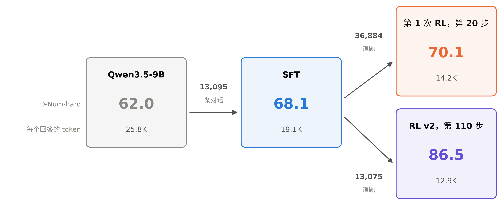</p>

<p align="center"><em>各训练阶段在 D-Num-hard 上的准确率（160 道留出题的 avg@8）与平均每条回答的输出 token 数。箭头标注流向下一阶段的训练数据；两次 RL 均从 SFT 检查点起步。</em></p>

## 概要

本项目在 24 卡共享集群（8 节点 × 3 张 A100-40GB）上，围绕定量地震学与科学推理对 Qwen3.5-9B 实施完整的后训练闭环。为了保证评测严谨客观，所有核心测试集都在任何训练开始前就已完成构建和版本冻结；同时，包括未微调基座在内的所有模型，均在完全相同的评测框架、提示模板和 token 预算下从头跑分。

阅读下文前，先快速对齐几个核心命名：
- **领域测试集：** `D-Num`（300 道教科书难度的地震学数值计算题）、`D-Num-hard`（160 道来自未见过题族的 3 步以上高难度数值题）、`D-Fresh`（60 道在模型发布日期之后全新编写、可排除预训练泄漏的题目）、`D-Code`（150 道隔离沙箱评测的地震学编程题）、`D-Report`（100 道长篇科学分析报告题）。
- **RL 训练任务：** `T1`（程序化求解器核验的数值推理）、`T2`（隐藏单元测试核验的 Python 编程）、`T3`（LLM 裁判按评分细则打分的技术报告）、`T4`（程序化约束核验的通用指令遵循与数学回放）。
- **核心指标：** `avg@8` 指每题采样 8 次的平均准确率；`pass@k` 指 `k` 次尝试中至少答对一次的概率。

整个实验月的推进脉络与核心发现如下：

### 1. 基座起步：教科书题目已经接近满分，瓶颈在于推理太冗长
领域后训练的常见路径是从一个强力开源模型出发，先通过 SFT 对齐格式与风格，再用 RL 拔高能力上限。实验一开始就让我们意外的是：Qwen3.5-9B 原生就已经非常擅长教科书级的地震学计算。在 `D-Num` 上，它的单样本平均准确率（`avg@8`）达到 91.6%，8 次采样至少答对一次的比例（`pass@8`）高达 99.7%。为数不多的失误几乎全都是执行收尾问题，而非物理公式用错：4.6% 的样本写满 32K token 上限仍未得出结论，2.3% 出现格式错误（如漏写单位或给出多个答案），真正算错数值的仅占 1.5%。

既然 `D-Num` 在 32K 预算下的准确率已经饱和，真正的提升空间就在推理效率上：如果把输出预算收紧到 8K token，基座模型只有 13% 的样本能在预算内答对（§3.3）。为了在不撞天花板的前提下真正衡量能力增长，我在看到任何训练结果之前就设计并冻结了一套更难的评测切片——D-Num-hard，涵盖 8 个训练阶段从未出现的复杂题族（共 160 题，每题至少需要 3 步以上推导）。在 `D-Num-hard` 上，基座模型只拿到 62.0%，且在两个接收函数（receiver-function）题族上准确率接近零（其中一族 160 个样本里有 159 个写满 32K token 仍未结束，§3.4）。

### 2. 第一阶段（SFT）：显著压缩长度并全面提分，仅 D-Num 微降
随后我们在 13,095 条对话（4,410 万 token）上运行了全参数 SFT，主体数据由 Qwen3.8-27B 教师模型生成解答并经由程序化求解器核验通过。SFT 教会了 9B 模型复现教师紧凑利落的推导风格和规范的最终答案格式，把平均输出长度砍掉了三分之一以上（从 1.47 万 token 降至 9,517 token），从而带动几乎所有原本因超时丢分的测试集全面上涨：
- D-Num-hard：`+6.1` 分（升至 68.1%）
- D-Fresh：`+8.1` 分（升至 78.8%）
- D-Code：`+5.8` 分（升至 86.3%）
- GPQA Diamond：`+14.7` 分（升至 71.3%）
- LiveCodeBench：`+14.3` 分（升至 52.5%）

唯一的例外是 `D-Num` 下降了 2.2 个百分点（降至 89.4%），超出了 10 组随机种子的采样噪声底线（标准差 `0.46`）。拆解错误样本后原因很清楚：SFT 让模型更果断地给出结论，但也略微抬高了给出错误数值的比例（§5.4）。

### 3. 第二阶段（第 1 轮 RL）：前 20 步顺利提效，随后发生长度崩塌
接着，我们在四类共 36,884 道题（`T1`–`T4`）上启动多任务 GRPO。然而题库构建时埋下了一个隐蔽错位：难度过滤是用基座模型跑的，而 RL 实际是从强得多的 SFT 模型起步。这导致第 1 轮 RL 前 20 步中，有高达 87% 的数值题组和代码题组出现“8 个采样全部做对”的情况——组内没有对错区分，GRPO 优势全为零，几乎不产生梯度（§6.3）。

即便信号稀疏，前 20 步仍然明显改善了模型在预算内收尾的能力：16K 限制下的开发集数值题准确率从 92.0% 升到 97.3%。但从第 20 步之后，所有任务的回答长度一路急剧萎缩。到第 52 步，数值与代码准确率跌至零；第 56 步时，训练/推理对数概率失配告警自动暂停了训练。最初我怀疑是 `T4`（通用任务）奖励了简短回答并主导了稀疏梯度，但逐步骤日志推翻了这一猜想——在每一步内部，答对和答错的回答长度基本一致。第 1 轮 RL 崩塌的真正诱因至今仍未完全定论（§6.4）。

按开发集曲线选出的最佳检查点（第 20 步）维持了 SFT 的综合精度，同时将平均输出进一步削减 41%（降至 5,637 token）：`D-Num-hard` 达到 70.1%，`D-Fresh` 提高 `+4.6`，`GPQA` 提高 `+2.9`。但在 `D-Num-hard` 上已经能看出隐患：1,280 个样本里未完成数从 `361` 降到 `211`，而错误数值却从 `46` 暴增到 `161`（§7.1）。此外，安全拒答率也出现实质性下滑：即使用最宽泛的拒答检测器，模型在应拒答提示上的拒答率也降低了 7.7 个百分点，主要集中在措辞看似无害的诱导样本上（§7.4）。

### 4. 校验裁判可信度，并追查失败根源
由于 `T3` 报告任务依赖 Gemma 4 26B-A4B 作为裁判，我们引入从未参与任何训练或筛选的独立第二裁判 GPT-6 Luna 重评了完全相同的报告配对。结果两位裁判分歧极大：Gemma 认为 SFT 报告对基座有 86% 的胜率，而 Luna 只给出 49%（平局）。以 70 分为及格线，Luna 判为不及格的 133 份报告中，Gemma 给其中 100 份打了及格；而且 Gemma 使用的 5,765 条评分细则中有 91% 将多个科学论断捆绑成一条复合标准。好消息是，在 RL 训练过程中两位裁判的分歧反而在缩小，证明 RL 并没有学会“讨好”奖励裁判（§6.5）。

为了明确下一步该补知识还是练执行，我对所有失败样本做了错误归因，并把在 32K 处截断的样本全部续写到 64K token（§7.2、§7.3）：
- 数值题失败主要是“没来得及写完”（执行瓶颈）：放开到 64K 空间后，SFT 模型在 `D-Num-hard` 上的正确率跃升至 83.9%——反超第 1 轮 RL 第 20 步（77.5%）和基座模型（69.8%）。两个接收函数题族对基座确实是知识盲区，但 SFT 一旦拥有足够的 token 空间就能解出大约一半。
- 报告题失败则是真正的“知识缺口”：报告普遍缺失核心科学内容或出现概念错误，这一点 SFT 和 RL 均未改善。

由此路线图非常明确：数值任务此时不需要继续预训练（中期训练，mid-training）；而针对报告知识缺口，性价比最高的实验是尝试从论文合成知识密集型 SFT 数据（§8.2）。

### 5. 用前沿大模型做盲审筛查，发现两处数据与公式隐患
由于当时没有领域专家可请，我们邀请一个前沿大模型对测试集与新数据做了全面、盲态的专家筛查（§8.5）：
- 冻结测试集经受住了检验：不看答案盲解全部 `D-Num-hard` 和 `D-Fresh` 共 220 道数值题，确认每一个标准答案全部正确；剔除被标记的 7 道边缘测试题后，所有实验结论丝毫不变。
- 发现并修复了一处隐蔽的震级公式 bug：筛查发现一个数值生成器在题干里印出了错误的 Hutton–Boore 震级常数（振幅单位为毫米 mm 时，错用了纳米 nm 对应的常数 `-2.09`，而正确值应为 `+0.591`）。因为题目自己印着错公式，求解器、教师和裁判全部照着错公式算出了同一个错答案，导致 825 道相差 `2.681` 震级单位的错题顺利通过了三方验证并混入第 1 轮 RL 题库！题库 v2 已移除这批受影响题目。
- 果断放弃纸面质量不过关的 `SFT v2` 论文数据：我原本让教师模型阅读 3,000 篇开放许可论文来生成 `SFT v2` 报告数据（§8.4），但在开训前抽查了 3,262 条中的 100 条，评审建议只留 2 条、直接删掉 50 条：为了让问题不依赖原文，教师模型凭预训练记忆补充了大量具体地震与断层细节，结果频频捏造事实——而 Gemma 对照论文段落的核查根本看不出原文之外的幻觉。于是我立刻取消 `SFT v2`，把原本排队给它的 8 节点作业额度改用来跑 RL v2 的第二个随机种子。

### 6. 重构 RL（`RL v2`）：兼顾速度与可靠性，110 步全程稳健
在 32K 预算下，第 1 轮 RL 第 20 步在 `D-Num-hard` 上只领先 SFT `+1.9` 分 `[−0.7, +4.6]`、在 `D-Fresh` 上只领先 `+4.6` 分 `[−0.8, +10.4]`，全部落在采样噪声内。在启动 RL v2 之前，我立下了明确的成功标准：在 32K token 预算下，同时在 `D-Num-hard` 和 `D-Fresh` 上以 95% 配对自助法显著超过 SFT。

针对第 1 轮信号匮乏与激励扭曲的问题，RL v2 做了精准重构（§8.3）：
1. 用 SFT 模型重评整个题库难度，专留 SFT “时对时错”的题目，并新增 18 个长程高难数值题族及专属难题开发集。
2. 把写满上限被截断的回答直接判为错误（0 分），并取消软长度惩罚。对第 1 轮第 0 步的回放证明，软长度惩罚会惩罚在上限附近算对的慢回答，反而放过没写完的截断回答。
3. 以 24K 上限训练（学习率减半，并移除嘈杂的报告任务；原计划在 16K 训练的第 3 个种子因前两个种子高度一致而在启动前取消）。

RL v2 运行稳定并达到预期目标。种子 1 稳稳跑完全部 110 步，没有发生任何崩塌，高分通过预先设定的检验：
- D-Num-hard（32K）：达到 86.5%，比 SFT 整整高出 +18.4 分 `[+14.4, +22.4]`。即便放宽到 64K（第 1 轮 RL 在那里曾落后 SFT `6.4` 分），RL v2 仍然大幅领先（+6.3 `[+3.7, +9.1]`）。
- D-Fresh（32K）：达到 89.2%（比 SFT 高 +10.4 `[+5.2, +16.2]`），64K 下仍领先 `+5.8` `[+1.7, +10.4]`。
- 为什么有效：在 32K 预算下，`D-Num-hard` 上写不完的样本比例从 SFT 的 28% 降至 6%，而数值错误仅从 4% 微升至 7%（远低于第 1 轮的 13%）。训练末期，同样只剩下约九分之一的数值题组带有梯度——和第 1 轮开局时一样稀疏——但训练依然无比稳定，说明“信号稀疏”本身并非第 1 轮崩塌的直接原因（§8.6）。
- 全面增益：`D-Num` 升至 95.6%（首次突破基座水平），`D-Code` 达到 92.7%，`GPQA` 77.5%，`LiveCodeBench` 63.2%，且平均回答长度为全系列最短（5,152 token）。拒答率停在 45.7%（未加入安全数据）。由于集群最终评测排队拥堵，种子 1 完整测试集在工作站 A100 上以同一套评测框架完成；种子 2 在集群上顺利复现了结果（32K 下 `D-Num-hard` `+15.2`，`D-Fresh` `+8.5`），因此种子 3 在排队启动前被主动取消。

### 7. 集群系统的真实代价
整个月里真正消耗精力的主要是系统工程而非纯算法调参。第 1 轮那个 8 节点大作业共运行 71.9 小时，其中计划内评测和训练只占 28.7 小时，其余 43.2 小时全都花在故障排查、挂起等待和节点保留上（单是 SFT 顺利启动前就卡了 35.1 小时，§9.2）。将带有 24.8 万词表和 MTP 头的 9B 模型放入 40 GB 显卡时余量极小——流水线最后一段峰值显存吃到 40,366 MiB / 40,437 MiB（§5.3）。`RL v2` 另跑了两个 8 节点作业（43 小时和 22 小时），期间的系统事故丢掉了种子 1 的作业内评测以及种子 2 的最后 10 步检查点（§9）。每次系统事故都沉淀为自动化测试或防护措施，全部 30 起事故均已详尽记录在 [PITFALLS.zh-CN.md](PITFALLS.zh-CN.md)。

---

## 目录

1. [结果速览](#1-结果速览)
2. [快速开始](#2-快速开始)
3. [在训练之前定义成功](#3-在训练之前定义成功)
4. [数据：RL 题库与 SFT 混合数据](#4-数据rl-题库与-sft-混合数据)
5. [第一阶段：监督微调](#5-第一阶段监督微调)
6. [第二阶段：多任务 RL](#6-第二阶段多任务-rl)
7. [模型错在哪里](#7-模型错在哪里)
8. [测试与结果意味着什么](#8-测试与结果意味着什么)
9. [系统：在共享超算上的一个月](#9-系统在共享超算上的一个月)
10. [评测发现了什么](#10-评测发现了什么)
11. [进一步放大这套方法还需要测什么](#11-进一步放大这套方法还需要测什么)
12. [失败图谱与训练陷阱](#12-失败图谱与训练陷阱)
13. [仓库结构](#13-仓库结构)
14. [重新生成图表](#14-重新生成图表)

配套排坑手册：[PITFALLS.zh-CN.md](PITFALLS.zh-CN.md) 系统整理了搭建本流水线过程中遇到的 30 次关键故障、它们制造的假象以及相应的回归测试。

---

## 1. 结果速览

### 1.1 模型、数据与算力

| 组件 | 详细配置 |
|---|---|
| 基座模型 | Qwen3.5-9B（开源发布版，开启思考，推理强度 `medium`）：32 层混合 Gated DeltaNet 与全注意力（`head_dim = 256`），配多 token 预测（MTP）头，词表大小 `248,320` |
| 教师模型 | Qwen3.8-27B（FP8）：负责撰写 SFT 解答与报告，并在题库校验中独立解题投票 |
| 奖励裁判 | Gemma 4 26B-A4B（FP8）（单张 A100 部署）：负责 `T3` 报告奖励打分、题库校验投票与数据检查 |
| 第二裁判 | GPT-6 Luna（API），严格仅限评测使用：担任 `D-Report` 独立第二裁判、裁判漂移审计以及错误类型标注。其输出不进入训练集 |
| RL 题库 | 第 1 轮：生成 `57,037` 道题经四道过滤保留 `36,884` 道（§4）：`25,588` 数值（`T1`）、`2,495` 代码（`T2`）、`1,193` 报告（`T3`）、`7,608` 通用（`T4`）。RL v2：`13,075` 道由 SFT 策略重评的题：`7,433` 数值、`2,442` 代码、`3,200` 通用（§8.3） |
| SFT 混合数据 | `13,095` 条对话（`4,410 万` token）：`8,776` 条经验证的数值解答、`1,301` 条工具调用编程轨迹、`554` 篇裁判优选报告、`2,464` 条基座自写通用指令回放（§4.5） |
| RL 训练设置 | 第 1 轮：组均值优势 GRPO（`8` 样本/题），每步 `126` 提示词，PPO 裁剪 `0.2 / 0.28`，无 KL 项，`16K` 长度上限；计划 `120` 步跑至 `56` 步中止，取第 `20` 步（§6）。RL v2：同算法学习率减半，`24K` 上限，截断计为错误；双种子各跑 `110` 步（种子 2 于第 `100` 步评测，§8.3） |
| 集群硬件 | 8 个 Slurm 节点 × 3 张 NVIDIA A100-PCIe-40GB（节点内无 NVLink，节点间 InfiniBand）。训练采用 `TP1 × PP8 × DP3`；rollout 在同一批 24 张卡上共置 `24` 个单卡 `vLLM` 实例 |
| 算力消耗 | 2026-10-13 至 11-19 共约 `1,290` 节点小时：第 1 轮 71.9 小时 8 节点大作业占 `575` 节点小时，RL v2 两个 8 节点作业占 `521` 节点小时（§9.2） |
| 评测体系 | 5 个训练前冻结的领域测试集（共 `770` 题）、5 个通用公开基准、1 个 `650` 条提示的安全拒答集；采用 95% 置信区间及 10 种子噪声底线（§3） |

### 1.2 各阶段结果

<p align="center">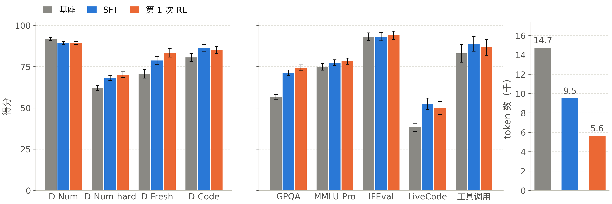</p>

| 测试集（指标，题数） | 基座 | SFT | RL 第 1 轮（第 20 步） | RL v2（种子 1，第 110 步） |
|---|---|---|---|---|
| D-Num（`avg@8`，300） | 91.6 ± 1.0 | 89.4 ± 0.9 | 89.2 ± 1.0 | **95.6** ± 0.7 |
| D-Num-hard（`avg@8`，160） | 62.0 ± 1.6 | 68.1 ± 1.4 | 70.1 ± 1.7 | **86.5** ± 1.5 |
| D-Fresh（`avg@8`，60） | 70.6 ± 2.6 | 78.8 ± 2.3 | 83.3 ± 2.6 | **89.2** ± 1.9 |
| D-Code（`pass@1`，150） | 80.5 ± 2.3 | 86.3 ± 2.0 | 85.2 ± 2.2 | **92.7** ± 1.5 |
| D-Report（对基座胜率，取两裁判较低者，100） | 50 | 49.0 ± 9.0 | 49.0 ± 8.5 | 58.0 ± 9.0 |
| GPQA Diamond（198） | 56.6 ± 1.6 | 71.3 ± 1.6 | 74.2 ± 1.8 | **77.5** ± 1.5 |
| MMLU-Pro，2K 子集（只看变化） | 74.8 | 77.3 | 78.3 | 79.2 |
| IFEval（377） | 93.1 | 93.1 | 93.9 | 93.6 |
| LiveCodeBench 2025-01 之后（70，只看变化） | 38.2 | 52.5 | 50.0 | **63.2** |
| 工具调用（188） | 83.0 | 88.8 | 86.7 | 87.8 |
| 应拒答提示词的拒答率，%（300） | **56.0** | 51.3 | 45.7 | 45.7 |
| 无害提示词的过度拒答率，%（350） | 3.4 | 4.0 | 2.6 | 2.9 |
| 平均输出 token 数 | 14,735 | 9,517 | 5,637 | **5,152** |

*评测口径说明：* `±` 为采样噪声的 95% 区间。所有模型——包括基座模型——都在完全相同的评测工具、提示模板和解码参数下重跑得出（§3.2），无任何直接抄录数据。上图略去了 `D-Report`（该项单独在 §6.5 展开作图）。原始数据出自 `docs/talk/data/run.json`。由于 `RL v2` 种子 1 在集群上的最终评测作业一直排队，我在工作站 A100 上以同一套评测框架、参数与判分器完成了全套测试（`docs/talk/data/rl_v2_seed1_local_1118.json`）；编程测试运行在 `bubblewrap` 沙箱中（重跑 SFT 集群回复得到分毫不差的 `86.3` 和 `52.5` 作为交叉验证），`D-Report` 第二裁判从集群登录节点调用，集群另复跑了 `D-Num-hard` 和 `D-Fresh` 核对。

各阶段主要变化解读：
- SFT 带来了最显著的起始跃升，核心贡献来自“精简推理”。平均输出缩短三分之一后，原本频繁超时的测试集分数普遍上升：GPQA 在 32K 处被截断的比例从 `38%` 降到 `17%`，LiveCodeBench 从 `61%` 降到 `29%`（`docs/talk/data/failure_types.json`, `cut_off_32k`）。唯有 `D-Num` 微降 `2.2` 分，源自错误数值率略有增加（§5.4）。
- 第 1 轮 RL（第 20 步）进一步提速，但尚未补足可靠性。输出长度再省 `41%`，大部分分数基本持平，只有 `D-Fresh`（`+4.6`）和 `GPQA`（`+2.9`）显著超出置信区间，`D-Num-hard` 仅微升 `+2.0`（配对 `[−0.8, +4.8]` 仍在噪声内）。RL 前定的 8 道发布门槛只过了两道（通用能力与推理成本）。在独立第二裁判眼中，`D-Report` 并无进步，安全性拒答率则出现了真实下滑（§7.4）。
- RL v2 真正打通了高难推理。种子 1 在 `D-Num-hard` 拿到 86.5%（配对较 SFT 大涨 +18.4 `[+14.4, +22.4]`），`D-Fresh` 拿到 89.2%（`+10.4` `[+5.2, +16.2]`），顺利通过预先定下的检验（§8.3）。它靠的是把难算的推导真正收尾：`D-Num-hard` 上 32K 截断率从 SFT 的 `28%` 降至 `6%`。同时增益全面外溢：`D-Num` 首度反超基座升至 95.6%，`D-Code` 92.7%，`GPQA` 77.5%，`LiveCodeBench` 63.2%，平均长度降至全阶段最低（`5,152` token）。未动的两项是拒答率（保持在 `45.7%`，因未加入安全数据）和第二裁判下的 `D-Report`（`58.0%`，仍在 SFT `49.0%` 噪声范围内）。
- 种子 2 顺利复现。在最后保存的第 100 步检查点上（§8.3），种子 2 测得：`D-Num-hard 83.4`、`D-Fresh 87.3`、`D-Num 95.0`、`D-Code 90.8`、`GPQA 77.9`、`LiveCodeBench 56.1`、`D-Report 62.5`、拒答率 `49.0%`（`docs/talk/data/run.json`；代码测试集因集群沙箱故障在工作站重判，且训练期间约八分之一代码样本曾被故障沙箱错判 0 分，故该分可能偏保守，[PITFALLS](PITFALLS.zh-CN.md) C8）。按预设 8 道发布门槛统计（§3.5），两个种子分别通过 5 道和 6 道：`D-Code`、`D-Fresh`、通用能力、成本与可复现性（两种子 `D-Num` 差 `0.7` 分，远小于 2 分上限），种子 2 还额外过了 `D-Report`（`docs/talk/data/ship_gates_rl_v2_1119.json`）；两者均未过的仅是按设定不可能达到的 `D-Num`（`基座 + 8 = 99.6`）和安全性。

### 1.3 样本的去向

<p align="center"></p>

为了看清各阶段到底改变了什么，上图把每个模型在测试集上的全部回答拆分成四种互斥结局（%）：
1. **正确：** 最终回答与求解器数值和单位严格匹配。
2. **未完成：** 思考过程直到触及 32K token 上限仍未收敛结束。
3. **数值错误：** 正常写完了最终答案，但数值算错了。
4. **格式失败：** 输出多个答案、未提取出答案或漏写单位（判分器严格只检查最终输出）。

这组分布清晰揭示了后训练的本质：**这里的后训练主要改变的是“模型何时停止思考”。**
- 在 `D-Num` 上，基座模型的少数失手多是写不完，而 SFT 和第 1 轮 RL 的失手大多是算错数值；
- 在 `D-Num-hard` 上这一演化更加剧烈：未完成率从 33%（基座）降到 28%（SFT）再到 16%（第 1 轮 RL），同时数值错误却从 1% 一路升到 4% 再升到 13%。
- RL v2 打破了这层跷跷板：未完成率进一步压到 6%，而数值错误率稳稳停在 7%。第 1 轮 RL 学会了提前收尾却频频猜错，而 RL v2 学会了“做完才停”（§8.6）。第 7 节将深入拆解错误数值背后到底是执行失误还是物理概念错误。

### 1.4 同一道题在不同阶段的表现

汇总表只反映宏观胜率，看不出模型思考过程的质感。为了杜绝“专挑好看的例子”，我在任何模型见到题目之前就用固定规则定下一道对照题：以种子 `20261118` 从公开训练题族 `three_layer_head_wave_time` 抽出的第一题——计算地震首波穿过两层水平地层并沿底层半空间顶界面传播的走时（地震学本科生手算四步即可完成的标准问题）。虽然该题族属于训练集，但这次抽出的具体参数对四个模型都全新，且不出现在任何测试集中。

四个模型在统一评测设置（`medium` 推理强度、温度 `1.0`、top-p `1.0`、最多 32K token）下各自作答 16 次，下图展示了每个模型第 0 个样本的推理开头、结尾和最终答案，以及 16 次作答的总体分布。

<p align="center">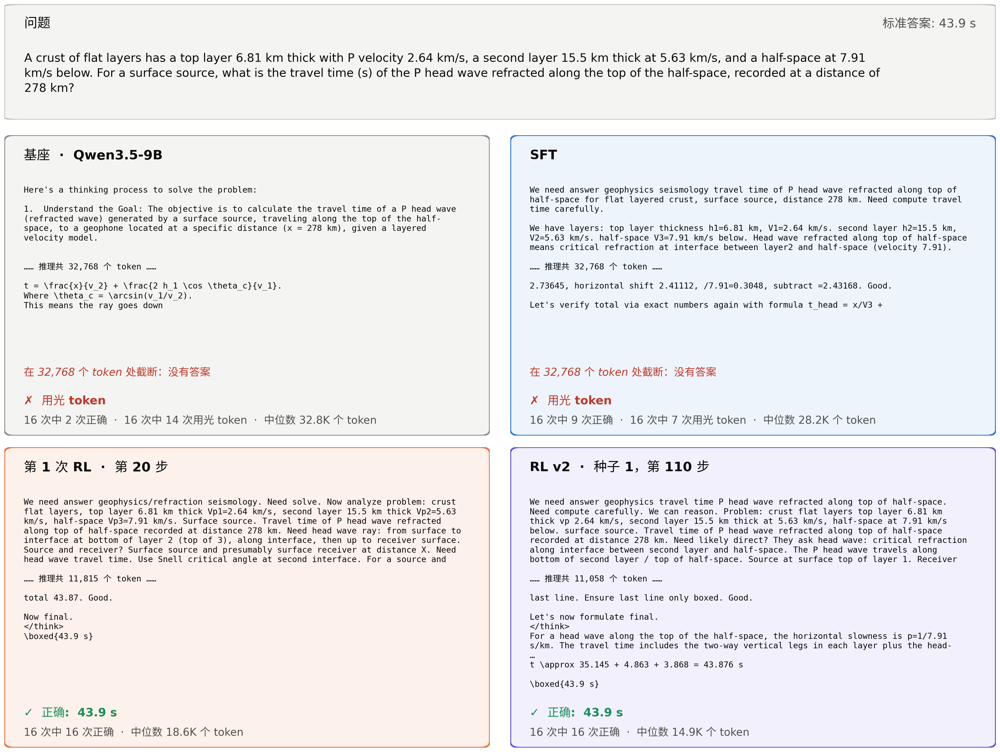</p>

从开头几句来看，四个模型审题完全一致——先复述层厚与速度参数，再追踪沿半空间顶界面滑行的临界折射射线。真正的分水岭在于是否停得下来：
- **基座模型：** 写满 32K token 时还在反复推导公式，16 次里有 14 次超时未完；仅有的 2 次答对分别耗掉了 2.1 万和 2.3 万 token。
- **SFT 模型：** 切换成教师紧凑凝练的风格，16 次答对 9 次；不过第 0 个样本在*第二遍复核加减法*时被 32K 截断，总计仍有 7 次未写完。
- **RL 第 1 轮与 RL v2：** 两者 16 次尝试全部写完且全部答对（16/16），RL v2 的中位长度比第 1 轮更省（`14.9K` 对 `18.6K`）。全部 64 条回复里没有哪怕一条算错数值——在这道题上，唯一的失败原因就是“不会及时停笔”。

单题只是显微镜，但它直观重现了 §1.3 和 §7.1 在 160 道题上测出的整体规律。数据来源：`docs/talk/data/stage_example.json`（由 `scripts/talk/stage_example.py` 生成）。

### 1.5 与更大模型在同等条件下的对比

<p align="center">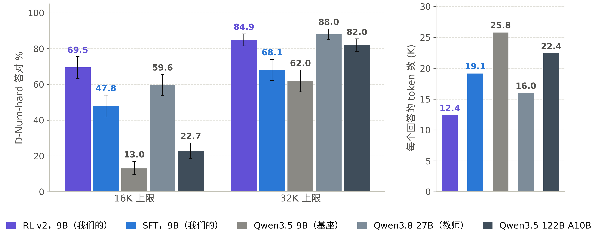</p>

把后训练完的 9B 放到更大参数的模型旁边，在完全同等的评测条件下表现如何？我们在工作站 A100 上以 4-bit 量化权重、相同的评测框架、提示词、`medium` 推理力度和采样参数（温度 `1.0`，每题 `8` 个样本），让两款更大的 Qwen 模型也跑了 `D-Num-hard`：
- Qwen3.8-27B：生成我们 SFT 训练数据的教师模型（`3×` 参数量）。
- Qwen3.5-122B-A10B：同代大型 MoE 模型（总参数量 `13×`，每 token 激活 `10B`）。

对所有模型都统一按 16K 和 32K 两个 token 预算分别截断打分（这正是 RL v2 检验自身是否超越 SFT 的标准，§8.3）。误差线为 160 道题上的 95% 区间，平均 token 数在 32K 上限下统计。数据：`docs/talk/data/large_models_1120.json`；脚本：`scripts/talk/large_models.py`。

| 模型 | 参数量 | 16K 预算答对率 | 32K 预算答对率 | 32K 下未写完 | 32K 下平均 token 数 |
|---|---|---|---|---|---|
| **RL v2（本模型）** | **9B** | **69.5%** | 84.9% | 7.4% | **12.4K** |
| SFT | 9B | 47.8% | 68.1% | 28.2% | 19.1K |
| Qwen3.5-9B（基座） | 9B | 13.0% | 62.0% | 32.9% | 25.8K |
| Qwen3.8-27B（教师） | 27B | 59.6% | **88.0%** | 10.2% | 16.0K |
| Qwen3.5-122B-A10B | 122B（激活 10B） | 22.7% | 82.0% | 14.8% | 22.4K |

**从 9B 基座一路追赶并越过 122B：**
9B 基座模型在 32K 下平均要写 `25.8K` token（全场最长），在 16K 预算下有 `87%` 的样本根本写不完（16K 下仅 `13.0%`，32K 下 `62.0%`）。在 32K 下，122B 比 9B 基座高出 `+20.0` 个百分点 `[+16.0, +24.1]`。而经过两阶段后训练，9B RL v2 在 16K 下领先基座 +56.4 分 `[+50.7, +62.0]`，在 32K 下领先 +23.0 分 `[+19.4, +26.7]`（其中 SFT 贡献了 16K 下 `+34.8` 和 32K 下 `+6.2`）——换言之，后训练让 9B 跨越了从自身基座到 122B 的整段距离，还略微超出一截。

9B 模型真正有优势的地方：
- **16K 紧预算：** RL v2 答对 69.5%，不仅击败 27B 教师（59.6%，`+9.8` 分 `[+6.1, +13.6]`），更是大幅甩开 122B（22.7%，`+46.7` 分 `[+41.3, +52.1]`）——两个大模型在 16K 到期时都还在冗长推导中（27B 有 `40%` 没写完，122B 高达 `77%`）。
- **32K 下对抗 122B：** RL v2 双种子平均 84.9% 对 122B 的 82.0%（`+3.0` `[+0.1, +5.8]`，刚好高出噪声；单看种子 1 为 `+4.5` `[+1.3, +7.7]`，种子 2 持平 `+1.4` `[−1.7, +4.4]`）。
- **推理算力成本：** 32K 下 RL v2 每题平均只输出 12.4K token，对比 27B 的 `16.0K` 与 122B 的 `22.4K`。结合 9B 稠密参数量，单题推理计算量约为 27B 的 四分之一，约为 122B-A10B（激活 10B）的 一半。

**仍然落后的地方：** 给足 32K 空间后，27B 教师仍然领先 RL v2 3.1 个百分点 `[−5.2, −1.1]`（`88.0%` 对 `84.9%`）。仔细对比失误分布就能看清下一步的瓶颈：27B 有 `10.2%` 没写完，但写完后算错的只有 `1.2%`；RL v2 写完得更多（仅 `7.4%` 没写完），但算错数值却多达 `7.3%`。多出 `6.1` 个百分点的错误数值已经超过了两者之间全部 `3.1` 分的差距——光靠给 RL v2 更多思考空间已经无法追平教师，下一步必须减少概念与计算失误。

*必须交代的对比局限：*
- 两个大模型使用的是 4-bit 量化权重（参考 27B NVFP4 模型卡：GPQA 为 `88.0`，BF16 原版为 `88.9`）。
- 仅在一个 160 题测试集上评测；文中的差值区间为逐题配对统计，而表内原始置信区间为非配对区间。
- 有意不比较 64K：RL v2 仅在 24K 上限下训练，从未被要求扩展到 64K。
- 27B 本身也是 SFT 解答的撰写者（风格一脉相承），且对比中所有模型均统一使用为 9B 设定的提示模板和 `medium` 强度，而非各自推荐的提示配置。

---

## 2. 快速开始

```bash
# --- 已发布模型：从 Hugging Face Hub 启动最终模型服务（提示词模板见模型卡） ---
vllm serve jiazhe868/Qwen3.5-9B-Seis-RL-v2 --max-model-len 40960 --reasoning-parser qwen3 --language-model-only

# --- 本地 CPU 校验：安装、单元测试、对抗判分器检查、集群显存规划器 ---
pip install -e . -r requirements/core.txt
make test            # CPU 单元测试（无需 GPU）
make graders         # 对抗性判分器套件（必须 100% 通过）
make plan-cluster    # 计算 8 节点 × 3 张 A100-40GB 的显存 / FLOPs / 通信预算

# --- Slurm 集群部署：环境搭建、模型下载与隔离自检（详见 scripts/slurm/README.md） ---
bash scripts/slurm/setup_login.sh conda
sbatch -A <allocation> scripts/slurm/build_env.slurm
bash scripts/slurm/setup_login.sh models && bash scripts/slurm/setup_login.sh sandbox
sbatch -A <allocation> scripts/slurm/check_node.slurm      # 必须打印 SANDBOX ISOLATED
sbatch -A <allocation> scripts/slurm/parity.slurm          # 核验 vLLM 与 Megatron 评测及训练前向一致性

# --- 数据流水线：启动教师、裁判和基座服务后，依次 生成 → 建库 → SFT 混合数据 ---
sbatch -A <allocation> scripts/slurm/data.slurm gen
sbatch -A <allocation> scripts/slurm/data.slurm bank
sbatch -A <allocation> scripts/slurm/data.slurm sft

# --- 第 1 轮完整实验（单个 8 节点作业）：基线评测 → SFT → SFT 评测 → RL 准入门槛 → RL → 最终评测 ---
sbatch -A <allocation> scripts/slurm/campaign.slurm

# --- RL v2（§8.3）：三个随机种子各自对应一个 8 节点作业 ---
scripts/slurm/submit_window.sh rl-build-queue          # 种子 1：若缺题库 v2 先建库 → 24K 测试 → RL v2 → 最终评测
scripts/slurm/submit_window.sh sft-v2-queue            # 种子 2：同上步骤（复用原为 SFT v2 排队的窗口，§8.4）
scripts/slurm/submit_window.sh rl-seed-queue 3         # 种子 3：同上步骤

# --- 从 docs/talk/data/ 重新生成本 README 中所有图表 ---
python scripts/readme_figures.py
```

完整的作业提交顺序及各阶段耗时/机时估计见 [scripts/slurm/README.md](scripts/slurm/README.md)。各模块背后的详尽设计文档均位于 `docs/` 目录：[data_pipeline.md](docs/data_pipeline.md)、[evaluation.md](docs/evaluation.md)、[rl_algorithm.md](docs/rl_algorithm.md)、[rewards_and_hacking.md](docs/rewards_and_hacking.md)、[systems.md](docs/systems.md) 和 [verl_integration.md](docs/verl_integration.md)。

---

## 3. 在训练之前定义成功

### 3.1 为什么测试先行

科研工程中最常见的一类隐患，是先跑出训练模型，再回头挑一套刚好分数好看的测试集。既然所有实验结论最终都依赖测试集说话，这里我们坚持测试先于一切训练构建并锁死。

2026 年 10 月 22–23 日，全套核心测试集率先建成并通过内容哈希和金丝雀字符串（canary）正式冻结——时间早于 RL 题库和 SFT 混合数据的构建，从而使去污染程序能够严格排查训练数据与测试集之间的任何重叠。此后唯一新增的只有 D-Num-hard，于 10 月 27 日冻结在任何 SFT 实验产生结果之前（§3.4）。训练流程全程严禁接触测试题、留出题族或评分细则：代码上通过 `split="heldout"` 将测试题族隔离在未公开的私有模块中（`src/dpt/data/gen/families.py`，见 [数据与许可](#数据与许可)），并由 `tests/eval/test_independence.py` 在单元测试层面强行禁止评测包导入任何奖励代码。

| 测试集 | 题数 | 考察能力 | 标准答案（gold） | 指标 |
|---|---|---|---|---|
| D-Num | 300 | 来自 10 个留出题族的 1–3 步地震学数值计算题 | 程序化求解器 | `avg@8` |
| D-Num-hard | 160 | 来自 8 个留出题族的 ≥3 步复杂数值题（每族 20 道） | 求解器，且经过第二套独立计算方法交叉验证 | `avg@8` |
| D-Fresh | 60 | 模型发布之后全新编写的题目（可排除预训练接触过） | 可独立复现答案的 `solve()` 草稿代码 + 模型投票 | `avg@8` |
| D-Code | 150 | 地震学领域编程任务 | 沙箱内运行的隐藏单元测试 | 4 个样本上的 `pass@1` |
| D-Report | 100 | 书面技术报告，每题配备 5 条加权标准与 5 条常见错误 | 无：相对基座模型的双裁判、正反顺序成对胜率 | 胜率 |
| 通用基准 | 5 个测试集 | GPQA Diamond、MMLU-Pro（2K 子集）、IFEval、LiveCodeBench（2025-01 之后）、工具调用 | 公开基准真值 | 各基准原指标 |
| 拒答安全集 | 650 | 300 条应拒答提示（JailbreakBench 与 XSTest 不安全样本）+ 350 条无害对照 | — | 拒答率（%） |

此外，我们还为数值测试集保留了两个仅修改输入数值的“扰动孪生集”（共 280 题），专门充当记忆化探针。由于本月计划没有配备人工领域专家，`D-Fresh` 和 `D-Report` 由 GPT-6 Luna 起草、Gemma 4 26B-A4B 核验；同时由于人工盲评接口（`dpt.eval.blind_review`）没能找到合适的人类评审人，后期由一个前沿大模型代替完成了全套专家筛查与盲评（§8.5）。因此本项目中全部参照标准均为程序化求解或大模型校验，不含人工标注（§8.1）。

### 3.2 解码与评分约定

为了确保跨阶段数字严格可比，每一个模型（包含基座）都通过同一套评测框架（`src/dpt/eval/harness.py`）重跑：使用相同的渲染提示词、`temperature = 1.0`、`top-p = 1.0`、`reasoning_effort = "medium"`、最大输出 `32K` token，以及逐题固定的随机种子。判分器只看 `</think>` 之后的最终答案，凡是推理过程写满 `32K` 仍未收尾的回答一律记为失败（并单独汇报各集的截断率）。数值判分器（`dpt.eval.graders.numeric`）与训练时的 `T1` 奖励完全独立编写且严格校验单位换算；在相同样本上，两者的判定一致率高达 `99.3%–100%`（§6.5）。

### 3.3 基座模型几乎让 D-Num 饱和

<p align="center">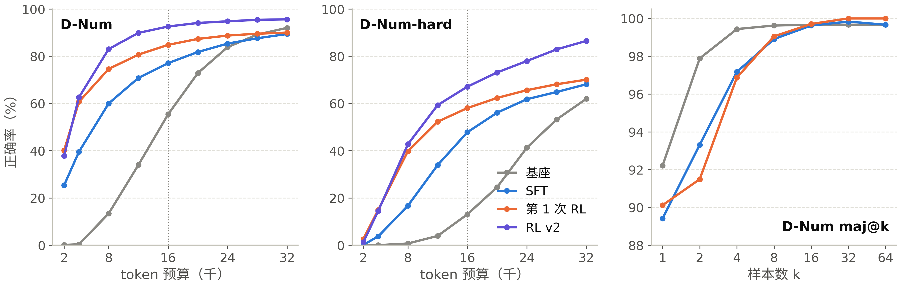</p>

<p align="center"><em>左图与中图：按不同 token 预算截断统计的样本答对比例（合并同模型各次运行，<code>dpt.eval.budget</code>；竖直点线标出第 1 轮 RL 的 16K 上限）。右图：<code>D-Num</code> 上对 k 个样本做多数投票的准确率曲线（<code>scripts/talk/research_1110.py</code>）。</em></p>

在 `D-Num` 上，未微调的 Qwen3.5-9B 基座单样本得分已达 91.6%，8 个样本至少对一个高达 99.7%，8 票多数投票更是达到 99.6%。如果只看 32K 上限处的最终准确率，基座模型在这个测试集上已接近饱和。

真正暴露问题的是计算成本：基座模型解完一道 1–3 步的教科书习题平均需要输出 1.77 万个 token。一旦将预算收紧到 `8K` token，基座只有 13.4% 的样本答对；收紧到 `16K` 时也只有 55.4%。相比之下，SFT 和 RL 把整条预算–准确率曲线大幅向左推进：在 `8K` token 以内，SFT 已经答对 60.0% 的样本，第 1 轮 RL 更是达到 74.6%。

**核心启示：** 当起点是一个推理能力很强的基座模型时，后训练首先买到的是“推理效率”，而非天花板处的原始准确率。对于已经接近饱和的基准，固定 token 预算下的准确率比不设限的总分更有区分度。

### 3.4 在看到训练结果前冻结更难的测试子集

既然 `D-Num` 已经被基座近乎满分解决，它就无法反映训练到底有没有带来真实进步。因此 10 月 27 日——在 SFT 尚未产出任何结果前——我新增并冻结了 D-Num-hard：严格按题族难度而非模型错题挑选，涵盖 8 个 ≥3 步推导的留出题族（每族 20 道，共 160 道）：
- 接收函数 Moho 界面深度（由 Ps 震相时延反演）
- 接收函数 $`H\text{--}\kappa`$ 叠加法求地壳厚与 $`V_p/V_s`$ 波速比
- 线性速度梯度介质中的地震射线传播距离
- 由地震波频谱低频平台反演矩震级 $`M_w`$
- 由地面运动预测方程反算震中距
- 由方向性效应估计断层破裂长度
- 静态库仑应力变化计算

其中每一个求解器都用完全独立的第二种数值方法（正演合成、数值求积射线积分、完整三维应力张量旋转）做过双保险校验。

基座模型在 `D-Num-hard` 上仅拿到 62.0%，三分之一样本在 32K 内根本写不完，平均每产生一个正确答案需要消耗 4.16 万 token（含浪费在超时失败样本上的算力）。在两个接收函数题族上，基座模型更是直接考出 0%：在 $`H\text{--}\kappa`$ 叠加题上，160 个样本里有 159 个一直推演到 32K 截断；在 Moho 深度题上，极少数算完的样本错误地直接把 P 波与 S 波射线总走时相减（导致 Moho 深度系统性偏深 `6%–19%`），而没有采用正确的平面波垂直时延关系式 $`H\left(\sqrt{1/v_s^2-p^2}-\sqrt{1/v_p^2-p^2}\right)`$。

### 3.5 噪声底线与门槛

为了避免把随机采样抖动误判为实验进步，我们在 `D-Num` 上用 10 个不同随机种子重跑了 10 次基座模型，得分分布在 `91.1–92.5` 之间（标准差 `0.46`；两两差值平均 `0.52`，最大 `1.42`；`docs/talk/data/run.json`, `eval.noise_floor`）。也就是说，在 `D-Num` 上低于约 1.4 分的波动纯粹属于采样噪声。

围绕实验推进，我们在启动前预先设定了两套门槛（gate）：
1. **RL 准入门槛（SFT 之后检查）：** 原本沿用 27B 方案的规则要求 `SFT 严格高于基座`，但在 92% 附近的高分天花板下这纯粹拼运气，且门槛一挂就会直接释放宝贵的 8 节点作业（重新排队需约 3 天）。因此我在 10 月 27 日 SFT 出结果前将它改为噪声感知版本：`D-Num` 允许在合并 95% 置信区间（约 `1.4` 分）内波动，`D-Code` 与 `D-Report` 需胜过基座；若未通过，作业仅挂起等待人工拍板而非直接释放节点。最终 SFT 未能通过（`D-Num −2.2`；第二裁判下 `D-Report` 持平），人工按预设方案放行进入 RL。
2. **八道发布门槛（RL 之后检查）：** 直接沿用项目初始参考方案的阈值。第 1 轮第 20 步通过两道：通用能力（`+7.5`，允许低至 `−1.0`）和推理成本（基座 token 的 `0.38×`，允许高至 `1.3×`）。它没能通过 `D-Num` 门槛（沿用规则要求 `基座 + 8 = 99.6%`——在已饱和测试集上任何模型都不可能达到）。由于直到 RL v2 出分前也没有另设新门槛，RL v2 也按同套尺子评分：两个种子在 8 道门槛里分别通过 5 道和 6 道，同样只差 `D-Num`（`95.6` 与 `95.0`）和安全性（§1.2）。

*必须坦白交代的评测局限：*
- `D-Num-hard` 只有 8 个题族 160 道题，整体分差很大程度上受那两个低分接收函数题族左右（§8.1）。
- `D-Fresh` 仅含 60 道题，完全由大模型生成并互检。
- 所有结果都在单一推理强度（`medium`）和单一截断上限（32K）下测得，准确率和思维简洁度耦合在同一数字中。

```bash
python -m dpt.eval.harness --model-name base_medium --sets d_num --seed 0 --endpoint http://localhost:8000 \
    --out eval_results/base_medium           # 跑单集单种子；连续跑种子 0-9 即得噪声底线
python -m dpt.eval.budget --eval-root eval_results --out talk/budget      # 统计不同 token 预算截断下的准确率
```

---

## 4. 数据：RL 题库与 SFT 混合数据

### 4.1 为什么生成的题目需要四道过滤

无论是模板程序生成还是大模型教师改写的题目，都会以训练损失曲线完全看不出来的隐蔽方式失效：错标签会让模型极其自信地学错物理；近似重复题会扭曲任务权重；泄漏测试题会把评测变成死记硬背；太简单的题目让 RL 根本拿不到梯度。因此，每道候选题目都会按顺序经过四道严格过滤（`src/dpt/data/pipeline.py`、`configs/data/pipeline.yaml`）：

<p align="center">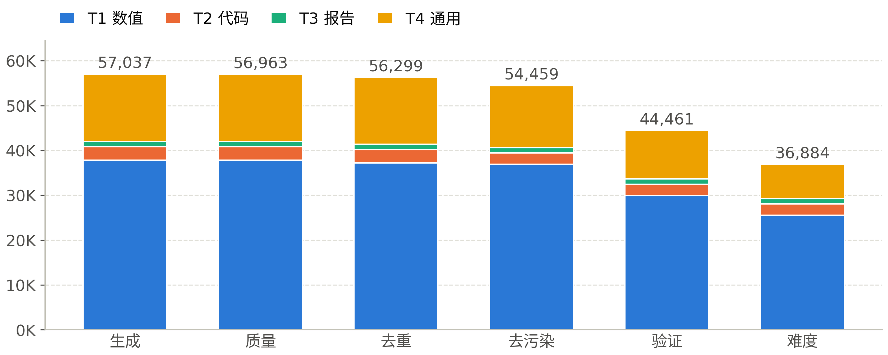</p>

| 过滤阶段 | 剔除数 | 拦截的问题类型 |
|---|---|---|
| 质量筛选 | 74 | 出现重复 4-gram、文本过短或格式异常 |
| 去重 | 664 | 文本近似重复或同一求解器实例重复（MinHash） |
| 去污染 | 1,840 | 与任一测试集的 n-gram / MinHash 匹配（`1,399`），及经裁判复核确认的语义等价改写（`441`） |
| 答案校验 | 9,998 | 整个模板被否决（`9,842`）、校验模型无法判定（`140`）、求解器与模型结果冲突（`16`） |
| 难度筛选 | 7,577 | 基座模型 8/8 全对的整批模板（`6,634`），以及单道 8/8 全对的题目（`943`） |

生成的 57,037 道候选题目经过层层漏斗后留下 36,884 道（保留率 `65%`）进入第 1 轮题库：包含 `36,668` 道训练题、`190` 道开发集验证题，以及 `26` 道未投入主训练的 `0/8` 极难题（`docs/talk/data/run.json`, `pipeline`）。

### 4.2 答案校验：求解器必须与两个模型一致

模板生成题目的质量完全取决于它的求解器代码是否无 bug。在全部 102 个模板与外部数据源上，我们抽样 20 道题，让 Qwen3.8-27B 教师模型各独立求解 4 次，再由 Gemma 裁判核对争议。为了防止一个写错公式的求解器批量污染题库，一旦某模板被模型校验否决，整套模板全部剔除。最终有 20 个来源被整批拒绝（19 个数值模板加上 `openai/gsm8k`），保留模板的单题通过率中位数为 `95%`。

顺便一提，首次全量跑校验时曾出现 102 个模板全部被拒绝的情况——排查后发现是两个在伪造对象单元测试里看不出来的真实环境 bug：一是校验进程忘记导入求解器注册表模块（全报错 `solver_error: KeyError`），二是裁判模型部署时漏开推理解析器导致输出缺少 `</think>` 标签，投票解析器全读出空票。修好并补上回归测试后，从缓存重跑校验仅用了 1 分钟。大规模信任任何数据流水线之前，务必用真实数据、真实服务跑通端到端测试（[PITFALLS](PITFALLS.zh-CN.md) A1）。

### 4.3 难度：去掉模型已经会做的题

GRPO 只从“8 个样本有对有错”的组里产生梯度（§6.3）。如果一道题模型每次采样 8 个全部答对，它的组内优势全为零，消耗算力却无法带来梯度更新。

为了筛选第 1 轮题库，基座模型在单张 A100 上花约两天时间逐一解答了 1,780 道抽检题（每题 8 个样本）。结果 1,620 道 `T1` 抽检题里已有 828 道（51%）拿到 8/8 全对。凡是抽检中 ≥90% 题目全对的模板直接整批放弃（11 个模板共 `6,634` 题），另外逐题剔除 `943` 道 8/8 全对题。

**v1 题库的缺陷就在这里：** 难度是用基座模型筛选的，可 RL 真正的起点是经过强化的 SFT 模型！SFT 之后模型能力大幅上升，导致基座眼里的“中等难度题”对 SFT 来说几乎成了送分题，于是 RL 第 1 轮刚一开跑就没了梯度（§6.3）。这正是后来 RL v2 用 SFT 模型全面重评难度的直接动因（§8.3）。

### 4.4 去污染

哪怕几道测试题混入训练集，高分就可能只是背题的结果。每一道训练题和 SFT 对话都用三道防线针对全部领域测试集和公开基准做排查：
1. **表层词面重叠：** n-gram 与 MinHash 相似度扫描；
2. **语义改写排查：** 向量嵌入召回近邻后，由裁判模型逐对确认是否为等价题目（裁判过滤了 `4,991` 个误报候选，实锤拦截 `441` 条语义同义改写）；
3. **答案碰撞排查：** 完全重合数为 `0`。

去污染从 RL 题库中剔除 `1,840 / 56,299` 题（`3.3%`），从 SFT 混合数据中剔除 `306 / 13,401` 条对话（`2.3%`），所有测试集埋下的金丝雀字符串均检出 `0` 次（`docs/contamination.md`）。

### 4.5 SFT 混合数据

| 子集 | 对话条数 | 来源与筛选规则 |
|---|---|---|
| 数值推理（`T1`） | 8,776 | 最终答案通过数值验证器的教师解答 |
| 工具调用轨迹（`T2`） | 1,301 | 借助 Python 工具调用完成的编程轨迹，仅保留代码可运行且通过全部隐藏测试的样本 |
| 科学报告（`T3`） | 554 | 教师模型多次采样撰写报告，再由 Gemma 裁判通过拒绝采样挑出的最优样本 |
| 通用指令回放（`T4`） | 2,464 | 基座模型自身在通用提示上的回复，防止领域微调后遗忘基础对话与指令能力 |

从原始 `17,638` 条轨迹出发，扣除未核验题目（`1,742` 条）和 RL 开发集留出题（`162` 条），再经质量与去污染过滤后，最终沉淀为 13,095 条对话（4,410 万 token）。样本长度分布极偏：最长一条达 `20,841` token，长度超过 `4,096` token 的对话只占条数的 `28%`，却占用了总 token 量的 `62%`。若直接按最大长度补齐，填充（padding）开销会浪费 `33%` 算力；把样本分进 `4K`、`8K`、`16K`、`32K` 四个长度桶打包后，填充浪费被压低到了 1.9%。

需要特别留意的是：那 `554` 条 SFT 报告是用 Gemma 做拒绝采样挑出来的——而后续 `D-Report` 主评测与 `T3` 奖励打分用的又是同一个 Gemma 模型。这一选择直接埋下了 §6.5 中两位裁判严重分歧的伏笔。

---

## 5. 第一阶段：监督微调

### 5.1 为什么在 RL 之前做 SFT

强化学习只能强化模型已经偶尔能够做到的行为。在 `D-Num` 题目上，基座模型思考长度的中位数就达到 1.5 万 token，它在题库上的采样生成有 34% 超过 `16K` token。而第 1 轮 RL 受显存所限只允许 `16K` 回答上限（§6.1）——如果直接拿基座开训 RL，三分之一的样本会在写完前被截断，无法贡献任何学习信号。

因此，我们必须先用教师模型写的解答做一轮 SFT，把策略引导成紧凑、利落、格式规范的推理风格，让 RL 从“能写得完的样本”起步：

```
基座模型：  推导漫长兜圈，经常撞到长度上限被截断，一次回复给出多个候选答案
SFT 模型：  学会教师简明紧凑的风格，干净利落地收束到唯一带单位的最终答案
RL 训练：   从写得完的样本出发，精准强化算得对的那部分策略
```

### 5.2 训练配方

我们在 `verl` 的 Megatron 引擎上运行全参数 SFT（`configs/sft/sft_9b.yaml`，继承自 `sft_27b.yaml`）：
- **优化与调度：** 训练 `2` 个 epoch（共 `206` 步，每步 `126` 条对话），峰值学习率 `8e-6`，先预热 `50` 步再余弦衰减至 `8e-7`，权重衰减 `0.1`。
- **多 token 预测（MTP）头：** 以 `0.1` 的损失权重联合训练，使模型在后续推理时仍能使用 MTP 投机草稿生成。
- **三维并行布局（`TP1 × PP8 × DP3`）：** 8 个流水线阶段分别落在 8 个 Slurm 节点上，节点内 3 张 GPU 互为数据并行副本（`DP3`）。由于这批 A100-PCIe 节点内部没有 NVLink，把数据并行锁在单机内部，梯度 `all-reduce` 就完全不会跨节点占满 InfiniBand 带宽。

内核编译完成后每步耗时约 37 秒，全部 `206` 步共用时 2.3 小时（主损失 `0.79 → 0.46`，MTP 损失 `0.87 → 0.47`）。

这一过程中暴露出 `verl 0.9.1` 两个会静默改写配方的框架缺陷：
1. `verl` 不会把配置里的 `optim.betas` 传递给 Megatron 优化器，原本会让 SFT 悄悄按默认的 `Adam β2 = 0.999` 而非配方要求的 `0.95` 运行（现已直接在 Megatron 层级写死）；
2. 只要 `test_freq > 0`，哪怕 `val_files: null`，`verl` 到点依然强行做验证，直接让首次全量运行在第 50 步崩溃；设置 `test_freq: -1` 后解决（[PITFALLS](PITFALLS.zh-CN.md) C3）。

### 5.3 把 9B 模型装进 40 GB 的 GPU

<p align="center"></p>

<p align="center"><em>左图：把最长的 SFT 样本（20,841 token）放进流水线最后一段时，四项显存优化前后的开销对比；虚线标出单卡 39.5 GiB 的实际可用上限。右图：同一张 GPU 在 2.3 小时 SFT 正式运行期间的实时显存曲线（<code>docs/talk/data/last_stage_memory.json</code>、<code>rl.json</code>）。</em></p>

在 `TP1`（不切分张量）设置下，第 8 段即最后一段流水线（0-indexed stage 7）不仅要扛起完整的 `248,320` 词输出投影层，还得装下自带一套 `10 亿` 参数词嵌入副本的 MTP 头——加起来整整 31.4 亿参数，还没算任何前向激活值就已经占用 29.3 GiB 的权重、梯度与 Adam 状态。同时，主损失和 MTP 损失默认把全词表 logits 上转为 FP32（每 token `2.38 MiB`），导致最后一段最多只能塞进 ~`3.5K` token——可 SFT 训练集里有 `28%` 的数据比 4K 更长！最初的显存预算脚本漏算了这两大块，是因为最初 27B 方案用了 `TP4` 把大词表切成了四份，换成 `TP1` 后词表全部压到了单张卡上。

我们没有牺牲任何数据长度、损失数学或优化器精度，而是通过调整显存驻留位置与局部运算精度解决了这一显存限制：

| 显存修复措施 | 底层原理 | 对第 7 段显存的效果 |
|---|---|---|
| Adam 卸载到 CPU | 使用 Megatron 混合优化器，将 FP32 主权重与 Adam 状态放在主机内存，数学精度保持纯 FP32 | `−11.7 GiB` |
| Transformer Engine 交叉熵 | 两个损失直接基于 BF16 logits 原地做 FP32 规约算交叉熵，不再生成完整 FP32 logits 副本（`dpt.verl_ext.patches` 修复 2） | `2.38 → 0.94 MiB/token` |
| 让 BF16 logits 绕过 `Float16Module` 上转 | 阻止 Megatron 的 `Float16Module` 在 `verl` 的 LM-head 前向中把最后一段输出转为 FP32（修复 3；Megatron 原生训练器在末尾返回标量损失，而 `verl` 返回整个 logits 张量） | 最长行 `−18.8 GiB` |
| 非均匀流水线切分 | 首尾两段各只放 `1` 个解码器层，中间 6 段每段放 `5` 个解码器层 | 把层参数和激活从输出头所在节点挪走 |

GPU 单元测试确认：上述修复与纯 FP32 参考实现对数概率相差不超过 `1e-4` nats/token，梯度相对 L2 误差不超过 `1%`。随后在最长的 12 条真实样本上跑通 8 节点预检，最后一段三张 A100 的峰值显存分别为 `38,686 / 40,366 / 38,326 MiB`（单卡总量 `40,437 MiB`），在显存上限内运行通过。

同一次预检还揪出一条“静默空补丁”：`verl` 把某方法定义在子类里，我们的补丁却挂在基类上，且配套单元测试照着错误假设写了一个伪造类掩盖了问题。现在所有补丁都加上了防静默断言，一旦目标缺失立即抛出 `RuntimeError`：

```python
# src/dpt/verl_ext/patches.py
def _own_attr(cls, name, what):
    """cls's own `name` (not inherited). Raises if missing: a fix must never be a silent no-op."""
    attr = vars(cls).get(name)
    if attr is None:
        raise RuntimeError(f"dpt.verl_ext.patches: {what} not found; did the pinned stack change?")
    return attr
```

**实践经验：** 在多节点正式启动前，应按真实最长序列、带上所有共置进程，通过训练器实际使用的完整代码路径实测最重节点。此前单卡 5 分钟探测漏掉了 `Float16Module` 在外层复制的 `18.8 GiB`；而 1 小时的 8 节点真实预检一次查出了这份副本及另外三项问题（[PITFALLS](PITFALLS.zh-CN.md) B2）。

### 5.4 SFT 改变了什么

| 测试集 | 基座 | SFT | 变化幅度 |
|---|---|---|---|
| `D-Num`（`avg@8`） | 91.6 | 89.4 `[88.4, 90.3]` | `−2.2` |
| `D-Num-hard`（`avg@8`） | 62.0 | 68.1 | `+6.1` |
| `D-Fresh`（`avg@8`） | 70.6 | 78.8 `[76.5, 81.0]` | `+8.1` |
| `D-Code`（`pass@1`） | 80.5 | 86.3 `[84.3, 88.3]` | `+5.8` |
| `D-Report` 胜率（`Gemma / Luna`） | 50 | 86.0 / 49.0 | `+36 / −1` |
| `GPQA Diamond` | 56.6 | 71.3 | `+14.7` |
| `LiveCodeBench`（2025-01 之后） | 38.2 | 52.5 | `+14.3` |
| 平均输出 token 数 | 14,735 | 9,517 | −35% |

SFT 干净利落地把教师模型的紧凑文风与答复规范迁移了过来：在 `D-Num` 上，回答长度中位数从 `1.52 万` 骤降到 `5.5 千` token，格式失败率几乎归零（`2.3% → 0.2%`）。在 4K token 以内收尾的短回答（占总样本 `42%`）上，SFT 准确率高达 96.3%（对比 `24–32K` 长回答的 `85.7%`）。至于 `D-Num` 总分为什么反而下降了 `2.2` 分，原因在于错误数值率从 `1.5%` 升到了 `4.1%`。

**回答长度是把双刃剑：** 缩短推导让此前总撞 32K 墙的基准大面积解套（GPQA 截断率从 `38%` 降到 `17%`），但这部分提分主要反映的是“按时写完”，而不一定代表新知识；而在需要耐心写完整代码与自我测试的 `D-Code` 上，SFT 的回答反而拉长了 `2.5` 倍（`4.5K → 11.1K` token，截断 `8.3%`）。

---

## 6. 第二阶段：多任务 RL

### 6.1 实际运行的算法

针对每条提示词，当前策略一次性采样 $`G = 8`$ 个回答。为了避免“组内几乎全对或全错时，偶然答对/答错的孤例因为极小的标准差而被放大成巨大梯度”，我们在计算组内优势（advantage）时不除以标准差，只做组均值中心化：

```math
A_i = r_i - \frac{1}{G}\sum_{j=1}^{G} r_j
```

在第 1 轮 RL 中，写满上限被截断的回答不参与组均值计算，也不赋予任何优势，以免把还没来得及收尾的推导误伤为“和算错一样的负样本”：

```python
# src/dpt/rl/advantage.py：group_mean_advantage，在按提示词对样本分组之后
for idx in groups.values():
    members = [i for i in idx if v[i]]      # v：有效，即没有在上限处被截断
    if len(members) < 2:
        continue                            # 只有一个样本就没有基线：它的优势保持为 0
    mean = r[members].mean()
    adv[members] = r[members] - mean
```

token 级策略损失采用 PPO 非对称裁剪代理目标（下界 `0.2`、上界 `0.28`、双重裁剪 `3`），对 token 损失求和后除以一个固定常数而非有效 token 数，确保丢弃全零优势组时不会改变剩余有梯度组的更新尺度。为修正 `vLLM` 推理引擎与 `Megatron` 训练引擎之间的微小概率偏移，每个 token 乘以截断重要性采样（TIS）权重 $`\min(\pi_\text{train}/\pi_\text{rollout}, 2)`$，且平均对数概率差距超过 `1e-2` 的序列直接屏蔽。算法中不使用 KL 惩罚项，也不保留参考模型。完整数学推导与参考方案依据见 [docs/rl_algorithm.md](docs/rl_algorithm.md)。

第 1 轮 RL 特有超参数配置（`configs/rl/rl_9b.yaml`）：

| 设置项 | 取值 | 设计原因 |
|---|---|---|
| 每步提示词数 | `126 × 8` 个样本（分 `2` 次更新，每次 `63` 题） | `128` 无法被 `DP3` 整除 |
| 回答长度上限 | `16K` token；从 `12K` 起线性扣分，到上限处达 `−0.5` | 训练 MTP 头时 `24K` 放不进流水线最后一段；基座 rollout 中位长度是 `12.7K` |
| 总步数与课程边界 | 计划 `120` 步，阶段切换点 `0 / 34 / 86` | RL 与最终评测必须一起塞进同一个 8 节点作业里（新排队约 3 天） |
| 任务配比 | 前期 `T1 50% / T2 25% / T4 25%`，第 34 步起引入 `T3 15%` | 故意延后加入大模型裁判任务，避免策略一开始先学“讨好裁判” |
| 学习率 | `2e-6`，最后 34 步降至 `1e-6` | 沿用参考方案的 9B 取值 |
| Rollout 架构 | `24` 个单卡 `vLLM` 共置副本，异步部分 rollout，关闭 MTP 草稿 | 开启 MTP 草稿会迫使 vLLM 进入 1 级休眠并在 CPU 存一份权重，导致主机内存溢出（[PITFALLS](PITFALLS.zh-CN.md) B4） |
| 安全告警 | 当训练/rollout 的 `log-ppl` 差距超过 `5e-3` 时自动暂停 | 概率失配在奖励下降之前就会提前升高 |

编译热身后每步耗时约 4 分钟（其中 rollout 生成约 `150–190` 秒）。

### 6.2 奖励：四个任务，一个裁判

| 任务 | 核验内容 | 得分机制 | 判分方 |
|---|---|---|---|
| T1 数值（`25,446` 训练题） | 只给出唯一最终数值，落在容差内且单位正确 | `1` 或 `0` | 程序化求解器验证（`dpt.rewards.numeric`） |
| T2 代码（`2,483` 训练题） | 在 Apptainer 隔离沙箱内跑隐藏单元测试 | 测试通过比例（若试图作弊篡改一律 `0` 分） | 程序化沙箱（`dpt.rewards.code_sandbox`） |
| T3 报告（`1,181` 训练题） | 每题 `4–6` 条加权评分标准，每条打 `0–10` 分 | 加权得分 × 引用系数（Crossref 查不到的文献每篇 `−0.1`），再扣超长与自夸惩罚 | **LLM：Gemma 4 26B-A4B**，温度 `0`（`dpt.rewards.judge`） |
| T4 通用（`7,558` 训练题） | `1–3` 条程序化格式/指令约束全部满足，叠加相关性门槛；数学题精确匹配 | `1` 或 `0` | 程序化规则（`dpt.rewards.instruction`） |
| 长度塑形（全任务） | 输出长度惩罚 | `12,288` 到 `16,384` token 间线性惩罚至 `−0.5` | 程序化 |

`T1`、`T2`、`T4` 全都是原子化判分，每次只核对单一数值、单一测试套或单一约束。唯有 `T3` 的评分细则是复合型的：每条标准中位长度达 47 词，`5,765` 条标准中有 91% 用 `"and"`、`"or"` 或 `";"` 把平均约三个独立科学论断拧成一条。为此，面向 RL v2，我们把每条标准拆解为 `1–6` 个需要引用原文片段作证的是/否原子化检查项（`dpt.data.gen.t3_atomic`；[docs/reports/reward_rubric_scaling_1110_zh.md](docs/reports/reward_rubric_scaling_1110_zh.md) §2）。

### 6.3 为什么训练组里几乎没有梯度信号

在 GRPO 中，每个回答的优势都是相对于同一条提示词下另外 7 个回答的均值来计算的（$`A_i = r_i - \bar{r}`$）。因此，一个提示词组只有当 8 个回答拿到的奖励不尽相同时才会产生训练梯度。只要 8 个回答得分一模一样——无论是 8 个全对（全得 `1` 分）还是 8 个全错（全得 `0` 分）——每一个回答都等于组平均分，所有优势全为零，这一步从这道题上就什么也学不到。

<p align="center">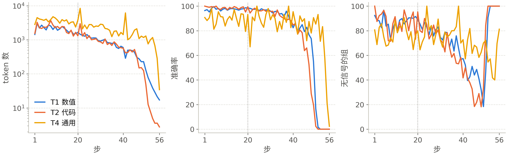</p>

<p align="center"><em>第 1 轮 RL 在三个可验证任务上的逐训练步指标：平均输出长度（左，对数坐标）、训练准确率（中），以及 8 个样本奖励完全相同的组占比（右）。竖直点线标出选用的第 20 步检查点（<code>docs/talk/data/rl.json</code>）。</em></p>

| 组内结果分布 | 全对（零梯度） | 对错混合（产生梯度） | 全错（零梯度） |
|---|---|---|---|
| `T1` 数值题，基座模型（建库抽检时） | 45% | 54% | 1% |
| `T1` 数值题，SFT 策略（第 1–20 步） | **87%** | 13% | 0% |
| `T2` 代码题，SFT 策略（第 1–20 步） | 87% | 13% | 0% |
| `T4` 通用题，SFT 策略（第 1–20 步） | 75% | 22% | 3% |

这张表直接点破了第 1 轮 RL 题库的病根。在 §4.3 建库时，我们是拿基座模型跑的难度过滤——对基座模型来说，`T1` 大约有一半题刚好落在有区分度的中间区间。然而真正开跑 RL 时，我们站在了能力强得多的 SFT 模型起点上。

结果，从第 1 轮 RL 的第一步起，高达 87% 的数值题组和代码题组都出现了 8 个样本全对的情况。每步 `1,008` 个采样样本（`126` 题 × `8`）中，只有区区 `88` 到 `272` 个样本带有非零优势。相反，提示词只占总配比四分之一的 `T4`（通用指令遵循任务）成了最不饱和的任务，反而在第 1–20 步期间提供了中位数 57% 的全盘梯度。

核心经验：题库的实际难度并不是题目固有的常数，而是完全取决于即将拿它来训练的策略模型本身。正因如此，RL v2 改用 SFT 策略把题库重评了一遍，并立下硬门槛：开训第 1 步至少要有 `40%` 的 `T1` 组呈现对错混合，且至少有 `1,000` 道 `T1` 题落在 `1–6/8` 的区间内，否则直接拒绝启动（§8.3）。

### 6.4 前二十步向好，随后崩塌

| 开发集（`190` 题 × 4，`16K` 上限） | 第 0 步 | 第 20 步 | 第 40 步 | 长度中位数演化（token） |
|---|---|---|---|---|
| T1 数值 | 92.0 | **97.3** | 78.9 | `1,250 → 675 → 193` |
| T2 代码（12 题） | 79.2 | 97.9 | 83.3 | `4,394 → 1,421 → 332` |
| T3 报告（裁判） | 63.7 | 64.3 | 63.5 | `7,949 → 7,080 → 2,423` |
| T4 通用 | 83.6 | 88.8 | 92.1 | `4,945 → 4,965 → 3,435` |

前 20 步的走向完全符合预期，成功治好了模型写满 token 写不完的毛病。第 0 步时，`760` 个开发集样本中有 `53` 个在 `16K` 处推理仍未收尾（截断样本的中位长度达 `1.26 万` token，全数落入超长惩罚区间）；到第 20 步时，未完成样本降到仅剩 `15` 个，带动 16K 开发集数值准确率从 92.0% 跃升至 97.3%，代码准确率从 79.2% 跃升至 97.9%。

但第 20 步一过，策略突然开始“放弃思考”。到第 40 步时，全部四个任务的回答长度集体塌缩：`T1` 长度中位数一路跌到 193 个 token——这点字数根本不够写多步地震学推导。`T1` 的报错原因也瞬间从“写不完”切换为“草率乱猜”（错误数值从 `9` 暴增到 `91`，漏单位从 `0` 升到 `17`）。第 52 步时，`T1` 与 `T2` 训练准确率同时跌至 0%，随后 `T3` 与 `T4` 也崩盘。到第 56 步，整批平均输出长度仅剩 13.7 个 token，同时训练/rollout 的 `log-ppl` 失配报警突破 `0.0128`，触发自动暂停并保存检查点。一旦每个组都全错，所有优势便归零，模型再也不可能靠自己拉回来。开发集选点工具（`dpt.eval.select_checkpoint`）理所当然地选中了 第 20 步（`97.27`，第 40 步掉至 `78.91`）。

围绕这场崩塌，训练日志目前能够确认、证伪以及尚未解决的问题如下：
- **已确定：** 从第 1 步开始，全部任务的回答都在单调缩短（第 2、20、40 步时 `T1` 批均值依次为 `3,047 → 1,649 → 595` token），而在 `T1`/`T2` 几乎满分的阶段里，`T4` 贡献了早期大部分梯度。
- **已证伪：** *“T4 奖励短回答，把模型教短了。”* 因为 `T4` 在缩水期占走了最多梯度，这个猜测乍看十分诱人。但核对逐步日志立刻将其推翻：在同一步内部，第 1–20 步答对和答错样本的长度几乎没有区别（中位数：`T4` 正确回答 `3,749` token 对错误回答 `3,341` token；`T1` 正确 `2,058` 对错误 `1,796`）。在真正决定梯度更新的 `T1` 组内回放中也得到了完全一致的结论（`T4` 未单独回放）。
- 早期推力的重要推手——软长度惩罚：我起初也排除过 `12K–16K` 长度惩罚，因为整批样本的最高长度只在 56 步中的 14 步触及过 `12K`（且多半在第 15 步前，`docs/talk/data/rl.json`, `response_length/max`）。但“整批统计”掩盖了 GRPO 实际向谁学习，因为全零优势的组根本不参与更新。11 月我拿起步时的 SFT 模型在 `16K` 上重放了第 1 轮第 0 步的 `256` 道部分可解 `T1` 题目（`docs/talk/data/run1_step0_replay_1116.json`）：共有 `82` 个组带有梯度，其中有 49 个组 8 个样本全部答对——也就是说，这 49 个组的梯度完全来自软长度惩罚对较长正确答案的扣分！它们占走了整步总优势的 28%，且 100% 朝更短的方向施压。其余 `33` 个对错混合组里，正确答案只在 `18` 个组中略短（中位数短 `250` token，与批均值吻合）。由此可见，软长度惩罚确实在起步阶段起到了明显推动作用；但它依然解释不了第 14 步至第 40 步之间（此时几乎没有任何回复接近 `12K`）为何继续一路崩到崩溃。
- **尚未查明：** 第 14 步至第 40 步持续缩水的深层机理。虽然 `T3` 在第 27 步加入并占去了第 27–40 步的 `26–72%` 梯度，但 `T1` 早在 `T3` 加入前就已从第 14 步的 `2,205` token 跌到了第 26 步的 `1,117` token。

早期实验记录曾误将原因归咎于 `T4`；一旦发现逐步指标并不支持，我们已于 2026 年 11 月 6 日正式撤回该说法（[PITFALLS](PITFALLS.zh-CN.md) D1）。同时，每 20 步测一次开发集虽然足以挑出第 20 步峰值，却无法在拐点刚出现时及时拦截。因此，RL v2 将开发集评测加密到了每 10 步一次。

### 6.5 裁判表现：打分宽松、细则复合，但没有发生漂移

四个任务中只有 `T3`（书面报告）的奖励来自大模型主观评审而非确定性程序。为了确认这位模型裁判是否可靠、有没有在训练中被“钻空子”，我们对 Gemma 进行了三轮独立核查。

<p align="center">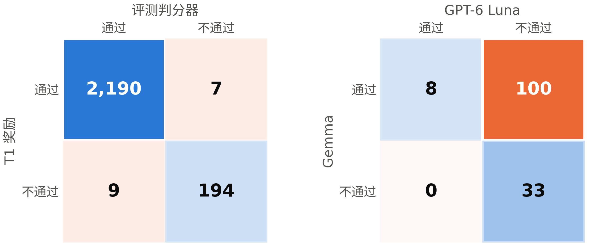</p>

<p align="center"><em>左图：T1 RL 奖励与独立编写的评测判分器在基座模型 2,400 个 D-Num 回答上的判定对比矩阵。右图：以 70 分为及格线，T3 奖励裁判（Gemma）与独立第二裁判（GPT-6 Luna）在 141 份 RL 开发集报告上的通过一致性（<code>docs/talk/data/reward_vs_eval.json</code>）。对角线格子代表两方一致。</em></p>

**1. 对照各自的独立参照标准检验一致性**

由于缺乏人工标准答案，我们将每种奖励与各自最独立的参照标准比对：
- **T1 数值奖励：** 与独立编写的评测判分器在基座模型的回答上一致率达 99.3%（仅有 `7` 例多答案误判为通过，以及 `9` 例误判为失败，其中 `8` 例属于无法解析），在 SFT 和 RL 后的模型上一致率更达到 100%。
- **T3 报告奖励：** Gemma 相比我们的独立评测裁判 GPT-6 Luna 明显宽容得多。以 `70` 分为及格线，在 `141` 份开发集报告里，Gemma 判及格了 108 份，而 Luna 只认可其中的 8 份（且凡是 Luna 判及格的报告 Gemma 从未判不及格）。换句话说，训练奖励给许多独立裁判眼中的不及格报告发了高分。

**2. 对照核查过的金标准校准三种打分格式（11 月 16 日）**

与 Luna 的比对说明 Gemma 偏宽松，但 Luna 本身也只是另一位模型裁判。为了搞清 Gemma 究竟在哪类准则上判错了、换一种提示词格式能不能治好它，我们构建了一套经过核查的模型金标准（严格隔离在训练和奖励之外）：由 GPT-6.1 Sol 阅读基座、SFT 和 RL 第 20 步的共 `300` 份 `D-Report` 回答，把每条评分准则标为`满足`、`部分满足`或`不满足`，随后模型评审（同 §8.5）核对并修正了其中 8 道题的参考解答（`v3`）。

拿着这套金标准，我在同一台机器上用 Gemma 按三种格式重评了 `31` 道留出题（包含 `196` 条`满足`、`167` 条`部分满足`和 `43` 条`不满足`）：
1. RL 训练原用的每条标准 0–10 分制；
2. 每条标准一个带原文引证的是/否核查；
3. 三等级打分（`完全满足`、`部分满足`、`不满足`）。

在黑白分明的两端，三种格式都表现不错：金标判为`满足`的条目，错判失败率仅 `1–4%`；判为`不满足`的条目，误放率在 `14–23%`。主要的盲区出在中间地带：金标准将全部准则中的 41% 标为`部分满足`，而不管提示词换成哪种格式，Gemma 都把其中 82–84% 判成了完全`满足`。即便格式里明确提供了“`部分满足`”这个选项，Gemma 在真正`部分满足`的条目上也只用了 `15%`，反而把 `26%` 完全`不满足`的条目归入“`部分满足`”（`部分满足`条目仅有 `3%` 完全不得分）。换言之，加入第三等级只是让 Gemma 的“否定”变得更委婉，没有教会它抓出半对回答里漏掉的科学要点。

<p align="center">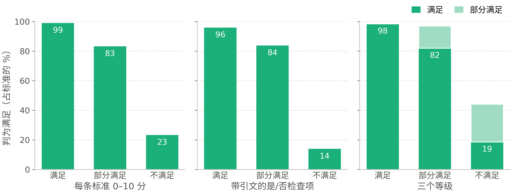</p>

<p align="center"><em>三种评分格式下，Gemma 在 31 道测试题准则上的判分行为，按金标准标签分组：满足 196 条、部分满足 167 条、不满足 43 条。柱体代表裁判判为“满足”的比例；三等级中的浅色段代表判为“部分满足”的比例（<code>docs/talk/data/rubric_formats_1116.json</code>）。</em></p>

如果看整份报告总分在各自最佳及格线上的表现，三种格式的分水岭十分清晰：

| 评分格式 | 误放金标 `< 60` 分报告 | 误拒金标 `≥ 60` 分报告 | 平衡准确率 |
|---|---|---|---|
| 每条标准 0–10 分（RL 原用） | 69% | 6% | 0.63 |
| 带引文的是/否核查 | 45% | 28% | 0.63 |
| 三等级（完全 / 部分 / 无） | 51% | 6% | 0.72 |

`0–10` 分制对 SFT 报告最宽大，是/否核查更严格但误拒较多，三等级制取得了最高平衡准确率（`0.72`）。不过对 GRPO 训练来说，绝对及格线并不重要，要紧的是同一道题多个答案之间的相对排序。比较同一题下金标相差 ≥10 分的两份答案（`128–129` 对，`dpt.eval.rubric_calibration`），三种格式与金标的排序一致率全部停在 `66–67%`（且本地 `0–10` 与集群原判相关系数高达 `r = 0.99`）。这证明仅仅换输出格式只能移动及格门槛，并不能让 Gemma 看清缺失细节——真正解决问题需要更强的裁判模型，或者把复合准则拆成细粒度的原子化检查项。

**3. 评测偏好偏差 vs. RL 训练中的裁判漂移**

<p align="center">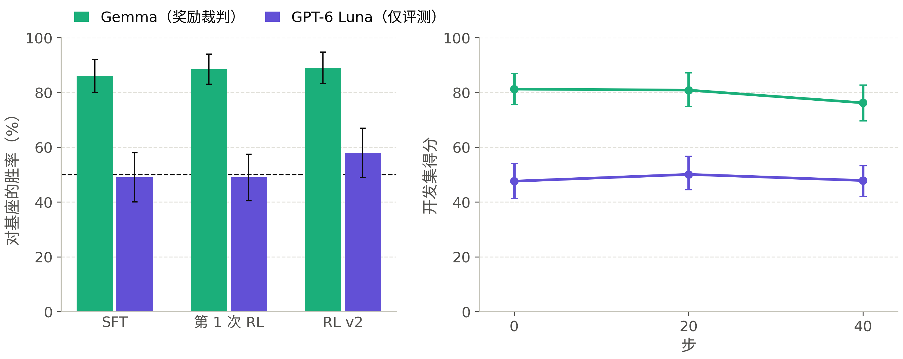</p>

<p align="center"><em>左图：两位裁判分别给出的 D-Report 对基座两两胜率及 95% 区间（虚线表示五五开打平；RL v2 为种子 1，在工作站跑 Gemma、登录节点跑 GPT-6 Luna）。右图：第 1 轮 RL 第 0、20、40 步时，同一批 T3 开发集回答在两裁判下的均分追踪（<code>scripts/slurm/judge_drift.sh</code>、<code>docs/talk/data/judge_drift.json</code>）。</em></p>

- 为什么两位裁判在 SFT 评测（`D-Report`）上截然相反：Gemma 以 `80–8`（86.0% 胜率）青睐 SFT 报告、以 `84–7`（88.5%）青睐 RL 第 20 步；而独立裁判 GPT-6 Luna 给两者打出的胜率全是 49.0%（纯平局，两位裁判一致的配对不到一半，只有 `43–45%`）。由于每对都按正反顺序各评了一次，裁判固定的宽松度已被对称抵消，剩下的分歧完全源于对“什么是好报告”的品味差异。由于 SFT 的报告训练数据恰恰是用 Gemma 做拒绝采样挑出来的（§4.5），SFT 极大概率学到了 Gemma 的偏好风格——这也正是为什么发布门槛坚持取两位裁判中较低的那一个。（在从未在报告上训练过的 RL v2 上，Gemma 给出种子 1 `89.0%`、种子 2 `95.0%`，Luna 则给出 `58.0%` 和 `62.5%`，仍在 SFT `49.0%` 的统计噪声内。）
- RL 过程中出现裁判漂移（reward hacking）了吗？ 没有。如果 RL 学会了迎合 Gemma 的口味，Gemma 给开发集报告的分数应该水涨船高、拉大与 Luna 的差距。而实际从第 0 步到第 40 步，Gemma 的打分反而在降（`−5.0` `[−9.4, −0.7]`），Luna 保持平稳（`+0.2` `[−3.2, +4.2]`），两者差距反而缩小了 `−5.3` `[−11.4, −0.1]`（此外选出的第 20 步甚至根本没练过 `T3`，因 `T3` 第 27 步才加入）。
- 警惕裁判奖励里的隐藏“侧门”：尽管裁判没漂移，拆解奖励分量却暴露出一个不易察觉的漏洞。到第 40 步时，变短的报告引用的参考文献变少（每篇从 `2.3` 降到 `1.4` 篇），被 Crossref 查出无法核实而扣分的文献也随之减少，导致引用乘数（`citation_factor`）从 `0.79` 升到 `0.83`——刚好把评分细则本体质量的大幅下滑（`81.2 → 73.3`）掩盖得严严实实，让 `T3` 总奖励表面上保持平稳。光凭回答变短就足以触发这一现象。**凡是使用大模型奖励，必须同步配一名完全隔离的独立第二裁判，并像盯紧裁判一样严密监控奖励公式里的每一个辅助乘子。**

---

## 7. 模型错在哪里

### 7.1 未写完变少了，算错的却变多了

只看 §1.2 的汇总准确率会漏掉关键的失效形态演化。把 `D-Num-hard` 上每个模型的全部 `1,280` 个回答（`160` 题 × `8` 样本）拆开来看，规律一目了然：

| `D-Num-hard` 1,280 个样本结局 | 基座 | SFT | RL 第 1 轮（第 20 步） | RL v2（种子 1，第 110 步） |
|---|---|---|---|---|
| 答对 | 793 | 872 | 897 | **1,107** |
| 32K 内未写完 | 421 | 361 | 211 | **81** |
| 数值错误 | 15 | 46 | 161 | 86 |
| 格式错误（多答案、缺失、错单位） | 51 | 1 | 11 | 6 |
| 平均输出 token | 25.8K | 19.1K | 14.2K | **12.9K** |
| `pass@8`（8 次至少对一次，%） | 75.0 | 87.5 | 91.9 | **100.0** |
| 放宽至 64K 预算的答对率（§7.3） | 69.8% | 83.9% | 77.5% | **90.2%** |

前三个阶段里，每向前走一步，模型都更早结束思考，代价是虽然未写完的样本变少了，却把其中很大一部分换成了“急着交卷却算错”的回答。在 `D-Num-hard` 上整体净收益仍为正（`pass@8` 从 `75.0` 升到 `91.9`），但单题稳定性下降——在 SFT 原已接近满分的两个题族上第 1 轮 RL 反而倒退（由方向性求破裂长度 `94.4 → 86.9`、由频谱平台求 `Mw` `95.6 → 85.6`）；在几乎本就全写完的 `D-Num` 上，数值错误更从基座的 `1.5%` 一路翻倍到 SFT 的 `4.1%` 与第 1 轮 RL 的 `8.6%`。

RL v2 改变了这一趋势：未完成样本压到区区 81 个，错误数值只有第 1 轮的一半出头（`86` 对 `161`），总计答对 `1,107 / 1,280`，实现了 100.0% 的 `pass@8`；在 `D-Num` 上数值错误率也降至 3.9%，反低于 SFT 的 `4.1%`（`docs/talk/data/rl_v2_seed1_local_1118.json`；原因见 §8.6）。

### 7.2 执行错误还是概念错误？

要想知道下一步应该补科学知识还是改善推理执行，我在不重新采样的前提下对既有失败回答分两轮做了细致归因（`scripts/talk/failure_types.py`；[docs/reports/failure_types_and_tests_1110_zh.md](docs/reports/failure_types_and_tests_1110_zh.md)）：
1. 程序规则扫描：结合判分结局、数值偏差指纹（微差、10 的幂次错、角度与弧度混淆、简单系数或符号错），以及 8 次尝试里是否 ≥3 次给出完全一致的错误答案；
2. GPT-6 Luna 分层盲标：对每个模型、每个题族抽取最多 10 个错答和 10 个未完成回答（附上题目、真值及参考求解器代码），再按题族样本量加权还原全体分布。

这里我们严格区分：概念错误（concept）指物理原理或公式用错；执行错误（execution）指算术失误、单位、格式或来不及写完。

<p align="center">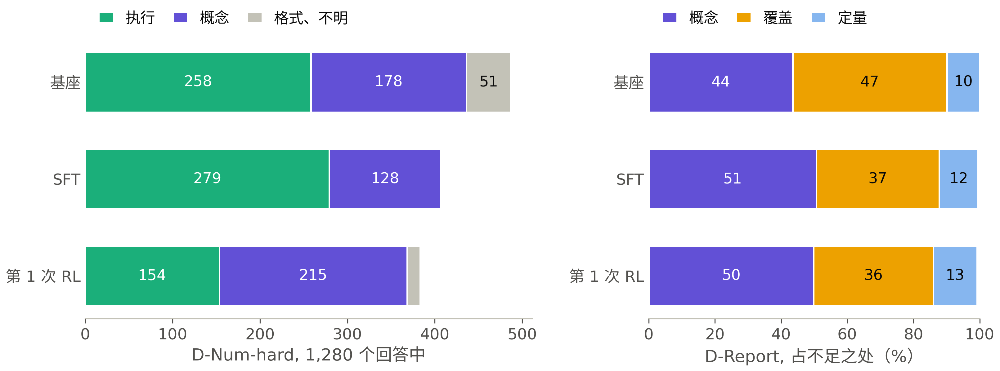</p>

<p align="center"><em>左图：D-Num-hard 1,280 个样本按归因拆解的加权失败次数。右图：D-Report 评分细则失分项按缺陷类别的占比（<code>docs/talk/data/failure_types.json</code>）。</em></p>

- D-Num-hard：主体是执行问题，两个接收函数题族卡在概念。在 Luna 审阅的未完成样本中，基座和 SFT 有 `63–82%` 其实方法完全正确，只是陷入反复验算导致写不完；概念错误只占基座失败的 `37%`、SFT 的 `31%`。第 1 轮 RL 虽然早停却常站错公式（它 `80%` 的数值错误属于概念错误，占总失败的 `56%`）。几乎所有概念失分都集中于两个接收函数题族（`Ps/PpPs` 求 `Vp/Vs` 在 32K 下全线 `≤5%`；`Ps` 时延求 Moho 深度 `0% → 15% → 29%`）。不过一旦把空间放宽到 64K，SFT 就立刻能解出其中 `40.0%` 与 `54.4%`，而基座依旧近乎零分（§7.3）——证实这两个题族是基座的知识缺口，且 SFT 已部分补齐。
- D-Report：纯正的知识与内容缺口。报告大概完全满足一半准则、部分满足另一半，失分几乎全集中在科学内容错误或缺失（`44–51%`）与核心部分遗漏（`36–47%`），语言流畅度与文献引用几乎不丢分。各个模型均有 `63–71%` 的报告以概念内容为主弱点，且配对细则均分没有改善（`SFT − 基座 = +1.5` `[−1.6, +4.3]`，`RL − 基座 = 0.0` `[−2.8, +2.6]`）——与 Luna 给出的平局结果一致，说明 Gemma 的高胜率并不可靠。

两条线必须对症下药：数值推理缺的是“在预算内顺利写完不出错”，堆知识救不了写不完；而报告写的是科学深度，练再多“快点写完”也变不出科学事实。

### 7.3 更多样本和更多 token 能换来什么

我们系统测算了测试时计算（test-time compute）在“增加样本投票数”和“放宽 token 预算”两个维度上的收益：
- **多数投票（`k = 1 → 8`）：** 在 `D-Num` 上，基座、SFT 和第 1 轮 RL 单样本虽只有 `89.4%–92.2%`，做 8 票投票后均升至 `98.9%–99.6%`（每题 64 样本，`docs/talk/data/research_1110.json`）；第 1 轮 RL 的错误集中在约 30 道题目上（这些题单次也有 `30–60%` 概率答对）。
- **Token 预算（`16K` vs `32K`）：** `16K` 下，基座在 `D-Num` / `D-Num-hard` 仅得 `55.4% / 13.0%`，第 1 轮 RL 为 `84.8% / 58.0%`，而 RL v2 达到 `92.6% / 67.1%`；放到 `32K` 后基座在 `D-Num` 上反超第 1 轮 RL（`92.0` 对 `90.0`），唯有 RL v2 稳守 `95.6`。
- **可达性 vs 可靠性：** 在 `D-Num-hard` 上前三个阶段 `pass@8` 连升（`75.0 → 87.5 → 91.9`），而 `avg@8` 只升到 `70.1`——训练先让模型“偶尔能做对”，然后 RL v2 才让它“次次都稳定做对”（`pass@8 = 100.0`，`avg@8 = 86.5`）。
- **把预算翻倍到 `64K` 续写：** 对所有在 32K 处截断的 `D-Num-hard` 回复，用同一模型、同一采样接续写到 64K（因前 32K 完全复用，算力只花了从头重跑的四分之一，`scripts/talk/numhard_continue.py`，`docs/talk/data/numhard_64k.json`）。

<p align="center">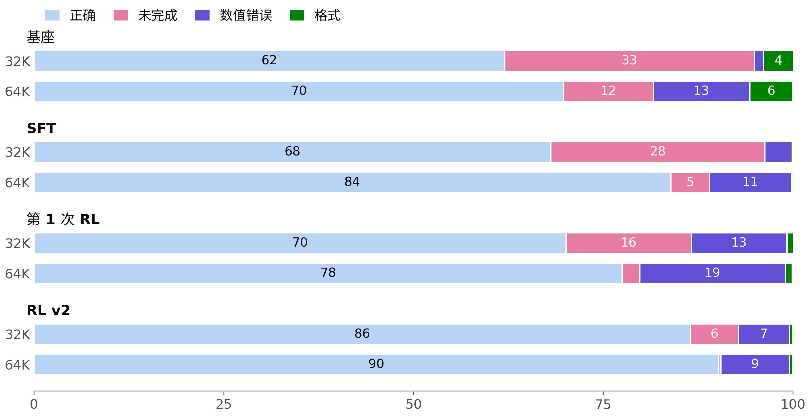</p>

<p align="center"><em>每个模型在 D-Num-hard 全部 1,280 个样本上，32K 限制与放宽至 64K 限制后的结局分布。</em></p>

| `32K` 处截断的样本去向 | 基座 | SFT | RL 第 20 步 | RL v2（种子 1） |
|---|---|---|---|---|
| 32K 截断总数 | 421 | 361 | 211 | 81 |
| → 64K 下答对 | 100 | 202 | 95 | 48 |
| → 64K 下算错 | 148 | 92 | 85 | 29 |
| → 64K 下仍没写完 | 151 | 65 | 30 | 4 |
| → 64K 下格式错 | 22 | 2 | 1 | 0 |

一放宽到 64K，SFT 立马反超第 1 轮 RL 和基座（`83.9%` 对 `77.5%` 和 `69.8%`）——SFT 在 32K 处截断的那 `361` 个回答里，其实超过一半（`202` 个）思路完全正确，只差写完！而 RL v2 在两个预算下都高居第一（32K `86.5%`、64K `90.2%`），把仅剩的 `81` 条截断又救回 `48` 条。同时两个接收函数题族在微调模型上大幅跃升（SFT：`Vp/Vs` `3.8% → 40.0%`，Moho `15.0% → 54.4%`；RL v2 64K 达 `66.2%` 和 `75.6%`；基座原地踏步在 `0.0%` 与 `0.6%`）。**只看单一 token 预算会遮蔽模型的真实推理准确度。**

### 7.4 拒答

<p align="center"></p>

门槛自带的严格检测器只在最终回答前 `1,500` 字符内匹配固定拒答短语。为了区分“真不拒答了”还是“换了说法拒答”，我们另外构造了一个宽泛词表上界（涵盖 `"I can't / won't"`、`"sorry … can't"`、`"I'm not able / going to"` 加任意动词及对应中文说法——哪怕正文其实配合给出了有害内容也会被算成拒答；`scripts/talk/refusal_breakdown.py`、`docs/talk/data/refusal.json`）。

| 应拒答率（%） | 基座 | SFT | RL 第 20 步 | RL v2 种子 1 | RL v2 种子 2 |
|---|---|---|---|---|---|
| 严格口径（门槛检测器） | 56.0 | 51.3 | 45.7 | 45.7 | 49.0 |
| 宽泛口径（上界估计） | 77.7 | 75.3 | 70.0 | 72.3 | 73.7 |
| `JailbreakBench` 有害请求（100），严格 / 宽泛 | 49 / 92 | 48 / 91 | 42 / 87 | 42 / 91 | 42 / 89 |
| `XSTest` 表面无害诱导（200），严格 / 宽泛 | 59.5 / 70.5 | 53.0 / 67.5 | 47.5 / 61.5 | 47.5 / 63.0 | 52.5 / 66.0 |
| 无害提示过度拒答（350），严格 / 宽泛 | 3.4 / 6.0 | 4.0 / 6.3 | 2.6 / 5.4 | 2.9 / 4.9 | 4.0 / 6.3 |

安全拒答率确实发生了真实下滑：即便在宽泛上界下，第 1 轮 RL 仍掉了 `7.7` 个点（远超门槛允许的 `±2` 分）。严格口径 `10.3` 分的跌幅里，约四分之一只是模型学会了词表之外的新拒答措辞，而真正下滑集中在 XSTest 中表面无害的诱导题（如“定义解释”类从 `25 → 17 → 12/25`、“比喻修辞”类 `23 → 23 → 16`），连同无害题的过度拒答一起下降——说明后训练整体让模型更倾向“配合作答”。基座原本严格拒答的 `168` 条里，第 1 轮 RL 保留 `105` 条、换词拒答 `36` 条、把 `27` 条变成两种检测器都读不出拒答的回答（需人工阅读辨别究竟是配合违规还是安全教育式回应），并新增拒答 `32` 条。

RL v2 同样没带安全回放数据，因此拒答停在相似水平（严格 `45.7%`、`49.0%`；宽泛 `72.3%`、`73.7%`），XSTest“定义”类仍只拒答 `14` 和 `15/25`。**安全检测口径必须在看到实验结果前固定下来**，事后放宽只会掩盖真实退步。

---

## 8. 测试与结果意味着什么

### 8.1 这套测试集能证明什么、还有哪些短板

在总结后训练到底改变了什么之前，先客观盘点整套评测体系各自能证明什么、又有哪些局限：

| 测试集 | 长处 | 短板 |
|---|---|---|
| D-Num | 求解器给出确定性参考答案、独立的严格单位判分器、窄置信区间（`±1.0`）、实测 10 种子噪声底线 | **已饱和：** 单样本 `92%`、8 票 `99.6%`，变动主要反映稳定性与格式；沿用的 `基座 + 8`（`99.6%`）门槛不可达 |
| D-Num-hard | 鲜明拉开各阶段差距（`62 / 68 / 70 / 86.5`）；题族与训练集零重叠 | 分差很大部分依赖两个接近零分的接收函数题族；32K 把知识与预算混在一起（64K 下 SFT 反超第 1 轮 RL，§7.3；32K 下第 1 轮 RL − SFT 在噪声内） |
| D-Fresh | 在模型发布之后编写，有效排除预训练泄漏；有效区分各阶段 | 规模较小（`60` 题），完全由模型起草与校验；部分提分源自 32K 内写完 |
| D-Code | 隔离沙箱内跑隐藏单元测试，客观性强 | 10 月及 11 月某节点遭遇沙箱基建故障（[PITFALLS](PITFALLS.zh-CN.md) C8）；现规定沙箱错超 `5%` 不予记分；SFT 长代码回复有 `8%` 截断 |
| D-Report | 贴近科研场景；隔离第二裁判；双顺序评测；含长度匹配子集 | 两位裁判在 `55–57%` 配对上意见不一；每题仅 `1` 个样本；无人工金标 |
| 通用基准 | 公开可复现，能及时兜底监测通用能力退步 | 受 32K 截断混杂（基座在 GPQA 上截断 `38%`、LiveCodeBench 截断 `61%`）；MMLU-Pro 记忆探针未过（`6.2%`），仅看相对变化 |
| 拒答集 | 成功抓出了真实的安全退步 | 基于粗糙的关键词表且宽严口径相差 `20` 分；`27` 条模糊回答需人工精读 |

*当前测试集仍缺少：* 任何一处的人工金标准（目前由前沿模型评审代人核验，§8.5）、第三个 RL v2 随机种子（种子 1 与 2 在 `D-Num` 上仅差 `0.7` 分，种子 3 已在排队前取消，§8.3）、每道 `D-Report` 题多于 1 个样本，以及多档推理强度和预算的交叉扫描（否则准确率与思考简洁度始终绑定在一起）。

一句话概括各阶段真实收获：
- SFT 带来实实在在的进步，主体红利来自推理提效（token 减三成，回复不再超时）。
- 第 1 轮 RL 进一步买到了速度（再省 `41%` token，`pass@8` 提升），但代价是单样本稳定性下滑。
- D-Report 在独立裁判下没有改善，而安全性拒答则出现了真实回退。
- RL v2 同时买到了速度与可靠性：双种子在 32K `D-Num-hard` 上领先 SFT `15–18` 分，64K 下仍领先，并带动 `D-Num`、`D-Code`、`GPQA` 和 `LiveCodeBench` 全面上涨（§8.3）。
- 总体来说，后训练让 9B 模型学会了稳健、精炼地把高难多步数值题算完算对；但它尚未展现出新注入的领域科学知识（`D-Report` 上 `58.0` 和 `62.5` 对 SFT `49.0` 仍在采样噪声内）。

### 8.2 9B 路线应该加入中期训练吗？

在领域语料上继续预训练（中期训练，mid-training）通常是灌注新知识的标准手段。但当前证据指向暂不需要在 9B 上做中期训练：
1. 在 `D-Num` 上，基座模型单样本就达 `92%`、8 票投票 `99.6%`，失分点在于执行与格式而非缺知识；
2. 在 `D-Num-hard` 上，多数失败也是写不完；且即便没有任何中期训练，SFT 也已经把 Moho 深度（64K 下 `54.4%` 对基座 `0.6%`）这类未见题族学透了很大一部分（§7.3）；
3. 参考方案 27B 路线的唯一数据点显示，中期训练在 `D-Num` 上只带来噪声内的 `+1.1` 分，通用基准却掉了 `−1.3` 分；
4. 在本集群上成本太高：目前尚无去污染后的地震学全文语料，约 `20 亿` token 在 8 节点上需跑约 `10` 小时（估计 `~80` 节点小时），且每次 8 节点作业动辄排队数日。

鉴于只有 `D-Report` 真正卡在知识缺口（§7.2），我们优先选择了成本更低的验证方案：从开放许可论文合成知识密集型 SFT 报告数据（§8.4）。随着该合成数据未能通过专家筛查，继续预训练也就顺理成章继续搁置。

### 8.3 RL v2：成功标准、核心改动与集群运行

**1. 跑前先定死成功标准**

在 RL v2 启动之前，我先明确了它的硬性检验标准：在 32K token 预算下，同时在 `D-Num-hard` 和 `D-Fresh` 上以配对逐题差值的 95% 自助法区间（按题重抽 `10,000` 次）严格落在零以上，显著击败 SFT。跑一次 32K 评测即可同时导出三个预算的数据且无抽样偏差（`python -m dpt.eval.budget compare`）：`16K` 仅保留 ≤`16,384` token 的答复；`32K` 即原跑分；`64K` 则让 32K 截断的样本原地接续采样至 64K（§7.3）。

用这把尺子检验第 1 轮 RL（第 20 步），它在 16K 过关，却在 32K 与 64K 双双折戟——只变快，未变稳：

| 测试集（题数） | 预算 | SFT | RL 第 20 步 | `RL − SFT` `[95% 区间]` |
|---|---|---|---|---|
| `D-Num-hard`（160） | 16K | 47.8 | 58.0 | **+10.2** `[+7.5, +12.9]` |
| | 32K | 68.1 | 70.1 | `+1.9` `[−0.7, +4.6]` |
| | 64K | 83.9 | 77.5 | **−6.4** `[−9.0, −3.8]` |
| `D-Fresh`（60） | 16K | 66.9 | 77.9 | **+11.0** `[+5.0, +17.5]` |
| | 32K | 78.8 | 83.3 | `+4.6` `[−0.8, +10.4]` |
| | 64K | 84.0 | 85.0 | `+1.0` `[−4.0, +6.5]` |

*数据来源：* `docs/talk/data/budgets_1111.json`；`D-Fresh` 64K 数据出自 `docs/talk/data/budgets_rl_v2_seed1_1118.json`（把 SFT 的 `41` 条和第 1 轮的 `12` 条截断样本连同 RL v2 一起续写至 64K）。

**2. RL v2 两个种子均通过检验**

将 RL v2 种子 1（第 110 步）与种子 2（第 100 步，最后保存的检查点，见下文“如何运行”）放到同一标准下检验：

| 测试集（题数） | 预算 | SFT | 种子 1 | 种子 2 | `种子 1 − SFT` `[95%]` | `种子 2 − SFT` `[95%]` | `合并 − SFT` `[95%]` |
|---|---|---|---|---|---|---|---|
| `D-Num-hard`（160） | 16K | 47.8 | 67.1 | 71.8 | **+19.3** `[+16.2, +22.3]` | **+24.0** `[+20.0, +28.1]` | **+21.6** `[+18.3, +25.0]` |
| | 32K | 68.1 | 86.5 | 83.4 | **+18.4** `[+14.4, +22.4]` | **+15.2** `[+11.9, +18.7]` | **+16.8** `[+13.4, +20.3]` |
| | 64K | 83.9 | 90.2 | 88.2 | **+6.3** `[+3.7, +9.1]` | **+4.3** `[+1.6, +7.1]` | **+5.3** `[+2.9, +7.8]` |
| `D-Fresh`（60） | 16K | 66.9 | 85.6 | 85.6 | **+18.8** `[+12.1, +26.0]` | **+18.8** `[+11.9, +26.2]` | **+18.8** `[+12.1, +26.1]` |
| | 32K | 78.8 | 89.2 | 87.3 | **+10.4** `[+5.2, +16.2]` | **+8.5** `[+3.5, +14.0]` | **+9.5** `[+4.4, +15.0]` |
| | 64K | 84.0 | 89.8 | 87.9 | **+5.8** `[+1.7, +10.4]` | `+4.0` `[−0.4, +8.8]` | **+4.9** `[+0.8, +9.5]` |

*数据来源：* `docs/talk/data/budgets_rl_v2_seeds12_1119.json`（`--pool rl_v2=rl_v2_seed1,rl_v2_seed2`）。因集群排队拥堵，种子 1 在工作站 A100 以完全相同的框架与判分器跑完，种子 2 在集群作业内完成评测。

在 32K 上，两个种子双双大幅越过噪声赢得验证；而且在每模型都足以写完的 64K 下，两者在 `D-Num-hard` 上依然显著领先 SFT（`+6.3` 和 `+4.3`，`D-Fresh` 合并 `+4.9`），说明 RL v2 兼得了速度与真正更稳的正确率。原本计划在 16K 上限下训练的种子 3 于 11 月 20 日在排队启动前取消：它需再等数天队列，而种子 1 与种子 2 的结果已经高度一致（32K `D-Num-hard` `+18.4` 对 `+15.2`）。

**3. RL v2 的全部改动及背后证据**

| 改动内容 | 来自第 1 轮的实证依据 | 代码/配置位置 |
|---|---|---|
| 用 SFT 模型重评题库难度（`24K` 下每题采 `8` 次，兼查 `16K`）：仅淘汰 `16K` 内 `8/8` 全对题；`0/8` 放入第 20 步以 `20%` 比例加入的难题池；难点题按通过率（`≤2/8, ≤4/8, ≤6/8, 7/8`）每轮抽 `4/3/2/1` 次 | 第 1–20 步中 `87%` 的数值与代码组 `8/8` 全对，零梯度（§6.3） | `dpt.data.difficulty`、`configs/rl/rl_9b_v2.yaml` |
| 新增 12 个难题族与 6 个长题族（`3–8` 步推导；生成 `10,800` 道，每族评定保留 `200` 道），抽样翻倍且单族上限 `6%` | 空间集中在长而难的题：SFT 在 32K `D-Num-hard` 有 `28.2%` 回答写不完 | `dpt.rl.curriculum.FamilyWeights`、`configs/rl/rl_9b_v2.yaml` |
| 重新准入“未定”的长题模板：只有 SFT 模型 24K 下 8 次至少 1 次得出标签才保留 | 原 16K 校验因超时淘汰了 `10/12` 长题模板，实际没有任何标签遭反驳（[PITFALLS](PITFALLS.zh-CN.md) A6） | `dpt.data.bank_merge.readmit_undecided`、`dpt.data.difficulty.drop_unconfirmed` |
| 开训前题库硬门槛：预期第 1 步至少 `40%` 数值组混有对错，且至少 `1,000` 道数值题处于 `1–6/8` | 第 1 轮起始只有 `13%` 混合数值组 | `dpt.data.bank_merge check` |
| 锁定并保留第 1 轮开发集，严禁进入训练 | 重评会丢掉 SFT 已解出的旧开发题，重抽会导致口径失效与泄漏 | `dpt.data.bank_merge pin-dev` |
| 新增难题开发集（每新增题族留至多 `10` 题且 ≤`1/3`）及自动暂停规则（准确率跌 `10` 分、错值涨 `10` 分、未写完但含真值涨 `12` 分；30 步内长度腰斩且伴随跌 `5` 分或均长 `<2,500`） | 第 1 轮开发集大多是容易题；32K `D-Num-hard` 上第 1 轮把 `11.7` 分的截断变成了 `9.0` 分的错值，仅多对 `2.0` 分 | `dpt.data.bank_merge carve-hard-dev`、`dpt.monitoring.bridge` |
| 剔除错常数局部震级旧题（已验证题库中 `836` 道） | 题干印错 `−2.09`（nm 常数）配 mm 振幅，标签偏低 `2.681`（§8.5） | `dpt.data.bank_merge.FAULTY_FAMILIES` |
| 训练移除报告任务：配比设为数值 `70%`、代码 `15%`、通用 `15%` | 检验核心是数值；`T3` 裁判过宽（§6.5）；代码未重评有 `90%` 是 `8/8`；通用只占 `21%` 题却吃走 `57%` 梯度 | `configs/rl/rl_9b_v2.yaml` |
| 学习率减半：`1e-6` 起步，后段降至 `5e-7` | 第 1 轮（`2e-6 → 1e-6`）第 20 步达峰后即发生崩塌漂移（§6.4） | `configs/rl/rl_9b_v2.yaml` |
| 冻结 MTP 头换取 `24K` 上限（若全长可进显存）；否则回退 `16K` | 第 1 轮 `16K` 训 `32K` 测；训练 MTP 头时 `24K` 放不进最后一段（§6.1） | `scripts/slurm/rl_v2_job.sh` |
| 每 10 步评测开发集并存检查点；开发集 `D-Num` 跌 `3` 分或错值占比升 `3` 分即暂停 | 第 1 轮第 20→40 步，开发集 `D-Num` 从 `97.3 → 78.9`，错值 `1.8% → 17.8%`，截断 `0.8% → 0%` | `dpt.monitoring.alerts`、`docs/talk/data/run1_dev_outcomes.json` |
| 全部种子：截断数值回答计为 `0` 分（错误），取消软长度惩罚 | `44–87%` 的 SFT 截断已在推理中写出正确答案；试评定回放显示旧规则让 `29%` 组只靠惩罚拿梯度，给 `23.5K` 正确答复打分还不如 `24K` 没写完的 | `dpt.rl.filtering`、`configs/rl/rl_9b_v2.yaml` |
| 仅种子 3（已取消）：`16K` 上限配合 `16K` 难度权重 | 试评定中所有在 `16K` 之后才写完的正确答案，都在 `16,384` token 前已算出真值 | `configs/rl/rl_9b_v2_seed3.yaml` |
| 每步记录混合组内长度差（含全部样本与仅限写完样本两套口径） | 第 1 轮只记录过整批均长，掩盖了组内真实激励（§6.4） | `dpt.rl.pipeline.within_group_length_gap` |

建库门槛利用每道题在 SFT 模型下的通过率 $`r`$ 估算 8 样本产生混合结果的期望比例：

```math
P_{\text{mixed}}(r) = 1 - r^{8} - (1 - r)^{8},
```

并对主池数值题取均值（略偏乐观，因 `7/8` 抽样题真实解决率可能高达 `95%`）。另外，原子化报告评分细则（每条标准拆为 `1–6` 项带原文引证的是/否核查）也已构建完毕，留待日后重启报告 RL 时启用。

**4. 11 月 15 日的试评定如何改写了 RL v2 的设计**

在启动任何 RL v2 种子前，我回到第 1 轮 RL 的日志里考察了一个根本问题：模型在训练里到底有什么可学的？ 过去我一直以为第 1 轮崩盘是算法不稳定导致的，可它的目标函数本身已经非常稳健——token 级损失求和后除以固定常数、优势不除以组标准差、上侧裁剪放宽至 `0.28`，而且超长回答会异步接续到下一步。第 1 轮真正缺的是可学的材料。在最初的 `26` 步里，有 `83–91%` 的采样回答落在“组内 8 个回答奖励完全相同”的零梯度组中。

值得把为什么这类组教不了东西说透。GRPO 会把同一道题下的 8 个回答彼此对比：高于组均值的获得正优势（被强化），低于组均值的获得负优势（被抑制）。如果 8 个回答全对，每一个都刚好等于组均值，全部优势都为零，这一步从这道题上学不到任何更新；8 个全错时也完全一样。只有当组内回答有对有错、分出高低时，这道题才算“带有梯度”。本小节的大部分工程设计，都是在做两件事：寻找更多落在这一有效学习区间的题目，并确保奖励规则不会反过来扭曲这些信号。

与此同时，我们的核心目标也已经转移。既然基座在 `D-Num` 上已经接近饱和，真正决定胜负的是 `D-Num-hard`——而在那里，SFT 最大的短板纯粹是写不完：在 `32K` 上限下它有 `28.2%` 的回复被截断，一旦给到 `64K` 它就能答对 `83.9%`。更关键的是，在它 `44–87%` 未写完的回答里，正确数值其实早已出现在思考过程中——模型明明算出了答案，随后却把剩余预算全耗在了没完没了的自我复核上。

因此，在任何 RL v2 种子启动前，我敲定了三项根本性调整：用 SFT 模型重评整个题库在 `24K` 下的通过率；给 SFT “时对时错”的题目更高抽样权重；同时新增 `18` 个高难长推导数值题族，并配一个专属难题开发集——只要未完成回答开始转化成错误数值，其暂停规则就会立刻告警拦停。

第一个意外发现：我原本以为新设计的这 18 个高难长题族肯定能难倒 SFT。动手开训前，我先在本地工作站 GPU 上挑了第一个题族 `array_apparent_velocity` 试跑评估（`6` 道题，每题 `24K` 下写 `8` 个样本，`scripts/talk/difficulty_pilot.py`）。结果大大出乎意料：SFT 模型在全部 `6` 道题上拿了 8/8 满分（长度介于 `3,800` 到 `19,400` token）。因为这类题族直接在题干中写明了物理方法，它们考的不是生僻知识，而是长链条数值计算——SFT 完全会算，只是算得慢。在 `24K` 上限下，这种 `8/8` 全对的题贡献不了任何梯度。

这一结果立刻让我把注意力转向了 token 预算。假如训练时把单条回答上限收紧到 `16K`，这个题族大约会有 `12%` 的慢回答在写完前被截断。此时这道题能不能教出东西，完全取决于训练器怎么处置被截断的样本：
- *如果按常见做法把截断样本移出损失：* 组里只剩写完的样本，而写完的全部答对——这个组依然没有任何梯度；
- *如果把截断样本直接记为错误（0 分）：* 同一个组里瞬间同时出现“在 16K 内算完的满分回答”和“超时截断的 0 分回答”，这个题族约三分之一的组立刻产生有效梯度，教的恰好就是 `D-Num-hard` 最需要的本事——按时答完，并且答对。

当天傍晚我就把种子 3 改成了 `16K` 上限外加“截断记为错误”；当天夜里跑完 18 题族完整试评定后，连种子 1 和种子 2 也一并改用这条规则。值得一提的是，我初版重评脚本曾差点把这些慢题族提前删光——因为初版脚本规定只要 `24K` 下 `8/8` 全对就一律剔除！多亏对计划的一次复查及时发现问题：现在 `dpt.data.difficulty`（`short_budget`）会同时核对 `24K` 和 `16K` 两个预算，只有 `16K` 内就全员答对的题才会被剔除（种子 1–2 读取 `24K` 通过率，种子 3 读取 `16K` 通过率）。

18 题族完整试评定：只看一个题族太片面，于是我从 `18` 个新题族里每族抽取 `10` 道题，让 SFT 模型在 `24K` 上限下每题作答 `8` 次（`docs/talk/data/difficulty_pilot_1115.json`）。结果显示各个题族差异巨大：4 个题族模型至少半数题目 `8/8` 全对，4 个题族在 `24K` 下几乎从未写完，其余 10 个题族恰好落在有对有错的黄金地带。整体来看，SFT 答对了 `44%` 的回答、用光 token 占 `50%`，有 `47%` 的题落在 `1–6/8` 的最佳可学习区间（对比第 1 轮开局的 `13%`）：

| 新增题族 | 类别 | 24K 答对率 | 24K 截断率 | 评为 `1–6/8` | 带梯度组比例（`24K / 16K`） |
|---|---|---|---|---|---|
| `array_apparent_velocity` | 难 | 99% | 1% | 0% | 10% / 50% |
| `poisson_ratio_from_wadati_fit` | 难 | 94% | 6% | 10% | 40% / 100% |
| `q_from_spectral_ratio` | 难 | 89% | 1% | 20% | 50% / 80% |
| `array_backazimuth` | 难 | 70% | 26% | 50% | 90% / 80% |
| `gr_count_from_magnitude_sample` | 难 | 60% | 5% | 50% | 50% / 90% |
| `second_interface_reflected_energy` | 难 | 57% | 39% | 90% | 90% / 70% |
| `three_layer_head_wave_time` | 难 | 38% | 60% | 100% | 100% / 30% |
| `second_layer_thickness_from_intercepts` | 难 | 22% | 69% | 90% | 90% / 60% |
| `epicentre_from_three_sp` | 难 | 14% | 85% | 80% | 80% / 10% |
| `depth_from_pp_delay` | 难 | 0% | 92% | 0% | 0% / 0% |
| `dipping_refractor_dip` | 难 | 0% | 92% | 0% | 0% / 0% |
| `dipping_refractor_velocity` | 难 | 0% | 98% | 0% | 0% / 0% |
| `fault_slip_stress_energy` | 长 | 94% | 1% | 10% | 40% / 60% |
| `wadati_origin_then_depth` | 长 | 70% | 25% | 80% | 90% / 80% |
| `refraction_then_reflection_time` | 长 | 38% | 59% | 90% | 90% / 60% |
| `attenuation_then_amplitude` | 长 | 29% | 61% | 100% | 100% / 50% |
| `locate_then_local_magnitude` | 长 | 11% | 86% | 60% | 60% / 30% |
| `great_circle_origin_time` | 长 | 2% | 98% | 20% | 20% / 10% |
| 全部 180 题汇总 | | 44% | 50% | 47% | 56% / 48% |

<p align="center">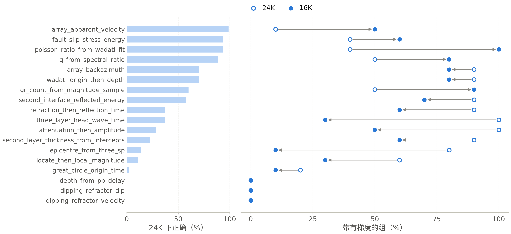</p>

<p align="center"><em>左图：各题族在 24K 下的答对比例。右图：当截断记为 0 分时，24K（空心柱）与 16K（实心柱）下带有梯度的题目组比例；题族按左图通过率从高到低排列（<code>docs/talk/data/difficulty_pilot_1115.json</code>）。</em></p>

对照最后一列就能看清收紧预算的影响：模型本来算得快的题族在 `16K` 下反而能拿到更多梯度，因为少数拖沓的回答被截成了错题（例如 `poisson_ratio_from_wadati_fit` 从 `40%` 升至 `100%`，中位仅 `11,400` token 的 `gr_count_from_magnitude_sample` 从 `50%` 升至 `90%`）；而正确回答全都极慢的题族则丢失信号（`epicentre_from_three_sp` 从 `80%` 降到 `10%`），那三个目前完全答不出的题族则在两个预算下均为零。

用训练器真实代码回放第 0 步，彻底改写种子 1–2 的奖励规则：原先种子 1–2 沿用的是开源常见配方——“超长截断样本移出损失，同时在上限前最后 4K token 区间做线性软惩罚（最多扣 0.5）”。把试评定结果送进训练器自己处理截断与计算优势的代码里实际跑一遍后，我发现这套规则存在明显的反向激励。试想这样一个 8 样本组：5 个几千 token 的短正确回答、1 个在第 `23,500` token 处稳稳答对的长回答，以及 2 个在 `24K` 被截断的未完成回答：
- 在旧规则下，那个在第 `23,500` token 处答对的回答被软惩罚扣到了 `0.63` 分；对照剩下 6 个完成回答的均值 `0.94`，它的优势成了 `−0.31`——梯度步会把一个完全正确的回答往下压；
- 与此同时，另外 2 个根本没写完的回答被移出了损失，优势为 `0`——训练器完全不对其施加惩罚。
**在这些长推理题族上，软长度惩罚实质上给了“未写完的回答”比“接近上限算对的回答”更高的分数。**

放眼整个 `24K` 试评定，虽然有 `50%` 的组带梯度，但全部组里有 `29%` 的梯度纯粹来自惩罚扣减全对组（占掉全部优势的四分之一，只教“写短点”而不教对错）；如果拿掉软惩罚但仍移出截断，则只剩下 `21%` 的组带梯度。反过来，改成截断计为 0 分（错误）、取消软惩罚后，同时传递“算对且按时完成”信号的组占比升至 24K 下 56%、16K 下 48%——既然超时已经拿 0 分，也完全不需要多余的软惩罚了。

<p align="center">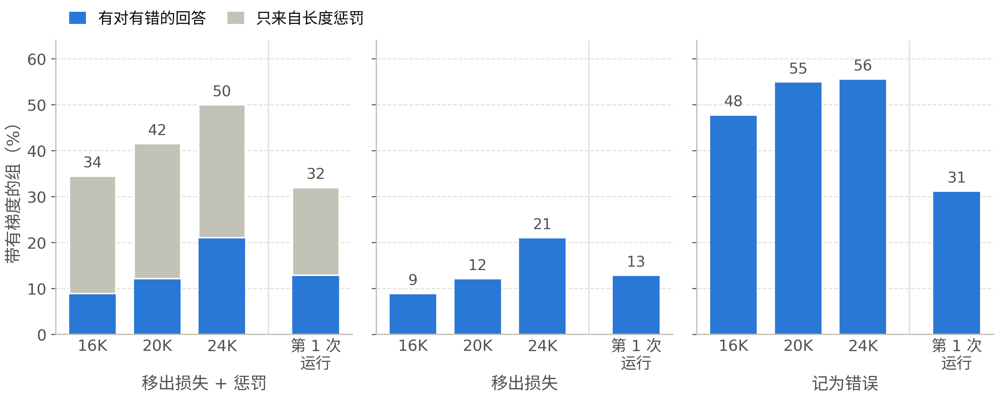</p>

<p align="center"><em>不同截断规则下第 0 步的梯度来源构成（基于训练器真实优势代码计算）。蓝色 = 真正混有对错的组；灰色 = 组内全对、全靠长度惩罚拉开分差的组。左三组为 180 道试评定题在三种预算下的对比，最右为第 1 轮 RL 在自身 256 题、16K 上限下的回放（<code>docs/talk/data/difficulty_pilot_1115.json</code>、<code>run1_step0_replay_1116.json</code>：第 1 轮也有 19% 的组纯来自惩罚，真正对错分化组仅 13%）。</em></p>

`16K` 会不会误判真正需要长思考的推理？ 在 `16K` 处截断，会把 `42%` 本可最终写完的慢正确答案记错。如果模型在 `16K` 之前其实早已算出了真值、剩下都在冗余复核，那么砍在 `16K` 就是安全有益的；反之则有害。为此，我在后续 `131` 道题中去掉题干自带答案的 `12` 题，在其余 `119` 道题上记录了与标准答案一致的数值首次出现的 token 位置。结果令人安心：在 16K 到 24K 之间写完的全部 `175` 个正确答案，无一例外全都在第 `16,384` token 之前就已经写出了正确数值——中位位置仅仅在第 `3,130` token，之后继续输出到约 `20,600` token 才结束。

<p align="center">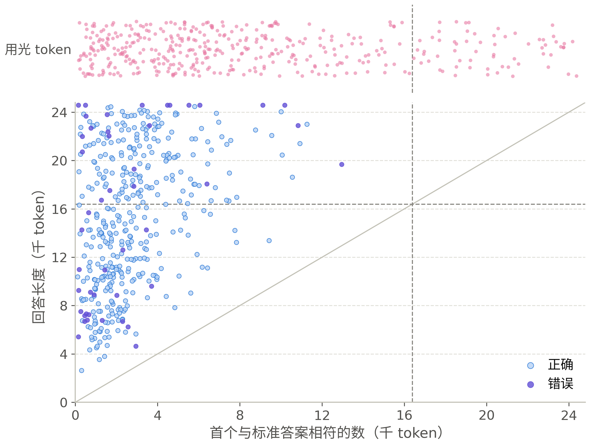</p>

<p align="center"><em>119 道题的 857/952 个回复中，标准答案数值首次出现的位置与回答总长散点图；上方随机打散高度的条带代表触及 24K 上限截断的回答（<code>docs/talk/data/value_positions_1115.json</code>）。正确答案紧贴左侧竖成一列：真值很早就算出，多出来的长度几乎全花在算完之后。</em></p>

在 `16K` 前算出真值的 `794` 个回复中，`389` 个最终答对，仅有 `46` 个在反复复核中把对的改成了错的，其余 `359` 个直到 `24K` 上限还在核对。（需注意任何匹配数字串都会计入，使上述占比略偏上界，不过人工抽读确认早期出现确属实质计算过程。）尽管从 `24K` 降到 `16K` 开局会少掉一批混合组（`36` 个混合组变全错、`22` 个全对变混合；`20K` 下同样保持 `55%` 混合组且代码中预留了 `extra_budgets`），我还是给种子 3 保留了 `16K`——一方面损失掉的恰恰是那些已经算完却停不下来的题目（随着停笔习惯在其他题上学会，它们很快会回来），另一方面 `20K` 与 `24K` 太接近，拉不开对比价值。

训练中的防崩塌监视：既然 RL v2 故意希望模型删掉算完后的多余核对，光看“长度变短”就分不清是良性停笔还是恶意偷懒（像第 1 轮那样跳过关键步骤，§6.4）。我们靠两组内差指标精确区分两者：除了包含截断 0 分样本的 `task/t1_num/len_gap_within`（按设计天然为负）外，还单独记录仅限写完样本的组内长度差 `task/t1_num/len_gap_within_finished`（在 38 个试评定组中中位数为 `+114` token，对错写完样本一样长）。一旦在难题已经变短后，这个指标明显转为负值，就说明模型开始在正确回答里省略必要推导步骤了。

暂停规则采用同样的哲学：30 步内难题回答长度减半只发告警；只有当减半伴随难题开发集准确率跌 `5` 分以上（`180 × 4` 开发集纯采样噪声仅约 `1.3` 分）、错误数值上升 `5` 个百分点以上，或均长跌破 `2,500` token 时才自动暂停。配套的监控脚本直接把训练日志喂进训练器真实报警逻辑（保证离线看图与线上停机分毫不差）——拿它回放第 1 轮日志，会在第 `40` 步（第 20 步达峰后的第一次开发集评测）就果断喊停，而不是拖到第 `56` 步：

```bash
python scripts/talk/rl_v2_watch.py --run seed1=<run dir>/metrics.jsonl --reference run1=<run 1>/metrics.jsonl \
    --out rl_v2_watch.png         # 画出每条曲线并打印距离暂停阈值还有多少余量
```

审阅后主动放弃的备选方案：
- *屏蔽截断样本除最后 4K 之外的前缀梯度：* 我们采用固定常数除法的纯策略梯度，而截断样本的前缀本来就和同组正确答案共享，梯度已在组内自然抵消；加掩码既会扭偏梯度，又多引入一个混杂变量。
- *阶梯安慰奖（推理写出真值给 `0.25`，否则给 `0.10`，高于写完算错的 `0`）：* 这等于变相发钱奖励模型别写完、并在草稿里乱撒数字；难题开发集本身就能防住用截断换错值。
- *无实证依据地把 `clip_high` 从 `0.28` 收到 `0.22`：* 保留与第 1 轮完全相同的 PPO 损失。
- *让种子 3 改用 `20K`（如上所述）。*
- *多跑一个沿用旧规则的对照组：* 第 1 轮已经用生命验证过旧规则，试评定也证实旧规则既让有梯度混合组显著减少（`21%` 对 `56%`）又把四分之一优势耗在长度上——不值得耗费三分之一 RL 预算去复现一个已知失效的旧规则。

**5. RL v2 在集群上的实际运行（11 月 16–18 日）**

**对这个模型来说，“难”几乎就等同于“长”：在 32K 的 `D-Num-hard` 上，SFT 用光 token 的次数是写完却算错的八倍。**

RL v2 通过 48 小时 8 节点预留窗口提交（`scripts/slurm/rl_v2_queue.slurm`、`scripts/slurm/rl_v2_job.sh`），作业甚至在题库建好前就已经排进队列，真正拿到计算节点时再动态读取仓库脚本，因此排队等待期间随时可以打补丁。若启动时题库 v2 尚未就绪，作业就在自己的 8 个节点上原地建库（2 节点跑教师与 Gemma，6 节点跑 SFT，教师跑完后全转 SFT，去污染嵌入放 CPU 避免占用推理显卡显存），切出难题开发集与课程表权重（`bank_merge carve-hard-dev`），测 `24K` 显存适配，随后开训 RL 并跑完三预算最终评测。

11 月 16 日种子 1 启动建库，第一天连遇三道险情并逐一化解：
1. 登录节点线程数限制顺着 `sbatch` 漏进计算节点：去污染步骤在 128 核节点上只用单核爬行，单核运行 8 小时并使两个教师节点空闲等待。我们直接用 `gdb` 挂载在线进程调用 `at::set_num_threads(56)`，15 分钟内在 15 分钟内顺利完成（[PITFALLS](PITFALLS.zh-CN.md) C6）。
2. `24K` 重评超时危机：全量 `10,800` 道新题在 `24K` 下每题采 8 次在 24 张卡上要跑约 `32` 小时，将把 RL 挤到没时间跑。由于整轮 RL 总共只抽约 `10,600` 道数值题，我们将重评上限按题目 ID 哈希固定设为 每族 `200` 题（共 `3,600` 题，`difficulty.max_per_family`），成功保出 ~13 小时训练 RL。
3. 重新纳入被误判的未定长题模板：原 `16K` 校验仅因校验者超时而淘汰了 `10/12` 长题模板，实际零争议（[PITFALLS](PITFALLS.zh-CN.md) A6）；`readmit_undecided` 将 5 族 `2,997` 道题送进 SFT `24K` 核验，只保留 SFT 8 次里至少答对 1 次的题。

因首日建库，种子 1 在 11 月 18 日 `02:19` 跑完 第 110 步后因作业时间上限有序停机（开发集优选第 110 步）。为保证跨种子对比口径对齐，后续种子 2 与 3 自动读取 `WALLTIME.json` 中的停机步数（`DPT_STOP_AT_STEP=110`），同时沿用相同的 120 步余弦学习率计划与采样器（且每用户节点限额 12 个，三个 8 节点作业本就串行排队）。遗憾的是种子 1 作业内最终评测因 `5` 个副本 `ssh` 启动丢包超时流产（[PITFALLS](PITFALLS.zh-CN.md) E4），被迫另起 4 节点评测作业并在工作站补测；`04:50` 启动的种子 2（`sft_v2_job.sh`，接手被砍掉的 `SFT v2` 窗口）打满 `110` 步，仅第 110 步存盘撞上 Lustre 跨节点建目录竞争（[PITFALLS](PITFALLS.zh-CN.md) C7，改用第 100 步评测——种子 1 上 100 与 110 在噪声内一致），且单节点沙箱故障令训练期约八分之一代码得分为 `0`（[PITFALLS](PITFALLS.zh-CN.md) C8）。带齐全部修复的种子 3 在前两个种子完美复现后于开跑前主动取消。

```bash
scripts/slurm/submit_window.sh rl-build-queue      # 种子 1：若缺库先建库 v2 → 24K 测试 → RL v2 → 最终评测
scripts/slurm/submit_window.sh sft-v2-queue        # 种子 2：同上步骤（scripts/slurm/sft_v2_job.sh）
scripts/slurm/submit_window.sh rl-seed-queue 3     # 种子 3：同上步骤（启动前已取消）
# 跑完后生成配对对比表：
python -m dpt.eval.budget compare --rows sft,rl_seed1,rl_v2_seed1,rl_v2_seed2,rl_v2_seed3 \
    --pool rl_v2=rl_v2_seed1,rl_v2_seed2,rl_v2_seed3 --out budgets_rl_v2.json
python -m dpt.eval.budget table budgets_rl_v2.json --rows rl_seed1,rl_v2_seed1,rl_v2_seed2,rl_v2_seed3,rl_v2 --lang zh
```

**要在队列里等好几天的作业，应该在开始运行时才动态读取它的执行步骤。**

*RL v2 的实话局限：* 实跑两个种子（种子 2 在第 100 步评测且带有 C8 代码奖励噪声，种子 3 已取消）；均在计划 `120` 步中的第 `110` 步停机（末学习率落在 `6.5 × 10⁻⁷` 而非 `5 × 10⁻⁷`）；`D-Fresh` 仅有 `60` 题（区间 `±5` 分）；试评定每族只有 `10` 题；真值位置记录只覆盖 `119/180` 题且把任何数字匹配都算上；拿掉 `T3` 使 RL v2 不会主动优化报告能力。

### 8.4 用论文合成报告知识数据，以及为何放弃 SFT v2

语言模型绝大多数的科学事实都是在预训练阶段学到的；几千条 SFT 数据主要重塑回答格式和推理习惯，真正补充领域新知识通常要靠继续预训练。既然报告题的硬伤是科学内容缺失（§7.2），而此时做继续预训练条件还不成熟（§8.2），成本较低的试验就是试试让答案直接携带论文里的新事实，看看这类知识密集型 SFT 能不能奏效。由于教师模型凭记忆作答只能传授它本来就会的东西，我让教师一边阅读开放许可地震学论文的片段一边撰写回答，再只把问题给学生模型训练（`src/dpt/data/gen/knowledge.py`）。

从语料库 `19,945` 篇全文中，依据 OpenAlex 许可元数据筛选出 `7,642` 篇开放许可论文（`CC-BY`、`CC-BY-SA`、`CC0` 或公有领域），从中精选 2026 年 8 月（早于 `D-Fresh` 编写）之前的 3,000 篇地震学论文，在致谢或参考文献处截断并切分成 8,286 个段落（每段 `4,000–9,000` 字符，中位数 `7,350`，`docs/talk/data/knowledge_selection.json`）。

单段数据的生成流程（`src/dpt/data/gen/knowledge.py`）：
1. 拟定专业提问：Qwen3.8-27B 教师读完段落后写出 `2` 个专家不看论文就能看懂的报告问题，同时列出一个好答案所需的段落核心事实。
2. 撰写提纲与报告：教师把所给段落当作“自己早已掌握的背景笔记”，写出简短提纲和一篇约 `550` 词的报告（对齐 `D-Report` 长度）。由于教师原始 `<think>` 仍会暴露“根据笔记……”，原始思考被丢弃，改用遵守同套保密规则的干净提纲作为学生的推理轨迹。
3. 自动质量与一致性过滤：只有同时满足以下条件才保留：提纲与报告不出现`笔记`、`摘录`、`该论文`、`作者`、`图`、`表`等泄露原文的词；字数在 `300–900` 词之间；且经 Gemma 检查零原文矛盾、原文未支撑论断不超过 `2` 条、知识分至少 `3/5`。
4. 可信文献引用与去污染：每条保留报告末尾附上指向来源论文（作者、年份、标题、DOI）的参考文献行（全行唯一百分百可靠的文献），随后按 §4.4/§4.5 走标准去重、n-gram、嵌入与教师改写核查，重点防范与无来源论文的 `D-Report` 问题措辞撞车。

```
教师看到：  论文片段（作为内部笔记）+ 报告问题
学生看到：  仅报告问题
学生学到：  干净提纲（充当思考）→ 科学报告 → 来源论文参考文献
```

原定计划：`SFT v2` 拟在 `SFT v1` 基础上以一半峰值学习率（`4e-6`）继续微调 1 epoch，将这批知识数据与 token 量为其两倍的 `SFT v1` 回放样本混合训练，随后再沿用 RL v2 配方跑 `RL v3`。

开训前抽查发现了什么：动手训练前，我按“每篇论文一条”从生成的 `3,262` 条里随机抽取 `100` 条交由前沿模型对照原文与领域真相逐条审核（评审规程见 §8.5，`docs/talk/data/screening_1114.json`）：

| 专家筛查结论 | 条数（共 100 条） |
|---|---|
| 保留：事实准确且有价值 | 2 |
| 修改：有用，但含可改正的事实错误 | 48 |
| 删除：核心论断出错、跑题或仅局限单篇研究 | 50 |

审核暴露出严重的事实偏差：98/100 条存在至少一处事实错误（总计 `382` 个错误，中位数每条 `4` 个），还有 `87` 条把单篇论文的局部观测当成普适规律写。就算只看 `62` 条出自纯地震学论文的数据，仍有 `28` 条必须删除！为什么自动审核全放过去了？一是因为提问刻意要求“不看论文也需要掌握的领域知识”，促使教师脱离原文凭记忆补充历史地震和断层细节，导致失真——有 4 条竟把左旋走滑的东安纳托利亚断层写成右旋，还有 1 条在并不存在的断层上编造了逆冲地震；二是大约五分之一的数据出自灾后幸存者调查、社交媒体或治理等根本不含地震学的论文，使教师只得完全凭记忆补充地震学背景。

由于 Gemma 检查每篇报告时只对照所给论文段落比对，段落里没有提及的捏造事实不可能“与段落矛盾”——于是只要 Gemma 自己恰好不知道正确答案，就会全部放行（[PITFALLS](PITFALLS.zh-CN.md) A4）。

最终决定：我当即废弃了 `SFT v2` 和 `RL v3` 并停掉全部数据作业，把排好队的 8 节点额度改用于跑 RL v2 种子 2（§8.3）。**对照来源的核查只保得住来源里明写的内容；一旦让教师在来源之外自由补充领域常识，这部分必须接受独立的领域真值核查。** 如果以后要重做可行版本，必须限定问题只问段落里明说的内容、强迫每一条具体论断一一对应到段落里的某句话，并严格先筛选纯地震学论文（代价是数据产出率会明显下降）。

```bash
python -m dpt.data.gen.knowledge licenses --corpus fulltext.jsonl preprints.jsonl --out data/knowledge/licenses.jsonl
python -m dpt.data.gen.knowledge select --corpus fulltext.jsonl preprints.jsonl \
    --licenses data/knowledge/licenses.jsonl --out data/knowledge/chunks.jsonl --max-papers 3000
sbatch -A <allocation> scripts/slurm/knowledge.slurm   # 问题 → 回答 → 检查 → 构建 SFT v2 混合数据（已在开训前废弃）
```

*局限提示：* 抽查 `100 / 3,262` 条带有约 `±10` 分的抽样不确定性；审阅者为模型（人类专家可能对部分瑕疵从轻发落）；提问、回答与检查全由模型完成。

### 8.5 用前沿模型盲审复核测试集和合成数据

本项目的所有测试集、评分细则和训练标签均由程序与模型共同构建或校验，且当月没有人类地震学专家参与复核。为了确保这些公开汇总的数字经得起推敲，一位前沿大模型以盲态方式承担了严苛的“模型评审”工作（对未公开测试集的单题笔记保持私有）：

各环节是如何核查的：
- 数值测试（`D-Num-hard`、`D-Fresh`）：在不给标准答案的前提下，仅凭题目文本以全双精度独立编写求解代码求解，再与标准答案逐一比对。
- `D-Report`：逐题重算全部 100 道题、529 条评分标准与 412 条常见错误里的每一处物理数值。
- 题库专家队列：对校验阶段搁置待查的 `156` 道题用相同方法独立复算。
- 知识数据（`SFT v2`）：抽查 `100` 条对照各自原文与领域常识（§8.4）。
- 盲评配对：重判第 1 轮以来一直在等人工评审的 `30` 对 `D-Report` 盲评样本。

| 审核对象 | 样本规模 | 审查结论 |
|---|---|---|
| `D-Num-hard` | 160 题 | 全部 160 个金标准确无误；仅依题干盲写的独立题族求解器与金标吻合至 `~1e-14`；`0` 题被标记 |
| `D-Fresh` | 60 题 | 全部 60 个金标准确无误；仅 `1` 题依赖未写明约定且容差 `0.1%`（另有 `24` 题题干未指定回答单位，因判分器强制索取单位并自动换算故依然公平） |
| `D-Report` | 100 题，529 准则，412 错例 | `515` 条准则无误；`6` 题被标记（`2` 套细则奖励错误物理、`1` 题因分号拆句将真陈述列为错误 [A5]、`2` 题只认多种合理解法之一、`1` 题后续发现走时自相矛盾） |
| 题库专家队列 | 156 题 | `150` 个标签成立、`6` 题删除、意外揪出 1 个系统性生成器公式 bug |
| 论文知识数据 | 100 条 | 保留 `2`、修改 `48`、删除 `50`（§8.4） |

去掉这 7 道被标记的测试题后，重跑全部评测的结果：

| 对比组 | 冻结完整版 | 筛查子集（剔除 7 题） |
|---|---|---|
| `D-Num-hard`，32K 下 RL 第 20 步 − SFT | `+1.9` `[−0.7, +4.6]` | 完全不变（`0` 题剔除） |
| `D-Fresh`，32K 下 RL 第 20 步 − SFT | `+4.6` `[−0.8, +10.4]` | `+3.6` `[−1.5, +9.1]` |
| `D-Report` 对基座，SFT（`Gemma / Luna`） | `86.0 / 49.0` | `87.2 / 49.5` |
| `D-Report` 对基座，RL 第 20 步（`Gemma / Luna`） | `88.5 / 49.0` | `88.8 / 48.9` |

任何实验结论都没有发生丝毫动摇（`docs/talk/data/budgets_screened_1115.json`、`docs/talk/data/screening_1114.json`）。

筛查中发现的生成器物理常数 bug：专家队列中有 5 道原本因其他原因搁置的题，进一步排查后暴露出局部震级（`ML`）生成器的一个隐蔽错误（[PITFALLS](PITFALLS.zh-CN.md) A3）。这个题族在题干里印出 `ML = log10 A + 1.11 log10 r + 0.00189 r − 2.09` 并写明振幅 `A` 以 mm 为单位——然而常数项 `−2.09` 实际只适用于 `A` 以 nm 为单位。以 mm 计量伍德–安德森振幅 $`A`$、km 计量震源距 $`r`$ 时，正确的 Hutton–Boore 关系式为：

```math
M_L = \log_{10} A + 1.11 \log_{10}(r/100) + 0.00189\,(r - 100) + 3.0 = \log_{10} A + 1.11 \log_{10} r + 0.00189\,r + 0.591.
```

只要拿里克特标准锚点验算一眼就无所遁形：`100 km` 处 `1 mm` 振幅在定义上严格对应 `ML = 3.0`，而印错的公式只给出 `0.32`——每道题的标签都整整偏低了 `2.681` 个震级单位！由于每道题都白纸黑字写着这个错公式，生成器的求解器、教师和裁判全部照着错公式算出了一致的错答案，于是 836 道题全部顺利通过验证（其中 `825` 道占第 1 轮题库 `2.2%`）。目前该生成器和复用同一公式的 `T2` 编程任务均已修正为 `+0.591`，题库 v2 也已移除旧题（§8.3）。**标签可以完美自洽于题目本身，同时把错误的物理关系教给模型——务必用物理定义锚点核查生成器。**

盲评位置偏置：在第一轮单顺序盲评中，模型评审员表现出明显的位置偏好——只要训练后模型排在第一位，就赢下全部 11/11 对；排在第二位时，却只赢了 19 对中的 8 对（`30` 对里 `22` 次选了第一位，[PITFALLS](PITFALLS.zh-CN.md) D6）。因此我们把每对答案左右对调补跑第二轮，并将正反顺序相互打架的 `6` 对记为平局，最终 RL 第 20 步胜率为 60.0%——恰好落于两位自动裁判之间、且明显更靠近 Luna（`30` 对置信区间约 `±17` 分）：

| 评审方（同 30 对） | RL 第 20 步 vs 基座 | 与模型评审的一致率 |
|---|---|---|
| 模型评审（双向综合） | **60.0%** | — |
| Gemma（奖励裁判） | 86.7% | 53% |
| GPT-6 Luna（独立第二裁判） | 45.0% | 63% |

```bash
python -m dpt.eval.budget compare --rows sft,rl_seed1,base_medium --baseline sft --exclude <private list>
python -m dpt.eval.report --row base_medium=… --row sft=… --row rl_seed1=… --exclude <private list> --summary-out …
python -m dpt.eval.blind_review page --row-dir eval_results/rl_seed1 --swap --out review_batch1_swapped.html
python -m dpt.eval.blind_review combine --first verdicts_batch1.csv --swapped verdicts_batch1_swapped.csv \
    --out verdicts_batch1_both.csv                  # 只有两种顺序意见一致才计入胜负
python -m dpt.eval.blind_review import --row-dir eval_results/rl_seed1 --reviewer model \
    --verdicts verdicts_batch1_both.csv verdicts_batch2_both.csv
```

*局限提示：* 评审仍为单一前沿模型而非真人，可能与被测模型共有盲点；被标 `7` 题仍留在冻结集中并同时汇报两版得分；盲评仅覆盖 `30` 对。

### 8.6 为什么 RL v2 能稳步训完，而第 1 轮崩溃了

RL v2 种子 1 稳稳跑完了全部 `110` 步，做到了第 1 轮从未做到的事：第 20 步之后不仅没垮，反而继续稳步提分，回答长度降到合理位置便自然止跌，并在跑前锁定的标准测试上大胜 SFT（32K `D-Num-hard +18.4`、`D-Fresh +10.4`，§8.3）。坦白讲，归因上的难点在于 RL v2 同时改了五件事——题库重构、截断计 0 且去长度惩罚、学习率减半、拿掉 `T3` 报告任务，以及将生成预算提到 `24K`——既没有对照组，后期也没剩余时间做单变量消融。因此这一节不凭空臆测，而是严格基于两轮实测记录的 110 步完整日志（`docs/talk/data/rl_runs_compared.json`）回答一个更扎实的问题：从实测数据里，我们能直接观察到哪些变化在发挥作用，又有哪些因子彼此纠缠无法拆开？

**1. 放在同一把“累计学习率之和”的尺子上对齐**

RL v2 采用的学习率只有第 1 轮的一半，直接按步数横比对第 1 轮并不公平。在 Adam 优化器下，单步对权重的改动幅度大致正比于当步学习率（无论梯度绝对模长大小），因此截至当前步的学习率累加和才准确反映策略被推动了多远（按此换算，RL v2 的第 `2n` 步大体相当于第 1 轮的第 `n` 步）。在这把尺子上，第 1 轮在第 40 步发生崩盘时累计学习率和为 `71`（单位 `10⁻⁶`，含预热），第 56 步叫停时为 `103`；而 RL v2 在第 76 步安然跨过 `71`，跑完第 110 步时累计到了 `101`——走完了与第 1 轮几乎相当的总优化距离。

<p align="center"></p>

<p align="center"><em>按累计学习率之和对齐对比第 1 轮与 RL v2：数值题贡献的总梯度占比（上）、回答存在差异的数值题组占比（中）、数值题正确回答长度（下，对数坐标；5 步滑动均值；虚线 = RL v2 种子 2；竖直点线 = 第 1 轮第 40 步崩溃位置；<code>docs/talk/data/rl_runs_compared.json</code>、<code>scripts/talk/rl_compare.py</code>）。</em></p>

**2. 训练曲线动态：熵值与旧样本 KL 早在准确率跌落前就已报警**

<p align="center">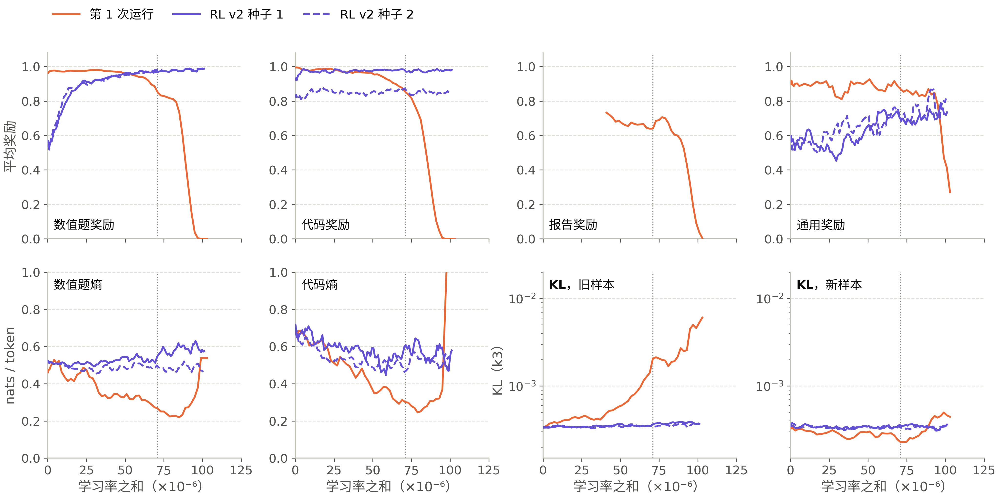</p>

<p align="center"><em>各任务奖励、每 token 熵值及训练器与 rollout 引擎间 k3 KL 散度随累计学习率演变（5 步均值；点线 = 第 1 轮崩盘点；因不使用参考模型故无对 SFT 的 KL；“新样本”由当前权重采出仅测双引擎固有差异，“旧样本”最多早 3 步采出从而包含策略自身漂移；<code>docs/talk/data/rl_runs_compared.json</code>）。</em></p>

- 奖励轨迹：第 1 轮开局每个任务奖励都接近 `1.0`（题库对 SFT 过于简单），崩盘后跌至 `0`；RL v2 在重评后的难题库上从 `0.55` 起步稳步上升至 `0.98`。（种子 2 的代码奖励自始至终停留在 `0.85` 而非 `0.97`，并非模型学坏，而是 1 台节点沙箱初始化失败导致约 `1/8` 代码样本被判 `0` 分，[PITFALLS](PITFALLS.zh-CN.md) C8；其不走沙箱的数值奖励曲线与种子 1 高度一致。）
- 熵值与 KL 预警：早在第 40 步开发集揭晓崩盘之前，第 1 轮数值回答的每 token 熵就已经跌掉一半以上（`0.5 → 0.2`，此时表面奖励还一片大好），同时旧样本 KL 持续上升（前 20 步约 `0.4×10⁻³` → 第 35 步 `1.0×10⁻³` → 第 39 步 `1.6×10⁻³`）。反观 RL v2 的熵稳定保持在 `0.5` 左右，旧样本 KL 全程平稳。三轮运行的新样本 KL 全程保持一条水平线（证实双引擎一直对齐），而 RL v2 自身的 PPO 单步更新 KL 始终低于 `1e-5`（第 1 轮末步冲到了 `0.08`）。

**3. 梯度到底从哪来、又在奖励什么**

| 梯度与组信号分布 | 第 1 轮（`1–20`） | 第 1 轮（`21–40`） | RL v2（`1–20`） | RL v2（`21–40`） | RL v2（`41–90`） | RL v2（`91–110`） |
|---|---|---|---|---|---|---|
| 来自数值题（`T1`）的梯度占比 | 36% | 38% | **93%** | 85% | 77% | 70% |
| 来自通用提示（`T4`）的梯度占比 | 57% | 18% | 6% | 13% | 20% | 28% |
| 来自裁判报告（`T3`）的梯度占比 | — | 35% | — | — | — | — |
| 带有梯度的数值题组比例 | 12% | 24% | **65%** | 38% | 21% | **11%** |

第 1 轮原本主打提高领域数值推理，实际上大部分梯度全被通用提示（`57%`）和报告裁判（`35%`）拿走，大约八组数值题里只有一组带梯度（`12%`）。而 RL v2 开局就把 93% 的梯度聚焦在数值题上（开始时每三组就有两组带梯度，`65%`）。随后随着模型逐渐攻克题库（训练准确率升至 `98%`），带梯度组占比顺理成章降到 `11%`——这才是健康的下降方式；反观第 1 轮第 20 步之后有梯度占比反而上升（`12% → 24%`），原因恰恰相反：原本做对的模型开始越练越错，导致组里重新冒出错误样本，直到最后全部答错归零。

表格最后一列显示了一个值得注意的现象：到最后 20 步时，RL v2 里带梯度的数值题组比例也掉到了 `11%`（大约九分之一，和第 1 轮开局一样稀疏），但 RL v2 仍然保持稳定——训练准确率保持在 `98%`，正确回答长度甚至微幅回升（第 41–90 步中位数 `7,339` token，第 91–110 步 `8,009` token）。**这证明“对错信号稀疏”本身不会让训练崩溃；真正决定训练走向的，是每一步剩下的梯度空间里装了什么。** 在 RL v2 里，剩下的 `70%` 梯度依然出自纯正的数值对错且零长度惩罚；在第 1 轮里，剩下大头全是其他任务，且第 0 步就有 `28%` 的优势纯出自把长答案往短压的长度惩罚。

在 RL v2 内部 `110` 步中有 `88` 步组内写完的正确答案都比写完的错误答案更长（中位数长 `734` token）——梯度从来没有偏好“答错的短回复”胜过“稍微长一点的正确推导”。在同等累计学习率节点（`10, 40, 60, 80, 100 × 10⁻⁶`）下对比数值正确回答长度，差距一目了然：
- **第 1 轮：** `2,230 → 1,248 → 815 → 458 → 无正确答案`（失控塌缩）；
- **RL v2：** `10,881 → 7,061 → 7,178 → 7,760 → 7,973`（仅在把超时回答变成写完的过程中收短，随后自然停稳）。

**4. 两轮运行如何转化未写完样本**

| 对比运行与切片 | 未写完变化 | 正确率变化 | 数值错误变化 |
|---|---|---|---|
| 第 1 轮，`D-Num-hard` 32K（`SFT → 第 20 步`） | `−11.7` | `+2.0` | `+9.0` |
| RL v2，`D-Num-hard` 32K（`SFT → 第 110 步`） | `−21.9` | **+18.4** | `+3.1` |
| RL v2，难题开发集 24K（`SFT 第 0 步 → 第 110 步`） | `−39.8` | **+44.9** | `−3.4` |

前两行是完全同等条件下的正面较量（同 160 道留出题、同 32K 预算）：第 1 轮消除了 `11.7` 个百分点的超时截断，却把其中 `9.0` 分变成了错误数值；RL v2 消除了 `21.9` 个百分点的超时截断，并且把绝大部分实实在在地转化成了 `+18.4` 分的正确答案！在自身 24K 难题开发集上幅度更大（正确率提高 `+44.9`，错误数值下降 `3.4` 分）——证明模型学到的能力成功迁移到了未见过的留出题族上，只是跨题族迁移幅度相对略小。

**5. 各改动按证据可信度盘点**

| 改动项 | 改变了什么 | 实测日志证据 | 因果结论 |
|---|---|---|---|
| SFT 重评题库 + 18 新题族 + 难点权重 | 梯度从何而来 | 带梯度数值组 `65%` vs `12%`；数值梯度占比 `93%` vs `36%` | 改变了训练信号来源；直接测得 |
| 截断计 `0` + 取消软长度惩罚 | 梯度激励方向 | 第 1 轮第 0 步 `28%` 优势纯属惩罚；RL v2 `88/110` 步组内对的更长，写完即止缩 | 修正了奖励激励；测得，但与题库改动耦合 |
| 学习率减半 | 每步走出的距离 | RL v2 在第 76 步越过第 1 轮崩盘和（`71`）走到 `101` 仍稳（`7,061 → 7,973`） | 仅凭步幅解释不了崩盘；小步长是否更安全不可剥离 |
| 拿掉 `T3` 报告任务 | 移除了第 27–40 步占 `26–72%` 梯度的主观裁判 | 第 1 轮早在 `T3` 加入前已缩水（第 14 步已跌至 `2,205` token） | 无法单独剥离 |
| `24K` 预算（替代 `16K`） | 推理周转空间 | 需靠 `16K` 种子 3（启动前已取消）对照剥离 | 尚待确定 |
| 10 步 dev + 难题开发集 + 暂停规则 | 监测粒度与保护机制 | `110` 步全程未触发过任何暂停规则 | 纯保险措施，不直接贡献性能差 |

**可以直接带到其他 RL 项目的工程经验：**
1. **怪罪强化学习算法之前，先盘点梯度到底来自哪里。** 两轮运行采用完全相同的损失函数、裁剪阈值、组大小和批大小；第 1 轮的问题是题库太简单，把大部分梯度喂给了无关任务和长度惩罚。
2. **软长度惩罚只奖励“写得短”，不管“答得对不对”。** 当对错分化信号不足时，它能在第 0 步就悄然占据 `28%` 的总优势。
3. **当核心目标是在预算内写完时，直接把截断判为 `0` 分。** 此时拿到奖励的唯一途径就是“既要写完又要写对”，回答自然在写完处停稳。
4. **不同学习率的实验务必按“累计学习率之和”对齐比较**，不要按原始步数死比。
5. **带梯度的组占比上升并不总是好事**——第 1 轮中段上升是因为已学好的策略开始出错退化。
6. **信号稀疏本身并不会直接引发崩盘**——RL v2 结尾和第 1 轮开局一样稀疏却依然稳健，决定成败的是其余部分装了什么。

*局限提示：* 仅两个实跑种子（种子 2 于第 100 步评测且带 C8 代码噪声，种子 3 已取消）；难题开发集出自训练题族新题，留出题族 `D-Num-hard` 上迁移略少；缺少单因素消融，题库与截断规则的作用耦合在一起。

```bash
python scripts/talk/collect_rl.py --run $SCRATCH/dpt/checkpoints/rl/rl9b_v2_seed1 --metrics-only \
    --hard-dev $WORK/dpt/data/v2/rl_dev_hard.jsonl --out rl_v2_seed1.json     # 集群运行后拉回本地
python scripts/talk/rl_compare.py                                              # → docs/talk/data/rl_runs_compared.json
python scripts/readme_figures.py rl_runs_compared
```

---

## 9. 系统：在共享超算上的一个月

### 9.1 机器与布局

这台超算集群每台计算节点配备 `3 × NVIDIA A100-PCIe-40GB` GPU（节点内部没有 NVLink）、`251 GiB` 主机内存，节点之间通过 InfiniBand 互联。共享 Slurm 队列规定单个作业最多申请 8 个 GPU 节点（每位用户同时最多占用 12 个节点），常规运行上限为 48 小时（集群管理员特批第 1 轮主作业延长至 `96` 小时）。由于一个 8 节点大作业每次排队通常都要等大约 3 天，只要中途一次崩溃丢掉分配，实验进度就会直接倒退半周。

因此，我将第 1 轮整条链路编排进了单个 8 节点 Slurm 作业里顺序执行（`scripts/slurm/campaign.sh`）：基线评测 → SFT → SFT 评测 → RL 准入门槛 → RL → 最终评测。训练切分为 `TP1 × PP8 × DP3`——每个节点承担一段流水线，让沉重的数据并行梯度 `all-reduce` 完全留在节点内 PCIe 通道上，跨越 InfiniBand 的流量仅限轻量级激活值。在 RL 阶段，同一批 24 张卡共置 `24` 个单卡 `vLLM` 引擎：Megatron 前向/反向步期间 `vLLM` 进入 2 级休眠（释放显存中的模型权重），每轮采样生成前再由权重同步刷新激活。

### 9.2 时间都花在了哪里

<p align="center"></p>

<p align="center"><em>第 1 轮 71.9 小时 8 节点大作业的时间线分布（<code>docs/talk/data/campaign_hours.json</code>）。蓝色 = 计划内的评测与训练阶段；粉色 = 系统故障、修复等待与节点保留。</em></p>

| 运行阶段 | 耗时（小时） | 现场经过 |
|---|---|---|
| 基线评测 | 13.8 | 基座全套基准、10 种子 `D-Num` 噪声底线、`D-Num pass@64` |
| SFT 受阻 | 35.1 | NFS 锁卡死（9.6h）、pandas `NaN` 崩溃、缺 `flash-attn`、第 7 段显存改造、预检、第 50 步验证崩溃 |
| SFT 训练 | 2.3 | `206` 个优化步 |
| HF 权重导出修复 | 2.1 | 模型合并脚本适配新检查点存储结构 |
| SFT 评测与门槛 | 4.8 | |
| RL 启动受阻 | 1.6 | 单机 Ray 劫持、7/8 节点缺沙箱、第 8 段主机内存溢出 |
| RL 第 1 轮训练 | 3.7 | `56` 步，触发失配告警自动暂停 |
| 等待监视脚本 | 0.8 | |
| 最终评测 | 4.2 | 第 20 步检查点 |
| 挂起等待决断 | 3.6 | 人工决断后安全释放 |

在 `71.9` 小时总机时中，计划内算力仅占 28.7 小时（`40%`），其余 43.2 小时（`60%`）全部耗在排障、等待与挂起上（其中 `35.1` 小时发生在 SFT 能够启动第一步之前）。保留节点固然会增加节点小时开销，却实打实省下了好几周的排队时间。支撑这一工作流的是两套机制：`KEEP_NODES` 保证任何阶段出错时不释放 Slurm 分配，而作业内进程接管能够在原分配里直接救活卡死作业（先用 `SIGSTOP` 冻结僵死总控，同一环境拉起跳过已完成阶段的新副本，待新副本结束由守护脚本清理旧副本）。**在排队瓶颈型集群上，作业设计的第一准则是：让崩溃只消耗这次分配里的几分钟，而不是丢失队列分配本身。**

`RL v2` 随后又运行了两个 8 节点作业：
- 种子 1（`43.2` 小时）：约 `22` 小时构建题库 v2 并实测 `24K` 适配（内含登录节点 `OMP_NUM_THREADS=1` 拖死 8 小时，[PITFALLS](PITFALLS.zh-CN.md) C6）、`20` 小时训完 `110` 步、`1` 小时浪费在 5 个服务未起的最终评测（E4）。
- 种子 2（`22.0` 小时）：`19` 小时训完 `110` 步 + `3` 小时评测，中途遇第 110 步 Lustre 跨机建目录竞争（C7）和单节点沙箱损坏（C8）。

10 月 13 日以来全项目累计耗用约 `1,290` 节点小时，合 `3,737 SU`（`docs/talk/data/run.json`, `compute`）。

### 9.3 遇到的主要系统故障

所有的系统与数据事故均按统一七段格式（含“误导性假象”与回归测试）详尽归档在 [PITFALLS.zh-CN.md](PITFALLS.zh-CN.md)。核心系统级故障速览：

| 故障现象 | 实际影响 | 修复方案与永久防护 |
|---|---|---|
| `verl` 向 Megatron 传了反转的 Qwen3.5 保留掩码 | A100 训练前向错 `1–2` nats/token，评测一致性检查却通过 | Import 钩子转换掩码格式；增加 GPU 训练前向对齐测试（[PITFALLS](PITFALLS.zh-CN.md) B1） |
| 两个客户端沿用 `httpx` 默认 100 连接池 | 校验限速在 `~3.2` 题/分；评测只用到 `~38/114` 槽位 | 连接池按配置并发数动态设定（C2） |
| 客户端超时短于排队 + 代理 1 小时读超时 | 放弃重发使后端过载；`pass@64` 整 1 小时集体失败 | 按 Little 定律设超时；代理取消读取超时并透传客户端断连取消（C2） |
| 校验进程未导求解器注册表；裁判缺推理解析器 | 首轮全量校验拒绝全部 `102` 个模板 | 真实数据测试；缓存 1 分钟重跑通过（A1） |
| `ssh` 远程命令壳不继承批处理登录模块 | `24` 个 vLLM 启动崩（缺 `libstdc++`）；`7/8` 节点缺 `apptainer` 致 `79%` 代码得 `0` | `env.sh` 显式预加载与二进制回退；单测覆盖 `ssh` 通道（C1） |
| NFS 主目录文件锁卡死 | SFT 首步前死锁挂起；`8` 节点空转 `9.6h` | 锁改迁本地 `/tmp`（C4） |
| `pandas` 把缺失 `tools` 键读成 `NaN` | 24 进程首批次全崩（原被卡死掩盖） | 统一转 `None`；预检真分词器全量遍历每条记录（A2） |
| A100 长序列 `head_dim=256` 缺可用融合注意力内核 | 首步 SFT 前向报错；非融合 16K OOM | 源码编译 SM80 `flash-attn 2.8.3` 并与非融合校验（B3） |
| 未切分词表 + MTP 副本超出流水线末段显存 | 长于 `3.5K` token 数据行直接 OOM | 四项显存组合修复 + 8 节点最长样本预检（B2、§5.3） |
| `verl` 忽略 `optim.betas` 且无验证集仍强行验证 | Adam `β2=0.999`；第 50 步崩溃 | 直接向 Megatron 传值；`test_freq: -1`（C3） |
| `verl` 驱动自带另起本地 Ray | RL 只看到 `24` 卡中的 `3` 张卡 | 导出 `RAY_ADDRESS`；全进程 token 认证 |
| MTP 草稿生成锁死 1 级休眠在 CPU 留权重副本 | 第 1 步存检查点导致末段主机内存溢出 | Rollout 关闭 MTP 草稿切至 2 级休眠（B4） |
| 登录节点 `OMP_NUM_THREADS=1` 顺作业泄露 | 建库 v2 在 128 核节点单线程跑掉 `8h` | 在线调试器改 `56` 线程；脚本显式覆写线程数（C6） |
| 种子 1 最终评测有 `5` 台副本 `ssh` 未起 | 评测等待满 1 小时后超时退出并重排队列 | 60 秒补拉缺失日志副本；`2/3` 法定多数即推进（E4） |
| `24` 进程同时在 Lustre 建第 110 步目录竞争 | 种子 2 第 110 步保存丢掉最后 10 步 | `local_mkdir_safe` 捕获 `FileExistsError` 重试（C7） |
| 某台节点的沙箱探针失败一次后永久缓存错误 | 种子 2 训练 `~1/8` 代码归零；`D-Code` 评测打 `0.0` | 失败探针 `60s` 重试；评测前预热检活；`>5%` 错拒绝报分（C8） |

---

## 10. 评测发现了什么

- **基座实力：** `Qwen3.5-9B` 在 32K 预算下已接近掌握教科书级地震学题目（`D-Num` 单样本 `91.6%`、8 票 `99.6%`），提升重点在于缩短推理耗时（8K 预算内仅对 `13%`，§3.3）。
- **SFT 成效：** `13,095` 条教师对话全面拔高 `D-Num-hard`（`+6.1`）、`D-Fresh`（`+8.1`）、`D-Code`（`+5.8`）、`GPQA`（`+14.7`）与 `LiveCodeBench`（`+14.3`）并省 `35%` token，仅因错值略微拉低 `D-Num −2.2`（§5.4）。
- **第 1 轮 RL：** 前 20 步稳住收尾（16K 开发集数值 `92.0 → 97.3`）输出又缩短了 `41%` 而精度持平 SFT，但第 52 步突然发生长度塌缩并跌至零分（原因尚无定论，§6.4）。
- **信号饥饿：** 用基座筛选难度导致 SFT 策略有 `87%` 数值/代码组拿到零梯度（§6.3）。
- **RL v2 突破：** SFT 重评题库 + 截断记 0 去惩罚 + 学习率减半，令种子 1 稳跑 `110` 步并通过预设严考：32K 下 `D-Num-hard` 领先 SFT `+18.4`（`86.5`）、`D-Fresh` `+10.4`（主要靠写完 SFT 超时题），同时把 `D-Num`（`95.6`）、`D-Code`（`92.7`）、`GPQA`（`77.5`）和 `LiveCodeBench`（`63.2`）一齐推向新高；种子 2 复现通过（合并 `D-Num-hard +16.8` `[+13.4, +20.3]`、`D-Fresh +9.5` `[+4.4, +15.0]`）。拒答未回升（`45.7%`），第二裁判下的 `D-Report`（`58.0`）仍在噪声内（§1.2、§8.3、§8.6）。
- **奖励与裁判：** 程序化奖励与评测判分器吻合 `99.3–100%`。Gemma 对报告极其宽松（以 70 分为线对照独立裁判精确率仅 `7%`），`91%` 细则为复合句，但 RL 期间并无奖励漂移（§6.5）。
- **失败分化：** 数值题主要卡在预算内写不完（仅两族接收函数缺公式），报告题卡在 SFT/RL 均未补上的科学知识（§7.2）。
- **64K 红利：** 放开 `64K` 空间，SFT 在 `D-Num-hard` 跃至 `83.9%`（超半数 32K 截断已走向真值），击败第 1 轮 RL（`77.5%`）与基座（`69.8%`）；RL v2 依然以 `90.2%` 领跑全场（§7.3）。
- **跨量级对比：** `16K` 紧预算下 `9B RL v2`（`69.5%`）大幅领先 `Qwen3.8-27B`（`59.6%`）与 `Qwen3.5-122B-A10B`（`22.7%`）；`32K` 下追平微超 `122B`（`+3.0` `[+0.1, +5.8]`），仅以 `3.1` 分微弱落后 `27B` 教师（差在错误数值多 `7.3%` 对 `1.2%`，§1.5）。
- **安全警示：** 应拒答率从 `56.0%` 跌至 `45.7%`（严格），即使宽泛上界也跌了 `7.7` 分，集中在表面无害诱导句（§7.4）。
- **集群代价：** 第 1 轮 8 节点作业 `60%` 机时耗在排错与保留节点；末段显存逼近物理天花板 `40,366 / 40,437 MiB`（§9）。
- **筛查纠偏：** 模型盲审证实全 `220` 道数值金标无误、标记 `7/320` 边缘测试题（不改结论）、揪出混入 `825` 道题的 Hutton–Boore 错常数 bug（§8.5），并及时枪毙 `98/100` 含幻觉的 `SFT v2` 论文数据（§8.4）。
- **评审偏差：** 单向盲评严重偏心首项；正反双向合并后 RL 第 20 步对基座胜率 `60.0%`，恰居 Gemma（`86.7%`）与 Luna（`45.0%`）之间（§8.5）。

**仍待补测的空白：** 任何人工金标；第三个种子（`16K` 种子 3 已取消）及数据/模型/步数缩放曲线；`27` 条模糊拒答的人工定性；第 1 轮 RL 崩塌终极诱因；干净分离 `24K` 与 `16K` 预算效应（§8.3）。

---

## 11. 进一步放大这套方法还需要测什么

算力汇报应使用可跨批大小迁移的单位：只说“跑了 56 步 RL”换个 batch 就失去了意义，而“56 步 × 1,008 样本（≤16K token）”在任何配置下都精确等价。

| 扩展维度 | 本项目实测范围 | 下一步推荐实验 |
|---|---|---|
| SFT 数据量 | 单套混合：`13,095` 条对话（`4,410 万` token） | 在 `D-Num-hard` 与 `D-Report` 做 `¼× / ½× / 1×` 数据量扫描；每一句话都严格对照论文原文的报告 SFT（§8.4） |
| RL 算力 | 第 1 轮：`56 × 1,008`（≤16K，8 节点 `~3.7h`，第 20 步封顶）。RL v2 种子 1：`110 × 1,008`（≤24K，8 节点 `~20h`，全程稳健，§8.6） | 补跑 `16K` 第三种子（原已取消，§8.3）；延长步数突破 `110` 步寻找收益天花板 |
| 模型规模 | 仅 `9B`（`27B` 做 RL 装不进 40 GB 卡） | 在 80 GB 集群跑 `27B`，或用 `4B` 作廉价消融探针 |
| 中期训练 | 暂未做（§8.2） | 只有在跑通严格锚定原文的报告 SFT 之后，再考虑小规模语料扫描 |
| 测试时计算 | `D-Num` 测 `2K–32K` 与 `1–64` 票；`D-Num-hard` 延伸至 `64K`（§7.3） | 增加 `low` / `xhigh` 推理强度横评 |
| 评测深度 | `770` 道领域题、单预算、模型交叉检查（含 `320` 题全盲审，§8.5） | 引入约 `100` 份报告与 `200` 道边缘数值题的人工金标 |
| 工程系统 | `8 × 3` A100-40GB，`TP1 × PP8 × DP3`，3 天排队 | 作业开跑动态拉取指令脚本（§8.3） |

按影响力排序，第 1 轮的瓶颈依次是集群排队与系统故障（§9）、对 SFT 过易的题库（§6.3）和失控缩水（§6.4）。RL v2 扫清了后两大障碍；排队周期依然决定节奏，而双接收函数题族与报告的瓶底仍受制于模型本身掌握的领域知识（§7.2）。

---

## 12. 失败图谱与训练陷阱

本项目踩过的每一起高代价事故——尤其是那些数字表面光鲜、底层逻辑却完全做错的静默故障——均已按 **故障症状 → 误导性假象 → 故障根因 → 修复方案 → 永久回归测试 → 已作废的产物 → 普适性教训** 梳理于 [PITFALLS.zh-CN.md](PITFALLS.zh-CN.md)。

---

## 13. 仓库结构

核心包位于 `src/dpt`（*domain post-training*，领域后训练）。代码结构在测试层强制保证评测包不导入任何奖励实现，防止同一处 bug 同时蒙蔽训练与评测。

```
qwen-seis-posttrain/
├── src/dpt/
│   ├── data/            # 数据流水线：导入、质检、去重、去污染、校验、难度定级、建库与 SFT 构建
│   │   └── gen/         # 题目生成器：T1 求解器题族、T2 编程、T3 评分细则、T4 通用、论文知识生成（留出题族不公开）
│   ├── rewards/         # RL 奖励实现：数值、代码沙箱、大模型裁判、指令核验、文献核查、长度与防破解检测
│   ├── rl/              # 框架无关的纯数学 RL 核心：优势、裁剪损失、TIS、过滤、课程权重、失配统计、部分 rollout
│   ├── verl_ext/        # verl 框架适配层：奖励接入、采样器、训练钩子及运行时猴子补丁
│   ├── eval/            # 统一评测框架、判分器、双裁判、统计置信区间、准入/发布门槛、预算分析、盲评与漂移审计
│   ├── parity/          # vLLM 与 Megatron 对数概率对齐、GPU 训练前向对齐与 Gated DeltaNet 内核校验
│   ├── launch/          # SFT 与 RL 启动器、显存预检、运行时限接力及检查点导出校验工具
│   ├── monitoring/      # 自动暂停告警、看板汇总与跨轮对比
│   ├── chat/            # 对话模板渲染与 <think> / 正文解析拆解
│   ├── planning/        # 按硬件配置精确估算显存、FLOPs 与通信开销
│   └── common/          # 配置加载、哈希、清单、随机种子与 I/O 工具
├── configs/             # 模型线、硬件模板、数据、SFT、RL、评测配置（每次实验对应独立 YAML）
├── scripts/
│   ├── 00_setup_env.sh … 08_audit.sh   # 可在任意机器复用的分阶段 Shell 脚本
│   ├── slurm/           # Slurm 批处理与窗口脚本（第 1 轮总作业、RL v2 三种子及知识流水线，详见 scripts/slurm/README.md）
│   ├── talk/            # 报告分析脚本：指标采集、双轮对比、单题演化、错误归因、裁判漂移、拒答拆解、RL v2 监控图
│   └── readme_figures.py   # 一键重绘本 README 全部中英文图表
├── tests/               # 与 src/dpt 镜像对应的 CPU 单元测试套件
├── docs/
│   ├── reports/         # 11-10 专题分析报告：奖励机制、失败类型与测试核验（中英双语）
│   ├── talk/data/       # 全部实验原始汇总 JSON：本文所有图表唯一数据来源
│   └── *.md             # 分模块系统与算法设计文档：数据、评测、RL 算法、奖励、系统、verl 集成
└── assets/              # README 配套图表文件（PNG + PDF，中英文双版）
```

---

## 14. 重新生成图表

```bash
python scripts/readme_figures.py                     # 重绘全部 20 张中英文图表 → assets/
python scripts/readme_figures.py rl_steps            # 重绘单张指定图表
python scripts/talk/collect.py                       # 集群运行：从日志刷新 docs/talk/data/run.json
python scripts/talk/collect.py --eval-only rl_v2     # 补采离群/工作站评测结果（需设 WORK=<目录>）
python scripts/talk/rl_compare.py                    # 生成第 1 轮 vs RL v2 对比文件：docs/talk/data/rl_runs_compared.json
python scripts/talk/stage_example.py --model ...     # 采集单题跨阶段对比数据：docs/talk/data/stage_example.json
python scripts/talk/refusal_breakdown.py             # 按检测器与提示类拆解拒答：docs/talk/data/refusal.json
```

本 README 中每一张图都纯粹从 `docs/talk/data/*.json` 生成，不依赖任何额外私有状态；两份手工整理的记录文件（`campaign_hours.json` 与 `last_stage_memory.json`）均在字段内写明了每一项数字出自哪条实验记录。

---

## 参考文献

**策略优化**
- Schulman, J., et al. (2017). Proximal Policy Optimization Algorithms. arXiv:1707.06347.
- Shao, Z., et al. (2024). DeepSeekMath: Pushing the Limits of Mathematical Reasoning in Open Language Models (GRPO). arXiv:2402.03300.
- Yu, Q., et al. (2025). DAPO: An Open-Source LLM Reinforcement Learning System at Scale（clip-higher、超长回答奖励塑形）. arXiv:2503.14476.
- Liu, Z., et al. (2025). Understanding R1-Zero-Like Training: A Critical Perspective（不除以标准差）. arXiv:2503.20783.
- Yao, F., et al. (2025). Your Efficient RL Framework Secretly Brings You Off-Policy RL Training（截断重要性采样）. Blog post.

**系统**
- Sheng, G., et al. (2025). HybridFlow: A Flexible and Efficient RLHF Framework (verl). EuroSys.
- Shoeybi, M., et al. (2019). Megatron-LM: Training Multi-Billion Parameter Language Models Using Model Parallelism. arXiv:1909.08053.
- Narayanan, D., et al. (2021). Efficient Large-Scale Language Model Training on GPU Clusters Using Megatron-LM. SC.
- Kwon, W., et al. (2023). Efficient Memory Management for Large Language Model Serving with PagedAttention (vLLM). SOSP.
- Dao, T. (2023). FlashAttention-2: Faster Attention with Better Parallelism and Work Partitioning. arXiv:2307.08691.
- Yang, S., et al. (2025). Gated Delta Networks: Improving Mamba2 with Delta Rule. ICLR.
- Gloeckle, F., et al. (2024). Better & Faster Large Language Models via Multi-token Prediction. ICML.
- Little, J. D. C. (1961). A Proof for the Queuing Formula L = λW. Operations Research.

**评测**
- Chen, M., et al. (2021). Evaluating Large Language Models Trained on Code（无偏 pass@k）. arXiv:2107.03374.
- Wang, X., et al. (2023). Self-Consistency Improves Chain of Thought Reasoning in Language Models. ICLR.
- Zheng, L., et al. (2023). Judging LLM-as-a-Judge with MT-Bench and Chatbot Arena. NeurIPS.
- Rein, D., et al. (2023). GPQA: A Graduate-Level Google-Proof Q&A Benchmark. arXiv:2311.12022.
- Wang, Y., et al. (2024). MMLU-Pro: A More Robust and Challenging Multi-Task Language Understanding Benchmark. NeurIPS.
- Zhou, J., et al. (2023). Instruction-Following Evaluation for Large Language Models (IFEval). arXiv:2311.07911.
- Jain, N., et al. (2024). LiveCodeBench: Holistic and Contamination Free Evaluation of Large Language Models for Code. arXiv:2403.07974.
- Röttger, P., et al. (2024). XSTest: A Test Suite for Identifying Exaggerated Safety Behaviours in Large Language Models. NAACL.
- Chao, P., et al. (2024). JailbreakBench: An Open Robustness Benchmark for Jailbreaking Large Language Models. NeurIPS Datasets and Benchmarks.
- Broder, A. Z. (1997). On the Resemblance and Containment of Documents (MinHash). SEQUENCES.

**地震学**
- Zhu, L., & Kanamori, H. (2000). Moho depth variation in southern California from teleseismic receiver functions（H-κ 叠加）. Journal of Geophysical Research, 105(B2), 2969–2980.

## 致谢

本工程流水线基于 `verl`、`Megatron-Core`、`Megatron-Bridge`、`Transformer Engine`、`vLLM` 与 `Ray` 构建。`Qwen3.5-9B` 与 `Qwen3.8-27B` 源自 Qwen 团队；`Gemma 4` 源自 Google DeepMind；`GPT-6 Luna` 源自 OpenAI。

## 数据与许可

- **测试集不公开：** 测试题目、标准答案与评分细则仅保存在训练集群，以便持续作为无污染留出评测使用；本仓库及报告仅公开汇总指标。
- **留出题生成器同样不公开：** 支撑 `18` 个留出数值题族（`D-Num`、`D-Num-hard`）与 `11` 种留出编程任务（`D-Code`）的模板、参数范围和求解器能够重新生成测试题，因此存放在三个被 `.gitignore` 排除的私有文件里（`src/dpt/data/gen/*_heldout.py`）。公开代码在缺少它们时也能正常运行（留出划分自动为空，构建测试集的六个单元测试通过 `dpt.data.gen.common.import_private_module_if_present` 自动跳过）。
- **GPT-6 Luna** 严格仅用于评测环节（起草与校验测试题、独立第二裁判、失败原因标注）。遵循服务条款要求，其输出从未进入任何训练数据。
- **模型权重**已按与基座相同的 Apache-2.0 协议开源至 Hugging Face：[SFT](https://huggingface.co/jiazhe868/Qwen3.5-9B-Seis-SFT)（`sft9b_seed1`）、[RL 第一轮](https://huggingface.co/jiazhe868/Qwen3.5-9B-Seis-RL-run1)（`rl9b_seed1_step20`）以及 [RL v2](https://huggingface.co/jiazhe868/Qwen3.5-9B-Seis-RL-v2)（种子 1，第 110 步），每个权重约 `19 GB`。
- 公开基准（`GPQA`、`MMLU-Pro`、`IFEval`、`LiveCodeBench`、`XSTest`、`JailbreakBench`）各自遵守原许可协议，本仓库不作二次分发（GPQA 要求不在网上公开具体考题）。
- `Qwen3.5-9B` 及其他基础模型均依据各自原许可使用。

## 许可证

MIT — 详见 [LICENSE](LICENSE)。
