<div align="center">

# Qwen-Seis-Posttrain

[English](README.md) | [中文](README.zh-CN.md) | [nanoGPT-Seis（预训练）](https://github.com/jiazhe868/nanogpt-seis) | [nanoGPT-Seis-Posttrain（113M SFT + GRPO）](https://github.com/jiazhe868/nanogpt-seis-posttrain)

在共享 GPU 集群上为地震学后训练（post-training）Qwen3.5-9B：先用教师撰写的数据做监督微调（SFT），再用程序化奖励和裁判打分的奖励做多任务 GRPO，并在任何训练开始之前就已冻结的测试集上评测。全部工作在一个月内完成，使用 8 个节点，每个节点 3 × NVIDIA A100-PCIe-40GB。

</div>

<p align="center">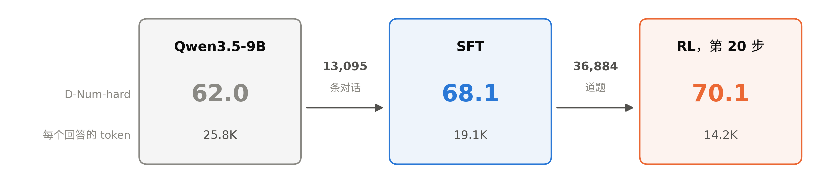</p>

<p align="center">各阶段的 D-Num-hard 准确率（160 道留出题上的 avg@8）与每个回答的平均 token 数。箭头上是用来训练下一个模型的数据。</p>

## 概要

做领域模型，通常的做法是从一个强大的开源模型起步：先用领域数据微调，再强化其中有效的做法。Qwen3.5-9B 在教科书级的地震学上已经很强。D-Num 是训练前冻结的 300 道数值题。在 D-Num 上，它 91.6% 的样本答对；在 99.7% 的题上，它 8 次尝试中至少答对一次。它的失败大多是在 32K token 上限处被截断的回答（占样本的 4.6%）或格式错误的回答（2.3%），另有 1.5% 给出错误数值。所以它的提升空间在于需要多少 token：在 8K token 以内，它有 13% 的样本答对（§3.3）。

饱和的测试显示不出进步。因此，在任何训练结果出现之前，我就冻结了一个更难的子集 D-Num-hard：160 道题，来自训练中从未出现过的 8 种题型。基座模型在上面得 62.0，其中两种接收函数（receiver function）题型接近 0%；在其中一种上，160 个样本有 159 个一直写到 token 上限（§3.4）。

监督微调（SFT）用 13,095 条对话（4,410 万 token）让模型学会了教师更简短的风格。这些对话大多是 Qwen3.8-27B 教师为求解器（solver）核验过的题目写的解答。平均回答从 1.47 万 token 降到 9.5 千 token，大多数测试集都有提升：D-Num-hard +6.1、D-Fresh +8.1、D-Code +5.8、GPQA Diamond +14.7、LiveCodeBench +14.3。D-Num 下降 2.2 个点，超出了它 10 个种子的噪声（标准差 0.46）。这次下降来自错误数值：SFT 之后，错误数值变得更常见（§5.4）。

随后，采用 GRPO 式组优势（group advantage）的强化学习（RL）在四类共 36,884 道题上训练：由求解器核验的数值题、由隐藏测试核验的代码、由 LLM 裁判（judge）按评分细则（rubric）打分的报告，以及由程序核验的通用指令。这些题目曾用基座模型做过难度过滤。经过 SFT，模型已经强了很多，所以在前 20 步中，87% 的数值题组和代码题组 8 个样本全部答对，这些组不产生梯度（§6.3）。

前 20 步教会了模型把推理写完：在开发集（dev set）上，16K token 上限下的数值题准确率从 92.0 升到 97.3。此后，每个任务的回答都在不断变短。到第 52 步，数值题和代码的准确率降到零；第 56 步，一次训练/rollout 失配（mismatch）告警让运行停了下来。我起初怀疑是某个任务奖励了短回答。训练日志排除了这种可能：在每一步之内，正确和错误回答的长度大致相同。原因仍未查明（§6.4）。

按开发集曲线选出的第 20 步保持了 SFT 的准确率，用的 token 少 41%（每个回答从 9.5 千 token 降到 5.6 千）：D-Num-hard 70.1、D-Fresh +4.6、GPQA +2.9。它未完成的回答更少，错误数值更多：在 D-Num-hard 的 1,280 个回答中，未完成的从 361 个降到 211 个，数值错误从 46 个升到 161 个（§7.1）。它的拒答也更少了。即使用宽泛的检测器，它在应拒答提示词上的拒答率也下降了 7.7 个点，下降主要发生在措辞像无害提示的不安全提示上（§7.4）。

报告奖励依赖一个裁判，所以我又用一个从未接触过训练的第二裁判给同样的报告打分。两个裁判的意见不一致。奖励裁判（Gemma）给出的 SFT 模型报告对基座的胜率是 86%，第二裁判（GPT-6 Luna）给出的是 49%。以 70 分为及格线（pass mark），Luna 判不及格的 133 份报告中，Gemma 判及格 100 份。Gemma 所用的评分细则也是复合的：5,765 条标准中有 91% 把几个论断连在一起。RL 期间，两个裁判之间的差距缩小了，所以 RL 没有学会讨好裁判（§6.5）。

接着，我给每个失败都打上了标签，结果发现数值题和报告失败的原因不同。数值题的失败大多属于执行（execution）问题：回答没有写完，用的方法是对的。为了检验这一点，我让每个在 32K 处被截断的回答继续写到 64K token。这样 SFT 模型在 D-Num-hard 上答对 83.9%，RL 第 20 步答对 77.5%，基座答对 69.8%（§7.3）。两种接收函数题型对基座仍然无解，这是知识缺口。SFT 模型有了空间之后，能解出其中约一半。报告的不足大多是科学内容缺失或错误，SFT 和 RL 都没有改变它们（§7.2）。因此，对数值题来说，中期训练（mid-training）不是下一步。对报告来说，最便宜的检验是知识密集的 SFT 数据（§8.2）。

这些结果为接下来的运行定下了方向。在 32K 下，RL 第 20 步在 D-Num-hard 上比 SFT 高 1.9 个点 [−0.7, +4.6]，在 D-Fresh 上高 4.6 [−0.8, +10.4]，都在噪声以内。在下一次 RL 运行开始之前，我把 32K 下的这种配对比较定为它的成功标准。RL v2 用 SFT 模型重新评定题库难度，让更多的组带有梯度。它去掉了报告任务，把学习率减半，并在开发集回答开始给出错误数值时暂停（§8.3）。对于报告，教师从 3,000 篇开放许可的论文写出回答，SFT v2 以闭卷方式学习这些回答，RL v3 从 SFT v2 开始（§8.4）。两次运行都已在队列中，结果还没有出来。

这个月的大部分时间花在了系统上。唯一的那个 8 节点作业运行了 71.9 小时：其中 28.7 小时运行计划内的阶段，43.2 小时花在故障、等待和挂起上，其中 35.1 小时发生在 SFT 能够开始之前（§9.2）。在 40 GB 的 GPU 上跑 9B 模型没有任何余量：流水线（pipeline）最后一段的峰值达到 40,437 MiB 中的 40,366 MiB（§5.3）。每次故障都留下了一个测试或一道防护；值得借鉴的那些写在 [PITFALLS.zh-CN.md](PITFALLS.zh-CN.md) 中。

## 目录

1. [结果速览](#1-结果速览)
2. [快速开始](#2-快速开始)
3. [在训练之前定义成功](#3-在训练之前定义成功)
4. [数据：RL 题库与 SFT 混合数据](#4-数据rl-题库与-sft-混合数据)
5. [第一阶段：监督微调](#5-第一阶段监督微调)
6. [第二阶段：多任务 RL](#6-第二阶段多任务-rl)
7. [模型错在哪里](#7-模型错在哪里)
8. [测试与结果意味着什么](#8-测试与结果意味着什么)
9. [系统：在共享超算上的一个月](#9-系统在共享超算上的一个月)
10. [评测发现了什么](#10-评测发现了什么)
11. [实验方法可扩展性分析](#11-实验方法可扩展性分析)
12. [失败图谱与训练陷阱](#12-失败图谱与训练陷阱)
13. [仓库结构](#13-仓库结构)
14. [重新生成图表](#14-重新生成图表)

[PITFALLS.zh-CN.md](PITFALLS.zh-CN.md) 收录了搭建这条流程时遇到的失败，以及现在能发现它们的检查。

---

## 1. 结果速览

### 1.1 模型、数据与算力

| | |
|---|---|
| 基座模型 | Qwen3.5-9B，即发布版模型，开启思考，推理强度 medium：32 层，混合 Gated DeltaNet 与全注意力（head_dim 256），带一个多 token 预测（MTP）头，词表 248,320 个词 |
| 教师 | Qwen3.8-27B（FP8）：撰写 SFT 解答和报告，并在题目验证中投票 |
| 奖励裁判 | Gemma 4 26B-A4B（FP8），运行在一张 A100 上：负责 T3 报告奖励、验证投票和数据检查 |
| 第二裁判 | GPT-6 Luna（API），只用于评测：D-Report 的第二裁判、裁判漂移审计、失败标签。它的输出从不进入训练数据 |
| RL 题库 | 生成的 57,037 道题中保留 36,884 道（§4）：25,588 道数值题（T1）、2,495 道代码题（T2）、1,193 道报告题（T3）、7,608 道通用题（T4） |
| SFT 混合数据 | 13,095 条对话，44.1M token：8,776 条数值解答、1,301 条工具调用轨迹、554 篇报告、2,464 条由基座模型自己写的通用回答（§4.5） |
| RL | 8 个样本的组均值优势，每步 126 个提示词，PPO 裁剪 0.2 / 0.28，无 KL 项，回答最长 16K token；计划的 120 步中跑了 56 步，保留第 20 步（§6） |
| 硬件 | 8 个节点，每个节点 3 × A100-PCIe-40GB，没有 NVLink，节点之间用 InfiniBand 互连，Slurm 调度。训练在 8 个节点上采用 TP1 × PP8 × DP3；rollout 在同一批 GPU 上，用 24 个单 GPU 的 vLLM 副本 |
| 算力 | 2026-10-13 至 11-11 共约 756 节点小时；其中 575 节点小时用在一个 71.9 小时的 8 节点作业上（§9.2） |
| 评测 | 5 个训练前冻结的领域测试集（770 道题）、5 个通用基准、一个 650 条提示词的拒答集；95% 区间，10 个种子的噪声底线（noise floor，§3） |

### 1.2 各阶段结果

<p align="center">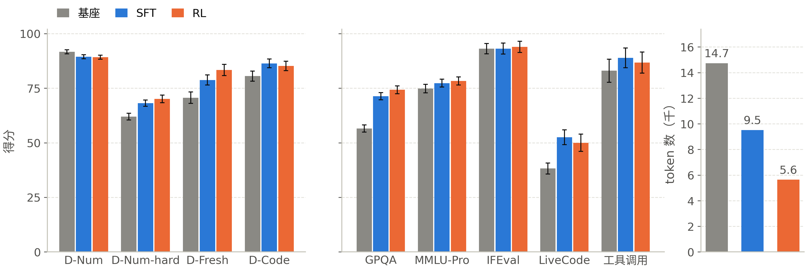</p>

| 测试集（指标，题数） | 基座 | SFT | RL 第 20 步 |
|---|---|---|---|
| D-Num（avg@8，300） | **91.6** ± 1.0 | 89.4 ± 0.9 | 89.2 ± 1.0 |
| D-Num-hard（avg@8，160） | 62.0 ± 1.6 | 68.1 ± 1.4 | **70.1** ± 1.7 |
| D-Fresh（avg@8，60） | 70.6 ± 2.6 | 78.8 ± 2.3 | **83.3** ± 2.6 |
| D-Code（pass@1，150） | 80.5 ± 2.3 | **86.3** ± 2.0 | 85.2 ± 2.2 |
| D-Report（对基座的胜率，取两个裁判中较低者，100） | 50 | 49.0 ± 9.0 | 49.0 ± 8.5 |
| GPQA Diamond（198） | 56.6 ± 1.6 | 71.3 ± 1.6 | **74.2** ± 1.8 |
| MMLU-Pro，2K 子集（只看变化） | 74.8 | 77.3 | 78.3 |
| IFEval（377） | 93.1 | 93.1 | 93.9 |
| LiveCodeBench 2025-01 之后的题（70，只看变化） | 38.2 | **52.5** | 50.0 |
| 工具调用（188） | 83.0 | 88.8 | 86.7 |
| 应拒答提示词的拒答率，%（300） | **56.0** | 51.3 | 45.7 |
| 无害提示词的过度拒答率，%（350） | 3.4 | 4.0 | 2.6 |
| 平均输出 token 数 | 14,735 | 9,517 | **5,637** |

± 是采样噪声的 95% 区间。每个模型（包括基座）都在同一个评测框架（harness）中、用同样的提示词和设置重新运行（§3.2）；没有任何数字是从别处抄来的。图中没有画 D-Report，它有单独的图（§6.5）。数据来源：`docs/talk/data/run.json`。

变化最大的是 SFT。它把回答缩短了三分之一，并提升了所有基座曾用完 token 的测试集。GPQA 回答在 32K 处被截断的比例从 38% 降到 17%，LiveCodeBench 从 61% 降到 29%（`docs/talk/data/failure_types.json`，`cut_off_32k`）。D-Num 下降了，因为 SFT 给出了更多错误数值（§5.4）。

RL 把回答再次缩短，准确率大致不变。每个回答的 token 又减少了 41%，大多数测试集保持了原来的分数。超出区间的增益是 D-Fresh +4.6 和 GPQA +2.9。D-Num-hard 又提高了 2.0 个点，这仍在噪声以内（[−0.8, +4.8]，配对）。RL 之前定下的八道发布门槛（ship gate）中，有两道通过：通用能力和成本。D-Num 门槛（基座 + 8，即 99.6）从设定上就不可能达到（§3.5）。

在从未接触训练的裁判看来，D-Report 没有提升；拒答率确实下降了（§7.4）。

### 1.3 样本的去向

<p align="center">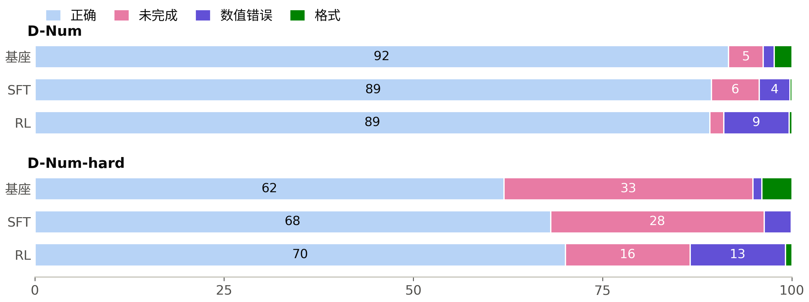</p>

每根柱子把一个模型的样本分成四种结果（%）：正确、未完成（推理在 32K token 内始终没有结束）、数值错误，以及格式失败（多个答案、没有答案或缺少单位）。判分器（grader）只看最终答案。

在 D-Num 上，基座的失败大多是未完成的回答，SFT 和 RL 的失败大多是数值错误。D-Num-hard 上也有同样的变化，幅度更大：未完成的回答从 33%（基座）降到 28%（SFT）再降到 16%（RL），数值错误从 1% 升到 4% 再升到 13%。**这里的后训练主要改变的是模型何时停止思考；停得更早的模型更常出错。** §7 探讨这些错误数值属于哪一类错误。

---

## 2. 快速开始

```bash
# --- CPU：安装、测试、判分器、显存规划器 -----------------------------------
pip install -e . -r requirements/core.txt
make test            # CPU 单元测试（不需要 GPU）
make graders         # 对抗性判分器测试套件，必须 100% 通过
make plan-cluster        # 8 个节点 × 3 张 A100-40GB 的显存 / FLOPs / 通信预算

# --- Slurm 集群：环境、模型、节点检查（scripts/slurm/README.md）--------------
bash scripts/slurm/setup_login.sh conda
sbatch -A <allocation> scripts/slurm/build_env.slurm
bash scripts/slurm/setup_login.sh models && bash scripts/slurm/setup_login.sh sandbox
sbatch -A <allocation> scripts/slurm/check_node.slurm      # 必须输出 SANDBOX ISOLATED
sbatch -A <allocation> scripts/slurm/parity.slurm          # vLLM 对比 Megatron：评测前向与训练前向

# --- 数据：启动教师、裁判和基座服务，然后 生成 → 题库 → SFT 混合数据 -------
sbatch -A <allocation> scripts/slurm/data.slurm gen
sbatch -A <allocation> scripts/slurm/data.slurm bank
sbatch -A <allocation> scripts/slurm/data.slurm sft

# --- 一个 8 节点作业：基线评测 → SFT → SFT 评测 → RL 准入门槛 → RL → 最终评测
sbatch -A <allocation> scripts/slurm/campaign.slurm

# --- 接下来的运行（§8.3、§8.4）：RL v2；知识数据；SFT v2 → RL v3 ---------------
scripts/slurm/submit_window.sh rl-build-queue          # 8 个节点：题库 v2（若缺失）→ 24K 测试 → RL v2 → 最终评测
sbatch -A <allocation> scripts/slurm/knowledge.slurm   # 1 个节点：从论文生成报告数据，然后构建 SFT v2 混合数据
scripts/slurm/submit_window.sh sft-v2-queue            # 8 个节点：SFT v2 → 它的评测 → RL v3 → 最终评测

# --- 本 README 中的图，由 docs/talk/data/ 中的结果文件生成 -----------------
python scripts/readme_figures.py
```

完整的步骤顺序，以及每一步的用时，见 [scripts/slurm/README.md](scripts/slurm/README.md) 中的表格。各阶段背后的设计文档在 `docs/` 中：[data_pipeline.md](docs/data_pipeline.md)、[evaluation.md](docs/evaluation.md)、[rl_algorithm.md](docs/rl_algorithm.md)、[rewards_and_hacking.md](docs/rewards_and_hacking.md)、[systems.md](docs/systems.md) 和 [verl_integration.md](docs/verl_integration.md)。

---

## 3. 在训练之前定义成功

### 3.1 为什么测试先行

通常的顺序是先训练，再去找一个能显示增益的测试。后面的每个数字都取决于测试，所以这里先做测试。这些测试集于 2026-10-22/23 构建并冻结，用内容哈希和金丝雀字符串（canary）固定下来。这发生在 RL 题库和 SFT 混合数据构建之前，这样去污染（decontamination）才能检查训练数据与它们是否重叠。之后加入的测试集只有 D-Num-hard 一个：它于 10-27 冻结，当时还没有任何 SFT 结果（§3.4）。训练从不接触测试集的任何一道题、任何一个题族（family）或任何一份评分细则。数值题族在代码中被划分为训练题族和留出（held-out）题族（`src/dpt/data/gen/families.py` 中的 `split="heldout"`；留出部分的定义本身不公开，见“数据与许可”），并有一个测试保证评测包从不导入奖励代码（`tests/eval/test_independence.py`）。

| 测试集 | 题数 | 测量什么 | 标准答案（gold） | 指标 |
|---|---|---|---|---|
| D-Num | 300 | 来自 10 个留出求解器题族的一到三步数值题 | 求解器 | avg@8 |
| D-Num-hard | 160 | 8 个 3 步及以上的留出题族，每族 20 道 | 求解器，并与一次独立计算核对 | avg@8 |
| D-Fresh | 60 | 模型发布之后编写的题，模型不可能见过 | 一个起草的 `solve()`，必须能复现答案，另加模型投票 | avg@8 |
| D-Code | 150 | 领域编程任务 | 沙箱中的隐藏单元测试 | 4 个样本上的 pass@1 |
| D-Report | 100 | 书面报告，每题 5 条加权标准和 5 个常见错误 | 无：与基座两两比较的胜率，两个裁判，两种顺序 | 胜率 |
| 通用 | 5 个测试集 | GPQA Diamond、MMLU-Pro（2K）、IFEval、LiveCodeBench（2025-01 之后）、工具调用 | 公开 | 各基准自己的指标 |
| 拒答 | 650 | 300 条应拒答提示词（JailbreakBench、XSTest 的不安全提示），350 条无害对照 | — | 拒答率 |

数值测试集另有两个扰动孪生版本（280 道题，数字已改），作为污染探针保留。这个月的计划里没有领域专家。GPT-6 Luna 起草了 D-Fresh 和 D-Report，Gemma 做了核查；一次由人完成的 20 对盲评（blind review）已经准备好，还没有进行（`dpt.eval.blind_review`）。所以本项目中的每个参照都是程序或模型，没有一个是人工标签（§8.1）。

### 3.2 解码与评分约定

每个模型（包括基座）都在同一个评测框架（`src/dpt/eval/harness.py`）中重新运行：同样渲染后的提示词，温度 1.0，top-p 1.0，推理强度 medium，最多 32K 个输出 token，每道题一个种子。只对最终答案判分。推理始终没有结束的回答算失败，每个测试集都报告截断率。数值判分器（`dpt.eval.graders.numeric`）与 T1 奖励分开编写，对单位要求严格。在相同的回答上，两者在 99.3–100% 的情况下一致（§6.5）。

### 3.3 基座模型几乎让 D-Num 饱和

<p align="center">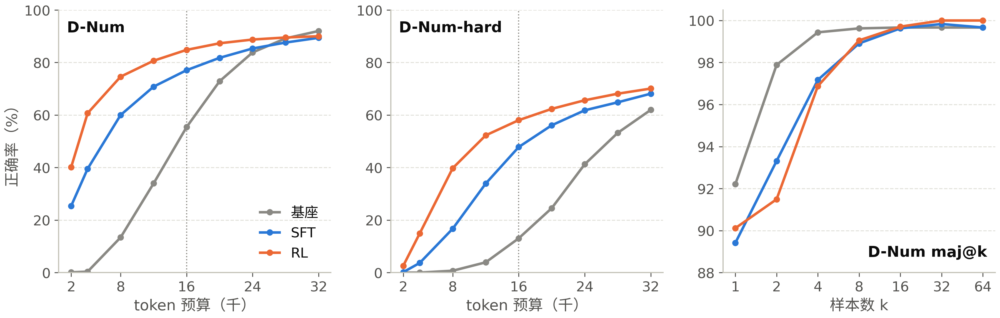</p>

左图和中图：在一个 token 预算内答对的样本比例，相当于把长度上限设为这个预算，同一模型的所有运行合并统计（`dpt.eval.budget`；点线是 RL 的 16K 上限）。右图：D-Num 上对 k 个样本做多数投票（`scripts/talk/research_1110.py`）。

基座在 D-Num 上单个样本得 91.6，8 个样本中至少一个答对的比例为 99.7%，8 个样本多数投票为 99.6%。按准确率衡量，这个测试集已经被解决了。接下来要看的是成本：在 8K token 以内，基座有 13.4% 的样本答对；在 16K 以内，有 55.4%。一个正确回答平均要花 1.77 万个输出 token，做的是一到三步的教科书计算。SFT 和 RL 把整条曲线向左移：在 8K token 以内，SFT 有 60.0% 的样本答对，RL 有 74.6%。

**在强基座模型上，后训练首先买到的是效率。** 对这个测试集，要看的数字是给定预算下的准确率，因为在上限处，这个测试集已经被解决了。

### 3.4 更难的子集，在任何结果之前冻结

基座已经能通过的测试，无法说明训练是否有帮助。因此，在 10-27、任何 SFT 结果出来之前，我加入了 D-Num-hard：8 种三步及以上的留出题型（接收函数的 Moho 深度与 H-κ Vp/Vs、速度梯度中的射线、由频谱平台求 Mw、由地面运动模型求距离、由方向性求破裂长度、库仑应力变化），每种 20 道。每个求解器都用一次独立计算做了核对（正演模型、用数值求积计算的射线积分、旋转后的应力张量）。子集按题族选定，选的时候没有看模型做错了哪些题。

基座在这里得 62.0。它三分之一的样本在 32K token 内始终没有写完，一个正确回答要花 4.16 万 token。两个接收函数题族为 0%。在 H-κ 上，160 个样本中有 159 个一直写到上限。在 Moho 深度上，少数写完的样本用的是 P 波与 S 波射线路径走时之差，这会把 Moho 算深 6–19%。正确的关系式是平面波时延 $`H\left(\sqrt{1/v_s^2-p^2}-\sqrt{1/v_p^2-p^2}\right)`$。

### 3.5 噪声底线与门槛

基座用不同种子在 D-Num 上跑 10 次，分数在 91.1–92.5 之间（标准差 0.46；两两之差平均为 0.52，最大 1.42；`docs/talk/data/run.json`，`eval.noise_floor`）。小于约 1.4 个点的差异就是噪声。

下一步怎么走由两类门槛（gate）决定，两者都事先定好：
- **RL 准入门槛**（SFT 之后）。在 D-Num 的天花板上，严格的“SFT 高于基座”检查会由噪声决定。另外，门槛不通过时，原先会直接结束 8 节点作业，下一个时段要等大约三天。所以，在 10-27、任何 SFT 结果出来之前，我把这道门槛改成了考虑噪声的门槛。D-Num 低于基座的幅度最多为合并后的 95% 区间（约 1.4 个点），D-Code 和 D-Report 必须胜过基座；不通过时，作业现在会挂起，直到有人决定继续或停止。SFT 没有通过（D-Num −2.2；按较低的裁判，D-Report 没有高于基座），继续的决定事先已经给出。
- **八道发布门槛**（RL 之后），阈值沿用本项目起步时所依据的参考计划。通过了两道：通用能力（+7.5，允许最低到 −1.0）和成本（基座 token 的 0.38×，允许最高到 1.3×）。D-Num 需要达到基座 + 8，即 99.6，在已饱和的测试集上没有模型能做到。这一点在 RL 之前就已知道。新的阈值必须在下一次运行出结果之前定好。

坦白地说，有这些局限：
- D-Num-hard 依赖 8 个题族的 160 道题，其中两个题族决定了它大部分的分差（§8.1）。
- D-Fresh 有 60 道题，全部由模型编写和核查。
- 所有结果都只在一个推理强度和一个预算下测量，所以每个分数里都混合了准确率和效率。

```bash
python -m dpt.eval.harness --model-name base_medium --sets d_num --seed 0 --endpoint http://localhost:8000 \
    --out eval_results/base_medium           # 一个测试集、一个种子；噪声底线对种子 0-9 重复这一步
python -m dpt.eval.budget --eval-root eval_results --out talk/budget      # 每个 token 预算内的准确率
```

---

## 4. 数据：RL 题库与 SFT 混合数据

### 4.1 为什么生成的题目需要四道过滤

由模板或教师写出的题目，会以损失曲线看不出来的方式出问题：错误的标签会把错误答案教得非常好，近似重复的题会放大某个主题，泄漏的测试题会抬高分数，模型总能做对的题不给 RL 任何梯度。每种问题都有自己的过滤器，按顺序执行（`src/dpt/data/pipeline.py`、`configs/data/pipeline.yaml`）：

<p align="center">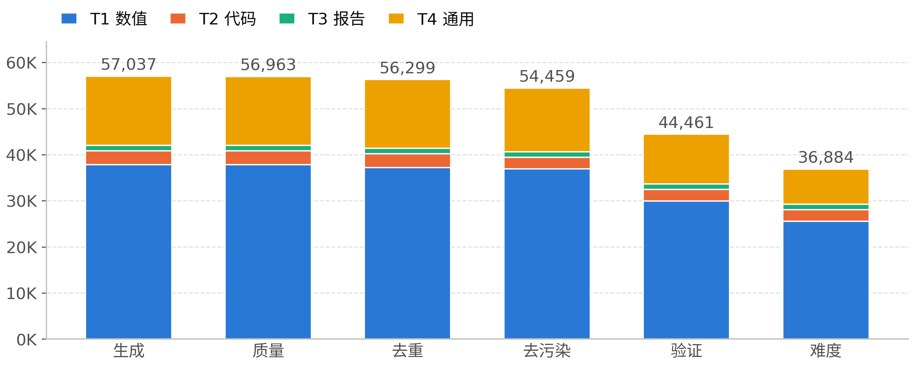</p>

| 阶段 | 移除 | 拦截的问题 |
|---|---|---|
| 质量 | 74 | 重复的 4-gram、过短 |
| 去重 | 664 | 近似重复（MinHash） |
| 去污染 | 1,840 | 与任一测试集的 n-gram / MinHash 匹配（1,399），经裁判确认的语义匹配（441） |
| 验证 | 9,998 | 整个模板被拒（9,842）、模型无法判定（140）、求解器与模型不一致（16） |
| 难度 | 7,577 | 基座 8/8 全对的整个模板（6,634）、8/8 全对的单道题（943） |

生成的 57,037 道题最后剩下 36,884 道（65%）。发布的题库包含 36,668 道训练题、190 道开发集题目，以及 26 道没有用于训练的难题，基座在这些题上 0/8（`docs/talk/data/run.json`，`pipeline`）。

### 4.2 验证：求解器与两个模型必须一致

一个模板的标签有多好，取决于它的求解器。对 102 个模板和来源中的每一个，教师解答其中 20 道题（每道 4 个样本），再由裁判裁定。一个有缺陷的求解器会一下子产生数百个错误标签，所以如果一个模板的题目被模型否决，就把整个模板丢弃。有 20 个被整个拒绝（19 个数值模板和 `openai/gsm8k`），模板保留题目比例的中位数为 95%。

第一次完整验证拒绝了全部 102 个模板。它碰上了两个只在真实数据上才出现的 bug。求解器注册表从未被导入，所以每道题都以 `solver_error: KeyError` 失败。裁判在部署时没有配推理解析器（reasoning parser），输出的思考内容不带 `</think>`，所以每一票都是空的。现在两者都有测试覆盖，从缓存重跑只用了一分钟。**在规模化地信任每个阶段之前，先在真实数据样本上跑一遍。**（[PITFALLS](PITFALLS.zh-CN.md) A1。）

### 4.3 难度：去掉模型已经会做的题

GRPO 只从样本结果不一致的组中学习（§6.3），所以一道 8 次中 8 次都答对的题只消耗算力，什么也教不了。基座模型对 1,780 道抽检题各回答 8 次，每次只用一张 A100，前后约两天。抽检的 1,620 道 T1 题中有 828 道 8/8 全对。抽检题中至少 90% 为 8/8 全对的模板被整个丢弃（11 个模板，6,634 道题），另有 943 道 8/8 全对的题被逐道丢弃。

这个过滤器用的是基座模型，这正是它的缺陷。在 RL 开始之前，SFT 已经让策略（policy）强了很多，所以保留下来的题大多对 RL 所训练的模型来说已经很容易（§6.3）。因此，RL v2 用 SFT 策略给每道题重新评定难度（§8.3）。

### 4.4 去污染

测试题一旦泄漏进训练，分数就变成了记忆力测试。每道训练题都用三种方式与每个测试集比对：n-gram 和 MinHash 重叠、必须由裁判确认的语义匹配（裁判否决了 4,991 个候选匹配），以及答案（0 个匹配）。RL 题库在 56,299 道题中去掉了 1,840 道（3.3%），SFT 混合数据在 13,401 条对话中去掉了 306 条（2.3%），植入测试集的 canary 字符串被发现 0 次（`docs/contamination.md`）。

### 4.5 SFT 混合数据

| 子集 | 对话数 | 来源 |
|---|---|---|
| 数值推理（T1） | 8,776 | 最终答案通过验证器的教师解答 |
| 工具调用轨迹（T2） | 1,301 | 借助工具调用完成的代码任务，只保留代码能运行且通过隐藏测试的 |
| 报告（T3） | 554 | 教师报告，多次采样后由裁判留下最好的一份 |
| 通用回放（T4） | 2,464 | 基座模型自己对通用提示词的回答，以免 SFT 后遗忘它们 |

17,638 个样本先去掉未经验证的题（1,742）和 RL 开发集题目（162），再经过质量与去污染过滤，剩下 13,095 条。这些对话共 4,410 万 token。最长的一条有 20,841 个 token；超过 4,096 个 token 的对话占 28%，这些对话包含了全部 token 的 62%。如果不分桶，填充（padding）会占 33%。把这些对话打包进四个长度桶（4K、8K、16K、32K），填充就降到 1.9%。

报告子集用 Gemma 做了拒绝采样（rejection sampling），后来评判 D-Report、给 T3 奖励打分的也是这个模型。这个选择最可能是 §6.5 中两个裁判出现分歧的原因。

---

## 5. 第一阶段：监督微调

### 5.1 为什么在 RL 之前做 SFT

RL 只能强化策略已经偶尔会做的事。基座模型在一道 D-Num 题上思考长度的中位数是 1.5 万 token，它在题库上的 rollout 有 34% 超过 16K token。在 16K 的回答上限下（§6.1），它三分之一的 RL 样本会被截断，不携带任何信号。因此，先用教师的解答做 SFT，把策略推向更短、更干净的风格，这样 RL 就能从写得完的样本开始：

```
基座：  推理很长，回答在上限处被截断，一次回复里给出多个答案
SFT：   教师更短的解答，一个带单位的最终答案
RL：    从能写完的样本出发，强化其中正确的那些
```

### 5.2 训练配方

用 verl 的 Megatron 引擎做全参数 SFT（`configs/sft/sft_9b.yaml`，继承自 `sft_27b.yaml`）：2 个 epoch，峰值学习率 8e-6，预热 50 步，之后余弦衰减到 8e-7，权重衰减 0.1，每步 126 条对话；MTP 头以权重 0.1 一起训练，这样它在推理时仍能生成草稿（draft）。并行布局是 TP1 × PP8 × DP3：每个节点放一个流水线段，节点上的三张 GPU 是数据并行副本，所以梯度 all-reduce 从不离开节点（这些 A100 没有 NVLink）。

206 步用时 2.3 小时（编译完成后每步约 37 s）：损失 0.79 → 0.46，MTP 损失 0.87 → 0.47。

途中发现了两个静默的配置缺陷。第一，verl 0.9.1 不会把 `optim.betas` 传给 Megatron，所以 SFT 本会以 Adam β2 = 0.999 运行。配方要求的是 0.95，所以现在这个值直接在 Megatron 上设置。第二，只要 `test_freq > 0`，即使没有验证集，verl 也会做验证，这让第一次完整运行在第 50 步崩溃。`test_freq: -1` 解决了这个问题（[PITFALLS](PITFALLS.zh-CN.md) C3）。

### 5.3 把 9B 模型装进 40 GB 的 GPU

<p align="center">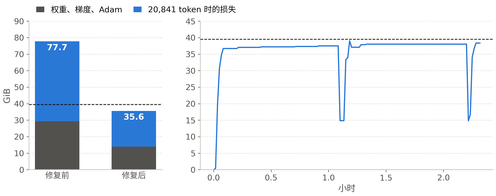</p>

左图：在最长的 SFT 数据行（20,841 个 token）上，流水线最后一段在修复前后所需的显存；虚线是 GPU 的 39.5 GiB。右图：同一张 GPU 在 2.3 小时 SFT 运行期间的情况（`docs/talk/data/last_stage_memory.json`、`rl.json`）。

在 TP1 下，流水线最后一段要放下完整的 248,320 词输出层和 MTP 头，MTP 头还保留着一份自己的嵌入副本（10 亿参数）。这样，在任何激活之前，就已有 31.4 亿参数，权重、梯度和 Adam 状态共 29.3 GiB。两个损失都把完整的 logits 升为 FP32，每个 token 2.38 MiB，所以这一段能放下的序列约为 3.5K token，28% 的 SFT 数据行比这更长。计划中的显存预算认为嵌入所在的那一段最重，为 32.3 GB。它既没有计入 MTP 的嵌入副本，也没有计入最后一段上的 FP32 logits，因为在 27B 计划中，TP4 把词表切成了四份。在 TP1 下，词表保持完整。

我保留了数据、损失和优化器的数学，只改变显存放在哪里：

| 修复 | 做法 | 对第 7 段的效果 |
|---|---|---|
| Adam 放在 CPU 上 | Megatron 的混合优化器把 FP32 主权重和 Adam 状态放在主机内存中；所有数据类型保持 FP32 | −11.7 GiB |
| Transformer Engine 交叉熵 | 两个损失都直接在 BF16 logits 上做 FP32 运算，而不再保留一份 FP32 副本（`dpt.verl_ext.patches` 中的修复 2） | 每个 token 2.38 → 0.94 MiB |
| 让 BF16 logits 绕过 FP16 包装器输出 | Megatron 的 `Float16Module` 把最后一段的输出升为 FP32；verl 在这里返回 logits，Megatron 自己的训练器则不会（修复 3） | 最长数据行上 −18.8 GiB |
| 不均匀的层划分 | 第一段和最后一段各放一个解码器层，中间每段放五个 | 输出层所在的段参数更少 |

这些修复与 FP32 参考实现的结果一致：每个 token 的差异在 1e-4 nats 以内，梯度的相对 L2 误差在 1% 以内（GPU 单元测试）。随后在最长的 12 行数据上做的 8 节点预检（pre-flight）中，最后一段三张 GPU 的峰值为 38,686 / 40,366 / 38,326 MiB，总量为 40,437。同一次预检还发现，其中一个修复什么也没打上：verl 把这个方法定义在子类上，补丁去基类上找，它的单元测试用的伪造类也犯了同样的错误。现在，补丁目标缺失时会直接报错：

```python
# src/dpt/verl_ext/patches.py
def _own_attr(cls, name, what):
    """cls's own `name` (not inherited). Raises if missing: a fix must never be a silent no-op."""
    attr = vars(cls).get(name)
    if attr is None:
        raise RuntimeError(f"dpt.verl_ext.patches: {what} not found; did the pinned stack change?")
    return attr
```

**在多节点启动之前，用最长的序列、连同所有将共享该节点的进程，测量最重的那一段。** 针对损失路径的单 GPU 探测用了五分钟，漏掉了在这条路径之外产生的那份副本。8 节点预检用了一小时，发现了这份副本，还发现了另外三个问题（[PITFALLS](PITFALLS.zh-CN.md) B2）。

### 5.4 SFT 改变了什么

| 测试集 | 基座 | SFT | 变化 |
|---|---|---|---|
| D-Num avg@8 | 91.6 | 89.4 [88.4, 90.3] | −2.2 |
| D-Num-hard avg@8 | 62.0 | 68.1 | +6.1 |
| D-Fresh avg@8 | 70.6 | 78.8 [76.5, 81.0] | +8.1 |
| D-Code pass@1 | 80.5 | 86.3 [84.3, 88.3] | +5.8 |
| D-Report 胜率，Gemma / Luna | 50 | 86.0 / 49.0 | +36 / −1 |
| GPQA Diamond | 56.6 | 71.3 | +14.7 |
| LiveCodeBench 2025-01 之后的题 | 38.2 | 52.5 | +14.3 |
| 平均输出 token 数 | 14,735 | 9,517 | −35% |

SFT 教会了模型教师更短的风格和干净的答案格式。D-Num 回答长度的中位数从 1.52 万 token 降到 5.5 千 token，格式失败从占样本的 2.3% 降到 0.2%。短回答几乎全对。在 4K token 以下的回答上（占其样本的 42%），SFT 的正确率为 96.3%；在 24–32K 的回答上为 85.7%。新增的错误是数值错误，从占样本的 1.5% 升到 4.1%，D-Num 下降就是因为它们。

**回答长度可能提高分数，也可能拉低分数。** 更短的回答提升了所有基座曾用完 token 的测试集。其中一部分增益来自模型及时写完，这并不说明模型有了新的知识：GPQA 的截断比例从 38% 降到 17%。在 D-Code 上，SFT 的回答长度变成基座的 2.5 倍，从 4.5 千 token 增加到 1.11 万 token，其中 8.3% 被截断。

---

## 6. 第二阶段：多任务 RL

### 6.1 实际运行的算法

对每个提示词，策略采样 $`G = 8`$ 个回答。每个回答的优势是它的奖励减去组内的平均奖励，不除以组内标准差：

```math
A_i = r_i - \frac{1}{G}\sum_{j=1}^{G} r_j
```

如果除以离散程度，推动最大的会是那些几乎全对或几乎全错的组。在这些组里，一次成功可能只是运气。在上限处被截断的回答不计入均值，也不获得优势，因为给同组的其他回答打分时，一个没写完的回答不应算作错误回答：

```python
# src/dpt/rl/advantage.py：group_mean_advantage，在按提示词对样本分组之后
for idx in groups.values():
    members = [i for i in idx if v[i]]      # v：有效，即没有在上限处被截断
    if len(members) < 2:
        continue                            # 只有一个样本就没有基线：它的优势保持为 0
    mean = r[members].mean()
    adv[members] = r[members] - mean
```

token 级损失是 PPO 的裁剪代理目标（clipped surrogate），上侧裁剪阈值更高（0.2 / 0.28，双重裁剪 3），对 token 求和后除以一个固定常数，这样丢弃零优势的组就永远不会改变其余组梯度的尺度。每个 token 都按 $`\min(\pi_\text{train}/\pi_\text{rollout}, 2)`$ 做重要性加权，以修正 vLLM 与 Megatron 概率之间的微小差异（截断重要性采样，TIS）；平均对数概率差距超过 1e-2 的序列会被掩码。没有 KL 项，也没有参考模型。推导过程，以及参考计划中做出每个选择的理由，见 [docs/rl_algorithm.md](docs/rl_algorithm.md)。

本次运行特有的设置（`configs/rl/rl_9b.yaml`）：

| 设置 | 取值 | 原因 |
|---|---|---|
| 每步提示词数 | 126 × 8 个样本，分 2 次更新，每次 63 个 | 128 不能被 DP3 整除 |
| 回答上限 | 16K token，从 12K 开始惩罚，到上限处为 −0.5 | 训练 MTP 头时 24K 放不进流水线最后一段；基座 rollout 长度的中位数是 12.7K token |
| 步数 | 计划 120 步，阶段边界 0 / 34 / 86 | RL 和最终评测必须放进正在运行的 8 节点作业，因为新作业要排队约 3 天 |
| 任务配比 | T1 50% / T2 25% / T4 25%，从第 34 步起加入 T3 15% | 由裁判打分的任务较晚加入，这样就不会先学会讨好裁判 |
| 学习率 | 2e-6，最后 34 步为 1e-6 | 参考计划中 9B 的取值 |
| rollout | 24 个单 GPU 的 vLLM 副本，与训练共置，异步部分 rollout，关闭 MTP 草稿生成 | 草稿生成在 CPU 上保留每份权重的副本，耗尽了最后一个节点的主机内存（[PITFALLS](PITFALLS.zh-CN.md) B4） |
| 告警 | 训练/rollout 的 log-ppl 差距超过 5e-3 时暂停 | 在奖励显出问题之前很久，这个差距就会上升 |

编译完成后，每步约 4 分钟（生成 150–190 s）。

### 6.2 奖励：四个任务，一个裁判

| 任务 | 检查什么 | 得分 | 评分方 |
|---|---|---|---|
| T1 数值（25,446 道训练题） | 在题目容差内给出一个最终数值，单位正确，且只有一个答案 | 1 或 0 | 程序：求解器的数值（`dpt.rewards.numeric`） |
| T2 代码（2,483） | Apptainer 沙箱中的隐藏单元测试 | 通过测试的比例；篡改得 0 分 | 程序（`dpt.rewards.code_sandbox`） |
| T3 报告（1,181） | 每道题 4–6 条评分标准，每条打 0–10 分 | 加权得分 × 引用系数（Crossref 无法核实的参考文献每条 −0.1），再减去长度惩罚和自夸惩罚 | **LLM：Gemma 4 26B-A4B**，温度 0（`dpt.rewards.judge`） |
| T4 通用（7,558） | 1–3 条程序化约束，必须全部满足，另加一道相关性门槛；数学题用精确匹配 | 1 或 0 | 程序（`dpt.rewards.instruction`） |
| 全部 | 回答长度 | 从 12,288 到 16,384 token 线性惩罚，最低到 −0.5 | 程序 |

T1、T2 和 T4 是原子化的：每次只检查一个数值、一个测试或一条约束。T3 的标准是复合的。标准长度的中位数为 47 个词，5,765 条标准中有 91% 用“and”、“or”或“;”把几个论断连在一起，所以一条标准大约包含三个论断。因此，RL v2 把每条标准改写成 1–6 个是/否检查项，每一项都要引用报告中的一段原文来回答（`dpt.data.gen.t3_atomic`；[docs/reports/reward_rubric_scaling_1110_zh.md](docs/reports/reward_rubric_scaling_1110_zh.md) §2）。

### 6.3 为什么组里几乎没有信号

样本之间结果不一致时，一个 GRPO 组就带有信号。如果 8 个样本得到相同的奖励，每个优势都是零。

<p align="center">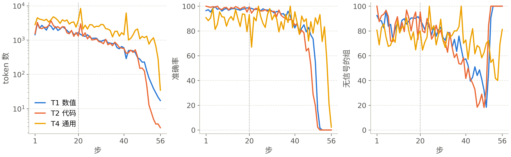</p>

第 1 次运行中，三个可验证任务在每个训练步的情况：平均回答长度（左，对数坐标）、训练准确率（中），以及 8 个样本奖励全部相同的组所占比例（右）。点线是第 20 步，即保留的检查点（`docs/talk/data/rl.json`）。

| 组的结果 | 全对 | 混合（有信号） | 全错 |
|---|---|---|---|
| T1，基座模型，题库抽检 | 45% | 54% | 1% |
| T1，SFT 策略，第 1–20 步 | **87%** | 13% | 0% |
| T2，SFT 策略，第 1–20 步 | 87% | 13% | 0% |
| T4，SFT 策略，第 1–20 步 | 75% | 22% | 3% |

难度过滤（§4.3）用的是基座模型。对基座来说，T1 有一半处在有用的中间地带。SFT 策略强得多，所以到第 1 步时大多数组已经全对，一步的 1,008 个样本中有 88–272 个优势非零。T4 是解出最少的任务，占四分之一的提示词，在第 1–20 步中提供的梯度占比中位数为 57%。**一个题库有多难，取决于在它上面训练的模型。** 因此，RL v2 用 SFT 策略重新评定题库难度；第 1 步时，T1 组中至少要有 40% 是混合的，否则 RL 不启动（§8.3）。

### 6.4 前二十步向好，随后崩溃

| 开发集（190 个提示词 × 4，16K 上限） | 第 0 步 | 第 20 步 | 第 40 步 | 长度中位数，token |
|---|---|---|---|---|
| T1 数值 | 92.0 | **97.3** | 78.9 | 1,250 → 675 → 193 |
| T2 代码（12 个任务） | 79.2 | 97.9 | 83.3 | 4,394 → 1,421 → 332 |
| T3 报告（裁判） | 63.7 | 64.3 | 63.5 | 7,949 → 7,080 → 2,423 |
| T4 通用 | 83.6 | 88.8 | 92.1 | 4,945 → 4,965 → 3,435 |

前 20 步修正了一种失败模式。第 0 步时，760 个开发集样本中有 53 个推理始终没有结束（中位数 1.26 万 token，全部落在超长惩罚区间内）；到第 20 步只剩 15 个。随后模型不再推理了。到第 40 步，T1 的失败已经从推理未完成变成了简短的错误回答（数值错误 9 → 91，缺少单位 0 → 17），T1 回答长度的中位数为 193 个 token。到第 52 步，T1 和 T2 的训练准确率降到零，随后 T3 和 T4 也是如此，第 56 步时平均回答只有 13.7 个 token。一旦每个组都全错，每个优势都为零，就没有任何东西能把模型拉回来。训练/rollout 的 log-ppl 差距达到 0.0128，告警在第 56 步暂停了运行，并保存了检查点。在开发集上做的检查点选择选中了第 20 步（`dpt.eval.select_checkpoint`：97.27，到第 40 步降到 78.91）。

哪些已经确定，哪些已经排除，哪些尚未查明：
- **已确定**：每个任务从最初几步起就在变短（T1 平均回答在第 2、20、40 步为 3,047 → 1,649 → 595 个 token）。在 T1 和 T2 几乎被解决的情况下，大部分梯度来自 T4。
- **已排除**：一是长度惩罚导致了这一现象（惩罚从 12K 开始）；二是某个任务通过奖励短回答教会了模型简短。在同一步之内，正确与错误回答的长度大致相同（第 1–20 步：T4 正确回答为 3,749 个 token，错误回答为 3,341 个；T1 为 2,058 和 1,796）。
- **尚未查明**：原因。T3 在第 27 步加入，在第 27–40 步中占梯度的 26–72%。T1 的回答在 T3 加入之前就已经开始缩短（第 14 步 2,205 个 token，第 26 步 1,117 个）。

这一分析的早期版本把原因归于 T4 教会了模型简短。逐步的指标不支持这一说法，所以它已被撤回（[PITFALLS](PITFALLS.zh-CN.md) D1）。**在几乎已被解决的可验证任务上，RL 的信号很少，这点信号还可能被某一个任务主导。每 20 步一次的开发集评测足以保留最好的检查点。要在转折发生时就看到它，评测必须做得更频繁。** 因此，RL v2 每 10 步做一次开发集评测。

### 6.5 裁判：宽松，评分细则复合，没有漂移

T3 是唯一一个奖励来自模型意见的任务，所以它要接受三项检查。

<p align="center">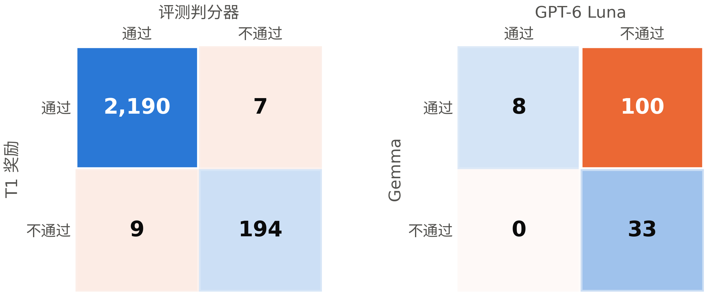</p>

左图：T1 奖励和评测判分器如何给基座模型的 2,400 个 D-Num 回答打分。右图：以 70 分为及格线，T3 奖励裁判（Gemma）和 GPT-6 Luna 如何给 141 份 RL 开发集报告打分（`docs/talk/data/reward_vs_eval.json`）。两者一致的情况落在对角线上。

**用独立参照来核对。** 没有人工标准答案，所以每个奖励都与能找到的最独立的参照比较。T1 与评测判分器在基座 99.3% 的回答上一致（7 个误判为通过，都是给出多个答案的回复；9 个误判为失败，其中 8 个无法解析），在训练后模型的回答上 100% 一致。T3 偏宽松。以 70 分为及格线，Gemma 判及格的报告有 108 份，其中 Luna 也判及格的有 8 份。Luna 判及格的报告，Gemma 从未判不及格。所以，这个奖励为独立裁判判不及格的报告付了分。

<p align="center">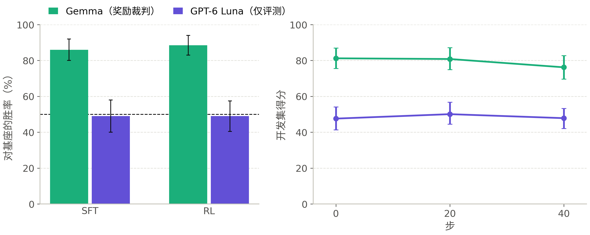</p>

左图：按裁判分列的 D-Report 对基座胜率，附 95% 区间；虚线表示打平。右图：同一批 T3 开发集回答在开发集评测第 0、20、40 步时，在两个裁判下的平均分（`scripts/slurm/judge_drift.sh`、`docs/talk/data/judge_drift.json`）。

**在评测上。** Gemma 认为 SFT 模型的报告比基座的好，80 胜 8 负（86.0%）；RL 模型的报告为 84 胜 7 负（88.5%）。Luna 把两者都评为与基座打平（49.0%）。两个裁判在 43–45% 的配对上一致。每对报告都按两种顺序评判，所以固定的宽松程度会相互抵消，剩下的是关于哪份报告更好的分歧。SFT 的报告数据是用 Gemma 做拒绝采样得到的（§4.5），所以 SFT 最可能学到的是 Gemma 的口味。门槛取两个裁判中较低的那个，正是为了这种情况。

**RL 期间的漂移。** 如果 RL 学会了讨好它的裁判，Gemma 给开发集回答的分数会上升，与 Luna 的差距会扩大。从第 0 步到第 40 步，Gemma 的分数下降了，差距也缩小了：Gemma −5.0 [−9.4, −0.7]，Luna +0.2 [−3.2, +4.2]，差距 −5.3 [−11.4, −0.1]。选中的第 20 步根本没有在 T3 上训练过（T3 在第 27 步才加入），所以它在 D-Report 上的分歧是随 SFT 一起带来的。

还剩一道侧门。T3 奖励是评分细则得分乘以引用系数。到第 40 步，回答引用的参考文献变少了（每个回答 2.3 → 1.4 篇），因而被扣分的无法核实的文献也少了。引用系数从 0.79 升到 0.83，评分细则部分从 81.2 降到 73.3，奖励维持不变。仅仅是回答变短就足以解释这一点。**由裁判打分的奖励需要一个从不参与训练的第二裁判；这个奖励自身的旁路，也要像裁判一样受到密切关注。**

---

## 7. 模型错在哪里

### 7.1 未完成的回答变成了错误的回答

§1.2 的分数掩盖了失败模式的变化（图见 §1.3）。在 D-Num-hard 上，每个模型有 1,280 个回答：

| | 基座 | SFT | RL 第 20 步 |
|---|---|---|---|
| 正确 | 793 | 872 | 897 |
| 32K 内未完成 | 421 | 361 | 211 |
| 数值错误 | 15 | 46 | 161 |
| 格式（多个答案、没有答案、单位） | 51 | 1 | 11 |
| 每个回答的平均 token 数 | 25.8K | 19.1K | 14.2K |
| pass@8（8 个中任一个正确） | 75.0 | 87.5 | 91.9 |
| 64K token 下答对（§7.3） | 69.8% | 83.9% | 77.5% |

每个阶段都让模型更常写完，也都把一部分新写完的回答变成了错误数值。在 D-Num-hard 上，净效果是正的，因为基座三分之一的样本都用完了 token，并且 RL 至少解出一次的题更多（pass@8 91.9）。同时，单个回答变得不那么可靠了。在 SFT 几乎已经解决的两个题族上，RL 退步了：由方向性求破裂长度从 94.4 降到 86.9，由频谱平台求 Mw 从 95.6 降到 85.6。D-Num 上未完成的回答本来就很少，所以在那里，同样的变化成了损失：数值错误从占样本的 1.5%（基座）升到 4.1%（SFT）和 8.6%（RL）。

### 7.2 执行错误还是概念错误？

更多训练数据还是更多知识会有帮助，取决于这些错误属于哪一类。公式或物理思路用错，是**概念**（concept）错误。算术、单位、格式出错或没能及时写完，是**执行**错误。因此，我在已有回答上分两轮给失败打标签，没有重新生成（`scripts/talk/failure_types.py`；[docs/reports/failure_types_and_tests_1110_zh.md](docs/reports/failure_types_and_tests_1110_zh.md)）：

1. 对每个回答应用规则：判分器的结果；每个错误数值相对正确数值的数值特征（差一点、差 10 的幂次、度与弧度混用、差一个简单因子、差一个符号）；以及一道题的 8 个回答中是否有 3 个或以上给出同一个错误数值。
2. 由 GPT-6 Luna 对分层抽样打标签：每个模型、每个题族最多 10 个错误回答和 10 个未完成回答，并提供题目、正确数值，以及作为参考方法的求解器代码。然后按题族把这些标签加权推回到每个失败的回答上。

<p align="center">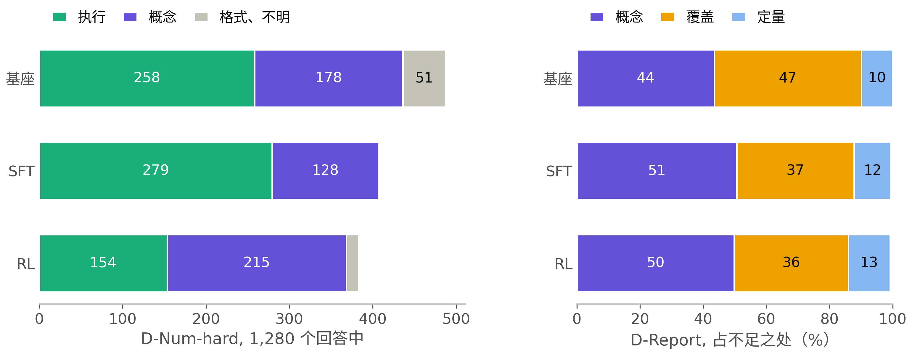</p>

左图：各模型在 D-Num-hard 上按原因分类的失败（1,280 个回答的加权计数）。右图：D-Report 按类型分类的不足之处，以占报告未满足的全部标准的比例表示（`docs/talk/data/failure_types.json`）。

**D-Num-hard：大多是执行错误，两个题族有概念错误。** 基座和 SFT 模型主要因为没写完而失败；在 Luna 读过的未完成回答中，63–82% 方法是对的：它们卡在了反复核对或来回摇摆上。概念错误占基座失败的 37%，占 SFT 失败的 31%。RL 更常写完，并且会认定错误的公式：它 80% 的错误数值是概念错误，占其全部失败的 56%。概念错误集中在两个接收函数题族：由 Ps 与 PpPs 走时求 Vp/Vs（32K 下任何模型的正确率都不超过 5%），以及由 Ps 时延求 Moho 深度（0% → 15% → 29%）。在 32K 下，这两个题族的回答大多用了错误的关系式。有 64K token 时，SFT 模型能解出其中的 40.0% 和 54.4%，基座仍几乎解不出（§7.3）。所以这两个题族是基座模型的知识缺口。

**D-Report：问题在内容，而且没有变化。** 这些报告完全满足大约一半的评分标准，其余的大多部分满足。不足之处是科学内容错误或缺失（占不足之处的 44–51%）以及遗漏的部分（36–47%）；表达清晰度和引用几乎从不出问题。对每个模型来说，63–71% 的报告的主要弱点都是概念问题。配对的评分细则得分没有变化：SFT − 基座 +1.5 [−1.6, +4.3]，RL − 基座 −0.0 [−2.8, +2.6]。这与 Luna 的 49% 胜率一致，与 Gemma 的 86–88.5% 不一致。

**两个任务失败的原因不同，所以需要不同的修正。** 那些方法已经正确的数值回答需要写完，更多的知识帮不了它们写完。报告遗漏了科学内容，更多写完的练习也补不上这些内容。

### 7.3 更多样本和更多 token 能换来什么

测试时计算（test-time compute）是本项目唯一测量得比较充分的缩放维度（图见 §3.3）。
- **投票。** 用单个样本时，三个模型在 D-Num 上的得分在 89.4 到 92.2 之间；用 8 票时，它们达到 98.9–99.6%（每道题 64 个样本；`docs/talk/data/research_1110.json`）。RL 的错误集中在 300 道题中的大约 30 道上，在这些题上它 30–60% 的样本答对。
- **Token。** 在 16K 预算下，基座在 D-Num 上 55.4% 的样本答对，在 D-Num-hard 上为 13.0%；RL 分别为 84.8% 和 58.0%。在完整的 32K 下，基座在 D-Num 上追了上来（基座 92.0，RL 90.0）。
- **k 个中任一个。** 在 D-Num-hard 上，pass@8 随各阶段上升，75.0 → 87.5 → 91.9，avg@8 从 62.0 升到 70.1。所以，训练在让正确答案变得可靠之前，先让它们变得更容易得到。
- **两倍的空间。** 我让每个在 32K 处被截断的 D-Num-hard 回答用同一个模型、同样的采样继续写到 64K token。用 64K 预算采样，在第 32K 个 token 之前与 32K 预算的采样完全相同，所以这只花一次全新运行的四分之一（`scripts/talk/numhard_continue.py`，`docs/talk/data/numhard_64k.json`）。

<p align="center">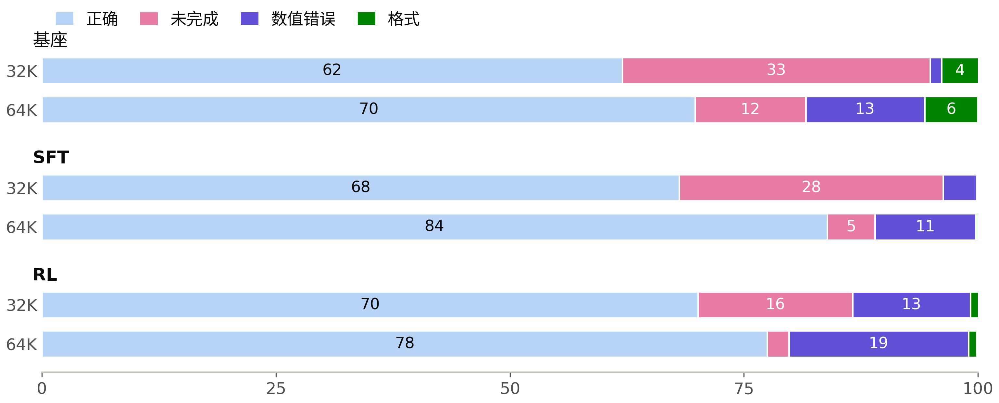</p>

每个模型 1,280 个 D-Num-hard 回答在评测所用的 32K 预算下和 64K 预算下的结果。

| 在 32K 处被截断的回答 | 基座 | SFT | RL 第 20 步 |
|---|---|---|---|
| 32K 处被截断 | 421 | 361 | 211 |
| 64K 下答对 | 100 | 202 | 95 |
| 64K 下数值错误 | 148 | 92 | 85 |
| 64K 下仍未写完 | 151 | 65 | 30 |
| 64K 下格式错误 | 22 | 2 | 1 |

有了写完的空间，SFT 模型是三者中最准确的：64K 下答对 83.9%，接着是 RL 第 20 步的 77.5% 和基座的 69.8%。SFT 被截断的回答里，超过一半原本正在走向正确的数值。基座被截断的回答里，四分之一是这样，另有 151 个在 64K 时又一次写到上限。RL 的回答很少写到上限，它的数值错误也留了下来：在破裂长度、Mw 和梯度介质射线距离上，它在两个预算下得分相同。接收函数题族对训练后的模型有了变化：SFT 的 Vp/Vs 从 3.8% 升到 40.0%，Moho 深度从 15.0% 升到 54.4%。基座仍是 0.0% 和 0.6%。

**想得更久的模型可能是更准确的那个；只用一个预算看不出这一点。** 32K 下 RL 排第一，来自各模型多快写完。

### 7.4 拒答

<p align="center">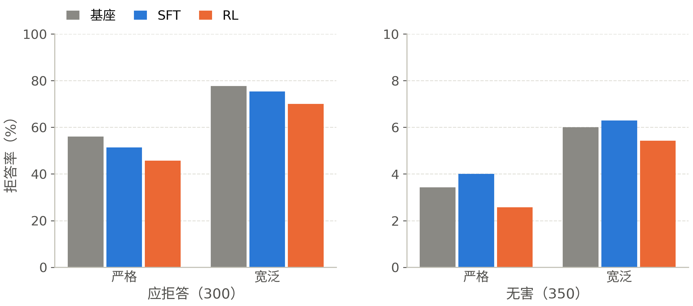</p>

门槛使用的拒答检测器在最终答案的前 1,500 个字符中匹配固定的拒答短语。更宽泛的词表加入了“I can't / won't”、“sorry … can't”、“I'm not able / going to”之后接任何动词的情形，以及对应的中文变体；它是一个上界，因为它也会把照做的回答里的免责声明算进去（`scripts/talk/refusal_breakdown.py`、`docs/talk/data/refusal.json`）。

| 应拒答率（%） | 基座 | SFT | RL 第 20 步 |
|---|---|---|---|
| 严格（门槛的检测器） | 56.0 | 51.3 | 45.7 |
| 宽泛（上界） | 77.7 | 75.3 | 70.0 |
| JailbreakBench 有害请求（100），严格 / 宽泛 | 49 / 92 | 48 / 91 | 42 / 87 |
| XSTest 措辞像安全提示的不安全提示（200），严格 / 宽泛 | 59.5 / 70.5 | 53.0 / 67.5 | 47.5 / 61.5 |
| 无害提示词的过度拒答（350），严格 / 宽泛 | 3.4 / 6.0 | 4.0 / 6.3 | 2.6 / 5.4 |

这次下降是真实的。即使用上界检测器，下降也有 7.7 个点，门槛允许的是 ±2 个点。严格口径下的下降中，约四分之一是模型换了新的措辞拒答，门槛的短语表没有覆盖到。应拒答提示词分两类：明显有害的请求，以及措辞像无害提示的不安全提示；损失集中在第二类上（XSTest 的“定义”类，25 条中的拒答数为 25 → 17 → 12；“比喻性语言”类为 23 → 23 → 16）。无害提示词的过度拒答也下降了，所以后训练让模型更倾向于作答。基座的 168 次严格拒答中，RL 保留了 105 次，换了措辞 36 次，并把 27 次变成了两个检测器都不认为是拒答的回答；它还对 32 条新的提示词拒答。这 27 个回答是照做还是安全的回应（safe completion），需要人来读。

**安全检测器必须在一次运行出结果之前就固定下来。** 在看到下降之后再放宽它，会让测量把这次退步吸收掉。

---

## 8. 测试与结果意味着什么

### 8.1 测试：长处与短板

| 测试 | 长处 | 短板 |
|---|---|---|
| D-Num | 求解器给出的标准答案、独立的严格判分器、窄区间（±1.0）、实测的噪声底线 | **已饱和**：单个样本 92%，8 票投票 99.6%，所以它的分数随可靠性和格式变化；基座 + 8 的门槛无法达到 |
| D-Num-hard | 能区分各模型（62 / 68 / 70）；没有题族在训练中出现过 | 依赖两个接近零分的题族；把知识与能否在 32K 内写完混在一起，64K 下 SFT 模型领先（§7.3）；32K 下 RL − SFT 在噪声以内 |
| D-Fresh | 在模型发布之后编写，排除了污染；能区分各模型 | 60 道题，只由模型编写和核查；部分增益来自写完 |
| D-Code | 客观的隐藏测试 | 沙箱在 10 月出现过基础设施故障（已修复）；SFT 的长回答有 8% 的时候被截断 |
| D-Report | 贴近实际的任务；从不参与训练的第二裁判；两种顺序；一个长度匹配的子集 | 两个裁判在 55–57% 的配对上意见不一；每道题一个样本；没有人工标准答案 |
| 通用 | 公开、可比，能发现大范围的退步 | 受“能否写完”混杂：基座在 GPQA 上 38%、在 LiveCodeBench 上 61% 的回答被截断；MMLU-Pro 没有通过记忆探针（6.2%），所以只看它的变化 |
| 拒答 | 发现了真实的下降 | 粗糙的词表，两种口径相差 20 个点；27 个回答需要人来读 |

这套测试缺少的是：任何地方的人工标准答案、第二个训练种子、每道 D-Report 题多于一个的样本，以及多于一个的推理强度和预算。没有最后这一项，每个分数里都混合着准确率和效率：思考更少的模型更常写完。

这些结果意味着什么，各用一句话说：
- SFT 是真实的改进，而且很大一部分是效率：用三分之二的 token 达到相同或更好的准确率，回答现在能写完了。
- RL 买到的是速度：token 又少了 41%，至少解出一次的题更多。它的单个回答更常出错，所以它没有买到可靠性。
- 在独立裁判看来，D-Report 没有提升；拒答率确实下降了。
- 后训练让 9B 更快，也更可能写完困难的多步题。它还没有显示出新的领域知识或更好的报告。

### 8.2 9B 路线应该加入中期训练吗？

中期训练（在领域文本上继续预训练）是补充知识的标准做法。这里的证据表明，现在还不该做。在 D-Num 上，基座单个样本得 92%，8 票投票得 99.6%，它的失败在于可靠性和形式，所以知识在那里没有出问题。在 D-Num-hard 上，大多数失败属于执行错误，而且 SFT 已经迁移到了它从未见过的题型上：有 64K token 时，SFT 模型能解出 54.4% 的 Moho 深度题，基座是 0.6%，都没有任何中期训练（§7.3）。唯一的数据点来自参考计划的 27B 路线：D-Num 提高 +1.1，在其噪声范围以内，通用能力下降了 1.3 个点。在这里，中期训练也很昂贵。经过去污染的领域语料还不存在，约 20 亿 token 在 8 个节点上要跑约 10 小时（约 80 节点小时，我的估计），每个 8 节点作业都要在队列里等上好几天。

报告的不足属于知识问题，SFT 和 RL 都没有触及它们（§7.2）。因此，下一步要做的是便宜的检验：为报告准备从开放许可论文写出的知识密集型 SFT 数据（§8.4）。继续预训练要等这项检验奏效之后再做。

### 8.3 RL v2：标准、改动与作业

**先定标准。** 在 RL v2 运行之前，它的成功标准就已确定：在 32K 预算下，D-Num-hard 和 D-Fresh 比 SFT 高出的幅度超过各自的噪声。这里的意思是，逐题配对差值的 95% 区间在零以上（按题重抽样，10,000 次）。一次 32K 运行就能给出三个预算，因为预算只限制回答的长度，不改变采样。在 16K 下，用了不超过 16,384 个 token 的回答才算数。在 64K 下，思考在 32K 内没有结束的回答由同一个模型继续写，做法同 §7.3（`python -m dpt.eval.budget compare`）。第 1 次运行的第 20 步在这一标准下的结果：

| 集合（题数） | 预算 | SFT | RL 第 20 步 | RL − SFT [95%] |
|---|---|---|---|---|
| D-Num-hard（160） | 16K | 47.8 | 58.0 | **+10.2** [+7.5, +12.9] |
| | 32K | 68.1 | 70.1 | +1.9 [−0.7, +4.6] |
| | 64K | 83.9 | 77.5 | **−6.4** [−9.0, −3.8] |
| D-Fresh（60） | 16K | 66.9 | 77.9 | **+11.0** [+5.0, +17.5] |
| | 32K | 78.8 | 83.3 | +4.6 [−0.8, +10.4] |

来源：`docs/talk/data/budgets_1111.json`。D-Fresh 在 64K 下的结果还需要把 SFT 的 41 个、第 1 次运行的 12 个被截断回答继续写完；RL v2 的最终评测会补上它们。

第 1 次运行在 16K 下达标，在 32K 下不达标。它让模型变快了，没有让模型更可靠。

**各项改动，以及每项改动背后的证据：**

| 改动 | 来自第 1 次运行的证据 | 位置 |
|---|---|---|
| 用 SFT 模型重新评定题库难度（8 个样本，16K）：去掉 8/8 全对的题，0/8 全错的题放进难题池，难题池在第 34 步加入，占 10%；更难的题每轮抽 3、2 或 1 次（通过率 ≤ 3/8、≤ 5/8、≤ 7/8）；新增 12 个难题族和 6 个长题族（数值题） | 在第 1–20 步，87% 的数值题组和代码题组 8 个样本全部答对，不产生梯度（§6.3） | `dpt.data.difficulty`、`configs/rl/rl_9b_v2.yaml` |
| 题库门槛：预计第 1 步时至少 40% 的数值题组结果有对有错 | 第 1 次运行是 13% | `dpt.data.bank_merge check` |
| 保留第 1 次运行的开发集划分，并让其中的题不进入训练 | 重新评定会去掉 SFT 模型能解出的开发集题目，新抽出的划分就会与第 1 次运行的不同，还会把其中的题漏进训练 | `dpt.data.bank_merge pin-dev` |
| 训练中不含报告任务；提示词中数值题 60%、代码 25%、通用 15% | 标准是数值题；报告奖励偏宽松（§6.5），它的原子化版本还没有与第二裁判对照过；通用任务占提示词的 21%，却贡献了中位数 57% 的梯度 | `configs/rl/rl_9b_v2.yaml` |
| 学习率减半：先 1e-6，后 5e-7 | 第 1 次运行（先 2e-6，后 1e-6）在开发集上于第 20 步达到峰值，此后发生漂移（§6.4） | `configs/rl/rl_9b_v2.yaml` |
| 若一个全长训练步能放进显存，就冻结 MTP 头、用 24K token 的回答；否则用 16K | 第 1 次运行在 16K 下训练，在 32K 下测试；训练 MTP 头时，24K 放不进流水线最后一段（§6.1） | `scripts/slurm/rl_v2_job.sh` |
| 每 10 步做一次开发集评测并保存检查点；开发集上的 D-Num 比最好成绩低 3 个点，或开发集数值回答中错误数值的占比比最低值高 3 个点时暂停 | 从第 20 步到第 40 步，开发集 D-Num 从 97.3 降到 78.9，错误数值从 1.8% 升到 17.8%，未完成的回答从 0.8% 降到 0% | `dpt.monitoring.alerts`、`docs/talk/data/run1_dev_outcomes.json` |

题库门槛用的是每道题在 SFT 模型下的通过率 $`r`$。这道题的一组 8 个样本结果有对有错的概率是

```math
P_{\text{mixed}}(r) = 1 - r^{8} - (1 - r)^{8},
```

门槛对主池中的数值题取它的平均。这个估计偏乐观：一道评为 7/8 的题，真实的解出率可能是 95%。

原子化的报告评分细则已经做好：每条标准变成 1–6 个是/否检查项，每个“是”都要有引用的片段。它们留给之后重新训练报告的运行使用，在那之前，它们需要与第二裁判一致。

**如何运行。** RL v2 是一个 48 小时的 8 节点作业，在它的题库建好之前就已排进队列。如果作业开始时题库还不存在，作业就在自己的节点上构建题库：教师和 Gemma 在 2 个节点上，SFT 模型在另外 6 个节点上，教师节点完成自己的部分后就改为运行 SFT 模型。随后依次是 24K 测试、RL，以及三个预算下的最终评测。作业在开始时才从仓库读取它的步骤，所以在它排队等待的那几天里，这些步骤仍然可以修改（`scripts/slurm/rl_v2_queue.slurm`、`scripts/slurm/rl_v2_job.sh`）。

```bash
scripts/slurm/submit_window.sh rl-build-queue      # 题库 v2（若缺失）→ 24K 测试 → RL v2 → 最终评测
```

**要在队列里等好几天的作业，应该在开始时才读取它的步骤。**

坦白地说，有这些局限：
- 每次运行只有一个种子；
- D-Fresh 只有 60 道题，它的区间约为 ±5 个点；
- 去掉报告任务之后，RL v2 无法提升 D-Report。

### 8.4 知识密集的报告数据与 SFT v2

模型的大部分事实是在预训练中学到的。几千条 SFT 数据主要改变它回答的方式，要补充知识，通常靠在领域文本上继续预训练。这里报告的不足在于缺少科学内容（§7.2），而现在还没有理由做继续预训练（§8.2）。更便宜的检验是：用回答中包含这些事实的 SFT 数据。教师凭记忆作答，只能传下它本来就知道的东西。因此，我让教师对照一篇它能读到的论文写出每个回答，学生只看问题来训练。

**论文。** 语料库中有 19,945 篇全文。OpenAlex 给出了所下载副本的许可，其中 7,642 篇是 CC-BY、CC-BY-SA、CC0 或公有领域。我从中选出 3,000 篇 2026 年 8 月之前的地震学论文（D-Fresh 写于此后）。每篇论文在致谢或参考文献处截断，再切分成 4,000–9,000 个字符的段落：共 8,286 段，中位数 7,350 个字符（`docs/talk/data/knowledge_selection.json`）。

**一个段落的处理步骤**（`src/dpt/data/gen/knowledge.py`）：
1. 教师写出 2 个报告问题，专家不看论文也能看懂，每个问题都附上一个好回答需要的、来自该段落的关键事实。
2. 对每个问题，教师写出一个简短的提纲和一篇约 550 词的报告，长度与 D-Report 相同。段落以笔记的形式给出，教师必须把它当作自己的知识。它的思考仍然会提到这些笔记，所以思考被丢弃。提纲按同样的规则写出，成为这条数据的思考。
3. 回答被保留的条件是：提纲和报告没有提到读者看不到的来源（笔记、摘录、论文、论文作者、图或表），报告有 300–900 词，并且 Gemma 没有发现与段落矛盾的陈述，它无法核实的论断不超过 2 条，知识得分至少为 5 分中的 3 分。
4. 每篇保留下来的报告以一行参考文献结尾，引用来源论文（作者、年份、标题、DOI）。报告的提示词要求列出参考文献，报告奖励会核验它们（§6.2），而来源论文是这条数据能确定无误给出的那一篇参考文献。

```
教师看到：  论文的一个段落（作为笔记）+ 一个报告问题
学生看到：  这个报告问题
学生学到：  提纲 → 报告 → 以来源论文作为参考文献
```

随后，SFT 混合数据构建器像对待其他数据一样处理这些数据：准入、质量、针对每个评测集的去污染（n-gram、嵌入，以及作为改写裁判的教师），以及渲染（§4.4、§4.5）。D-Report 是根据主题起草的，没有来源论文，所以剩下的风险是与它的问题措辞相近，去污染会检查这一点。

**SFT v2 与 RL v3。** SFT v2 以 SFT v1 一半的峰值学习率（4e-6）在 SFT v1 的基础上继续训练一个 epoch。训练数据是这些知识数据，加上 v1 混合数据的回放样本，回放样本的 token 数是知识数据的两倍，这样就保留了 v1 教会的东西，包括 25% 的自蒸馏占比。从基座重新做一次 SFT 会占去一个 48 小时作业的大半时间，而这样只要约一小时。RL v3 随后从 SFT v2 出发，沿用 RL v2 的配方，所以比较 RL v3 与 RL v2，就能单独看出 SFT 起点的作用。这些步骤都在一个 8 节点作业里：SFT v2、它的评测、RL v3 和最终评测（`scripts/slurm/sft_v2_job.sh`）。

将要测量的内容：SFT v2 和 RL v3 在两个裁判下的 D-Report；D-Num-hard 和 D-Fresh 在三个预算下与 SFT v1 的对比；通用测试集，用来看新事实的代价。目前还没有结果。数据在一个节点上生成（教师和 Gemma），作业中途停下后，会从停下的地方继续。

```bash
python -m dpt.data.gen.knowledge licenses --corpus fulltext.jsonl preprints.jsonl --out data/knowledge/licenses.jsonl
python -m dpt.data.gen.knowledge select --corpus fulltext.jsonl preprints.jsonl \
    --licenses data/knowledge/licenses.jsonl --out data/knowledge/chunks.jsonl --max-papers 3000
sbatch -A <allocation> scripts/slurm/knowledge.slurm   # 问题 → 回答 → 检查，然后构建 SFT v2 混合数据
scripts/slurm/submit_window.sh sft-v2-queue            # SFT v2 → 它的评测 → RL v3 → 最终评测
```

**SFT 教会的是写在它的回答里的事实。要补充知识，就对照来源写出回答，再在没有来源的情况下训练。**

坦白地说，有这些局限：
- 问题、回答和检查都由模型完成，没有人阅读它们；
- 对 9B 模型来说，一个 epoch 可能不足以让它在不看论文时回忆起这些事实；
- Gemma 的核实只读该段落，所以段落之外的论断，只能凭 Gemma 自己的知识来判断。

---

## 9. 系统：在共享超算上的一个月

### 9.1 机器与布局

每个节点配有 3 × A100-PCIe-40GB，没有 NVLink，主机内存 251 GiB，节点之间用 InfiniBand 互连。队列允许每个作业最多使用 8 个这样的节点、每个用户最多 12 个，最长 48 小时（集群管理方为主作业批准了 96 小时），一个 8 节点作业要等大约三天才能开始。

因此，我围绕一个按顺序运行所有阶段的 8 节点作业规划了整个月（`scripts/slurm/campaign.sh`）：基线评测、SFT、SFT 评测、RL 准入门槛、RL 和最终评测。训练使用 TP1 × PP8 × DP3，每个节点一个流水线段，这样数据并行的 all-reduce 留在节点内的 PCIe 上，跨越 InfiniBand 的流量是流水线的激活值。rollout 在同样的 24 张 GPU 上运行：在 Megatron 的训练步中，vLLM 休眠（丢弃权重，level 2），每次权重同步之后再唤醒。

### 9.2 时间都花在了哪里

<p align="center">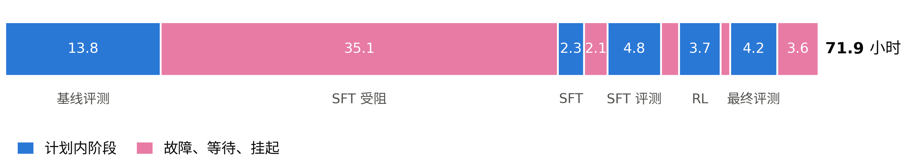</p>

8 节点作业的 71.9 小时，按时间顺序排列（`docs/talk/data/campaign_hours.json`）。蓝色：计划内的阶段。粉色：故障、等待和挂起。

| 时段 | 小时 | 发生了什么 |
|---|---|---|
| 基线评测 | 13.8 | 基座跑所有测试集、10 个种子的噪声底线、D-Num pass@64 |
| SFT 受阻 | 35.1 | NFS 锁挂起、一个数据 bug、没有可用的注意力内核、最后一段的显存、预检、第 50 步崩溃 |
| SFT | 2.3 | 206 步 |
| HF 导出修复 | 2.1 | 模型合并工具读不了这种检查点格式 |
| SFT 评测与门槛 | 4.8 | |
| RL 启动失败 | 1.6 | 只在一个节点上的 Ray、8 个节点中有 7 个缺少沙箱、主机内存 |
| RL | 3.7 | 56 步，被告警暂停 |
| 等待监视进程 | 0.8 | |
| 最终评测 | 4.2 | 第 20 步 |
| 挂起等待决定 | 3.6 | 之后释放 |

计划内的阶段用了 28.7 小时（40%）。其余 43.2 小时花在故障、等待和挂起上，其中 35.1 小时发生在 SFT 能够开始之前。占着节点要花节点小时，也省下了好几天。如果不占着节点，每次崩溃都会结束作业，下一个 8 节点时段要等三天。有两个机制让占着节点成为可能。`KEEP_NODES` 在某个阶段失败时保留节点分配。卡住的运行流程（campaign）还可以在同一个作业内被接管：用 SIGSTOP 暂停原来的进程，以原进程的环境启动第二个副本并跳过已完成的步骤，再由一个小的监督程序在新副本退出后结束被暂停的那个。

**在共享机器上，决定节奏的是队列。设计作业时，要让一次失败只损失几分钟的分配，并让作业保住它的节点。**

### 9.3 故障

下面每次故障都是由一次测量发现、修复，并配上了一个测试或一道防护。每一项都写在 [PITFALLS.zh-CN.md](PITFALLS.zh-CN.md) 中，包括它曾支撑的错误说法，以及现在守护它的测试。

| 故障 | 影响 | 修复与防护 |
|---|---|---|
| verl 为 Qwen3.5 向 Megatron 传入了一个反转的注意力掩码 | 在 A100 上，训练前向每个 token 错 1–2 nats；一致性检查测的是评测前向，结果通过了 | 一个 import hook 补丁；训练前向一致性检查（[PITFALLS](PITFALLS.zh-CN.md) B1） |
| 两个 HTTP 客户端沿用了 httpx 默认的 100 个连接的连接池 | 验证被限制在约 3.2 道题/分钟；评测时每个副本约 114 个样本中只有约 38 个同时运行 | 连接池大小按配置的并发度设定（C2） |
| 客户端超时短于排队等待时间 | 请求被重发，而代理仍在运行已被放弃的请求；验证停滞了一小时 | 超时覆盖排队等待时间（利特尔法则，Little's law）；代理取消被放弃的请求（C2） |
| 求解器注册表从未被导入；裁判输出思考内容时不带 `</think>` | 第一次完整验证拒绝了全部 102 个模板 | 在真实数据上测试；从缓存重新验证（A1） |
| 通过 ssh 启动的 shell 缺少批处理作业会继承的环境 | 运行流程的 24 个 vLLM 服务在启动时就挂了（libstdc++）；8 个节点中有 7 个没有沙箱，所以 79% 的代码奖励为 0 | 环境脚本在每个节点上预加载并提供回退；一个测试覆盖 ssh 路径（C1） |
| NFS 主目录上的文件锁 | SFT 在第一步之前挂住；8 个节点空闲 9.6 小时 | 锁改放在节点本地的 /tmp 中（C4） |
| pandas 把缺失的 `tools` 键读成 NaN | 全部 24 个 rank 在第一个 batch 就失败，被那次挂起掩盖 | 缺失值为 None；每次启动前都用真实的分词器构建每一行（A2） |
| A100 上没有适用于长序列、head_dim 256 的注意力内核 | 第一次 SFT 前向失败；非融合注意力在 16K 时显存不足 | 为 SM80 构建 flash-attn 2.8.3，并与非融合路径核对（B3） |
| 流水线最后一段 | 超过约 3.5K token 的数据行放不下 | 四项显存修复和一次 8 节点预检（B2，§5.3） |
| verl 忽略 `optim.betas`，并在没有验证集时做验证 | Adam β2 为 0.999 而不是 0.95；第 50 步崩溃 | 直接在 Megatron 上设置；`test_freq: -1`（C3） |
| verl 的驱动程序自己另起了一个 Ray | RL 只看到 24 张 GPU 中的 3 张 | 导出 `RAY_ADDRESS`；每个 Ray 进程都使用 token 认证 |
| MTP 草稿生成在 CPU 上保留每份权重的副本 | 第 1 步保存检查点时，最后一个节点的主机内存耗尽 | rollout 中关闭草稿生成，vLLM 以 level 2 休眠（B4） |

---

## 10. 评测发现了什么

- **基座。** 在 32K 预算下，Qwen3.5-9B 几乎让教科书级地震学饱和：D-Num 单个样本 91.6，8 票投票 99.6。它的提升空间在成本：8K token 以内有 13% 答对（§3.3）。
- **SFT。** 13,095 条教师撰写的对话提升了 D-Num-hard（+6.1）、D-Fresh（+8.1）、D-Code（+5.8）、GPQA（+14.7）和 LiveCodeBench（+14.3），并把 token 减少了 35%。错误数值增多，使 D-Num 降低了 2.2（§5.4）。
- **RL。** 二十步修正了推理未完成的问题（16K 下开发集数值题 92.0 → 97.3）。随后回答不断缩短，直到第 52 步准确率崩溃，原因尚未查明。第 20 步达到了 SFT 的准确率，用的 token 少 41%（§6.4）。
- **信号。** 用基座模型做的难度过滤，让 SFT 策略 87% 的数值题组和代码题组没有梯度（§6.3）。
- **奖励。** 程序化奖励与评测判分器在 99.3–100% 的回答上一致。由裁判打分的报告奖励偏宽松（以独立裁判为参照、以 70 分为及格线，精确率为 7%），它的评分细则是复合的（91% 的标准把几个论断连在一起）。裁判没有漂移（§6.5）。
- **失败。** 数值题的失败大多属于执行错误。在两个接收函数题族上，基座模型不掌握方法。RL 把未完成的回答变成了错误的公式。报告的不足属于知识问题，SFT 和 RL 都没有触及（§7.2）。
- **预算。** 在 D-Num-hard 上给 64K token 时，SFT 模型答对 83.9%，RL 第 20 步答对 77.5%，基座答对 69.8%。SFT 被截断的回答里，超过一半原本正在走向正确的数值（§7.3）。
- **安全。** 应拒答提示词的拒答率从 56.0% 降到 45.7%（严格口径），即使用宽泛的检测器也下降了 7.7 个点，主要发生在措辞像无害提示的不安全提示上（§7.4）。
- **系统。** 主作业 60% 的时间花在故障、等待和挂起上；流水线最后一段运行时用到 40,437 MiB 中的 40,366 MiB（§9）。
- **尚未测量：**
  - 任何奖励或测试的人工标准答案（盲评已准备好，尚未进行）；
  - 第二个种子，以及数据量、模型规模或 RL 步数上的任何缩放曲线；
  - 那 27 个不明确的拒答回答；
  - RL 崩溃的原因；
  - RL v2，或者 SFT v2 之后再接 RL v3，能否在 32K 下超过 SFT（§8.3 的标准；两次运行都已在队列中）。

---

## 11. 实验方法可扩展性分析

报告可迁移的单位。“56 个 RL 步”换一个 batch 大小就没有意义了。“56 步 × 1,008 个样本，每个 ≤ 16K token”在任何设置下说的都是同一件事。

| 维度 | 本项目的测量 | 需要补充的 |
|---|---|---|
| SFT 数据 | 一种混合：13,095 条对话，44.1M token，一次运行 | 在 D-Num-hard 和 D-Report 上做数据量扫描（¼、½、1×）；从论文写出的报告数据（SFT v2，§8.4） |
| RL 算力 | 56 步 × 1,008 个样本，8 个节点上约 3.7 h；到第 20 步为止都是好的 | 第二个种子；一次能撑过第 20 步的运行 |
| 模型规模 | 只有 9B（27B 路线做 RL 时放不进 40 GB 的 GPU） | 在 80 GB 的 GPU 上跑 27B，或用 4B 做低成本探针 |
| 中期训练 | 无（§8.2） | 一次小规模 token 扫描，只在尝试过知识密集的 SFT 数据之后进行 |
| 测试时计算 | D-Num 上预算 2K–32K、投票 1–64；D-Num-hard 上直到 64K 的预算（§7.3） | 再多一个推理强度 |
| 评测 | 770 道领域题，一个预算，由模型生成的参照 | 为约 100 份报告和约 200 个数值边界情况提供人工标准答案 |
| 系统 | 8 × 3 张 A100-40GB，TP1 × PP8 × DP3，3 天的排队 | 每次运行作为一个在开始时读取步骤的作业（§8.3） |

限制本次运行的因素依次是：队列和系统（§9），策略已经能解出它的大部分训练题（§6.3），以及 RL 无法控制住的回答长度漂移（§6.4）。在两个数值题族和报告中，限制来自模型知识（§7.2）。

---

## 12. 失败图谱与训练陷阱

代价最大的失败，或者产生了看上去正确、实际上错误的数字的失败，都写在 [PITFALLS.zh-CN.md](PITFALLS.zh-CN.md) 中：每一项都包括症状、它曾支撑的错误说法、根本原因、修复方法、现在守护它的回归测试，以及可以迁移到其他项目的教训。

---

## 13. 仓库结构

代码包是 `src/dpt`（“domain post-training”，即领域后训练）。评测代码从不导入奖励代码，所以一方的 bug 不会藏在另一方里。

```
qwen-seis-posttrain/
├── src/dpt/
│   ├── data/            # 数据流程：导入、质量、去重、去污染、验证、难度、题库与 SFT 构建
│   │   └── gen/         # 题目生成器：T1 求解器题族、T2 代码、T3 评分细则、T4 通用、从论文生成的报告数据（留出部分不公开）
│   ├── rewards/         # RL 奖励：数值、代码沙箱、裁判、指令检查、引用、长度、奖励破解模式
│   ├── rl/              # 与框架无关的 RL 数学：优势、损失、TIS、过滤、课程、失配、部分 rollout
│   ├── verl_ext/        # verl 如何运行它：奖励函数、采样器、训练器钩子，以及运行时补丁
│   ├── eval/            # 评测框架、判分器、裁判、统计、门槛、预算、盲评、漂移审计
│   ├── parity/          # vLLM 与 Megatron 的对数概率一致性、训练前向一致性、Gated DeltaNet 内核检查
│   ├── launch/          # SFT 与 RL 启动器、预检、运行时限与检查点工具
│   ├── monitoring/      # 带自动暂停的告警、仪表盘、运行对比
│   ├── chat/            # 对话模板渲染，以及思考/回答的拆分
│   ├── planning/        # 按硬件配置估算显存、FLOPs 和通信预算
│   └── common/          # 配置、哈希、清单、种子、I/O
├── configs/             # 模型路线、硬件配置、数据、SFT、RL、评测（每个实验一个 YAML）
├── scripts/
│   ├── 00_setup_env.sh … 08_audit.sh   # 以普通脚本形式实现的各阶段，可在任何机器上运行
│   ├── slurm/            # Slurm 作业脚本：运行流程、RL v2 与 SFT v2 → RL v3（各为一个 8 节点作业）、知识数据（命令见 README.md）
│   ├── talk/            # 报告背后的分析：数据收集、失败类型、裁判漂移、拒答
│   └── readme_figures.py   # 本 README 中的每一张图
├── tests/               # CPU 单元测试，目录结构与 src/dpt 对应
├── docs/
│   ├── reports/         # 11-10 对奖励、失败类型与测试的分析，中英文
│   ├── talk/data/       # 本次运行结果的 JSON：这里的每张图和每个表都由它们生成
│   └── *.md             # 设计文档：数据、评测、RL 算法、奖励、系统、verl、计划
└── assets/              # README 图表，png + pdf，中英文
```

---

## 14. 重新生成图表

```bash
python scripts/readme_figures.py                     # 全部 13 张图，中英文 → assets/
python scripts/readme_figures.py rl_steps            # 单张图
python scripts/talk/collect.py                       # 在集群上：从运行结果刷新 docs/talk/data/run.json
```

这些图只读取 `docs/talk/data/*.json`，不读其他数据。其中两个手工记录的文件（`campaign_hours.json`、`last_stage_memory.json`）注明了每个数值出自哪条笔记。

---

## 参考文献

**策略优化**
- Schulman, J., et al. (2017). Proximal Policy Optimization Algorithms. arXiv:1707.06347.
- Shao, Z., et al. (2024). DeepSeekMath: Pushing the Limits of Mathematical Reasoning in Open Language Models (GRPO). arXiv:2402.03300.
- Yu, Q., et al. (2025). DAPO: An Open-Source LLM Reinforcement Learning System at Scale（clip-higher、超长回答奖励塑形）. arXiv:2503.14476.
- Liu, Z., et al. (2025). Understanding R1-Zero-Like Training: A Critical Perspective（不除以标准差）. arXiv:2503.20783.
- Yao, F., et al. (2025). Your Efficient RL Framework Secretly Brings You Off-Policy RL Training（截断重要性采样）. Blog post.

**系统**
- Sheng, G., et al. (2025). HybridFlow: A Flexible and Efficient RLHF Framework (verl). EuroSys.
- Shoeybi, M., et al. (2019). Megatron-LM: Training Multi-Billion Parameter Language Models Using Model Parallelism. arXiv:1909.08053.
- Narayanan, D., et al. (2021). Efficient Large-Scale Language Model Training on GPU Clusters Using Megatron-LM. SC.
- Kwon, W., et al. (2023). Efficient Memory Management for Large Language Model Serving with PagedAttention (vLLM). SOSP.
- Dao, T. (2023). FlashAttention-2: Faster Attention with Better Parallelism and Work Partitioning. arXiv:2307.08691.
- Yang, S., et al. (2025). Gated Delta Networks: Improving Mamba2 with Delta Rule. ICLR.
- Gloeckle, F., et al. (2024). Better & Faster Large Language Models via Multi-token Prediction. ICML.
- Little, J. D. C. (1961). A Proof for the Queuing Formula L = λW. Operations Research.

**评测**
- Chen, M., et al. (2021). Evaluating Large Language Models Trained on Code（无偏 pass@k）. arXiv:2107.03374.
- Wang, X., et al. (2023). Self-Consistency Improves Chain of Thought Reasoning in Language Models. ICLR.
- Zheng, L., et al. (2023). Judging LLM-as-a-Judge with MT-Bench and Chatbot Arena. NeurIPS.
- Rein, D., et al. (2023). GPQA: A Graduate-Level Google-Proof Q&A Benchmark. arXiv:2311.12022.
- Wang, Y., et al. (2024). MMLU-Pro: A More Robust and Challenging Multi-Task Language Understanding Benchmark. NeurIPS.
- Zhou, J., et al. (2023). Instruction-Following Evaluation for Large Language Models (IFEval). arXiv:2311.07911.
- Jain, N., et al. (2024). LiveCodeBench: Holistic and Contamination Free Evaluation of Large Language Models for Code. arXiv:2403.07974.
- Röttger, P., et al. (2024). XSTest: A Test Suite for Identifying Exaggerated Safety Behaviours in Large Language Models. NAACL.
- Chao, P., et al. (2024). JailbreakBench: An Open Robustness Benchmark for Jailbreaking Large Language Models. NeurIPS Datasets and Benchmarks.
- Broder, A. Z. (1997). On the Resemblance and Containment of Documents (MinHash). SEQUENCES.

**地震学**
- Zhu, L., & Kanamori, H. (2000). Moho depth variation in southern California from teleseismic receiver functions（H-κ 叠加）. Journal of Geophysical Research, 105(B2), 2969–2980.

## 致谢

这条流程构建在 verl、Megatron-Core 和 Megatron-Bridge、Transformer Engine、vLLM 以及 Ray 之上。Qwen3.5-9B 和 Qwen3.8-27B 来自 Qwen 团队；Gemma 4 来自 Google DeepMind；GPT-6 Luna 来自 OpenAI。

## 数据与许可

- **测试集不公开。** 它们的题目、答案和评分细则只保存在训练机器上，以便继续用作留出测试；README 和报告中只有汇总数据。
- **留出题的生成器同样不公开。** 18 个留出数值题族（D-Num、D-Num-hard）和 11 种留出代码题型（D-Code）的模板、参数范围和求解器能够重新生成测试题，所以它们放在三个不纳入 git 的文件中（`src/dpt/data/gen/*_heldout.py`）。公开代码没有它们也能运行：留出划分为空，构建这些测试集的六个测试会被跳过（`dpt.data.gen.common.import_private_module_if_present`）。
- **GPT-6 Luna** 只用于评测（起草和核查测试题、担任第二裁判、打失败标签）。按照其使用条款的要求，它的任何输出都不在任何训练集中。
- **模型权重**（`sft9b_seed1`、`rl9b_seed1_step20`，各 19 GB）尚未发布。
- 公开基准（GPQA、MMLU-Pro、IFEval、LiveCodeBench、XSTest、JailbreakBench）按各自的许可使用，本仓库不再分发。GPQA 要求不要在网上公开它的题目。
- Qwen3.5-9B 和其他模型均按各自的许可使用。

## 许可证

MIT，见 [LICENSE](LICENSE)。
