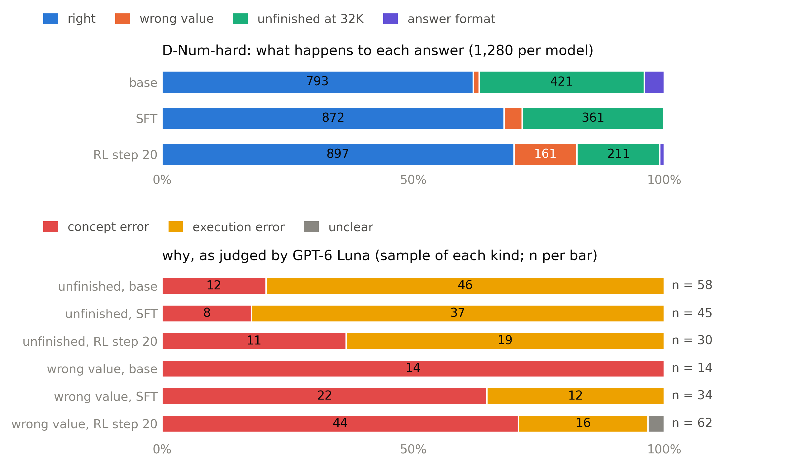
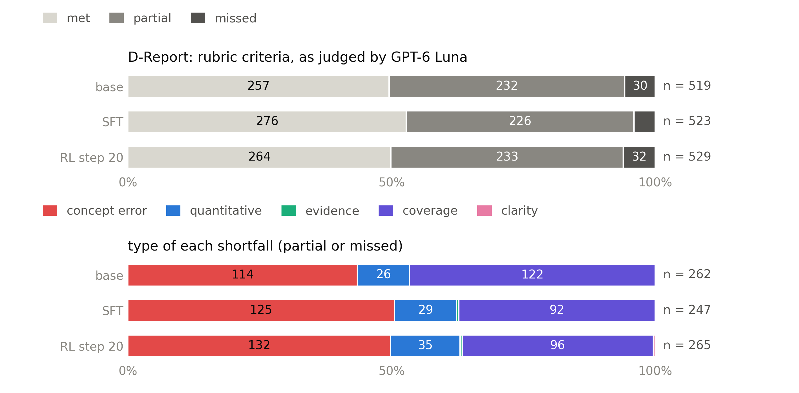
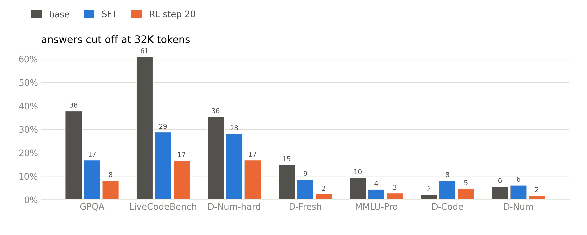

# Failure types on D-Num-hard and D-Report, and what the current tests and results mean (2026-11-10)

This answers the request of 11-10: "run the failure-type classification on D-Num-hard and D-Report. analyze what
current tests and results means — pros and cons". It follows `reward_rubric_scaling_1110_en.md` §7, which proposed
the classification as the cheap test of whether mid-training is worth it. Chinese version:
`failure_types_and_tests_1110_zh.md`.

The answers classified are the existing ones of the October final eval: base (Qwen3.5-9B, medium effort), SFT, and
RL step 20. Nothing was regenerated.

Code and data:
- `scripts/talk/failure_types.py` (rules, labeling, summary) and `scripts/talk/research_figures.py` (Figures 5–7);
- counts only: `docs/talk/data/failure_types.json`;
- the per-answer labels, with short evidence quotes, stay on the cluster in `$WORK/dpt/talk/failure_types/`.

## Short answers

- **D-Num-hard: most failures are execution, not missing knowledge,** except in two families, and except for RL's
  wrong answers.
  - The base and SFT models mostly fail by **not finishing within 32K tokens**: 33% and 28% of their answers.
  - GPT-6 Luna read a sample of those answers. 63–82% had the right method and were stuck re-checking or going back
    and forth.
  - Weighted by family, **37% of base failures and 31% of SFT failures are concept errors**.
  - The RL model finishes more often, but it **commits to wrong formulas**: 12.6% of its answers are wrong values,
    and 80% of those are concept errors. That makes 56% of its failures concept errors.
  - The concept errors concentrate in **two receiver-function families**: Vp/Vs from Ps and PpPs times, and Moho
    depth from the Ps delay. No model gets more than 5% and 29% right there.
- **D-Report: the shortfalls are content, and neither SFT nor RL changed them.**
  - The reports fully meet about half of their rubric criteria and partly meet most of the rest.
  - What falls short is **wrong or missing science (44–51% of shortfalls) and parts left out (36–47%)**, almost never
    clarity or citations.
  - A concept problem is the main weakness of 62–70% of the reports, for every model.
  - The paired rubric score did not move: SFT − base +1.5 [−1.6, +4.3], RL − base −0.0 [−2.8, +2.6]. That agrees
    with Luna's 49% win rate, not with Gemma's 86–88.5%.
- **For mid-training: two different pictures (§4).**
  - The numeric failures are mostly execution, and mid-training would not fix them.
  - The report shortfalls are mostly knowledge, and SFT and RL left them untouched.
  - Still not for this allocation. Next allocation, first test knowledge-dense SFT data for reports (~70 SU), and
    consider continued pre-training only if that works.
- **The tests (§5).**
  - Strengths: frozen sets drawn from families never used in training, independent graders, CIs.
  - Weaknesses:
    - D-Num is saturated;
    - D-Num-hard rides on two families, and its score mixes knowledge with finishing in time;
    - D-Report's two judges disagree on more than half the pairs;
    - every score mixes accuracy with efficiency, because everything runs at one budget;
    - there are no human gold labels.
- **The results (§6).**
  - SFT helped, but a large part of the gain is answers that now finish within 32K.
  - RL bought speed and lost reliability.
  - D-Report shows no gain, and refusals fell for real.

## 1. How the classification works

**D-Num-hard** has 160 problems, each answered 8 times per model: 1,280 answers per model.

1. **Rules, on every answer.** Each answer is graded the way the evaluation grades it. A failure is one of:
   - unfinished: the thinking never closed within 32K;
   - an answer-format failure;
   - a wrong value.

   Each wrong value gets a numeric signature against the correct one: near miss, power of ten, degrees vs radians,
   simple factor, sign, or other. It is called systematic when 3 or more of the 8 answers share the same wrong
   value.
2. **GPT-6 Luna, on a stratified sample.** Up to 10 wrong values and 10 unfinished answers per model and family.
   Luna gets:
   - the problem and the correct value;
   - the solver's Python code as the reference method;
   - the model's written solution, or, for an unfinished answer, the first 6,000 and the last 3,000 characters of
     its reasoning.

   It answers concept (wrong formula or assumption, misread question), execution (right method, carried out wrongly
   or not finished), or unclear.
3. **Weighting.** The sample takes up to 10 per family, but failures concentrate in a few families. The totals
   therefore weight each family's label shares by that family's number of failures.

**D-Report** has 100 questions, with one report per model.
- Luna reads each report against the question's 5 weighted rubric criteria, rating each met, partial or missed.
- It checks the 5 common errors written with the question, present or not.
- It types each shortfall: concept, quantitative, evidence, coverage or clarity.

**Caveats.**
- Luna is a judge, not gold: it is the project's independent evaluation judge and never touched training.
- The samples are small: 14–62 labeled wrong values and 30–58 unfinished answers per model.
- A cheap rule was tried and rejected for unfinished answers: does a number matching the correct value appear in the
  reasoning? It does for 55% (base), 87% (SFT) and 85% (RL) of them. But another problem's correct value also
  appears in 19%, 41% and 53%, because long reasoning contains thousands of numbers. The rule is too weak to classify
  single answers, so the unfinished answers rely on Luna.
- 559 Luna calls at medium reasoning effort, about 1.8M tokens (≈1.2M in, ≈0.6M out). The run was restarted
  once with more workers, and `failure_types.json` records the second part only.

## 2. D-Num-hard: what fails and why

*Figure 5. Top: the outcome of all 1,280 answers per model. Bottom: Luna's verdict on the labeled sample of wrong
values and of unfinished answers, unweighted. The weighted totals are in the table below.*

| outcome (share of all answers) | base | SFT | RL step 20 |
|---|---|---|---|
| right | 62.0% | 68.1% | 70.1% |
| unfinished at 32K | 32.9% | 28.2% | 16.5% |
| wrong value | 1.2% | 3.6% | 12.6% |
| answer format (several answers, missing unit, …) | 4.0% | 0.1% | 0.9% |
| median tokens of a right answer | 22.0K | 12.4K | 7.3K |

| why (Luna, weighted by family) | base | SFT | RL step 20 |
|---|---|---|---|
| unfinished: right method but stuck (execution) | 258 | 265 | 125 |
| unfinished: wrong method (concept) | 163 | 96 | 86 |
| wrong value: wrong formula or assumption (concept) | 15 | 32 | 129 |
| wrong value: arithmetic, input or unit slip (execution) | 0 | 15 | 28 |
| **concept share of all failures** | **37%** | **31%** | **56%** |
| concept failures as a share of all answers | 14% | 10% | 17% |

What the labels say:
- **Unfinished answers.**
  - The most common reason is re-checking an answer already reached: 33 of 58 base labels, 16 of 45 SFT, 10 of 30
    RL.
  - Next is going back and forth between equivalent choices: 8, 12 and 8.
  - SFT also struggles with the arithmetic itself (9 of 45).
- **Wrong values.**
  - Mostly a wrong formula: 19 of 34 SFT labels and 38 of 62 RL labels.
  - The rest are arithmetic slips: 11 SFT, 13 RL.
  - Only 7% of SFT's wrong values and 15% of RL's are systematic, so the same wrong value seldom recurs across the 8
    answers.
  - The numeric signatures (§1) also point away from slips. Of RL's 161 wrong values, only 29 are near misses and
    18 are off by a simple factor; none is off by a power of ten or swaps degrees and radians.

Per family (right / unfinished / wrong, % of 160 answers):

| family | base | SFT | RL step 20 |
|---|---|---|---|
| Coulomb stress change | 93 / 4 / 0 | 99 / 1 / 1 | 96 / 0 / 2 |
| GMPE distance for PGA | 96 / 0 / 0 | 95 / 1 / 3 | 96 / 0 / 4 |
| rupture length from directivity | 98 / 1 / 1 | 94 / 1 / 5 | **87** / 0 / 13 |
| Mw from the spectral plateau | 81 / 12 / 0 | 96 / 2 / 2 | **86** / 0 / 14 |
| gradient ray: range | 67 / 25 / 4 | 91 / 5 / 4 | 88 / 0 / 11 |
| gradient ray: travel time | 61 / 29 / 0 | 51 / 48 / 1 | 74 / 14 / 10 |
| **Moho depth from the Ps delay** | 0 / 92 / 5 | 15 / 76 / 9 | 29 / 38 / 31 |
| **Vp/Vs from Ps and PpPs** | 0 / 99 / 0 | 4 / 93 / 3 | 5 / 79 / 14 |

Two kinds of failure, then:
1. **Running out of room with the right method.** This is common in every family where the base and SFT models
   fail. It is an efficiency problem, and RL fixed most of it.
2. **Not knowing the method.**
   - It is concentrated in the two receiver-function families. There, 4–6 of every 10 labeled unfinished answers use
     a wrong relation, and RL's wrong values there are mostly wrong formulas.
   - RL also adds wrong-formula answers in families SFT had nearly solved: rupture length (94 → 87% right) and Mw
     (96 → 86%).
   - So RL did not learn new methods. It stopped thinking sooner and sometimes committed to a wrong one.

## 3. D-Report: what falls short and why

*Figure 6. Top: Luna's verdict on every rubric criterion of every report. Bottom: the type of each shortfall
(partial or missed). Two base reports and one SFT report never finished their thinking and are not counted.*

| | base | SFT | RL step 20 |
|---|---|---|---|
| reports read | 98 | 99 | 100 |
| criteria met / partial / missed | 49.5 / 44.7 / 5.8% | 52.8 / 43.2 / 4.0% | 49.9 / 44.0 / 6.0% |
| rubric score (met 1, partial ½, by weight) | 73.2 | 75.1 | 72.9 |
| paired change from base | | +1.5 [−1.6, +4.3] | −0.0 [−2.8, +2.6] |
| better / same / worse than base, per question | | 43 / 24 / 30 | 42 / 22 / 34 |
| shortfalls: concept / coverage / quantitative | 44 / 47 / 10% | 51 / 37 / 12% | 50 / 36 / 13% |
| shortfalls: evidence and clarity | 0% | 0.4% | 0.8% |
| reports with at least one concept shortfall | 71% | 70% | 74% |
| main weakness: concept / quantitative / coverage | 70 / 11 / 16 | 62 / 19 / 10 | 64 / 26 / 5 |
| the question's common errors present | 4.2% | 6.9% | 5.3% |

What this says:
- **The problem is content, not form.** Wrong or missing science and left-out parts make up 86–90% of all
  shortfalls; evidence and clarity make up under 1%.
- **The questions' anticipated mistakes are rare** (4–7% of checks). The reports avoid the obvious errors but miss
  depth: mechanisms, conditions and limits.
- **Training shifted the kind of shortfall, not the amount.**
  - The base model leaves more out: coverage is 47% of its shortfalls.
  - SFT and RL write more complete reports with more content errors: concept is 50–51% of their shortfalls.
  - RL adds quantitative errors: they are the main weakness of 26 RL reports, against 11 for base.
- **The rubric score did not change.** That is consistent with Luna's 49% pairwise win rate. It also confirms that
  Gemma's 86–88.5% is not a quality signal (§5).

## 4. Concept or execution: what it means for mid-training

The two sets give two different pictures.

1. **Numeric reasoning (D-Num, D-Num-hard): mostly execution.**
   - For the base and SFT models, concept errors are 31–37% of failures, 10–14% of all answers.
   - Most of the rest is running out of room with the right method.
   - The concept errors concentrate in the two receiver-function families.
   - RL's extra concept errors appear in families SFT had solved, so they come from the policy stopping early, not
     from missing knowledge.
   - Mid-training would not touch the main failure modes here. These would: RL v2's fixes (difficulty filter, stop
     rule, a wrong-answer monitor), evaluation at more than one budget, and, if wanted, receiver-function training
     material (§7).
2. **Reports (D-Report): mostly knowledge.**
   - Concept and coverage shortfalls dominate, and a concept problem is the main weakness of 62–70% of reports.
   - Neither SFT, whose report data was teacher-written, nor RL changed the rubric score.
   - This is where depth of domain knowledge limits the 9B.

So the case for knowledge work is stronger than the 11-10 recap assumed, but it is specific to explanations. The
cheapest tests, in order:
1. **Knowledge-dense SFT data for reports:** teacher-written explanations of mechanisms, conditions and limits,
   checked against sources, scored with the same Luna rubric read. A small SFT ablation, ~70 SU plus data work.
2. **Retrieval at answer time:** relevant literature in the prompt. This tests whether the gap is knowing or
   accessing.
3. **Continued pre-training on a domain corpus,** only if 1 or 2 shows that knowledge is the lever. The reference
   report's one CPT point measured D-Num, not reports.

The recommendation for this allocation is unchanged: no mid-training before Nov 30. Report knowledge goes on the
agenda for the next allocation, starting with test 1.

**Caveat.** These are Luna's judgments, and Luna also drafted the questions. Judging "missing depth" is subjective,
so a person should spot-check, for example with the 20-pair blind review that is ready.

## 5. The current tests: pros and cons

Sizes, grading and CIs from `eval_results/summary.json` and the eval sets. CIs are 95% bootstrap half-widths.

| test | what it is | pros | cons |
|---|---|---|---|
| **D-Num** | 300 problems from 10 held-out solver families. Numeric grader with strict units; mean over 8 samples at 32K, medium effort. | The gold comes from solvers. The grader is independent and strict, and the T1 reward agrees with it on 99.3–100% of answers. No family appears in training. The CI is tight (±1.0), and the noise floor was measured over 10 seeds (SD 0.46). | **Saturated.** The base model already scores 92% with one sample and 99.6% with 8 votes, so the score moves on single-sample reliability and answer format, not on what the model knows. The ship gate of base + 8 (99.6) cannot be reached. |
| **D-Num-hard** | 160 problems from 8 held-out families of 3+ steps, 20 each. Graded like D-Num. | It separates the models (62 / 68 / 70), and no family appears in training. | **The score rides on a few families.** Four families sit near the ceiling for every model (86–99%). Two are near the floor: Vp/Vs from Ps and PpPs is ≤ 5% right, Moho depth ≤ 29%. **Most failures are unfinished reasoning, not wrong answers** (§2), so the set measures finishing within 32K as much as knowledge. The CI is ±5–6 points per model, and RL − SFT (+2.0, [−0.8, +4.8]) is not significant. |
| **D-Fresh** | 60 problems written after the model's release, drafted by GPT-6 Luna and checked by models. | It controls contamination: the model cannot have seen them. It separates the models (70.6 / 78.8 / 83.3, CI ±2.3–2.6). | Only 60 problems, written and checked by models, with no human check. The base model fails to finish 15% of its answers, so part of the gain is finishing. |
| **D-Code** | 150 domain coding problems with hidden tests; pass@1 over 4 samples. | Objective hidden tests; CI ±2.0–2.3. | The sandbox had infrastructure failures in October (fixed). The SFT model fails to finish 8% of its answers. |
| **D-Report** | 100 report questions, each with 5 weighted criteria and 5 common errors. Win rate against the base model's report; two judges, both orders; the gate takes the lower score. | It is a realistic task. One judge (Luna) never touched training. Pairs are judged in both orders, and a length-matched subset is reported. | **The judges disagree on 55–57% of pairs.** Gemma gives SFT 86.0% and RL 88.5%; Luna gives 49.0% to both. Gemma is the T3 reward judge, and it prefers the trained models' reports even for SFT, which was never trained on it. There is no human gold, the CI is ±8.5–9 points, and there is one sample per question. |
| **General** (5) | GPQA (198), MMLU-Pro (2,000; read as a change only), IFEval (377), LiveCodeBench after 2025-01 (70; change only), tool calling (188). | Public and comparable, and they would catch a general regression. A memorization probe flagged MMLU-Pro (6.2% for base). | **Confounded by finishing.** The base model fails to finish 38% of GPQA and 61% of LiveCodeBench answers within 32K, against 8% and 17% for RL (Figure 7). LiveCodeBench has only 70 problems. |
| **Refusal** | 650 prompts (XSTest, JailbreakBench and others), scored with refusal-word lists. | It caught a real drop (§6). | Crude: the strict and broad word lists differ by ~20 points, and 27 answers need a person to read them. |
| **Ship gates** | 8 gates fixed before RL. | A decision rule fixed in advance. | Two gates could not be met by design: D-Num at base + 8 = 99.6, and the D-Fresh gain ratio, which is undefined when D-Num falls. |
| **RL dev set** | 190 problems at 16K, every 20 steps (run 1). | Cheap and frequent. | The 16K cap is not the evaluation's 32K, so the dev gain (92 → 97.3) did not carry over. It is small, and in run 1 it was checked only every 20 steps. |

What the whole suite does well:
- the eval sets are frozen, with canaries and content hashes, and decontaminated;
- every family is disjoint from training;
- there is a measured noise floor and bootstrap CIs;
- pass@k, maj@k and budget curves are reported;
- D-Report has two judges, and a blind-review page exists;
- the reports contain aggregates only.

What it lacks:
- **No human gold labels anywhere.** Every reference is a program or a model.
- **One training seed.**
- **One sample per D-Report question.**
- **One effort level (medium) and one budget (32K).** Without both, accuracy and efficiency mix in every score: a model that thinks less finishes more often.

## 6. The current results: what they mean

*Figure 7. The share of answers that hit the 32K-token limit, as the harness records it. An answer can also be cut
off after its thinking closed, which is why the base model's D-Num-hard value (36%) is above §2's 32.9% unfinished.*

1. **SFT is a real improvement, partly in efficiency.**
   - The gains:
     - D-Code +5.8;
     - D-Fresh +8.2;
     - D-Num-hard +6.2 [+3.4, +8.9];
     - GPQA +14.7, LiveCodeBench +14.3 (read as a change only).
   - The answers are 35% shorter.
   - Much of the general and D-Fresh gain is answers that now finish. Base → SFT, the share cut off fell 38 → 17% on GPQA, 61 → 29% on LiveCodeBench and 15 → 9% on D-Fresh (Figure 7).
   - *Pro:* the same or better accuracy for half the tokens is worth having.
   - *Con:* this is not clean evidence of new knowledge.
2. **RL bought speed, not reliability.**
   - Answers shrank again, from 9.5K to 5.6K tokens. D-Fresh went up 4.5 points.
   - D-Num-hard +2.0 over SFT is inside the noise, and D-Num did not move.
   - RL turned unfinished answers into wrong ones. On D-Num-hard, wrong values went from 3.6% to 12.6% of answers. On two families SFT had nearly solved, it lost ground: rupture length 94 → 87% right, Mw 96 → 86%.
   - The run then collapsed after step 20.
3. **D-Report shows no gain.**
   - The independent judge scores SFT and RL at 49%, a tie with the base model.
   - Gemma's 86–88.5% is not credible as a quality signal: it agrees with Luna on fewer than half the pairs and prefers trained models' style.
   - On the 31 SFT pairs of matched length, SFT wins 45%.
4. **Refusals of harmful requests fell for real:** 56.0 → 51.3 → 45.7% under the strict word list.
5. **Overall, post-training made the 9B faster and more likely to finish hard multi-step problems.** It has not shown new domain knowledge or better reports, and RL made single answers less reliable.

## 7. What to change

| change | why | cost |
|---|---|---|
| Report D-Num-hard as **right / unfinished / wrong** per family, next to the single score | The single score hides that base and SFT fail by not finishing while RL fails by answering wrongly | none (this script) |
| Evaluate the hard sets at **two budgets** (16K and 64K), or report accuracy against tokens | At one budget, accuracy and efficiency mix in every score (§5, Figure 7) | ~60 SU for a 64K pass of D-Num-hard over 3 models |
| Treat the **two receiver-function families** as a known knowledge gap and report them separately. Closing the gap needs receiver-function training material (Ps, PpPs and PsPs timing), but then these two families no longer test transfer to kinds never trained on, and the held-out set needs new kinds. **A trade-off for you to decide, not a default.** | They hold most of the concept errors and sit at 0–29% for every model | new solver families, plus replacement held-out kinds |
| For RL v2, add a **wrong-answer monitor** on dev: the wrong-value rate, not only accuracy | RL run 1 turned unfinished answers into wrong ones; accuracy alone hid it | none (dev metrics) |
| D-Report: **human calibration** (the 20-pair blind review, then ~100 per-criterion labels); keep the gate on the lower judge; report the length-matched subset | Judges disagree on 55–57% of pairs; Gemma prefers trained models' style | a reviewer's time |
| Replace the refusal word lists with a **judge-read refusal check** (Luna, eval-only), at least for the 27 unclear answers | The word lists differ by ~20 points | small API cost |
| Revise the **ship gates** before RL v2 starts | Two gates cannot be met by design | your decision |
