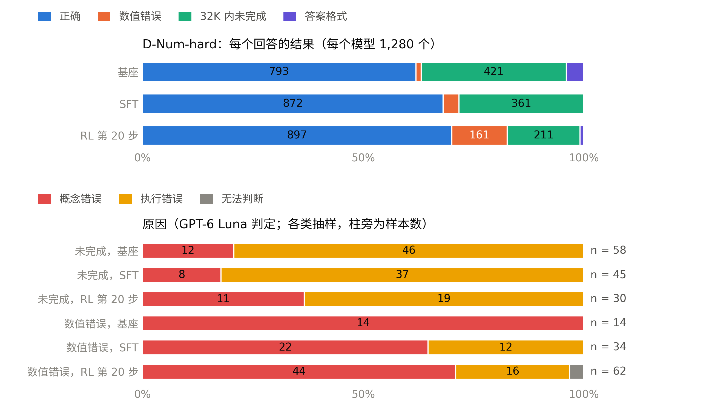
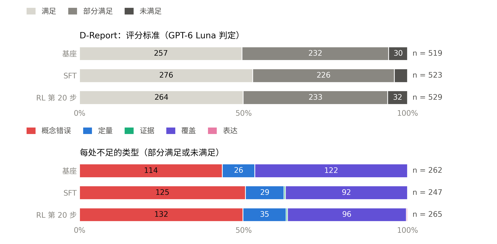
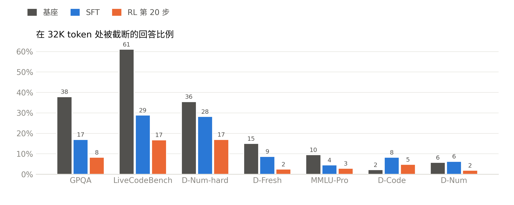

# D-Num-hard 与 D-Report 的错误类型，以及现有评测和结果意味着什么（2026-11-10）

本文回应 11-10 的要求：“run the failure-type classification on D-Num-hard and D-Report. analyze what current tests and results means — pros and cons”。它接续 `reward_rubric_scaling_1110_zh.md` §7：那里提议用这次分类，以低成本检验中期训练是否值得做。英文版：`failure_types_and_tests_1110_en.md`。

分类的对象是 10 月最终评测中已有的回答：基座（Qwen3.5-9B，medium 推理强度）、SFT 和 RL 第 20 步。没有重新生成任何回答。

代码与数据：
- `scripts/talk/failure_types.py`（规则、标注、汇总）和 `scripts/talk/research_figures.py`（图 5–7）；
- 只含计数：`docs/talk/data/failure_types.json`；
- 逐个回答的标签（含简短证据引文）留在集群的 `$WORK/dpt/talk/failure_types/`。

## 简短回答

- **D-Num-hard：大多数失败出在执行上，而不是缺知识，** 但两个题族和 RL 的错误答案例外。
  - 基座和 SFT 模型主要败在**没能在 32K token 内写完**：分别占其回答的 33% 和 28%。
  - GPT-6 Luna 读了其中一批样本：63–82% 方法是对的，只是卡在反复核对或来回犹豫上。
  - 按题族加权，**基座 37%、SFT 31% 的失败是概念错误**。
  - RL 模型更常写完，但它会**认定错误的公式**：12.6% 的回答数值错误，其中 80% 是概念错误。于是它 56% 的失败是概念错误。
  - 概念错误集中在**两个接收函数题族**：由 Ps 与 PpPs 时间求 Vp/Vs，以及由 Ps 延迟求 Moho 深度。在这两个题族上，没有一个模型的正确率超过 5% 和 29%。
- **D-Report：不足出在内容上，SFT 和 RL 都没有改变它。**
  - 报告完全满足约一半的评分标准，其余大多部分满足。
  - 不足之处是**科学内容错误或缺失（占不足的 44–51%）和遗漏要求的部分（36–47%）**，几乎从不是表达或引用。
  - 对每个模型而言，62–70% 的报告的主要弱点都是概念问题。
  - 成对比较的细则得分没有变化：SFT − 基座 +1.5 [−1.6, +4.3]，RL − 基座 −0.0 [−2.8, +2.6]。这与 Luna 49% 的胜率一致，而与 Gemma 的 86–88.5% 不符。
- **对中期训练：两幅不同的图景（§4）。**
  - 数值题的失败大多出在执行上，中期训练解决不了。
  - 报告的不足大多是知识问题，SFT 和 RL 都没有触及。
  - 本期配额内仍然不做。下一期先测试面向报告的知识密集型 SFT 数据（约 70 SU）；只有它奏效，再考虑继续预训练。
- **评测（§5）。**
  - 优点：评测集已冻结、题族从未用于训练、判分器独立、有置信区间。
  - 不足：
    - D-Num 已饱和；
    - D-Num-hard 取决于两个题族，分数把知识和能否按时写完混在一起；
    - D-Report 的两个裁判在一半以上的报告对上意见不一；
    - 所有评测都在同一个预算下运行，所以每个分数都把准确率和效率混在一起；
    - 没有人工金标。
- **结果（§6）。**
  - SFT 有帮助，但很大一部分提升是回答现在能在 32K 内写完了。
  - RL 换来了速度，丢了可靠性。
  - D-Report 没有提升，拒答率确实下降了。

## 1. 分类方法

**D-Num-hard** 有 160 道题，每个模型每题回答 8 次：每个模型 1,280 个回答。

1. **规则，用于每一个回答。** 每个回答都按评测的方式判分。失败分为以下几种：
   - 未完成：思考在 32K 内没有结束；
   - 答案格式错误；
   - 数值错误。

   每个错误数值都与正确值比较，得到一个数值特征：接近正确、差 10 的整数次幂、角度与弧度混淆、差一个简单因子、符号错误，或其他。如果 8 个回答中有 3 个以上给出同一个错误值，就称为系统性错误。
2. **GPT-6 Luna，用于分层抽样。** 每个模型每个题族最多 10 个错误数值和 10 个未完成回答。Luna 拿到：
   - 题目和正确值；
   - 求解器的 Python 代码，作为参考方法；
   - 模型写出的解答；对于未完成的回答，则是其推理的前 6,000 个和后 3,000 个字符。

   它判定为概念错误（公式或假设错误、读错题）、执行错误（方法对，但执行出错或没写完），或无法判断。
3. **加权。** 抽样每个题族最多 10 个，但失败集中在少数题族。因此总数按各题族的失败数，对该题族的标签比例加权。

**D-Report** 有 100 道题，每个模型一份报告。
- Luna 对照题目的 5 条加权评分标准阅读每份报告，逐条判为满足、部分满足或未满足。
- 它检查随题目写好的 5 个常见错误，判断是否出现。
- 它给每处不足标类型：概念、定量、证据、覆盖或表达。

**注意事项。**
- Luna 是裁判，不是金标：它是本项目独立的评测裁判，从未接触训练。
- 样本较小：每个模型标注了 14–62 个错误数值和 30–58 个未完成回答。
- 对未完成的回答，试过一个低成本规则后放弃了：推理中是否出现与正确值相符的数字？基座、SFT、RL 分别有 55%、87%、85% 出现。但换成另一道题的正确值，也有 19%、41%、53% 出现，因为长推理中有成千上万个数字。这个规则太弱，无法判定单个回答，所以未完成的回答依靠 Luna 判定。
- Luna 共调用 559 次，推理强度 medium，约 180 万 token（输入约 120 万，输出约 60 万）。运行中途加大并发重启过一次，`failure_types.json` 只记录了后半段。

## 2. D-Num-hard：哪里失败，为什么

*图 5。上：每个模型全部 1,280 个回答的结果。下：Luna 对错误数值和未完成回答的标注样本的判定，未加权。加权后的总数见下表。*

| 结果（占全部回答） | 基座 | SFT | RL 第 20 步 |
|---|---|---|---|
| 正确 | 62.0% | 68.1% | 70.1% |
| 32K 内未完成 | 32.9% | 28.2% | 16.5% |
| 数值错误 | 1.2% | 3.6% | 12.6% |
| 答案格式（多个答案、缺单位等） | 4.0% | 0.1% | 0.9% |
| 正确回答的 token 数中位数 | 22.0K | 12.4K | 7.3K |

| 原因（Luna，按题族加权） | 基座 | SFT | RL 第 20 步 |
|---|---|---|---|
| 未完成：方法对但卡住了（执行） | 258 | 265 | 125 |
| 未完成：方法错（概念） | 163 | 96 | 86 |
| 数值错误：公式或假设错（概念） | 15 | 32 | 129 |
| 数值错误：算术、输入或单位失误（执行） | 0 | 15 | 28 |
| **概念错误占全部失败的比例** | **37%** | **31%** | **56%** |
| 概念错误占全部回答的比例 | 14% | 10% | 17% |

标签说明了什么：
- **未完成的回答。**
  - 最常见的原因是反复核对一个已经得到的答案：基座 58 个标签中有 33 个，SFT 45 个中 16 个，RL 30 个中 10 个。
  - 其次是在等价的选择之间来回犹豫：分别为 8、12、8 个。
  - SFT 还会卡在算术本身（45 个中 9 个）。
- **错误数值。**
  - 多数是公式错误：SFT 34 个标签中 19 个，RL 62 个中 38 个。
  - 其余是算术失误：SFT 11 个，RL 13 个。
  - SFT 只有 7%、RL 只有 15% 的错误数值是系统性的，所以同一个错误值很少在 8 个回答中重复出现。
  - 数值特征（§1）也说明这些不是失误。RL 的 161 个错误数值中，只有 29 个接近正确，18 个差一个简单因子；没有一个差 10 的整数次幂，也没有角度弧度混淆。

各题族的结果（正确 / 未完成 / 错误，占 160 个回答的百分比）：

| 题族 | 基座 | SFT | RL 第 20 步 |
|---|---|---|---|
| 库仑应力变化 | 93 / 4 / 0 | 99 / 1 / 1 | 96 / 0 / 2 |
| 由 PGA 求 GMPE 距离 | 96 / 0 / 0 | 95 / 1 / 3 | 96 / 0 / 4 |
| 由方向性求破裂长度 | 98 / 1 / 1 | 94 / 1 / 5 | **87** / 0 / 13 |
| 由谱平台求 Mw | 81 / 12 / 0 | 96 / 2 / 2 | **86** / 0 / 14 |
| 梯度介质射线：震中距 | 67 / 25 / 4 | 91 / 5 / 4 | 88 / 0 / 11 |
| 梯度介质射线：走时 | 61 / 29 / 0 | 51 / 48 / 1 | 74 / 14 / 10 |
| **由 Ps 延迟求 Moho 深度** | 0 / 92 / 5 | 15 / 76 / 9 | 29 / 38 / 31 |
| **由 Ps 与 PpPs 求 Vp/Vs** | 0 / 99 / 0 | 4 / 93 / 3 | 5 / 79 / 14 |

由此可见两类失败：
1. **方法对，但写不完。** 在基座和 SFT 模型失败的每个题族里都很常见。这是效率问题，RL 解决了大部分。
2. **不会这个方法。**
   - 集中在两个接收函数题族。那里每 10 个被标注的未完成回答中有 4–6 个用了错误的关系式，而 RL 在那里的错误数值多是公式错误。
   - 在 SFT 几乎已经解决的题族上，RL 也增加了公式错误的回答：破裂长度（正确率 94% → 87%）和 Mw（96% → 86%）。
   - 所以 RL 没有学会新方法。它只是更早停止思考，有时认定了一个错误的方法。

## 3. D-Report：哪里不足，为什么

*图 6。上：Luna 对每份报告每条评分标准的判定。下：每处不足（部分满足或未满足）的类型。有 2 份基座报告和 1 份 SFT 报告的思考没有结束，未计入。*

| | 基座 | SFT | RL 第 20 步 |
|---|---|---|---|
| 阅读的报告数 | 98 | 99 | 100 |
| 标准：满足 / 部分满足 / 未满足 | 49.5 / 44.7 / 5.8% | 52.8 / 43.2 / 4.0% | 49.9 / 44.0 / 6.0% |
| 细则得分（满足 1，部分 ½，按权重） | 73.2 | 75.1 | 72.9 |
| 相对基座的成对变化 | | +1.5 [−1.6, +4.3] | −0.0 [−2.8, +2.6] |
| 逐题比基座好 / 相同 / 差 | | 43 / 24 / 30 | 42 / 22 / 34 |
| 不足：概念 / 覆盖 / 定量 | 44 / 47 / 10% | 51 / 37 / 12% | 50 / 36 / 13% |
| 不足：证据和表达 | 0% | 0.4% | 0.8% |
| 至少有一处概念不足的报告 | 71% | 70% | 74% |
| 主要弱点：概念 / 定量 / 覆盖 | 70 / 11 / 16 | 62 / 19 / 10 | 64 / 26 / 5 |
| 出现该题常见错误的比例 | 4.2% | 6.9% | 5.3% |

这说明：
- **问题出在内容，而不是形式。** 科学内容错误或缺失，加上遗漏的部分，占全部不足的 86–90%；证据和表达不到 1%。
- **题目预想的常见错误很少出现**（4–7% 的检查）。报告避开了明显的错误，但缺乏深度：机理、条件和局限。
- **训练改变了不足的类型，而不是数量。**
  - 基座模型遗漏得更多：覆盖类占其不足的 47%。
  - SFT 和 RL 写得更完整，但内容错误更多：概念类占其不足的 50–51%。
  - RL 增加了定量错误：它是 26 份 RL 报告的主要弱点，基座只有 11 份。
- **细则得分没有变化。** 这与 Luna 在成对比较中 49% 的胜率一致，也印证了 Gemma 的 86–88.5% 不是质量信号（§5）。

## 4. 概念还是执行：对中期训练意味着什么

两个评测集给出两幅不同的图景。

1. **数值推理（D-Num、D-Num-hard）：大多出在执行上。**
   - 对基座和 SFT 模型而言，概念错误占失败的 31–37%，即全部回答的 10–14%。
   - 其余大多是方法对、但写不完。
   - 概念错误集中在两个接收函数题族。
   - RL 多出来的概念错误出现在 SFT 已经解决的题族里，所以它们来自策略过早停止，而不是缺知识。
   - 中期训练触及不到这里的主要失败模式。能起作用的是：RL v2 的改进（难度过滤、停止规则、错误答案监控）、在多个预算下评测，以及如果需要，接收函数方面的训练材料（§7）。
2. **报告（D-Report）：大多是知识问题。**
   - 概念和覆盖类不足占主导，62–70% 的报告的主要弱点是概念问题。
   - 无论是用教师撰写的报告数据训练的 SFT，还是 RL，都没有改变细则得分。
   - 这正是领域知识的深度限制 9B 模型的地方。

所以，做知识方面工作的理由比 11-10 复盘中设想的更充分，但它只针对解释类任务。成本最低的测试，依次为：
1. **面向报告的知识密集型 SFT 数据：** 由教师模型撰写对机理、条件和局限的解释，对照资料核对，再用同样的 Luna 细则阅读打分。一次小规模 SFT 消融，约 70 SU 加数据工作。
2. **答题时检索：** 把相关文献放进提示。这能检验缺口在于“不知道”还是“取不到”。
3. **在领域语料上继续预训练，** 只有当 1 或 2 表明知识是关键时才做。参考报告唯一的继续预训练数据点测的是 D-Num，不是报告。

本期配额的建议不变：11 月 30 日前不做中期训练。报告知识列入下一期配额的议程，从测试 1 开始。

**注意。** 这些都是 Luna 的判断，而题目也是 Luna 起草的。“缺乏深度”的判断带有主观性，所以需要人来抽查，例如用已准备好的 20 对盲审。

## 5. 现有评测：优点与不足

规模、判分方式和置信区间取自 `eval_results/summary.json` 和评测集本身。置信区间为 95% bootstrap 半宽。

| 评测 | 内容 | 优点 | 不足 |
|---|---|---|---|
| **D-Num** | 来自 10 个留出求解器题族的 300 道题。数值判分器，单位从严；在 32K、medium 强度下取 8 个样本的平均。 | 标准答案由求解器算出。判分器独立且严格，T1 奖励与它在 99.3–100% 的回答上一致。没有一个题族出现在训练中。置信区间很窄（±1.0），噪声底已用 10 个种子测过（标准差 0.46）。 | **已饱和。** 基座模型单样本就有 92%，8 票多数投票达 99.6%，所以分数反映的是单样本可靠性和答案格式，而不是模型知道什么。“基座 + 8”（99.6）的上线门槛无法达到。 |
| **D-Num-hard** | 来自 8 个留出题族的 160 道题，每题至少 3 步，每族 20 题。判分方式同 D-Num。 | 能区分模型（62 / 68 / 70），没有一个题族出现在训练中。 | **分数取决于少数几个题族。** 四个题族对所有模型都接近满分（86–99%）。两个接近零分：由 Ps 和 PpPs 求 Vp/Vs 的正确率 ≤ 5%，Moho 深度 ≤ 29%。**大多数失败是推理没写完，而不是答错**（§2），所以它测的既是知识，也是能否在 32K 内写完。每个模型的置信区间为 ±5–6 分，RL − SFT（+2.0，[−0.8, +4.8]）不显著。 |
| **D-Fresh** | 模型发布之后写成的 60 道题，由 GPT-6 Luna 起草、模型核对。 | 控制了污染：模型不可能见过。能区分模型（70.6 / 78.8 / 83.3，置信区间 ±2.3–2.6）。 | 只有 60 道题，由模型编写和核对，没有人工检查。基座模型有 15% 的回答没写完，所以部分提升来自“写完了”。 |
| **D-Code** | 150 道领域编程题，带隐藏测试；4 个样本的 pass@1。 | 隐藏测试客观；置信区间 ±2.0–2.3。 | 沙箱在 10 月出过基础设施故障（已修复）。SFT 模型有 8% 的回答没写完。 |
| **D-Report** | 100 道报告题，每题 5 条加权标准和 5 个常见错误。与基座模型的报告比较胜率；两个裁判、两种顺序；门槛取较低的分数。 | 任务贴近实际。其中一个裁判（Luna）从未接触训练。每对报告按两种顺序评判，并报告长度匹配的子集。 | **两个裁判在 55–57% 的报告对上意见不一。** Gemma 给 SFT 86.0%、RL 88.5%；Luna 给两者都是 49.0%。Gemma 是 T3 奖励裁判，而且它偏好训练过的模型的报告，连从未用它训练的 SFT 也不例外。没有人工金标，置信区间 ±8.5–9 分，每题只有一个样本。 |
| **通用**（5 项） | GPQA（198）、MMLU-Pro（2,000；只看变化量）、IFEval（377）、2025-01 之后的 LiveCodeBench（70；只看变化量）、工具调用（188）。 | 公开、可比，能发现通用能力的退化。记忆探针标出了 MMLU-Pro（基座 6.2%）。 | **与“能否写完”混在一起。** 基座模型在 32K 内没写完的回答：GPQA 38%、LiveCodeBench 61%，RL 分别是 8% 和 17%（图 7）。LiveCodeBench 只有 70 道题。 |
| **拒答** | 650 个提示（XSTest、JailbreakBench 等），用拒答词表判定。 | 发现了真实的下降（§6）。 | 很粗糙：严格词表和宽松词表相差约 20 分，有 27 个回答需要人来读。 |
| **上线门槛** | RL 前定好的 8 项门槛。 | 决策规则事先确定。 | 有两项在设计上就无法满足：D-Num 的“基座 + 8”= 99.6；D-Fresh 的增益比在 D-Num 下降时无定义。 |
| **RL 开发集** | 190 道题，16K 上限，每 20 步一次（第一轮）。 | 便宜，频繁。 | 16K 上限不同于评测的 32K，所以开发集上的提升（92 → 97.3）没有延续到评测。规模小，第一轮中每 20 步才查一次。 |

整套评测做得好的地方：
- 评测集已冻结，带 canary 和内容哈希，并做过去污染；
- 所有题族都与训练集不重合；
- 测过噪声底，并给出 bootstrap 置信区间；
- 报告了 pass@k、maj@k 和预算曲线；
- D-Report 有两个裁判，还有盲审页面；
- 报告中只含汇总数据。

缺少的东西：
- **任何地方都没有人工金标。** 每个参照要么是程序，要么是模型。
- **只有一个训练种子。**
- **每道 D-Report 题只有一个样本。**
- **只有一个推理强度（medium）和一个预算（32K）。** 两者缺一，每个分数里准确率和效率就混在一起：想得少的模型更容易写完。

## 6. 现有结果意味着什么

*图 7。按评测流程记录，触及 32K token 上限的回答比例。回答也可能在思考结束后才被截断，所以基座模型在 D-Num-hard 上的数值（36%）高于 §2 中 32.9% 的“未完成”。*

1. **SFT 是真实的改进，其中一部分是效率。**
   - 提升：
     - D-Code +5.8；
     - D-Fresh +8.2；
     - D-Num-hard +6.2 [+3.4, +8.9]；
     - GPQA +14.7，LiveCodeBench +14.3（只看变化量）。
   - 回答短了 35%。
   - 通用能力和 D-Fresh 的提升，很大一部分是回答现在能写完了。从基座到 SFT，被截断的比例 GPQA 从 38% 降到 17%，LiveCodeBench 从 61% 降到 29%，D-Fresh 从 15% 降到 9%（图 7）。
   - *优点：* 用一半的 token 达到相同或更好的准确率，本身就有价值。
   - *不足：* 这不是新知识的干净证据。
2. **RL 换来的是速度，不是可靠性。**
   - 回答又变短了，从 9.5K 降到 5.6K token。D-Fresh 提高 4.5 分。
   - D-Num-hard 比 SFT 高 2.0 分，但在噪声范围内；D-Num 没有变化。
   - RL 把没写完的回答变成了答错的回答。在 D-Num-hard 上，数值错误从 3.6% 升到 12.6%。在 SFT 几乎已经解决的两个题族上，它退步了：破裂长度从 94% 降到 87%，Mw 从 96% 降到 86%。
   - 第 20 步之后训练崩溃。
3. **D-Report 没有提升。**
   - 独立裁判给 SFT 和 RL 的胜率都是 49%，与基座持平。
   - Gemma 的 86–88.5% 不能作为质量信号：它与 Luna 在不到一半的报告对上一致，并且偏好训练过的模型的风格。
   - 在 31 对长度相近的 SFT 报告中，SFT 胜率 45%。
4. **对有害请求的拒答确实下降了：** 按严格词表，从 56.0% 降到 51.3%，再到 45.7%。
5. **总的来说，后训练让 9B 模型更快，也更容易把多步难题写完。** 它没有表现出新的领域知识或更好的报告，而 RL 让单个回答更不可靠。

## 7. 应当改什么

| 改动 | 原因 | 成本 |
|---|---|---|
| D-Num-hard 在单一分数旁，按题族报告**正确 / 未完成 / 错误** | 单一分数掩盖了一点：基座和 SFT 败在没写完，而 RL 败在答错 | 无（本脚本） |
| 难题集在**两个预算**（16K 和 64K）下评测，或报告准确率随 token 数的变化 | 只用一个预算时，每个分数都把准确率和效率混在一起（§5，图 7） | 三个模型在 64K 下跑一遍 D-Num-hard，约 60 SU |
| 把**两个接收函数题族**视为已知的知识缺口，单独报告。要补上这个缺口需要接收函数方面的训练材料（Ps、PpPs、PsPs 的走时），但那样这两个题族就不再检验向未训练题型的迁移，留出集需要换新的题型。**这是需要你来权衡的取舍，不是默认选项。** | 大部分概念错误都集中在这里，所有模型在这两个题族上只有 0–29% | 新的求解器题族，外加替换用的留出题型 |
| 给 RL v2 的开发集加一个**错误答案监控**：看数值错误率，而不只是准确率 | RL 第一轮把没写完的回答变成了答错的回答，只看准确率发现不了 | 无（开发集指标） |
| D-Report：做**人工校准**（先做 20 对盲审，再做约 100 条逐标准的标注）；门槛仍取较低的裁判分；报告长度匹配的子集 | 两个裁判在 55–57% 的报告对上意见不一；Gemma 偏好训练过的模型的风格 | 一位审阅人的时间 |
| 把拒答词表换成**由裁判阅读的拒答判定**（Luna，只用于评测），至少用于那 27 个无法判断的回答 | 两套词表相差约 20 分 | 少量 API 费用 |
| RL v2 开始前**修订上线门槛** | 有两项门槛在设计上就无法满足 | 由你决定 |
