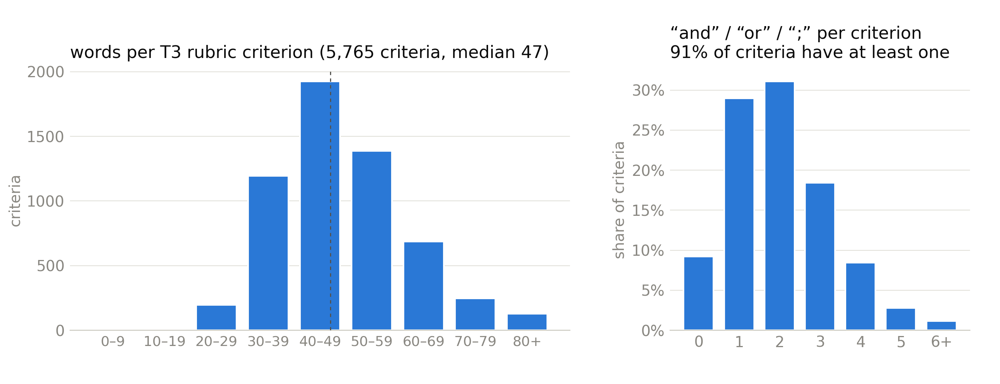
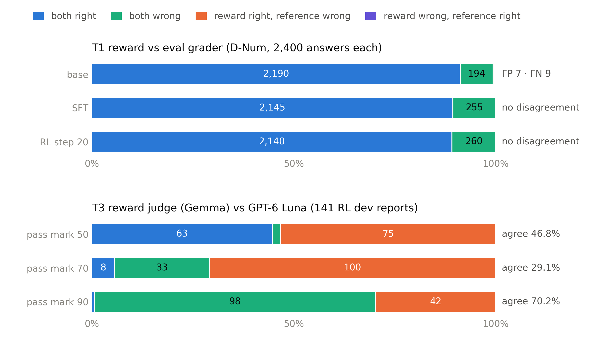
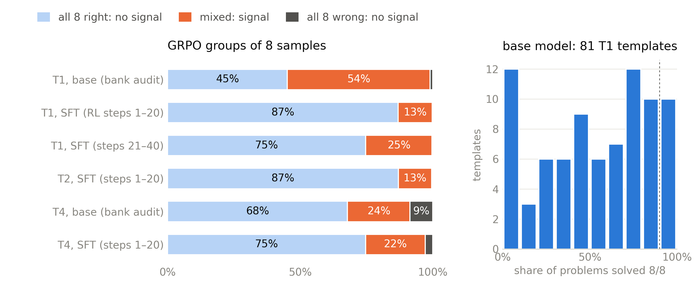
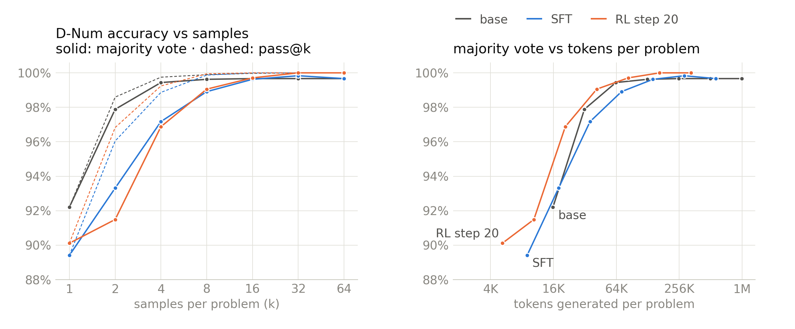

# Rewards, rubrics, GRPO signal and scaling on the 9B line (2026-11-10)

This note answers seven questions about RL run 1 (`rl9b_seed1`) and RL v2. It is a recap of the 11-07 audit, with
four new measurements and four new figures:
1. What are the rewards and rubrics?
2. Are they atomic?
3. Is an LLM judge involved?
4. How do the rewards score against a reference (TP/FP/TN/FN)?
5. How often do GRPO groups give a learning signal?
6. What do we know about scaling in mid- and post-training?
7. Should the 9B line add a mid-training stage?

Chinese version: `reward_rubric_scaling_1110_zh.md`.

The numbers come from:
- `docs/talk/data/research_1110.json`, written by `scripts/talk/research_1110.py` on the cluster on 11-10;
- `docs/talk/data/reward_vs_eval.json`, from `scripts/talk/reward_vs_eval.py` on 11-07;
- `docs/talk/data/run.json` and `docs/talk/data/rl.json`.

The figures are in `docs/reports/figures/` (`scripts/talk/research_figures.py`) and in `assets/` (`scripts/readme_figures.py`).

**Terms.**
- **base:** the released Qwen3.5-9B model, run at medium effort.
- **SFT:** our fine-tuned model, where RL starts.
- **RL step 20:** the checkpoint chosen from run 1.
- **pass@k:** at least one of k sampled answers is right.
- **maj@k:** the answer most of the k samples agree on is right.
- **GRPO group:** the 8 answers sampled for one prompt in one RL step. A group where all 8 get the same reward
  carries no gradient.

## Short answers

| question | answer |
|---|---|
| What are the rewards? | Four task rewards plus one shared length penalty. T1, T2 and T4 are programmatic checks. T3 (reports) is an LLM rubric judge with citation, length and self-praise terms (§1). |
| Are they atomic? | T1, T2 and T4 are atomic. T3 is not: 91% of its 5,765 criteria join several claims with "and", "or" or ";", and the median criterion has 47 words. RL v2 rewrites them as single-claim yes/no checks (§2). |
| Is an LLM judge involved? | Only for T3, where Gemma 4 judges. GPT-6 Luna is used only for evaluation and never touches training (§3). |
| TP/FP/TN/FN vs gold? | There are **no human gold labels** in this project, so we compare against independent references. T1 agrees with the evaluation grader on 99.3–100% of answers. T3 is lenient: at a pass mark of 70, Gemma passes 100 of the 133 reports Luna fails, and it never fails one Luna passes (§4). |
| GRPO groups in the useful middle? | **No.** In steps 1–20 of run 1, 87% of T1 and T2 groups and 75% of T4 groups were all-right, so they carried no gradient. The difficulty filter had used the base model; the SFT policy is far stronger (§5). |
| Scaling laws? | **None measured.** We have one model size, one SFT run, one 56-step RL run, one seed and no mid-training. Test-time compute is the one axis measured well: thinking budget and samples. With 8 votes, all three models reach 99–99.6% on D-Num. The proposed sweeps are in §6.5. |
| Add mid-training to the 9B line? | **Not in this allocation.** Knowledge is not what fails on D-Num, and the only mid-training data point (the reference report) gained +1.1 D-Num inside its noise band. It would cost ~500+ SU and several multi-day queue waits before Nov 30 (§7). |

## 1. The rewards in training today

Sources: `configs/rl/rewards.yaml`, `src/dpt/rewards/`, `configs/model/qwen35_9b.yaml`.

| task | what is checked | how it scores | judge |
|---|---|---|---|
| **T1 numeric** (29,954 problems in the v1 bank) | one final value, inside the problem's tolerance, with the right unit, and only one answer | binary, 1 or 0. Partial credit is off: in the reference report it raised the reward but cost 1.8 D-Num. | program (`dpt.rewards`, solver-computed references) |
| **T2 code** (2,495) | hidden unit tests in a sandbox | the fraction of tests passed; tampering scores 0 | program (sandbox) |
| **T3 report** (1,193) | 4–6 rubric criteria per question | Each criterion is scored 0–10, then the scores are weighted. The result is multiplied by a citation factor (−0.1 per reference Crossref cannot verify). Then two penalties are subtracted: a length penalty past 1.5× the reference length (at most −0.5) and a self-praise penalty (−0.1 per sentence, at most −0.3). | **LLM: Gemma 4 26B-A4B FP8**, temperature 0, pinned model name |
| **T4 general** (10,819) | instruction prompts with 1–3 programmatic constraints, all of which must hold, plus a relevance gate (prompt overlap ≥ 0.15, filler repetition < 0.3); math prompts by exact match | binary | program |
| all tasks | answer length | a linear penalty from 12,288 to 16,384 tokens, reaching −0.5; answers are cut at 16K | program |

The 7,490 instruction prompts and the 3,329 math prompts make up T4's 10,819.

**What RL v2 changes in the rewards.** Only T3. Each criterion becomes 1–6 atomic yes/no checks, at most 30 per
rubric:
- the teacher (Qwen3.8-27B) writes the checks, and Gemma checks that they cover the criterion;
- the judge must quote a span of the answer for every "yes";
- the reward is the weighted share of "yes".

The code is in `dpt.data.gen.t3_atomic` and `dpt.rewards.judge`, and it is tested. The conversion itself runs in
window 1 (job 3571166, queued). T1, T2 and T4 are unchanged, so the comparison with run 1 isolates data and reward.

## 2. Are the rewards atomic assertions?

| task | unit of judgment | atomic? |
|---|---|---|
| T1 | one value with its unit. 74% of problems use a 1% relative tolerance, 13% use 2%, and 13% use an absolute tolerance; 70% require a unit. | yes, one assertion |
| T2 | one hidden test each | yes, one assertion per test |
| T4 | one programmatic constraint each, such as `include_keywords`, `no_commas`, `end_with` or `json_format` (20 types) | yes, 1–3 per prompt |
| **T3** | a criterion of a median 47 words (p10 34, p90 66) | **no** |

*Figure 1. The 5,765 criteria of the 1,193 T3 rubrics in the verified v1 bank.*
- *Left: length in words.*
- *Right: how many times a criterion uses "and", "or" or ";". Only 9% use none; the median uses two, so it holds
  roughly three claims.*
- *53% of the criteria contain a number.*

Why it matters: a 0–10 score per compound criterion lets the judge give partial points for partial content, and it
hides which claim was missing. That is how Gemma came to average ~81 on the RL dev reports where Luna averaged ~48
(§4). RL v2's atomic checks fix the unit of judgment.

## 3. Is an LLM judge involved?

| where | judge | role |
|---|---|---|
| T3 reward in RL | Gemma 4 26B-A4B FP8 (temperature 0) | the **only** LLM in the reward |
| D-Report evaluation | Gemma (primary) and GPT-6 Luna (second judge) | evaluation only, pairwise against the base answers |
| judge-drift audit | Luna re-scores Gemma's T3 dev answers | evaluation only |
| data verification | the teacher and Gemma check generated problems | data, not reward |

Rules: Luna output never enters training, and the eval sets and D-Report rubrics are frozen.

Known judge risks and their status:
- **Leniency.** Shown in §4. The fix is atomic checks with quoted evidence.
- **Drift.** No sign. The Gemma − Luna gap changed by −5.3 points between steps 0 and 40, with a CI of [−11.4,
  −0.1] (`docs/talk/data/judge_drift.json`).
- **A side door through the citation factor.** In run 1, the T3 reward stayed flat while the rubric score fell,
  because answers cited less.
- **No calibration set.** `data/judge_calibration.jsonl` was never built, so the judge has never been checked against
  fixed reference scores.

## 4. Reward vs reference: TP / FP / TN / FN

**There are no human gold labels.** `data/grader_human_labels.jsonl` was never built, so every comparison below is
against an independent reference, not gold:
- **T1:** the evaluation grader (`dpt.eval.graders.numeric`, a separate implementation with strict units), on
  solver-computed answers. This is the closest thing to gold here.
- **T3:** GPT-6 Luna scoring the same answers with the same rubric. It is independent of training, but it is a judge,
  not gold.

"Positive" means the reward says right or pass.

*Figure 2. Top: T1 reward vs the evaluation grader on all D-Num answers. Bottom: the T3 reward judge vs Luna on 141
RL dev reports, at three pass marks.*

| T1 vs eval grader | TP | TN | FP | FN | agreement |
|---|---|---|---|---|---|
| base | 2,190 | 194 | 7 | 9 | 99.3% |
| SFT | 2,145 | 255 | 0 | 0 | 100% |
| RL step 20 | 2,140 | 260 | 0 | 0 | 100% |

The base's disagreements:
- **7 FP:** multiple-answer replies that the reward accepted.
- **9 FN:** 8 replies the reward could not parse, and 1 it read as a multiple answer.

The trained models' answers are clean enough that the two graders never differ.

| T3 Gemma vs Luna | TP | TN | FP | FN | agreement |
|---|---|---|---|---|---|
| pass mark 50 | 63 | 3 | 75 | 0 | 46.8% |
| pass mark 70 | 8 | 33 | 100 | 0 | 29.1% |
| pass mark 90 | 1 | 98 | 42 | 0 | 70.2% |

- FN is 0 at every pass mark: Gemma is never stricter than Luna.
- At a pass mark of 70, only 8 of Gemma's 108 passes are passes for Luna, a precision of 7%.
- The reward therefore paid for reports that an independent judge fails.

**Not measured.** T2 against the evaluation sandbox and T4 against the IFEval checker use the same deterministic
mechanisms. Their risk is hacking rather than disagreement, which is what the tamper checks and the relevance gate
are for. The adversarial suite passes 163/163, but it covers only numeric formats and T4 math.

**Missing, and needed before trusting T3 v2:** a small human-checked set:
- ~100 T3 reports with a human verdict per atomic check, giving the judge's precision and recall per check;
- ~200 T1 edge cases: multiple answers, missing units, parse failures.

The 20-pair blind-review page in `dpt_private/blind_review` is a start; it needs a reviewer.

## 5. GRPO groups: is the success rate in the useful middle?

GRPO learns only from mixed groups. A group that is all right or all wrong has zero advantage.

*Figure 3. Left: outcomes of groups of 8 samples. "Bank audit" is the base model on the problems of the templates
kept in the v1 bank, 20 per template, at 16K tokens and medium effort. "SFT" is the policy's own groups in RL run 1.
Right: the base model's share of problems solved 8/8, per T1 template; templates at ≥ 90% were dropped from the
bank.*

| | all right (no signal) | mixed (signal) | all wrong (no signal) |
|---|---|---|---|
| T1, base model (audit of kept templates) | 45% | 54% | 1% |
| T1, SFT policy, RL steps 1–20 | **87%** | 13% | 0% |
| T1, SFT policy, RL steps 21–40 | 75% | 25% | 0% |
| T2, SFT policy, RL steps 1–20 | 87% | 13% | 0% |
| T4, base model (audit of kept groups) | 68% | 24% | 9% |
| T4, SFT policy, RL steps 1–20 | 75% | 22% | 3% |

All shares are means over steps of the per-step fractions. Over all 81 T1 templates, including the 10 that were
dropped, the base audit gives 51% / 48% / 1%. The 11-07 plan's "46% / 53%" was also for the kept templates,
computed slightly differently.

What happened:
- **The difficulty filter was run with the base model.** For the base model, half of T1 was in the useful middle.
- **SFT made the policy much stronger,** so by step 1 most groups were all-right.
  - Only 13% of T1 groups taught anything.
  - The mixed share rose only as the policy started to break (steps 21–40).
  - In steps 41–56, 41–47% of T1 and T2 groups were all wrong. That was the collapse
    (`assets/rl_steps_en.png`).
- **Templates are not uniform.** For the base model:
  - 12 of 81 templates had under 10% of their problems at 8/8;
  - 10 had 90% or more and were dropped;
  - the rest spread across the range.

  So a per-problem pass rate matters, not only a per-template decision.
- **On D-Num itself**, with 64 samples per item, 72–77% of the items were answered right in ≥ 90% of samples by each
  model. The RL model's errors concentrate on about 30 items, where 30–60% of its samples are right.

**RL v2's answer** (implemented; the data is built in window 1):
- every problem is re-graded with the **SFT policy** (8 samples, 16K, medium);
- 8/8 problems are dropped;
- 0/8 problems go to a hard pool that joins at step 34 with a 10% share;
- problems at ≤ 3/8, ≤ 5/8 and ≤ 7/8 are drawn 3×, 2× and 1×;
- 12 hard families and 6 new long families are added.

The bank check reports the pass-rate bands before RL starts. **Target: at least 40% of T1 groups mixed at step 1.**
If the bank cannot reach that, RL v2 should not start.

## 6. Scaling: what we know for mid- and post-training

**We have not measured a scaling law.** The 9B line has one model size, one SFT run, one RL run (56 steps, the first
20 useful), one seed, no data-size or compute sweeps, and no mid-training. Below is what the data supports, and what
it would take to measure more.

### 6.1 Mid-training (continued pre-training)

Not run on the 9B line. The only data point is in the reference report this project follows (27B): a 2B-token
continued pre-training run (720 GPU·h) gained **+1.1 D-Num, inside the ±1.6 CI**, and cost 1.3 general points, so
the report dropped it. That is one point, not a curve.

### 6.2 SFT

One run. Its training loss fell from 0.79 to 0.46 (README §5.2). Against the base model:

| | base | SFT |
|---|---|---|
| D-Code | 80.5 | 86.3 |
| D-Fresh | 70.6 | 78.8 |
| D-Num-hard | 62.0 | 68.1 |
| D-Num | 91.6 | 89.4 |
| general skills (mean of 5) | 69.1 | 76.6 |

On the benchmarks: GPQA +14.7, LiveCodeBench +14.3. The answers are 35% shorter. Without a data-size sweep, we cannot
say how these gains grow with SFT tokens.

### 6.3 RL

Dev D-Num (16K cap) went from 92.0 at step 0 to 97.3 at step 20, then to 78.9 at step 40. Past step 20, instability
dominates the curve, so it is not a compute-scaling curve (`assets/rl_steps_en.png`).

RL v2 runs a dev pass and saves a checkpoint every 10 steps, so if it stays stable, it yields an RL step-scaling
curve at no extra cost.

### 6.4 Test-time compute: the axis we did measure

**Thinking budget** (`assets/test_time_compute_en.png`): the share of answers that are right and finish within
the budget.

| set | budget | base | SFT | RL step 20 |
|---|---|---|---|---|
| D-Num | 8K | 13.5 | 60.1 | 73.8 |
| D-Num | 16K | 54.9 | 77.9 | 83.9 |
| D-Num | 32K | 91.6 | 89.4 | 89.2 |
| D-Fresh | 16K | 27.5 | 66.9 | 77.9 |
| D-Num-hard | 16K | 13.0 | 47.8 | 58.0 |
| D-Num-hard | 32K | 62.0 | 68.1 | 70.1 |

Post-training mostly buys efficiency: the same accuracy with 2–3× fewer tokens. At 32K, the D-Num scores converge.

**Samples (new).** Majority voting over the 64-sample D-Num runs:
- Every answer is graded exactly as the harness grades it.
- Answers within the item's tolerance count as the same vote, and ties count as the average of the tied answers.
- Answers without a usable value abstain: 6.7% for base, 6.4% for SFT, 2.1% for RL.

*Figure 4. Left: D-Num accuracy against the number of samples (solid: majority vote; dashed: pass@k). Right:
majority-vote accuracy against the tokens generated per problem (k × mean answer length: 16.2K tokens for base,
9.2K for SFT, 5.3K for RL).*

| k | base maj@k | SFT maj@k | RL maj@k | pass@k (all three) |
|---|---|---|---|---|
| 1 | 92.2 | 89.4 | 90.1 | 89–92 |
| 4 | 99.4 | 97.2 | 96.9 | 98.9–99.7 |
| 8 | 99.6 | 98.9 | 99.1 | 99.9 |
| 64 | 99.7 | 99.7 | 100.0 | 100 |

At matched compute (tokens per problem), RL leads, most at small budgets:

| tokens per problem | 16K | 32K | 64K |
|---|---|---|---|
| base | 92.3 | 97.9 | 99.4 |
| SFT | 92.7 | 96.5 | 98.6 |
| RL step 20 | 94.8 | 98.2 | 99.5 |

What this means:
1. **D-Num no longer separates the models** once 8 votes are allowed. What remains is single-sample reliability and
   cost. That fits the 10-27 finding that the base model saturates D-Num.
2. **Harder exams are needed to see post-training gains:** D-Num-hard, the long families, and a harder D-Num slice,
   which was approved on 10-27.
3. **RL's measured benefit is a better accuracy-per-token frontier,** not new capability on D-Num.

### 6.5 What it would take to measure real scaling curves

| curve | how | cost on the cluster | when |
|---|---|---|---|
| RL steps → dev D-Num and D-Num-hard | RL v2's dev pass and checkpoint every 10 steps (already configured) | 0 extra | RL v2 |
| SFT data → scores | 3 more SFT runs at 12.5%, 25% and 50% of the mix, each with an eval, in one 8-node job so there is one queue wait | ~135 SU (~63 SFT + ~72 eval) | after RL v2, if wanted |
| test-time samples on harder sets | 64-sample runs of D-Num-hard and D-Fresh for the 3 models, giving maj@k and pass@k | ~60 SU | can share the RL v2 final-eval job |
| mid-training tokens → scores | a domain corpus (not built), then 0 / 0.5 / 1 / 2B-token runs, each followed by SFT and an eval | ~500–1,000 SU plus corpus work | next allocation, if §7's test points there |

## 7. Should the 9B line add a mid-training stage?

**Recommendation: no, not in this allocation.** The evidence:
- **Knowledge is not the bottleneck on D-Num.**
  - The base model gets 92% with one sample, 99.9% pass@8 and 99.6% by majority vote.
  - The failures are about reliability and form: wrong values, multiple answers, missing units, and thinking that
    never finishes within 16K. As unfinished answers disappeared, wrong values rose from 1.5% of D-Num samples (base)
    to 4.1% (SFT) and 8.6% (RL step 20).
  - Mid-training adds knowledge and language, not reliability.
- **The only data point is weak.** A 2B-token run gained +1.1 D-Num, inside the noise band, and lost 1.3 general
  points (reference report, 27B).
- **SFT already transfers to problem kinds it never saw.**
  - D-Num-hard went from 62.0 to 68.1.
  - The Moho-depth family went from 0% (base) to 15% (SFT) to 29% (RL), without mid-training.
- **Cost and time.**
  - The ingredients:
    - a decontaminated domain corpus that does not exist yet;
    - ~2B tokens of training, roughly 10 h on 8 nodes or ~240 SU (my estimate);
    - a new SFT run (~72 SU) and evaluations.
  - Each 8-node job currently waits several days for nodes.
  - The allocation ends Nov 30, and RL v2 is already queued behind window 1.

**What would change this.** Classify the D-Num-hard and D-Report failures by type, using the existing generations,
with no new compute:
- **concept errors:** a wrong formula or physical idea;
- **execution errors:** arithmetic, units, format, length.

If concept errors dominate, mid-training becomes worth testing next allocation. So do the cheaper alternatives:
knowledge-dense SFT data drawn from textbooks, or retrieval. The test would start as a small token sweep.

## 8. What this means for the next steps

| finding | action | status |
|---|---|---|
| The T3 judge is lenient and its rubrics are compound | atomic yes/no checks with quoted evidence | code done; data in window 1 (job 3571166) |
| No human gold or judge calibration set exists | a ~100-report per-check set and ~200 T1 edge cases, labeled by a person | **proposed; needs a labeler** |
| 87% of T1 groups were all-right at the start | re-filter with the SFT policy, hard and long families, difficulty weights | done; measured by the bank check before RL |
| D-Num saturates under voting | report maj@8 and D-Num-hard next to pass@1; use the harder slice | proposed for the RL v2 report |
| No scaling curves | dev every 10 steps in RL v2; an optional SFT data sweep (~135 SU) | RL v2 / your call |
| The cause of run 1's collapse is open | `best_drop` pause at −3 dev points; length-drop warning | done (RL v2 config) |
| Mid-training question | not now; first the cheap failure-type test of §7 | proposed |

## Data and code

| file | content |
|---|---|
| `scripts/talk/research_1110.py` | maj@k and pass@k on D-Num; rubric, constraint and tolerance statistics (the cluster) |
| `docs/talk/data/research_1110.json` | its output, aggregates only |
| `scripts/talk/reward_vs_eval.py`, `docs/talk/data/reward_vs_eval.json` | the T1 and T3 confusion counts (11-07) |
| `scripts/talk/research_figures.py` | Figures 1–4, English and Chinese (`docs/reports/figures/recap_*`) |
| `README §8.3` | the RL v2 plan, jobs and reservation windows |
