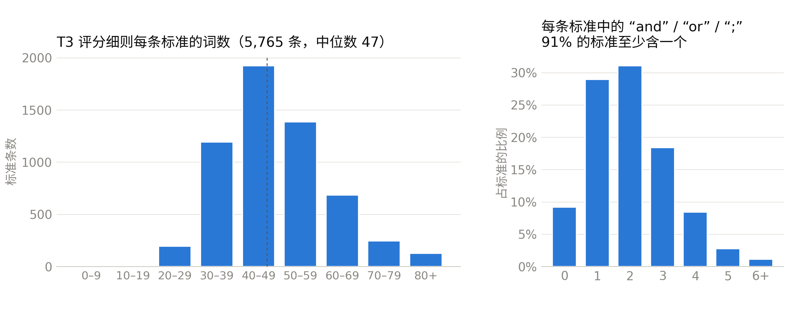
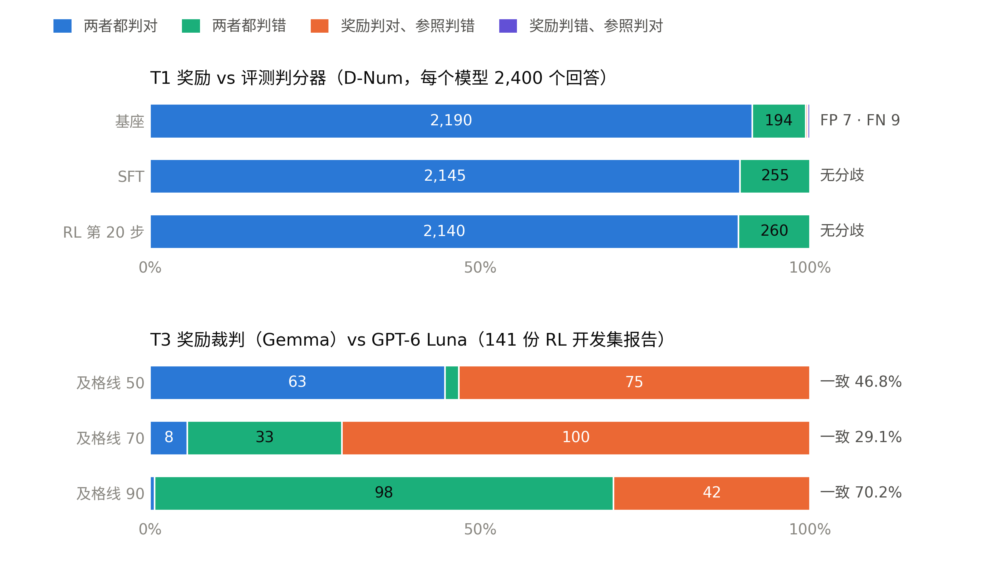
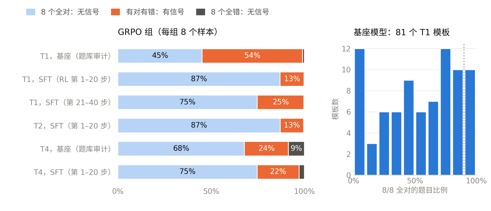
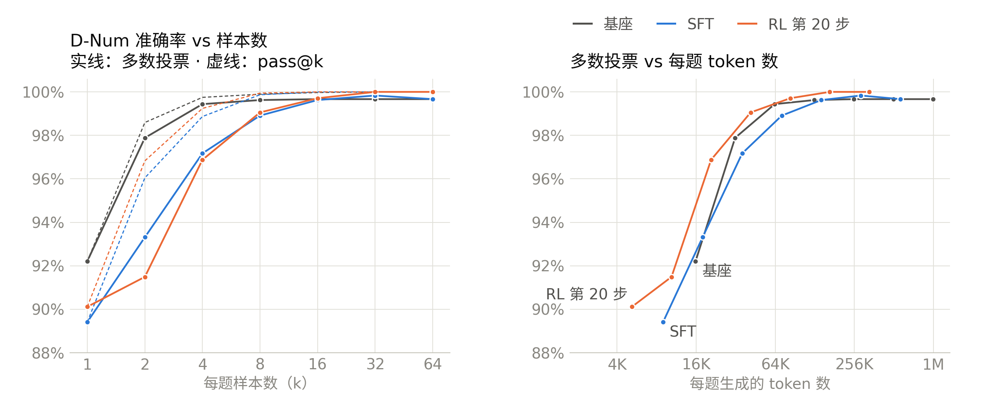

# 9B 线的奖励、评分细则、GRPO 信号与扩展规律（2026-11-10）

本文回答关于 RL 第一轮（`rl9b_seed1`）和 RL v2 的七个问题。它是 11-07 审计的复盘，新增了四项测量和四张图：
1. 奖励和评分细则是什么？
2. 它们是否原子化？
3. 是否用到 LLM 裁判？
4. 奖励与参照相比的 TP/FP/TN/FN 如何？
5. GRPO 组多久能提供学习信号？
6. 中期训练和后训练的扩展规律知道多少？
7. 9B 线要不要加中期训练阶段？

英文版：`reward_rubric_scaling_1110_en.md`。

数据来源：
- `docs/talk/data/research_1110.json`，由 `scripts/talk/research_1110.py` 于 11-10 在集群上写出；
- `docs/talk/data/reward_vs_eval.json`，来自 11-07 的 `scripts/talk/reward_vs_eval.py`；
- `docs/talk/data/run.json` 与 `docs/talk/data/rl.json`。

图在 `docs/reports/figures/`（`scripts/talk/research_figures.py`）和 `assets/`（`scripts/readme_figures.py`）。

**术语。**
- **基座：** 发布版 Qwen3.5-9B，medium 推理强度。
- **SFT：** 我们微调后的模型，也是 RL 的起点。
- **RL 第 20 步：** 第一轮选出的检查点。
- **pass@k：** k 个采样回答中至少一个正确。
- **maj@k：** k 个采样回答中多数一致的答案正确。
- **GRPO 组：** 一个提示在一个 RL 步中采样的 8 个回答。8 个回答奖励相同的组没有梯度。

## 简短回答

| 问题 | 回答 |
|---|---|
| 奖励是什么？ | 四个任务奖励，外加一个共用的长度惩罚。T1、T2、T4 是程序化检查。T3（报告）用 LLM 按评分细则打分，另有引用、长度和自夸三项修正（§1）。 |
| 是否原子化？ | T1、T2、T4 是原子化的。T3 不是：5,765 条标准中 91% 用 “and”、“or” 或 “;” 把多个论断连在一起，标准的中位长度为 47 个词。RL v2 把它们改写成单论断的是/否检查项（§2）。 |
| 是否用到 LLM 裁判？ | 只有 T3 用，裁判是 Gemma 4。GPT-6 Luna 只用于评测，从不进入训练（§3）。 |
| 与金标的 TP/FP/TN/FN？ | 本项目**没有人工金标**，所以只能和独立参照比较。T1 与评测判分器在 99.3–100% 的回答上一致。T3 偏宽松：及格线 70 时，Luna 判不及格的 133 份报告中 Gemma 判及格 100 份，而 Luna 判及格的报告 Gemma 从未判不及格（§4）。 |
| GRPO 组的成功率是否落在有用的中间区间？ | **没有。** 第一轮第 1–20 步，T1 和 T2 有 87% 的组、T4 有 75% 的组全对，没有梯度。难度过滤当时用的是基座模型，而 SFT 策略强得多（§5）。 |
| 扩展规律？ | **一条也没有测到。** 我们只有一个模型规模、一次 SFT、一次 56 步的 RL、一个种子，也没有中期训练。测得比较充分的只有推理时计算这一维：思考预算和样本数。8 票多数投票时，三个模型在 D-Num 上都达到 99–99.6%。建议的扫描实验见 §6.5。 |
| 9B 线要不要加中期训练？ | **本期配额内不加。** D-Num 上出错的不是知识；唯一的中期训练数据点（参考报告）D-Num 只提高 1.1，落在噪声带内。在 11 月 30 日前做它要约 500+ SU 和多次数天的排队（§7）。 |

## 1. 当前训练中的奖励

来源：`configs/rl/rewards.yaml`、`src/dpt/rewards/`、`configs/model/qwen35_9b.yaml`。

| 任务 | 检查什么 | 怎么计分 | 裁判 |
|---|---|---|---|
| **T1 数值**（v1 题库 29,954 题） | 一个最终数值，落在题目容差内，单位正确，且只给一个答案 | 二值，1 或 0。不给部分分：参考报告中部分分抬高了奖励，却让 D-Num 降了 1.8。 | 程序（`dpt.rewards`，参考答案由求解器算出） |
| **T2 代码**（2,495） | 沙箱中的隐藏单元测试 | 通过测试的比例；篡改记 0 | 程序（沙箱） |
| **T3 报告**（1,193） | 每题 4–6 条评分标准 | 每条标准打 0–10 分，再加权。结果乘以引用系数（每条 Crossref 无法核实的引用 −0.1）。然后减去两项惩罚：超过参考长度 1.5 倍后的长度惩罚（最多 −0.5）和自夸惩罚（每句 −0.1，最多 −0.3）。 | **LLM：Gemma 4 26B-A4B FP8**，温度 0，服务模型名固定 |
| **T4 通用**（10,819） | 带 1–3 个程序化约束的指令提示，约束须全部满足，外加相关性门槛（与提示重合度 ≥ 0.15，填充重复 < 0.3）；数学题精确匹配 | 二值 | 程序 |
| 所有任务 | 回答长度 | 从 12,288 到 16,384 token 线性惩罚，最高 −0.5；回答在 16K 处截断 | 程序 |

T4 的 10,819 题由 7,490 道指令题和 3,329 道数学题组成。

**RL v2 改了哪些奖励。** 只改 T3。每条标准变成 1–6 个原子化的是/否检查项，每份细则最多 30 个：
- 教师模型（Qwen3.8-27B）写检查项，Gemma 检查它们是否覆盖原标准；
- 裁判每判一个“是”，都必须引用回答中的一段原文；
- 奖励是“是”的加权占比。

代码在 `dpt.data.gen.t3_atomic` 和 `dpt.rewards.judge`，已有测试。转换本身在窗口 1 中运行（作业 3571166，排队中）。T1、T2、T4 不变，所以与第一轮的对比只隔离数据和奖励两个因素。

## 2. 奖励是原子化的断言吗？

| 任务 | 判定单位 | 是否原子化 |
|---|---|---|
| T1 | 一个带单位的数值。74% 的题用 1% 相对容差，13% 用 2%，13% 用绝对容差；70% 要求单位。 | 是，一个断言 |
| T2 | 每个隐藏测试 | 是，每个测试一个断言 |
| T4 | 每个程序化约束，如 `include_keywords`、`no_commas`、`end_with`、`json_format`（共 20 类） | 是，每题 1–3 个 |
| **T3** | 一条中位长度 47 个词的标准（p10 为 34，p90 为 66） | **否** |

*图 1。已验证 v1 题库中 1,193 份 T3 细则的 5,765 条标准。*
- *左：词数。*
- *右：每条标准用了几次 “and”、“or” 或 “;”。只有 9% 一次都没有；中位数是两次，即大约三个论断。*
- *53% 的标准含有数字。*

为什么重要：给复合标准打 0–10 分，裁判就能为部分内容给部分分，也看不出缺的是哪个论断。这就是为什么在同一批 RL 开发集报告上，Gemma 平均约 81 分，Luna 平均约 48 分（§4）。RL v2 的原子化检查项修正了判定单位。

## 3. 是否用到 LLM 裁判？

| 用在哪里 | 裁判 | 作用 |
|---|---|---|
| RL 中的 T3 奖励 | Gemma 4 26B-A4B FP8（温度 0） | 奖励中**唯一**的 LLM |
| D-Report 评测 | Gemma（主裁判）和 GPT-6 Luna（第二裁判） | 只用于评测，与基座回答两两比较 |
| 裁判漂移审计 | Luna 重新给 Gemma 打过分的 T3 开发集回答打分 | 只用于评测 |
| 数据验证 | 教师模型和 Gemma 检查生成的题目 | 用于数据，不进奖励 |

规则：Luna 的输出从不进入训练；评测集和 D-Report 评分细则都已冻结。

已知的裁判风险及现状：
- **偏宽松。** 见 §4。对策是带原文引用的原子化检查项。
- **漂移。** 没有迹象。第 0 步到第 40 步，Gemma − Luna 的差距变化 −5.3 分，置信区间 [−11.4, −0.1]（`docs/talk/data/judge_drift.json`）。
- **引用系数这道侧门。** 第一轮中，评分细则得分下降，T3 奖励却持平，因为回答少写了引用。
- **没有校准集。** `data/judge_calibration.jsonl` 从未建立，所以裁判从未对照固定参考分检查过。

## 4. 奖励 vs 参照：TP / FP / TN / FN

**没有人工金标。** `data/grader_human_labels.jsonl` 从未建立，所以下面的每项比较都是对照独立参照，而不是金标：
- **T1：** 评测判分器（`dpt.eval.graders.numeric`，另一套实现，单位从严），参考答案由求解器算出。这是本项目最接近金标的参照。
- **T3：** GPT-6 Luna 用同一份细则给同一批回答打分。它独立于训练，但仍是裁判，不是金标。

“阳性”指奖励判对或判及格。

*图 2。上：T1 奖励与评测判分器在全部 D-Num 回答上的对比。下：T3 奖励裁判与 Luna 在 141 份 RL 开发集报告上、三个及格线下的对比。*

| T1 vs 评测判分器 | TP | TN | FP | FN | 一致率 |
|---|---|---|---|---|---|
| 基座 | 2,190 | 194 | 7 | 9 | 99.3% |
| SFT | 2,145 | 255 | 0 | 0 | 100% |
| RL 第 20 步 | 2,140 | 260 | 0 | 0 | 100% |

基座的分歧：
- **7 个 FP：** 奖励接受了给出多个答案的回答。
- **9 个 FN：** 8 个回答奖励解析不出，1 个被奖励当成多答案。

训练后模型的回答足够规整，两个判分器从未分歧。

| T3 Gemma vs Luna | TP | TN | FP | FN | 一致率 |
|---|---|---|---|---|---|
| 及格线 50 | 63 | 3 | 75 | 0 | 46.8% |
| 及格线 70 | 8 | 33 | 100 | 0 | 29.1% |
| 及格线 90 | 1 | 98 | 42 | 0 | 70.2% |

- 每个及格线下 FN 都是 0：Gemma 从不比 Luna 严。
- 及格线 70 时，Gemma 判及格的 108 份中只有 8 份 Luna 也判及格，精确率 7%。
- 也就是说，奖励为独立裁判判不及格的报告付了分。

**未测量。** T2 对照评测沙箱、T4 对照 IFEval 检查器，用的是同一类确定性机制。它们的风险是被钻空子，而不是判分分歧，篡改检查和相关性门槛就是为此设的。对抗测试集 163/163 全部通过，但只覆盖数值格式和 T4 数学题。

**缺少、且在信任 T3 v2 前需要补上的：** 一个小规模的人工检查集：
- 约 100 份 T3 报告，每个原子检查项都有人工判定，用来得出裁判在每个检查项上的精确率和召回率；
- 约 200 个 T1 边界样本：多答案、缺单位、解析失败。

`dpt_private/blind_review` 里 20 对样本的盲审页面是个起点，还需要一位审阅人。

## 5. GRPO 组：成功率是否落在有用的中间区间？

GRPO 只从“有对有错”的组学习。全对或全错的组优势为零。

*图 3。左：每组 8 个样本的结果。“题库审计”是基座模型在 v1 题库保留模板的题目上的表现，每个模板 20 题，16K token，medium 强度。“SFT”是该策略在 RL 第一轮中自己的组。右：基座模型在每个 T1 模板中 8/8 全对的题目比例；≥ 90% 的模板已从题库剔除。*

| | 全对（无信号） | 有对有错（有信号） | 全错（无信号） |
|---|---|---|---|
| T1，基座模型（审计，保留的模板） | 45% | 54% | 1% |
| T1，SFT 策略，RL 第 1–20 步 | **87%** | 13% | 0% |
| T1，SFT 策略，RL 第 21–40 步 | 75% | 25% | 0% |
| T2，SFT 策略，RL 第 1–20 步 | 87% | 13% | 0% |
| T4，基座模型（审计，保留的组） | 68% | 24% | 9% |
| T4，SFT 策略，RL 第 1–20 步 | 75% | 22% | 3% |

所有比例都是各步比例的平均。若计入全部 81 个 T1 模板（包括剔除的 10 个），基座审计为 51% / 48% / 1%。11-07 计划中的“46% / 53%”也是保留模板的数字，只是算法略有不同。

发生了什么：
- **难度过滤用的是基座模型。** 对基座模型而言，一半的 T1 题落在有用的中间区间。
- **SFT 让策略强了很多，** 所以到第 1 步时大多数组已经全对。
  - 只有 13% 的 T1 组有学习价值。
  - 有对有错的比例只在策略开始崩溃时才上升（第 21–40 步）。
  - 第 41–56 步，T1 和 T2 有 41–47% 的组全错，那就是崩溃（`assets/rl_steps_zh.png`）。
- **模板之间并不均匀。** 对基座模型而言：
  - 81 个模板中有 12 个，8/8 全对的题目不到 10%；
  - 有 10 个达到 90% 以上，被剔除；
  - 其余分布在整个区间。

  所以需要逐题的通过率，而不只是按模板决定去留。
- **D-Num 本身：** 每题 64 个样本时，每个模型都有 72–77% 的题目在 ≥ 90% 的样本中答对。RL 模型的错误集中在约 30 道题上，这些题它只有 30–60% 的样本答对。

**RL v2 的对策**（已实现；数据在窗口 1 中生成）：
- 每道题都用 **SFT 策略**重新判难度（8 个样本，16K，medium）；
- 8/8 全对的题剔除；
- 0/8 全错的题进入难题池，第 34 步加入，占 10%；
- 通过率 ≤ 3/8、≤ 5/8、≤ 7/8 的题分别按 3 倍、2 倍、1 倍抽取；
- 新增 12 个难题族和 6 个长题族。

RL 开始前，题库检查会报告各通过率区间的分布。**目标：第 1 步时至少 40% 的 T1 组有对有错。** 如果题库达不到，RL v2 就不应开始。

## 6. 扩展规律：中期训练和后训练知道多少

**我们没有测到扩展规律。** 9B 线只有一个模型规模、一次 SFT、一次 RL（56 步，有用的是前 20 步）、一个种子，没有数据量或计算量扫描，也没有中期训练。下面是现有数据能支持的结论，以及要测更多需要什么。

### 6.1 中期训练（继续预训练）

9B 线上没做过。唯一的数据点来自本项目所依据的参考报告（27B）：一次 2B token 的继续预训练（720 GPU·h），D-Num **提高 1.1，落在 ±1.6 的置信区间内**，通用能力降了 1.3 分，所以参考报告放弃了它。这只是一个点，不是一条曲线。

### 6.2 SFT

只做过一次。训练损失从 0.79 降到 0.46（README §5.2）。与基座相比：

| | 基座 | SFT |
|---|---|---|
| D-Code | 80.5 | 86.3 |
| D-Fresh | 70.6 | 78.8 |
| D-Num-hard | 62.0 | 68.1 |
| D-Num | 91.6 | 89.4 |
| 通用能力（5 项平均） | 69.1 | 76.6 |

基准测试上：GPQA +14.7，LiveCodeBench +14.3。回答短了 35%。没有数据量扫描，就说不出这些提升如何随 SFT token 数增长。

### 6.3 RL

开发集 D-Num（16K 上限）从第 0 步的 92.0 升到第 20 步的 97.3，再跌到第 40 步的 78.9。第 20 步之后，曲线由不稳定主导，所以它不是计算量扩展曲线（`assets/rl_steps_zh.png`）。

RL v2 每 10 步跑一次开发集并保存检查点，只要训练稳定，就能顺带得到一条 RL 步数扩展曲线。

### 6.4 推理时计算：我们确实测过的一维

**思考预算**（`assets/test_time_compute_zh.png`）：在预算内答完且答对的比例。

| 评测集 | 预算 | 基座 | SFT | RL 第 20 步 |
|---|---|---|---|---|
| D-Num | 8K | 13.5 | 60.1 | 73.8 |
| D-Num | 16K | 54.9 | 77.9 | 83.9 |
| D-Num | 32K | 91.6 | 89.4 | 89.2 |
| D-Fresh | 16K | 27.5 | 66.9 | 77.9 |
| D-Num-hard | 16K | 13.0 | 47.8 | 58.0 |
| D-Num-hard | 32K | 62.0 | 68.1 | 70.1 |

后训练主要换来的是效率：用少 2–3 倍的 token 达到同样的准确率。到 32K 时，三者的 D-Num 分数趋于一致。

**样本数（新）。** 在每题 64 个样本的 D-Num 结果上做多数投票：
- 每个回答都按评测流程原样判分。
- 落在题目容差内的回答算同一票；平票时取平票各答案的平均。
- 没有可用数值的回答弃权：基座 6.7%，SFT 6.4%，RL 2.1%。

*图 4。左：D-Num 准确率随样本数的变化（实线：多数投票；虚线：pass@k）。右：多数投票准确率随每题生成 token 数的变化（k × 平均回答长度：基座 16.2K token，SFT 9.2K，RL 5.3K）。*

| k | 基座 maj@k | SFT maj@k | RL maj@k | pass@k（三者） |
|---|---|---|---|---|
| 1 | 92.2 | 89.4 | 90.1 | 89–92 |
| 4 | 99.4 | 97.2 | 96.9 | 98.9–99.7 |
| 8 | 99.6 | 98.9 | 99.1 | 99.9 |
| 64 | 99.7 | 99.7 | 100.0 | 100 |

在相同计算量（每题 token 数）下，RL 领先，预算越小领先越多：

| 每题 token 数 | 16K | 32K | 64K |
|---|---|---|---|
| 基座 | 92.3 | 97.9 | 99.4 |
| SFT | 92.7 | 96.5 | 98.6 |
| RL 第 20 步 | 94.8 | 98.2 | 99.5 |

这意味着：
1. **允许 8 票后，D-Num 已经分不出模型的高低。** 剩下的是单样本的可靠性和成本。这与 10-27 的发现（基座让 D-Num 饱和）一致。
2. **要看出后训练的收益，需要更难的考试：** D-Num-hard、长题族，以及 10-27 批准的更难的 D-Num 子集。
3. **RL 测得的好处是更好的“每 token 准确率”前沿，** 而不是 D-Num 上的新能力。

### 6.5 要测出真正的扩展曲线需要什么

| 曲线 | 做法 | 集群成本 | 时间 |
|---|---|---|---|
| RL 步数 → 开发集 D-Num 和 D-Num-hard | RL v2 每 10 步一次开发集和检查点（已配置） | 不额外花费 | RL v2 |
| SFT 数据量 → 分数 | 再做 3 次 SFT，分别用 12.5%、25%、50% 的数据，各带一次评测，放在一个 8 节点作业里，只排一次队 | 约 135 SU（SFT 约 63 + 评测约 72） | RL v2 之后，如需要 |
| 更难评测集上的推理时样本数 | 三个模型在 D-Num-hard 和 D-Fresh 上各跑 64 个样本，得出 maj@k 和 pass@k | 约 60 SU | 可与 RL v2 的最终评测作业合并 |
| 中期训练 token 数 → 分数 | 先建领域语料（尚未建），再跑 0 / 0.5 / 1 / 2B token，每次后接 SFT 和评测 | 约 500–1,000 SU，外加语料工作 | 下一期配额，如果 §7 的测试指向这里 |

## 7. 9B 线要不要加中期训练阶段？

**建议：本期配额内不加。** 依据：
- **D-Num 上的瓶颈不是知识。**
  - 基座模型单样本 92%，pass@8 99.9%，多数投票 99.6%。
  - 错误来自可靠性和形式：数值算错、多个答案、缺单位、16K 内思考没结束。随着未完成的回答消失，错误数值占 D-Num 样本的比例从 1.5%（基座）升到 4.1%（SFT）和 8.6%（RL 第 20 步）。
  - 中期训练补的是知识和语言，不是可靠性。
- **唯一的数据点很弱。** 一次 2B token 的训练让 D-Num 提高 1.1，落在噪声带内，通用能力降了 1.3 分（参考报告，27B）。
- **SFT 已经能迁移到没见过的题型。**
  - D-Num-hard 从 62.0 升到 68.1。
  - Moho 深度题族从 0%（基座）到 15%（SFT）再到 29%（RL），没有用中期训练。
- **成本与时间。**
  - 需要：
    - 一份去污染的领域语料，目前还没有；
    - 约 2B token 的训练，大约 8 节点 10 小时、约 240 SU（我的估算）；
    - 一次新的 SFT（约 72 SU）和评测。
  - 目前每个 8 节点作业都要排队好几天才能拿到节点。
  - 配额 11 月 30 日到期，RL v2 已经排在窗口 1 之后。

**什么会改变这个判断。** 用现有生成结果给 D-Num-hard 和 D-Report 的错误分类，不需要新算力：
- **概念错误：** 公式或物理概念错了；
- **执行错误：** 算术、单位、格式、长度。

如果概念错误占多数，下一期就值得测试中期训练，以及更便宜的替代方案：从教科书提炼的知识密集型 SFT 数据，或检索。测试先从小规模的 token 数扫描开始。

## 8. 对下一步意味着什么

| 发现 | 对策 | 状态 |
|---|---|---|
| T3 裁判偏宽松，细则是复合的 | 带原文引用的原子化是/否检查项 | 代码已完成；数据在窗口 1（作业 3571166） |
| 没有人工金标，也没有裁判校准集 | 由人标注约 100 份逐检查项的 T3 报告和约 200 个 T1 边界样本 | **建议；需要一位标注人** |
| 开始时 87% 的 T1 组全对 | 用 SFT 策略重新过滤，新增难题族和长题族，按难度加权 | 已完成；RL 前由题库检查衡量 |
| 多数投票下 D-Num 饱和 | 在 pass@1 旁同时报告 maj@8 和 D-Num-hard；使用更难的子集 | 建议用于 RL v2 报告 |
| 没有扩展曲线 | RL v2 每 10 步一次开发集；可选的 SFT 数据量扫描（约 135 SU） | RL v2 / 由你决定 |
| 第一轮崩溃的原因未明 | 开发集比最好成绩低 3 分即暂停（`best_drop`）；长度骤降警告 | 已完成（RL v2 配置） |
| 中期训练问题 | 现在不做；先做 §7 中低成本的错误分类测试 | 建议 |

## 数据与代码

| 文件 | 内容 |
|---|---|
| `scripts/talk/research_1110.py` | D-Num 上的 maj@k 和 pass@k；细则、约束和容差统计（集群） |
| `docs/talk/data/research_1110.json` | 上述脚本的输出，只含汇总数据 |
| `scripts/talk/reward_vs_eval.py`、`docs/talk/data/reward_vs_eval.json` | T1 和 T3 的混淆计数（11-07） |
| `scripts/talk/research_figures.py` | 图 1–4，中英两版（`docs/reports/figures/recap_*`） |
| `README §8.3` | RL v2 计划、作业和预约窗口 |
